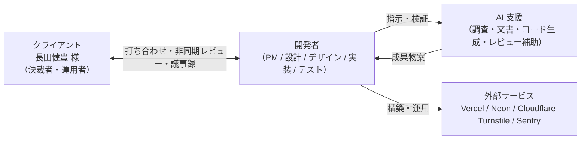
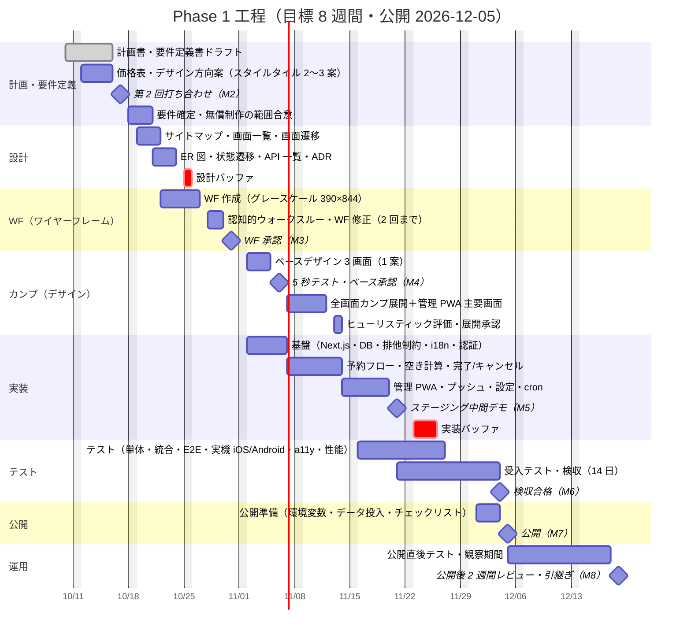

# プロジェクト計画書 — Neuer Barber 長田健豊 予約サイト＋管理 PWA

| 項目 | 内容 |
|---|---|
| 文書 ID | PLAN-001 |
| 版 | v0.3（ドラフト） |
| 作成日 | 2026-10-10 |
| 作成者 | 開発者（フリーランス） |
| 承認者 | 長田健豊 様（クライアント） |
| 関連文書 | `docs/02_requirements/requirements.md`（要件定義書）、`docs/research/reports/美容師予約サイト制作ナレッジ.md`（統合レポート） |
| 凡例 | 【要確認】＝第 2 回打ち合わせまでに確認・確定する事項。【決定済み】＝開発者・クライアントが合意済みの事項 |

### 変更履歴

| 版 | 日付 | 変更内容 |
|---|---|---|
| v0.1 | 2026-10-10 | 第 1 回ヒアリングと調査結果をもとに初版ドラフト作成 |
| v0.2 | 2026-10-10 | 一次資料検証（09_gap_*）の反映: ホスティング前提の変更、Push ペイロード形式、カレンダー記号、法務記載の訂正 |
| v0.3 | 2026-10-10 | ホスティング前提を Hobby 運用（規約リスク了承）に変更、制作費を無償に変更 |

---

## 1. 目的と背景

### 1.1 クライアントと現状

- クライアント: 長田健豊 様。Neuer BARBERSHOP（大阪市阿倍野区、天王寺駅徒歩 5 分）所属のスタイリスト。
- 稼働形態: スタイリスト 1 名・席 1 つ・同時に受けられる予約は 1 件。
- 顧客層: 若年男性が中心。訪日外国人客も一定数あり、英語での予約ニーズがある。
- 現状の予約受付: Instagram の DM。**DM の見落としと二重予約（ダブルブッキング）**が発生しており、顧客・本人双方の信頼を損ねている。
- 店舗 HP（neuer.frei.jp）は日本語のみで、長田様個人の予約導線は存在しない（根拠: `docs/research/reference/README.md`）。

### 1.2 本プロジェクトの目的

1. **予約の見落としと二重予約をゼロにする** — 空き枠のみを表示する予約サイトと、DB レベルで重複を禁止する仕組みで構造的に防止する。
2. **日英バイリンガルで 24 時間受付できる予約導線を持つ** — Instagram のプロフィールリンクから、言語を選んで最少タップで予約を完了できるようにする。
3. **スマートフォン 1 台で予約を管理できる** — ホーム画面に追加した管理 PWA にプッシュ通知が届き、手動予約・時間ブロック・休業設定を片手で行える。
4. **将来の顧客チャット（Phase 2）・電子カルテ（Phase 3）に無理なく拡張できる土台を作る**。

### 1.3 自作（スクラッチ開発）を選ぶ根拠

統合レポート『無料 SaaS は月 50 件で破綻し、大阪の英語オンライン予約は空白である』より:

- RESERVA Free・STORES 予約 Free はいずれも **月 50 件**が上限（公式料金ページで 2026-10-10 に確認）。本件の営業条件（週 6 日 × 最大 11 枠 = 週 66 枠）は稼働率 50% でも月 140 件前後となり、初月から超過する。有料化すると RESERVA ブルー 3,850 円/月（年払、200 件）〜、STORES スモール 9,790 円/月（年契約、200 件）・チーム 19,690 円/月（300 件）の固定費が発生する。minimo は月額 0 円だが来店ごとに 110〜880 円（客単価 6,601 円以上は 880 円）の手数料がかかり、売上の 7〜16% に相当する。
- Hot Pepper Beauty は掲載料非公開（公式 FAQ「エリアやプランによって異なります」）＋予約手数料 2%。Instagram の「今すぐ予約」ボタンは提携 SaaS 限定。
- 大阪で英語対応をうたうバーバーの公開情報は電話番号のみが多く、**`/en` で料金・所要時間・キャンセル規定・アクセスまで完結する英語予約は希少**。
- 自作であれば、ふりがな・職業（学割）・9 メニューといったクライアント固有の入力項目と、Phase 2/3 への拡張を自由に設計できる。

---

## 2. ゴールと成功指標（KPI）

| ID | 指標 | 現状（ベースライン） | 目標 | 計測方法 | 計測開始 |
|---|---|---|---|---|---|
| KPI-01 | 予約の見落とし件数 | 発生あり（件数未計測）【要確認】 | **0 件/月** | 管理 PWA の未確認件数ログ＋クライアント申告 | 公開後 1 か月 |
| KPI-02 | 二重予約（同一枠の重複確定） | 発生あり【要確認】 | **0 件**（システム上は構造的に不可） | DB 排他制約の違反ログ、`audit_log` | 公開時 |
| KPI-03 | DM 経由予約の比率 | ほぼ 100% | 公開後 3 か月で **30% 以下**【要確認】 | `bookings.source` 別集計（web / instagram / phone / walk_in） | 公開後 |
| KPI-04 | 月間予約件数 | 未計測【要確認】 | 現状比で減少させない（まず計測基盤を作る） | `bookings` の月次集計 | 公開後 |
| KPI-05 | 英語（`/en`）経由の予約件数 | 0 | 計測し、3 か月後に目標値を設定 | `bookings.locale` 別集計 | 公開後 |
| KPI-06 | 予約フォーム離脱率（フォーム開始→完了） | — | 段階別に計測。良好値の目安 1% 未満（統合レポート『アクセシビリティと多言語…』） | ステップ別 URL のページ遷移（Vercel Web Analytics） | 公開後 |
| KPI-07 | 新規予約から管理 PWA 通知到達までの時間 | — | **10 秒以内**（best-effort） | 受け入れテスト、`notification_log` | 検収時 |
| KPI-08 | 無断キャンセル率 `no_show / (completed + no_show + cancelled_late)` | 未計測 | 計測基盤を作り、Phase 2 で対策効果を評価 | SQL 集計（根拠: 研究ノート 08『KPI 定義案』） | 公開後 |
| KPI-09 | Core Web Vitals（公開ページ） | — | LCP 2.5 s / INP 200 ms / CLS 0.1 以内 | Lighthouse CI、`useReportWebVitals` | 実装中〜 |

ベースラインが未計測の指標は、公開後 1 か月を「計測期間」とし、第 2 回打ち合わせで現状の月間件数・DM 件数の概算をヒアリングする。

---

## 3. スコープ

### 3.1 フェーズ構成

| フェーズ | 内容 | 時期 | 本計画書の対象 |
|---|---|---|---|
| **Phase 1** | 顧客向け予約サイト（JP/EN）＋管理 PWA（プッシュ通知、手動予約、時間ブロック、設定） | 2026-10 〜 2026-12（約 8 週間） | **対象** |
| Phase 2 | 顧客チャット（LINE 公式アカウント主軸、Instagram は受信箱取り込み＋定型返信） | Phase 1 公開後、別途合意 | 概算のみ |
| Phase 3 | 電子カルテ（施術記録・薬剤・写真・次回提案、要配慮情報の分離と同意） | Phase 2 後、別途合意 | 概算のみ |

### 3.2 Phase 1 のスコープ（概要）

詳細な MoSCoW 表は要件定義書 4 章を参照。

**含む（Must）**

- 顧客サイト: トップ、メニュー（料金・所要時間・学割表示）、段階開示フォーム（メニュー → 氏名・ふりがな → 職業 → 電話 → 備考）、Hot Pepper Beauty 型の空き枠のみ表示カレンダー、確認画面、完了画面（スクリーンショット前提、ICS、キャンセルリンク）、トークン式キャンセル、`/ja` `/en` の二言語、プライバシーポリシー・キャンセルポリシー。
- 管理 PWA: パスキーによるログイン、今日ビュー・週ビュー、予約の状態変更、手動予約、時間ブロック、営業時間・休業日・メニュー設定、プッシュ通知（新規予約・キャンセル）、未確認件数バッジ＋ポーリング、日次サマリー通知。
- 基盤: Vercel Hobby（Phase 1 本番。規約リスク了承済み、警告・停止時は Pro / Cloudflare Workers Paid へ移行。vercel.app ドメインで開始）、Neon Postgres、DB 排他制約による二重予約防止、Bot 対策（Turnstile＋ハニーポット＋レート制限）、日次バックアップ、エラー監視、監査ログ。

**含まない（Won't — Phase 1）**

| 項目 | 理由 / 扱い |
|---|---|
| 顧客向けメール・SMS・LINE 通知（確認・リマインド） | クライアント要望により完了画面＋ICS で代替。Phase 2 で LINE を検討 |
| 顧客アカウント・マイページ・ログイン | 入力摩擦を増やすため不採用。キャンセルはトークンリンクで実現 |
| オンライン決済・事前決済・キャンセル料の自動請求 | 決済なし前提。「請求より予防」の運用ポリシーで対応 |
| 顧客チャット | Phase 2 |
| 電子カルテ・写真管理 | Phase 3 |
| 複数スタイリスト・複数席の同時運用 | 設計上 `resource_id` で将来対応可能にするが UI は作らない |
| Google カレンダー双方向同期 | オプション候補（価格表に記載） |
| 既存顧客の一括取り込み | 【要確認】第 2 回打ち合わせで扱いを決定 |
| 店舗 HP（neuer.frei.jp）の改修 | 対象外。長田様個人のサイトとして独立して構築 |
| ネイティブアプリ（App Store / Google Play） | PWA で代替 |
| 写真撮影・コピーライティング | オプション候補 |

---

## 4. 前提と制約

### 4.1 前提（第 1 回ヒアリングで確定した事項）

| # | 前提 |
|---|---|
| A-01 | スタイリスト 1 名・席 1 つ・同時予約 1 件 |
| A-02 | 顧客入力項目: 名前（フルネーム）＋ふりがな、職業（学生/社会人、学割判定用）、電話番号、備考、メニュー。**メールアドレスは取得しない** |
| A-03 | メニューは 9 種: カット / カットパーマ / カットカラー / 特殊パーマ / ブリーチ / リタッチ / ブリーチ 2 回目以上 / 編み込み・特殊ヘア / アイロンパーマ（濡れパン） |
| A-04 | ふりがなは `/ja` で表示、`/en` では非表示（または任意） |
| A-05 | 予約は即時確定（承認ステップなし）。管理者は手動予約と時間ブロックを追加できる |
| A-06 | 顧客への通知は完了画面のみ（メール/SMS なし）＋トークン付きキャンセルリンク |
| A-07 | 管理画面はホーム画面に追加する PWA。クライアントの端末は最近の iPhone。Android でも動作すること |
| A-08 | ホスティングは Vercel。**Phase 1 本番は Vercel Hobby（無料）で運用する**【決定済み】。Hobby は Fair Use Guidelines で「non-commercial personal use only」と定められ、商用利用の定義に「Advertising the sale of a product or service」（サービスの販売の宣伝）を含むため、営業中の予約サイトを Hobby で公開することには規約上のリスク（警告・停止）がある。本案件は無償制作（友人案件）であり、このリスクは開発者・クライアントが了承済みである。Vercel から警告・停止があった場合は Vercel Pro（約 $20/月、hnd1 東京リージョン）または Cloudflare Workers Paid（$5/月、`@opennextjs/cloudflare`）へ移行する（アプリ側の移行は環境変数と DNS の切替のみで完了する設計: 要件定義書 FR-S-10。Cloudflare の場合は事前の互換性検証が前提）。紹介案件など有償案件では最初から Pro を使う。vercel.app ドメインで開始し後から独自ドメインに移行、ドメインはコードにハードコードしない |
| A-09 | DB は Postgres（Vercel Marketplace の Neon を推奨、Supabase は代替） |
| A-10 | 第 2 回打ち合わせでロゴファイルを受領する（店舗 HP の Neuer Barber ロゴは既知） |

### 4.2 仮置きの業務ルール（第 2 回打ち合わせで確定）

| # | 仮ルール | 状態 |
|---|---|---|
| P-01 | 全メニュー 60 分 | 【要確認】メニュー別の所要時間 |
| P-02 | 受付時間 18:00〜24:00 | 【要確認】店舗営業時間 10:00〜20:00 との関係（閉店後利用か） |
| P-03 | 30 分刻みの開始時刻（60 分メニューなら 18:00〜23:00 の最大 11 枠） | 【要確認】 |
| P-04 | 月曜定休 | 【要確認】店舗は月曜＋第 2・第 3 火曜定休。個人の予定は別途あるか |
| P-05 | 当日予約可、リードタイム 60 分 | 【要確認】 |
| P-06 | 予約間バッファ 0 分（空き判定は所要時間のみ） | 【要確認】片付け時間が必要か |
| P-07 | セルフキャンセル締切は予約開始 2 時間前 | 【要確認】キャンセルポリシー文言と合わせて確定 |

### 4.3 制約

| # | 制約 | 影響 |
|---|---|---|
| C-01 | 低コスト運用（Vercel Hobby ＋ Neon Free。Hobby は規約上は商用不可だが、Phase 1 は規約リスクを了承して Hobby で運用する: A-08） | Neon Free はスケジュールバックアップなし（GitHub Actions で代替）。Vercel Hobby の制約として、ロールバックは直前 1 件のみ、cron は 1 日 1 回・±59 分、ランタイムログ 1 時間、WAF レート制限ルール 1 本、Web Analytics 月 5 万イベント（カスタムイベント不可）を受け入れる。Pro 移行時は cron 毎分精度・任意デプロイへのロールバック・ログ 1 日に改善する |
| C-02 | iOS の Web Push は「ホーム画面に追加したウェブアプリ」内のみ動作し、購読が無言で失効することがある | プッシュは best-effort とし、ポーリングと日次サマリーで補完（統合レポート『iOS のプッシュは…』） |
| C-03 | 顧客に連絡手段（メール/SMS）を持たない | 完了画面が唯一の証憑。自動リマインド不可。オーナー都合の変更は電話連絡 |
| C-04 | 個人情報保護法は個人事業主にも全面適用（5,000 件以下事業者の除外は平成 27 年改正・2017-05-30 施行で撤廃済み）。令和 8 年改正法（2026-07-10 成立、施行は 2028-07-16 まで）で 16 歳未満の法定代理人規定・委託先義務・漏えい通知要件が変わる | プライバシーポリシー（法 32 条の公表事項＋米国クラウド事業者の明記）、同意取得、保存期間の明文化が必須。改正施行時の見直し項目を運用マニュアルに記録 |
| C-05 | 開発者 1 名（AI 支援開発）で、クライアントのレビュー時間も限られる | 打ち合わせは原則 2 回＋非同期レビュー。修正回数を契約で定める |
| C-06 | 初回調査時にネットワーク制限で未取得だった一次資料（Vercel 規約、個人情報保護委員会ガイドライン等）は 2026-10-10 の検証ノート（`09_gap_*`）で原典確認済み。HPB の締切分数・RESERVA の日時画面・iOS 26.x の通知挙動などは未解決 | 統合レポート『調査ギャップの検証結果』の未解決表を受け入れテスト・第 2 回打ち合わせで確定 |

---

## 5. 体制と役割

| 役割 | 担当 | 責務 |
|---|---|---|
| クライアント（決裁者・運用者） | 長田健豊 様 | 要件の決定、価格表・デザイン案の承認、ロゴ・メニュー・料金・営業ルールの提供、レビュー期限内のフィードバック、受入テスト、公開後の日常運用 |
| 開発者 | フリーランス開発者（本案件は無償制作・友人案件） | プロジェクト管理、計画・要件定義・設計・デザイン・実装・テスト・公開・引継ぎ、議事録と確認事項リストの管理、法務文書のドラフト |
| AI 支援開発 | Claude 等のコーディング/文書エージェント | 調査、文書ドラフト、コード生成、テスト生成、レビュー補助。**最終判断と品質責任は開発者が負う**。生成コードはテスト・レビューを経てからマージ |
| 外部サービス | Vercel、Neon、Cloudflare、Sentry、GitHub | ホスティング、DB、Bot 対策、エラー監視、CI/バックアップ。アカウントの所有者はクライアントとする【要確認】 |

決裁者は長田様本人であり、店舗（Neuer BARBERSHOP）側の承認が必要か（店名・住所・ロゴの使用許諾）は第 2 回打ち合わせで確認する【要確認】。

---

## 6. 工程とマイルストーン

### 6.1 方針

- 統合レポート『フェーズと成果物はベイジ・LIG の工程を一人案件向けに圧縮する』の 8 フェーズ（計画 → 要件定義 → 設計 → WF → カンプ → 実装 → テスト → 公開 → 運用）に従う。
- Phase 1 の目標期間は **約 8 週間**（2026-10-10 〜 2026-12-05 公開目標）。各工程にバッファを明示し、使わなければ前倒しする。
- クライアント打ち合わせは 2 回（第 1 回: 実施済みヒアリング、第 2 回: 要件・価格・デザイン方向の合意）。以降は非同期レビュー（48〜72 時間の回答期限）で進める。
- 実装は WF 承認後に予約バックエンド（DB・空き計算・排他制約）から着手し、ベースデザイン承認後に UI を仕上げることで、デザイン工程と並行させる。

### 6.2 ガントチャート（Phase 1）

第 2 回打ち合わせの日程（2026-10-17 仮）および公開目標日は【要確認】。

### 6.3 マイルストーンと合意ポイント

| ID | マイルストーン | 目標日 | 合意内容 / 完了条件 |
|---|---|---|---|
| M0 | 第 1 回打ち合わせ（ヒアリング） | 実施済み | 目的・入力項目・メニュー・仮の営業ルール・フェーズ分け |
| M1 | 計画書・要件定義書ドラフト送付 | 2026-10-16 | 本書と要件定義書 v0.1 をクライアントへ送付 |
| **M2** | **第 2 回打ち合わせ** | 2026-10-17【要確認】 | 価格表・デザイン方向案・要件ドラフトを提示。未決事項の回答、デザイン方向 1 案選択、価格プラン選択。ロゴ受領 |
| M2' | 無償制作の範囲合意 | 2026-10-21 | 本案件は無償（友人案件）のため契約書・着手金はなし。要件定義書のスコープ（Must/Won't）、修正回数、検収 14 日、変更管理の扱いを議事録で合意する。アカウント帰属（Q-12）も確定 |
| M3 | WF 承認 | 2026-10-31 | 非同期レビュー、修正 2 回まで |
| M4 | ベースデザイン承認 | 2026-11-06 | トップ／メニュー・空き検索／予約フォームの 3 画面、修正 2 回まで |
| M4' | 展開カンプ承認 | 2026-11-14 | 全画面＋管理 PWA 主要画面、修正 1 回 |
| M5 | ステージング中間デモ | 2026-11-21 | staging URL で予約〜通知〜キャンセルを実演、受入テスト開始 |
| M6 | 検収合格 | 2026-12-04 | 受入基準（要件定義書 15 章）をすべて満たす。期間内に不合格通知がなければ合格みなし |
| M7 | 公開（Go/No-Go） | 2026-12-05 | 公開前チェックリスト完了、公開直後テスト合格 |
| M8 | 公開後 2 週間レビュー・引継ぎ | 2026-12-19 | 運用マニュアルによるレクチャー、KPI 初期値の確認、Phase 2 の検討開始 |

### 6.4 バッファの考え方

- 設計バッファ 2 日、実装バッファ 4 日に加え、検収期間（14 日）がテスト修正の吸収帯となる。
- クライアントのレビュー回答が期限（48〜72 時間）を超えた場合、その日数分マイルストーンを後ろ倒しにする（変更管理 9 章）。
- 見積工数にも 20〜30% の予備を明示し、未使用分は請求しない（統合レポート『見積は内訳標準＋バッファ可視化…』）。

---

## 7. 成果物一覧

| # | 成果物 | パス（`docs/` 配下） | 作成時期 | 承認 |
|---|---|---|---|---|
| 1 | プロジェクト計画書（本書） | `01_plan/project_plan.md` | M1 | M2 |
| 2 | 要件定義書 | `02_requirements/requirements.md` | M1 | M2〜M2' |
| 3 | 価格表・見積書 | `01_plan/pricing.md`（予定） | M2 | M2' |
| 4 | 議事録・確認事項リスト・変更要求 | `01_plan/minutes/`、`01_plan/open_issues.md`、`01_plan/change_requests.md`（予定） | 随時 | — |
| 5 | 調査資料（統合レポート・領域別ノート・参考資料） | `research/` | 作成済み | — |
| 6 | 設計書一式（概要・サイトマップ・画面一覧・画面遷移・画面仕様・ER・状態遷移・API・コンポーネント・セキュリティ・ADR） | `03_design/`（`00_overview.md` 〜 `09_security.md`、`adr/`） | 設計〜実装前 | M3 |
| 7 | ワイヤーフレーム（Figma リンク＋書き出し画像） | `04_wireframes/` | WF 工程 | M3 |
| 8 | デザイン提案書（スタイルタイル 2〜3 案）、ベースデザイン、全画面カンプ、デザインガイド | `05_design_comps/` | M2、カンプ工程 | M4、M4' |
| 9 | 評価レポート（認知的ウォークスルー、5 秒テスト、ヒューリスティック評価、ユーザビリティテスト） | `06_test/evaluation/` | 各レビュー時 | — |
| 10 | テスト仕様書・結果、Lighthouse/axe レポート、不具合一覧 | `06_test/` | テスト工程 | M6 |
| 11 | 公開手順書・公開前チェックリスト・ロールバック手順 | `07_release/` | 公開前 | M7 |
| 12 | 運用マニュアル（日英、スクリーンショット付き）、運用設計書、保守契約案 | `07_release/operations/` | 公開〜引継ぎ | M8 |
| 13 | ソースコード、テストコード、`AGENTS.md`/`CLAUDE.md` | リポジトリ直下 | 実装工程 | M6 |
| 14 | 法務文書（プライバシーポリシー JA/EN、キャンセルポリシー、利用規約）ドラフト | `02_requirements/legal/`（予定） | 要件〜カンプ | M4'（弁護士確認推奨） |

---

## 8. レビュー・評価計画

統合レポート『評価は認知的ウォークスルー・ヒューリスティック・5 人テストと自動ゲートを時期で使い分ける』に基づく。

| タイミング | 手法 | 実施者 | 所要 | アウトプット |
|---|---|---|---|---|
| 第 2 回打ち合わせ | 要件ドラフト読み合わせ、未決事項の回答、スタイルタイル選択 | クライアント＋開発者 | 90 分 | 議事録、確認事項リスト更新 |
| WF 完成時（M3 前） | 認知的ウォークスルー。タスク: ①訪日客が「明日 20:00 にカット」を英語で予約する ②オーナーが 1 時間ブロックする ③顧客がキャンセルリンクから取り消す | 開発者＋クライアント | 1〜2 時間 | 各ステップの 4 問回答表、問題一覧 |
| ベースデザイン時（M4 前） | 5 秒テスト（トップを 5 秒見せて「何の店か・何ができるか」） | 知人 5 名程度 | 30 分 | 第一印象メモ |
| 全画面カンプ時（M4' 前） | ヒューリスティック評価（Nielsen 10 原則 × 各画面、重大度 0〜4） | 開発者（日を置いて 2 回）＋可能なら外部 1〜2 名 | 2〜3 時間 | 所見表 |
| 実装中（毎 PR） | Lighthouse CI（performance ≥ 0.9 警告、accessibility = 1.0 エラー）、axe（WCAG 2.2 AA）、Vitest/Playwright | CI | 自動 | レポート |
| ステージング（M5） | 中間デモ、iOS/Android 実機の PWA 受け入れテスト 9 項目（要件定義書 15 章） | 開発者＋クライアント | 60 分 | 不具合一覧 |
| 公開前 | 思考発話ユーザビリティテスト（実機スマホ、予約〜キャンセル、各 20〜30 分） | 実客 1〜2 名＋知人 | 2 時間 | 課題一覧（重大度付き）、修正判断 |
| 公開後 2 週間（M8） | KPI 初期値確認、通知到達の実績、運用上の困りごとヒアリング | クライアント＋開発者 | 60 分 | 公開後レビュー議事録、Phase 2 検討メモ |

ソロ開発で 3〜5 名の独立評価を満たせない場合は、その限界を評価レポートに明記する。

---

## 9. リスクと対策

| ID | リスク | 影響 | 発生可能性 | 対策 | 担当 |
|---|---|---|---|---|---|
| R-01 | iOS の Web Push が届かない（購読失効、Safari タブで開いている、集中モード、SW 例外で許可取り消し） | 新規予約に気づかない | 高 | プッシュは best-effort と位置づけ、未確認件数バッジ＋可視時 20 秒ポーリング＋日次サマリーで多層化。起動時に購読を再確認し再購読バナーを出す。トラブルシュート手順を運用マニュアルに記載 | 開発者 |
| R-02 | 無料枠の制約（Neon の 5 分スケール to ゼロ・スケジュールバックアップなし、Vercel Hobby の cron 1 日 1 回 ±59 分・ロールバック直前 1 件・ランタイムログ 1 時間・同梱枠の上限） | 初回表示の遅延、日次サマリーの時刻ぶれ、障害時の復旧困難 | 中 | Suspense で冷起動を吸収、GitHub Actions で日次 `pg_dump` を 30 世代保存、日次サマリーは ±59 分を前提に設計、使用量を月次確認、ロールバック手順を引継書に明記 | 開発者 |
| R-03 | Hobby の規約リスク（停止・警告）: Fair Use Guidelines 上 Hobby は非商用の個人利用に限られ、「サービスの販売の宣伝」も商用に含まれる。開発者・クライアントは了承済み（A-08） | Vercel からの警告・停止により予約サイトが止まる | 中 | 公開前に Pro / Cloudflare Workers Paid への移行手順書を用意し、切替をリハーサルする（環境変数と DNS のみで完了する設計: FR-S-10。Cloudflare は着手前に 1 日の互換性検証（`proxy.ts`・web-push・Images・Neon 接続・DNS 移管））。停止中は電話受付で代替。Hobby の制約（ロールバックは直前 1 件、cron ±59 分、ログ 1 時間、WAF レート制限ルール 1 本）を前提に設計・運用する | 開発者 |
| R-04 | スコープクリープ（打ち合わせ後の機能追加、デザイン方向の転換） | 納期遅延・採算悪化 | 高 | Won't 一覧、修正回数（WF 2 回・ベース 2 回・展開 1 回）、前工程戻りは別見積、変更要求フォームの 4 点セットを価格表と同時に提示 | 双方 |
| R-05 | 法務（個人情報保護法、消費者契約法 9 条、店名・ロゴの使用許諾） | 掲載差し止め、ポリシー不備 | 中 | プライバシーポリシーは法 32 条の公表事項（事業者名・住所、利用目的、開示手続、安全管理措置、苦情申出先）に米国クラウド事業者（Vercel・Neon）の明記を含めて要件化。キャンセル料は裁量条項に留め、金額を掲げる場合は自店の「平均的な損害」の算定根拠メモを用意（9 条 2 項の説明努力義務）。特商法表記ページは該当性が不明でも掲載。弁護士確認を推奨、店舗側の許諾を第 2 回打ち合わせで確認【要確認】 | 双方 |
| R-06 | Bot による枠の埋め立て・いたずら予約（即時確定×決済なし） | 営業妨害 | 中 | Turnstile（siteverify）＋ハニーポット＋レート制限（IP 5 回/10 分、電話番号 3 件/日）を Phase 1 必須に | 開発者 |
| R-07 | 無断キャンセル・直前キャンセル | 売上減 | 中 | 同意チェック、ICS の VALARM、`no_show_count` による段階制限（2 回目以降は電話のみ受付）。自動リマインドは Phase 2 | 双方 |
| R-08 | 業務ルール（営業時間・定休日・所要時間）が確定せず設計が手戻りする | 設計遅延 | 中 | 第 2 回打ち合わせで未決事項を一括確定。ルールは `settings`/`business_hours`/`menus` に外出しし、変更がコード改修にならない設計にする | 双方 |
| R-09 | クライアントのレビュー遅延 | 工程遅延 | 中 | レビュー期限 48〜72 時間、期限超過分はスケジュールを後ろ倒し（変更管理で合意） | クライアント |
| R-10 | DM 運用が残り、システム外で予約が入る | 二重予約の再発 | 高 | 運用ルール「DM 予約は必ずシステムに入力してから返信し、確認 URL を貼る」。Instagram のプロフィールリンク・ハイライト・DM 自動応答で予約 URL へ誘導 | クライアント |
| R-11 | 独自ドメイン移行時にキャンセルリンク等の URL が壊れる | 旧リンク無効 | 低 | `SITE_URL` をサーバー専用環境変数で持ち、DB には相対パスのみ保存。`*.vercel.app` からのリダイレクトを設定 | 開発者 |
| R-12 | AI 生成コードの品質・セキュリティ欠陥 | 不具合・脆弱性 | 中 | テストピラミッド（契約・統合・E2E）、CI ゲート（Lighthouse/axe/型検査）、OWASP チェックリスト、開発者レビュー必須 | 開発者 |
| R-13 | 一次資料でも確定できない項目（iOS 26.x の前面通知・`app_badge` 位置・`navigate` 挙動、HPB の締切分数、PPC のアレルギー情報の見解）と実態の乖離 | 設計変更 | 低〜中 | 原典確認は 2026-10-10 の検証ノート（`09_gap_*`）で完了。残る項目は統合レポート『調査ギャップの検証結果』の未解決表に沿って実機検証・照会し、差分は ADR に記録 | 開発者 |
| R-14 | 開発者 1 名の稼働リスク（体調・他案件） | 工程遅延 | 低 | バッファの明示、文書とコードをリポジトリに集約して引継可能な状態を保つ | 開発者 |

---

## 10. コミュニケーション計画

| 手段 | 目的 | 頻度 / 期限 | 備考 |
|---|---|---|---|
| 対面/オンライン打ち合わせ | 要件・価格・デザイン方向の合意（第 2 回）、中間デモ（M5）、公開後レビュー（M8） | 計 3〜4 回、各 60〜90 分 | 決裁者（長田様）同席 |
| 議事録 | 決定事項・保留・宿題の固定 | 打ち合わせ翌営業日までに送付。**送付後 3 営業日以内に異議がなければ確定** | 書式: 基本情報／議題別要点／決定事項（主語・対象・数量を明記）／確認・保留／宿題（担当・期限）／次回 |
| 確認事項リスト（オープンイシュー表） | 未決事項の追跡 | 随時更新、打ち合わせ前に共有 | 列: ID／質問／背景／選択肢／影響（工数・費用・納期）／回答期限／回答／決定日。要件定義書 14 章と連動 |
| 非同期レビュー（Figma コメント、チャット） | WF・カンプ・ステージングのレビュー | 回答期限 48〜72 時間 | 事前に「見てほしい観点リスト」を配布。コメントは 1 か所に集約 |
| 日常連絡 | 質問・簡易確認 | 平日 10:00〜18:00 を目安に 1 営業日以内に返信【要確認】 | 連絡手段（LINE / メール等）は第 2 回打ち合わせで決定 |
| 進捗報告 | マイルストーン到達と次の予定 | 週 1 回（金曜） | 短文＋ステージング URL |

---

## 11. 変更管理

1. **変更要求（CR）フォーム**で受け付ける: CR 番号／依頼日／依頼内容／理由／影響範囲（画面・機能）／追加工数・費用／納期影響／対応区分／承認者・承認日。
2. 対応区分:
   - **無償**: 誤記、軽微な文言・配色調整、要件定義書に明記された内容の実装不備。
   - **有償**（本案件は無償のため「別途合意」扱い）: 要件定義書にない機能追加、承認済み WF/カンプの構造変更、前工程に戻る修正。本案件では無償で対応するか次フェーズ送りにするかを都度合意する。
   - **次フェーズ送り**: Phase 2/3 の範囲に属する要望。
3. 修正回数の上限: WF 2 回、ベースデザイン 2 回、展開カンプ 1 回。上限超過分は有償。
4. 承認済み成果物への変更は、要件定義書・設計書の該当箇所を更新し、変更履歴に CR 番号を残す。
5. 納期への影響があるときは、議事録またはチャットで新しいマイルストーン日程を合意してから着手する。

---

## 12. 費用・ランニングコスト見込み

### 12.1 制作費

**本案件の制作費は無償（友人案件）とする。** 第 2 回打ち合わせで提示する価格表（`01_plan/pricing.md`）には、メニュー価格・所要時間、ランニングコスト、および将来の有償案件（本案件のクライアントからの紹介案件など）向けの制作費テンプレートを載せる。下表は制作費テンプレートの構成を示す（本案件では制作費を請求しない）。

| 区分 | 内容 |
|---|---|
| 基本パッケージ（Must 一式） | 企画・要件定義／設計／デザイン（ベース＋展開）／フロント実装／予約バックエンド／管理 PWA／テスト／公開／引継ぎ（運用マニュアル・レクチャー） |
| オプション（Should/Could） | LINE 通知連携、Google カレンダー同期、写真撮影、文章作成、ロゴのバリアント作成（単色・ダーク用） |
| 次フェーズ概算 | Phase 2 顧客チャット、Phase 3 電子カルテ（レンジ提示のみ） |
| 月額保守 | ホスティング実費（有償案件は Vercel Pro 約 3,000 円/月。本案件は Hobby で 0 円、移行時は Pro 約 3,000 円/月または Cloudflare 約 750 円/月）の立替有無、監視、依存更新、軽微修正 n 時間/月、規約改訂、Q&A 対応。参考相場: 月額 5,000〜2 万円が約 6 割、平均 4.1 万円・中央値 1.1 万円（Web幹事）。5,000 円前後はドメイン・サーバ・SSL の維持中心、1〜2 万円で不具合修正・バックアップ・軽微修正枠まで含む（Fyve）。含む作業と含まない作業（新機能・デザイン変更）を明示する |
| 条件 | 修正回数、前工程戻りの扱い、検収 14 日、支払条件（着手金／中間／検収後）、ソースコードとアカウントの帰属（クライアント所有を推奨） |

概算工数は「画面一覧 × 画面種別単価 ＋ Server Action/Route 本数 × 単価 ＋ 横断作業（認証・通知・PWA・テスト・公開・文書）＋ ディレクション 15〜25% ＋ バッファ 20〜30%（未使用分は請求しない）」として可視化する。

### 12.2 ランニングコスト（月額・年額）

| 項目 | プラン | 費用 | 備考 |
|---|---|---|---|
| ホスティング（Vercel） | Hobby | 0 円 | Phase 1 本番は Hobby で運用（A-08【決定済み】）。Fair Use Guidelines 上は商用利用不可で規約リスク（警告・停止）があり、開発者・クライアント了承済み。警告・停止時の移行先は Vercel Pro（約 $20/月 ≒ 3,000 円/月、1 開発者席・$20 分の利用クレジット付き）または Cloudflare Workers Paid（$5/月）。有償案件では最初から Pro |
| ホスティング移行先候補（Cloudflare Workers Paid） | Workers Paid | $5/月（≒ 750 円/月）※移行時のみ | Hobby が警告・停止された場合の移行先候補。`@opennextjs/cloudflare` で Next.js 16 を動かす。`proxy.ts` 対応は experimental、Images binding・DNS 移管が前提。Workers Free は SSR に不適のため不採用 |
| データベース（Neon） | Free | 0 円 | 100 CU-hours/月、1 GB。超過時は Launch 従量（$0.106/CU-hour 等）。Supabase 代替時は Free 0 円 / Pro $25/月 |
| 独自ドメイン | 年間登録 | 約 1,500〜3,000 円/年【要確認】 | TLD と登録事業者により変動。移行時期は未定 |
| Bot 対策（Cloudflare Turnstile） | Free | 0 円 | |
| エラー監視（Sentry） | Developer | 0 円 | cron モニタ 1・uptime モニタ 1 を含む |
| バックアップ（GitHub Actions） | Free | 0 円 | パブリックリポジトリは無制限、プライベートは月 2,000 分の無料枠内で運用【要確認: リポジトリの公開/非公開】 |
| Web 解析（Vercel Web Analytics） | Hobby 同梱 | 0 円 | 月 5 万イベントまで、カスタムイベント不可（予約ステップを別 URL にしてページ遷移でファネル計測） |
| **Phase 1 合計** | | **0 円/月 ＋ ドメイン年額（Vercel Hobby）** | 移行時は約 3,000 円/月（Vercel Pro）または約 750 円/月（Cloudflare Workers Paid）＋ ドメイン年額。Neon Free・Turnstile・Sentry・GitHub Actions は 0 円 |
| （任意）LINE 公式アカウント | コミュニケーション | 0 円（月 200 通まで） | Phase 2。月 100〜150 件の確認＋リマインド運用ではライトプラン 5,000 円/月、またはリマインド 1 通への絞り込みが必要 |
| （任意）メール送信（Resend） | Free | 0 円（3,000 通/月） | 管理者向けマジックリンクのフォールバックに使う場合のみ |
| （任意）保守契約 | 月額 | 価格表で提示 | |

---

## 13. 第 2 回打ち合わせのアジェンダ（案）

| 時間 | 議題 | 持ち物 / 事前送付 | ゴール |
|---|---|---|---|
| 0:00–0:10 | 前回の振り返り、本日のゴール確認 | 議事録 #01 | 認識合わせ |
| 0:10–0:35 | **未決事項の確定**（下表） | 確認事項リスト | 全項目に回答または回答期限を設定 |
| 0:35–0:50 | **価格表の提示**（メニュー価格と所要時間の叩き台、ランニングコスト、保守の条件。ホスティングは Q-14 決定済み: Vercel Hobby 0 円で開始、警告・停止時の移行先 Pro 約 3,000 円/月 / Cloudflare 約 750 円/月を共有） | `01_plan/pricing.md`、店舗 HP 料金表 | メニュー価格・所要時間の確定、移行時のホスティング費用の負担方法の確認 |
| 0:50–1:10 | **デザイン方向案**（スタイルタイル 2〜3 案＋各トップ 1 画面） | デザイン提案書 | 1 案に収束。以後の方向転換は変更要求扱い |
| 1:10–1:25 | **要件定義書ドラフトの読み合わせ**（スコープ・Won't・受入基準・キャンセルポリシー文言） | `02_requirements/requirements.md` | 主要な Must と Won't の合意 |
| 1:25–1:30 | 次のアクション（契約、ロゴ受領、連絡手段、WF レビュー予定） | — | 宿題・期限の確定 |

### 未決事項（第 2 回打ち合わせで確認）

| ID | 確認事項 | 背景 | 影響 |
|---|---|---|---|
| Q-01 | 各メニューの価格と所要時間（9 メニュー、学生価格の有無） | 現在は全 60 分仮置き。店舗 HP の料金（カット 5,000 円、学割 500 円引き等）を参考値とする | 空き枠計算、メニュー表示、価格表 |
| Q-02 | 受付時間 18:00〜24:00 の妥当性と根拠（店舗営業 10:00〜20:00 の閉店後利用か、別の時間帯もあるか） | 店舗 HP の営業時間と異なる | 営業時間設定、英語表記（24:00） |
| Q-03 | 定休日（店舗は月曜＋第 2・第 3 火曜。個人の休みは月曜のみか、他に不定休はあるか） | 仮は月曜のみ | `business_hours`、休業日オーバーライド |
| Q-04 | 既存顧客の扱い（データ取り込みの有無、初回予約時の入力で十分か） | Phase 1 では新規入力のみを想定 | データ移行、顧客一覧 |
| Q-05 | キャンセルポリシーの文言（セルフキャンセル締切、無断キャンセル時の対応、遅刻ルール） | 「請求より予防」の方針を提案 | 確認画面・完了画面の文言、`cancelled_late` 判定 |
| Q-06 | 当日予約の可否とリードタイム（仮: 可、60 分前まで） | HPB は 30 分、Cal.com 例は 120 分 | `settings.lead_time_min` |
| Q-07 | 予約間のバッファ（片付け時間）の要否と分数 | 仮: 0 分 | `menus.buffer_after_min`、1 日の枠数 |
| Q-08 | 英語表記でのスタイリスト名・ブランド名（例: "Kento Osada" / "Neuer Barber"）、ふりがなの扱い | `/en` の見出し・完了画面・ICS に使用 | 翻訳、`<ruby>` 表示 |
| Q-09 | サイトに店舗住所・店名を掲載するか、長田様個人のページとしてブランディングするか（店舗側の許諾） | 完了画面・ICS の `LOCATION`、構造化データに影響 | 法務（許諾）、デザイン |
| Q-10 | ロゴファイルの受領（形式、単色・ダーク用バリアントの有無） | 店舗 HP のロゴは既知 | デザイン |
| Q-11 | 現状の月間予約件数・DM 件数の概算（KPI ベースライン） | 未計測 | KPI-03/04 |
| Q-12 | 各種アカウント（Vercel、Neon、GitHub、ドメイン、Sentry）の名義と支払い | クライアント所有を推奨 | 契約、引継ぎ |
| Q-13 | 日常の連絡手段とレビュー可能時間帯 | — | コミュニケーション計画 |
| Q-14 | **【決定済み → 下の「決定事項」へ移動】** ホスティングの選択: Vercel Hobby（0 円）で開始 | Vercel Hobby は Fair Use Guidelines 上は商用利用不可だが、無償案件のため規約リスクを開発者・クライアントが了承（2026-10-10）。警告・停止時は Vercel Pro（約 3,000 円/月）または Cloudflare Workers Paid（約 750 円/月）へ移行 | A-08、C-01、R-03、12.2 ランニングコスト |
| Q-15 | 予約ステップの順序（クライアント要望どおり「メニュー → お客様情報 → 日時」か、HPB/RESERVA と同じ「メニュー → 日時 → お客様情報」か） | HPB の実フローは「クーポン・メニューを選ぶ → 日時を指定する → ログイン → 情報入力」。HPB 慣れの若年客には日時先行が自然だが、現行要件は情報入力先行 | FR-C-01、段階開示フォームの構成、WF |

### 決定事項（第 2 回打ち合わせでは共有のみ）

| ID | 決定事項 | 決定日 | 内容 | 影響 |
|---|---|---|---|---|
| Q-14 | ホスティングは Vercel Hobby（0 円）で開始【決定済み】 | 2026-10-10 | 無償案件（友人案件）のため Phase 1 本番を Hobby で運用。Fair Use Guidelines 上の規約リスク（警告・停止）は開発者・クライアントが了承済み。警告・停止時は Vercel Pro（約 $20/月）または Cloudflare Workers Paid（$5/月）へ移行（FR-S-10）。有償案件は最初から Pro | A-08、C-01、R-03、12.2 ランニングコスト |

---

## 14. 次のアクション

| # | アクション | 担当 | 期限 |
|---|---|---|---|
| 1 | 本書と要件定義書 v0.1 をクライアントへ送付 | 開発者 | 2026-10-16 |
| 2 | 価格表（メニュー価格・所要時間の叩き台、ランニングコスト、有償案件向け制作費テンプレート）とスタイルタイル 2〜3 案を作成 | 開発者 | 2026-10-16 |
| 3 | ~~統合レポート『調査ギャップ』のうち Vercel 規約・Neon 無料枠・iOS 通知仕様を原典確認~~ → **完了（2026-10-10、検証ノート `09_gap_*` 5 本）**。Vercel Hobby 商用不可が判明したため、Q-14（ホスティング費用）を第 2 回打ち合わせの議題に追加 → v0.3 で「Hobby で開始（規約リスク了承）」に決定 | 開発者 | 完了 |
| 4 | 第 2 回打ち合わせの日程確定、ロゴファイルの準備 | クライアント | 2026-10-14【要確認】 |
| 5 | 第 2 回打ち合わせ実施、議事録送付 | 双方 | 2026-10-17 / 翌営業日 |
