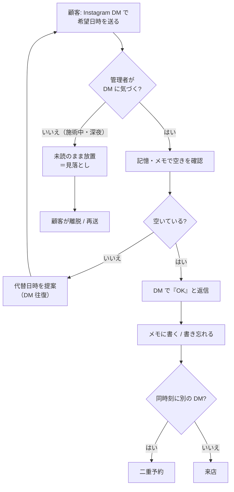
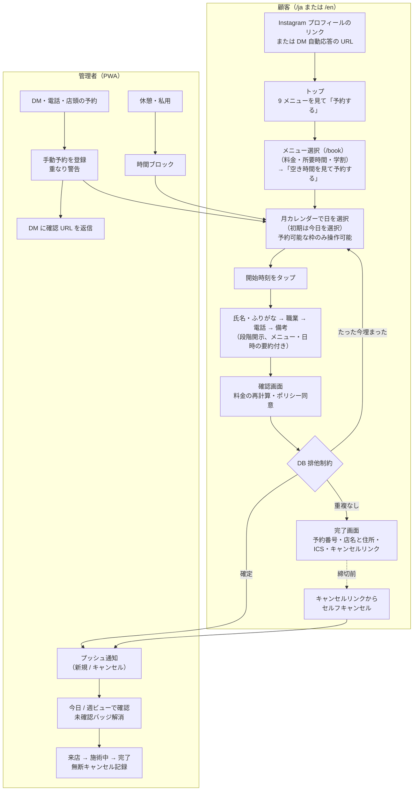
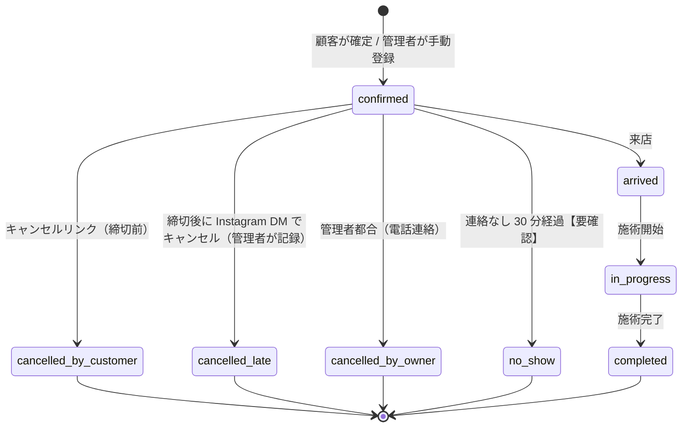
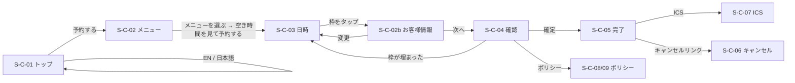
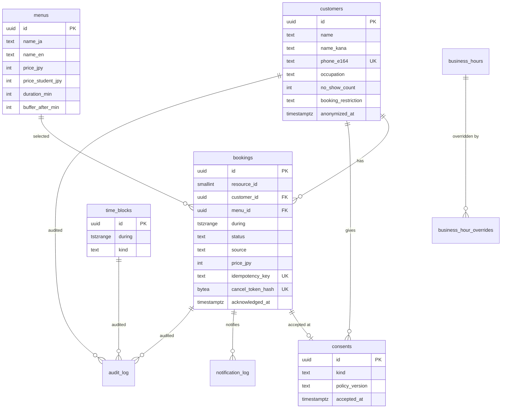

# 要件定義書 — Neuer Barber 長田健豊 予約サイト＋管理 PWA（Phase 1）

## 1. 文書情報

| 項目 | 内容 |
|---|---|
| 文書 ID | REQ-001 |
| 版 | v0.7（ドラフト、レビュー修正を反映） |
| 作成日 | 2026-10-10 |
| 作成者 | 開発者（フリーランス） |
| 承認者 | 長田健豊 様 |
| 対象フェーズ | Phase 1（予約サイト＋管理 PWA）。Phase 2/3 は拡張性要件としてのみ記載 |
| 関連文書 | `docs/01_plan/project_plan.md`（計画書）、`docs/research/reports/美容師予約サイト制作ナレッジ.md`（統合レポート）、`docs/research/research_notes/美容師予約サイト制作ナレッジ/`（領域別ノート 01〜08、および一次資料検証ノート `09_gap_infra_tooling.md` / `09_gap_push_notifications.md` / `09_gap_competitors_design.md` / `09_gap_legal_process_ux.md` / `09_gap_hosting_alternatives.md`） |
| 凡例 | 【要確認】＝第 2 回打ち合わせまでに確認・確定する事項。「根拠: 統合レポート『…』」＝要件の出典節 |

### 変更履歴

| 版 | 日付 | 変更内容 |
|---|---|---|
| v0.1 | 2026-10-10 | 初版ドラフト |
| v0.2 | 2026-10-10 | 一次資料検証（09_gap_*）の反映: ホスティング前提の変更、Push ペイロード形式、カレンダー記号、法務記載の訂正 |
| v0.3 | 2026-10-10 | ホスティング前提を Hobby 運用（規約リスク了承）に変更（PRE-08、CON-02、NFR-EN-01、NFR-PF-06、NFR-AV-05、FR-A-12、FR-S-04、11 章、OI-18 決定済み） |
| v0.4 | 2026-10-10 | WF 評価と決定事項の反映: ステップ順序、住所掲載、共有ボタン、× 表示規則、OTP フォールバック、ブロックプリセット（認知的ウォークスルー EVAL-001 の要件確認項目。FR-C-01/04/07/08/11/12/14/16、FR-A-01/05/06、US-01/02、UC-01、6.2、8.1、8.3、11 章、12 章、OI-09/11/12/19 決定済み、OI-20〜22 追加、AT-02/04/09/13/21。画面 S-C-02b を新設） |
| v0.5 | 2026-10-12 | クライアントフィードバックの反映（決定 2026-10-12）。F1 トップ構成の簡素化（ヒーロー文言と単独の受付時間カードを廃止し、受付時間・定休・予約締切をアクセスに統合）、F2 日付選択を月カレンダー（HPB 型、Must）＋時間枠リストに変更し週ストリップを廃止、F3 顧客向けの電話導線を廃止し Instagram DM（`@neuer.kento`、仮）に置換・電話番号は非掲載、予約制限 `phone_only` → `dm_only`（4.1、US-01、6.2、6.3、FR-C-07/11/12/14/16/17、FR-A-13、8.1、NFR-AV-01、10.1、12.1、12.2、12.4、OI-09/16、OI-10 決定済み、OI-23/24 追加、AT-04/07） |
| v0.6 | 2026-10-12 | 決定事項 G1〜G4（2026-10-12 確定）の反映。G1 **予約導線の 1 本化**: トップ →「1. メニューを選ぶ」（`/{locale}/book`）→ 日時 → お客様情報 → 確認の 1 本。トップの CTA（ヘッダー＋メニュー直後）は「予約する / Book」で `/book` へ、「空き時間を見て予約する / See available times」はメニュー段でメニュー選択後に出す CTA だけに使う。トップの「全 9 メニューと料金を見る」を廃止し、9 メニューを情報表示のカード（リンクなし）で掲載（FR-C-01/02/14、6.2、8.1、8.3、OI-25 追加・決定済み）。G2 Instagram アカウント `@neuer.kento` 確定（FR-C-11/12/16、12.1、12.2、OI-23 決定済み）。G3 特商法表記の電話番号は「請求があれば遅滞なく開示」方式で確定（12.4）。G4 月カレンダーの初期の選択日 = 今日（FR-C-07、OI-24 決定済み） |
| v0.7 | 2026-10-12 | レビュー修正の反映（`docs/06_test/review/` の code_review_v1・security_review_v1 の対応、設計書 ADR-0009）。10.1・12.3 の `consents.ip` を `ip_hash`（HMAC）に、FR-S-06 にキャンセル済みリンクの冪等な再送を追記。NFR-EN-01/02 を実装のツールチェーン（TypeScript 6.0、Node 24 LTS・`engines.node >=22.13.0`・`.nvmrc` 24、日時は `Intl`、Playwright はスクリプトから利用）に、10.3・12 章の保存期間を「最終利用から 3 年」に、FR-S-04 にレート制限の詳細（電話の上限はロック下で判定、完了・キャンセルページ・ICS の IP 制限、WAF ルールの対象に `book/(confirm\|time)`）、FR-A-04 に「直前の状態に戻す」（実装済み）、FR-A-07 に日次サマリーの時刻は Hobby では表示のみ |

### 構成

本書は研究ノート 07『要件定義書テンプレート案（14 章）』を本案件向けに再構成したもの。体制・コミュニケーション・スケジュールは計画書に委ね、本書では 2〜15 章に要件を記載する。

---

## 2. 背景・目的

### 2.1 現状と課題

| 観点 | 現状 | 課題 |
|---|---|---|
| 予約受付 | Instagram DM で日時を往復して決める | DM の見落とし、返信中の別客との二重予約、深夜・施術中は返信できない |
| 空き状況 | 本人の記憶・メモ | 顧客は空きが分からず、何度も往復する |
| 外国人客 | DM で英語対応 | 英語の予約導線が公開されていない |
| 記録 | DM 履歴のみ | 件数・再来率・無断キャンセルが計測できない |

### 2.2 目的

1. 予約できる枠だけを選べる予約サイトと DB レベルの排他制約で、**二重予約を構造的に不可能にする**。
2. 新規予約・キャンセルを管理 PWA のプッシュ通知と未確認バッジで受け取り、**見落としをゼロにする**。
3. `/ja` `/en` の二言語で、アカウント不要・最少タップで予約を完了させる。
4. 予約データを自前 DB に蓄積し、Phase 2（チャット）・Phase 3（カルテ）の基盤とする。

### 2.3 KPI

計画書 2 章の KPI-01〜09 を参照。本書の受入基準（15 章）は KPI-02（二重予約 0 件）と KPI-07（通知 10 秒以内）に直結する。

---

## 3. 用語定義

| 用語 | 定義 |
|---|---|
| 顧客 | 予約サイトを利用する来店者。アカウントは持たない |
| 管理者 / オーナー | 長田健豊 様。管理 PWA の唯一の利用者 |
| メニュー | 施術の種類（9 種）。価格・学生価格・所要時間・バッファを持つ |
| 枠（スロット） | 予約の開始候補時刻。`slot_step_min`（仮 30 分）刻みで生成される |
| 空き枠 | その開始時刻から「所要時間＋バッファ」を連続して確保できる枠 |
| リードタイム | 現在時刻から予約可能な最短時間（仮 60 分） |
| 先行予約上限 | 何日先まで予約できるか（仮 60 日） |
| 営業時間テンプレート | 曜日ごとの受付開始・終了時刻と定休日（`business_hours`） |
| 休業日オーバーライド | 特定日の臨時休業・時間変更（`business_hour_overrides`） |
| 時間ブロック | 管理者が予約を受けない区間（休憩・私用・臨時休業）。`time_blocks` |
| 手動予約 | 管理者が電話・店頭・DM 経由の予約を PWA から登録したもの。`source` で区別 |
| 即時確定 | 顧客が確定ボタンを押した時点で予約が成立し、管理者の承認を要しない |
| キャンセルトークン | 完了画面と ICS に載せる推測不能な文字列。DB にはハッシュのみ保存 |
| 完了画面 | 予約成立後に表示する画面。本件では唯一の予約証憑 |
| 未確認件数 | 管理者がまだ閲覧していない新規予約・キャンセルの件数（`acknowledged_at` が NULL） |
| PWA | Progressive Web App。ホーム画面に追加して standalone 表示で動くウェブアプリ |
| Web Push | Service Worker 経由のプッシュ通知。iOS ではホーム画面追加アプリ内のみ動作 |
| 学割 | 職業で「学生」を選んだ顧客に適用する割引価格【要確認: 金額・条件】 |
| 状態（予約） | `confirmed` → `arrived` → `in_progress` → `completed`、または `cancelled_by_customer` / `cancelled_by_owner` / `cancelled_late` / `no_show` |
| MoSCoW | 優先度。Must（必須）/ Should（重要）/ Could（可能なら）/ Won't（今回は作らない） |

---

## 4. スコープ

### 4.1 MoSCoW 概要

| 優先度 | 顧客サイト | 管理 PWA | 基盤・運用 |
|---|---|---|---|
| **Must** | 段階開示フォーム、メニュー（価格・所要時間・学割）、予約可能な枠のみ操作可能な月カレンダー＋時間枠リスト（◎×の 2 記号・× に理由ラベル・締切明記）、確認・完了画面（ICS・キャンセルリンク）、キャンセルフロー、JP/EN、ポリシーページ（プライバシー・キャンセル・特商法表記）、Instagram DM 導線（電話番号は非掲載） | パスキーログイン、今日/週ビュー、予約詳細・状態変更、手動予約、時間ブロック、営業時間・休業日・メニュー設定、プッシュ通知（出荷版 Declarative Web Push 形式）、未確認バッジ＋ポーリング、日次サマリー、インストール案内 | 排他制約、空き計算、Bot 対策、レート制限、トークンハッシュ、監査ログ、日次バックアップ、エラー監視、`SITE_URL` によるドメイン非依存、Vercel Hobby（Phase 1 本番。Pro / Cloudflare へ移行可能） |
| **Should** | Google カレンダー追加リンク、祝日表示（月カレンダーは v0.5 で Must に移動） | 顧客一覧・検索・名寄せ、`no_show_count` による予約制限、JSON エクスポート・匿名化、他端末ログアウト、オフライン時の読み取り表示 | 保存期間ジョブ、Vercel WAF Rate Limiting の前段配置 |
| **Could** | 「English available」バナー、Instagram DM 自動応答用の定型文 | ダークモード手動固定、週次 KPI カード | Lighthouse CI の性能予算強制、Serwist 導入 |
| **Won't（Phase 1）** | 顧客アカウント、メール/SMS/LINE 通知、決済、予約変更（キャンセル→再予約で代替）、チャット | 複数スタイリスト UI、カルテ、Google カレンダー同期 | ネイティブアプリ、既存顧客一括取込【要確認】 |

### 4.2 Won't の明文化

| 項目 | 扱い |
|---|---|
| 顧客向け自動通知（メール・SMS・LINE） | 完了画面＋ICS（VALARM 付き）で代替。Phase 2 で LINE 公式アカウントを検討 |
| 顧客ログイン・マイページ | 不採用。キャンセルはトークンリンクのみ |
| オンライン決済・キャンセル料自動請求 | 不採用。「請求より予防」の運用（12 章） |
| 予約日時の変更 | 「キャンセル後に再予約」で代替（1 席・60 分固定のため十分。根拠: 統合レポート『完了画面は唯一の証憑…』） |
| 複数席・複数スタイリスト | `resource_id` 列で将来対応。UI は作らない |
| 顧客チャット / 電子カルテ | Phase 2 / Phase 3。データモデルに拡張点のみ用意（10 章） |
| 店舗 HP の改修 | 対象外 |

---

## 5. 利用者と利用シーン

### 5.1 ペルソナ

| ID | ペルソナ | 特徴 | 端末・言語 | 主な目標 |
|---|---|---|---|---|
| P-01 | 若年男性客（JP） | 20 代前後、学生または社会人。Instagram で長田様を知る。Hot Pepper Beauty のネット予約に慣れている | iPhone/Android、日本語 | 夜に空いている日をすぐ見つけて、入力最少で予約したい。確認メールは来なくてよいが、予約した証拠は残したい |
| P-02 | 訪日客（EN） | 大阪滞在中の観光客・短期滞在者。日本語は読めない。英語対応の店を探している | スマホ、英語。海外の電話番号 | 料金・所要時間・場所・キャンセル規定を英語で理解し、JST で日時を間違えずに予約したい |
| P-03 | 管理者（長田様） | 施術中は手が離せない。閉店後の夜間に予約を確認する。iPhone 利用、PC は常用しない | iPhone（PWA）、日本語 | 新規予約・キャンセルに即気づきたい。DM・電話の予約も同じ画面で管理し、二重予約をなくしたい。休みや私用を数タップでブロックしたい |

### 5.2 ユースケース

| ID | ユースケース | 主アクター | 概要 | 関連要件 |
|---|---|---|---|---|
| UC-01 | 空き検索→予約 | P-01, P-02 | メニュー選択 → 空き枠選択 → お客様情報入力 → 確認 → 即時確定 → 完了画面 | FR-C-01〜11 |
| UC-02 | セルフキャンセル | P-01, P-02 | 完了画面/ICS のリンクから予約を確認し、締切前にキャンセル | FR-C-12 |
| UC-03 | 手動予約の登録 | P-03 | 電話・店頭・DM で受けた予約を PWA に登録し、重なりを確認 | FR-A-05 |
| UC-04 | 時間ブロック | P-03 | 休憩・私用・臨時休業を区間でブロック | FR-A-06 |
| UC-05 | 当日運用 | P-03 | 今日ビューで来店・施術・完了・無断キャンセルを記録、電話をかける | FR-A-02, FR-A-04 |
| UC-06 | 通知受信 | P-03 | 新規予約・キャンセルのプッシュを受け取り、未確認を解消 | FR-A-09〜11 |
| UC-07 | 設定変更 | P-03 | 営業時間・休業日・メニュー価格の変更 | FR-A-07, FR-A-08 |
| UC-08 | 言語切替 | P-02 | `/en` でサイト全体を英語で利用 | FR-C-13 |

### 5.3 ユーザーストーリー（代表例）

| ID | ストーリー | 受入基準（Given/When/Then） |
|---|---|---|
| US-01 | 若年男性客として、空いている時間だけを見て 2 タップで日時を決めたい | Given 空き枠が存在する日 / When 月カレンダーで日を 1 タップし時間を 1 タップ / Then 次の段（お客様情報）へ進める。埋まった枠は × の行として表示されるが、ボタンにならずフォーカスも当たらない |
| US-02 | 訪日客として、英語で料金と場所を理解して予約したい | Given `/en` / When 予約を完了 / Then 完了画面に英語で料金・JST の時刻・店名と住所（地図リンク）・キャンセルリンク（共有・コピー）が表示される |
| US-03 | 管理者として、予約が入ったら施術中でも通知で気づきたい | Given PWA をホーム画面から起動し通知を許可済み / When 顧客が予約を確定 / Then 10 秒以内に通知が届き、起動すると未確認 1 件が表示される |
| US-04 | 管理者として、DM で受けた予約を同じカレンダーに入れて二重予約を防ぎたい | Given 19:00 に web 予約あり / When 19:00 の手動予約を保存しようとする / Then 重なり警告が表示され、既定では保存されない |

---

## 6. 業務フロー

### 6.1 現状（as-is）: Instagram DM 予約



### 6.2 将来（to-be）: 予約サイト＋管理 PWA



運用ルール: **DM で予約を受けたら、返信前に必ず PWA に手動予約を登録し、確認 URL を DM に貼る**（根拠: 統合レポート『予防中心のキャンセル規定と予約状態遷移で現場を回す』）。

### 6.3 予約の状態遷移



排他制約の対象は `confirmed` / `arrived` / `in_progress` のみ。キャンセル済み・完了済みの枠は再予約できる。

---

## 7. 機能要件

ID 体系: `FR-C-xx` 顧客サイト、`FR-A-xx` 管理 PWA、`FR-S-xx` システム・基盤。優先度は MoSCoW。各 Must に客観的な受入基準を 1 つ以上付ける。

### 7.1 顧客サイト（FR-C）

| ID | 機能 | 要件 | 優先度 | 受入基準 | 根拠 |
|---|---|---|---|---|---|
| FR-C-01 | 段階開示フォーム | 予約は「メニューを選ぶ → 日時を選ぶ → お客様情報 → 確認」の順に進める（OI-19 決定済み、2026-10-10）。ルートは `/{locale}/book`（1. メニュー）→ `/book/time`（2. 日時）→ `/book/info`（3. お客様情報）→ `/book/confirm`（4. 確認）→ `/book/done/{token}`。**予約の入口は 1 本**（OI-25 決定済み、2026-10-12）: トップ（ヘッダー＋メニュー直後）・全ページのヘッダー・404 の予約 CTA は「予約する / Book」とし、必ず `/{locale}/book`（1. メニュー）に入る。トップから `/book/time` へ直接遷移するリンクは置かない。メニュー段の CTA は「空き時間を見て予約する / See available times」で、メニューを選んだ後にだけ表示し `/book/time` へ進める（この文言はメニュー段の CTA 専用）。お客様情報は同一ページ内で「氏名・ふりがな → 職業 → 電話 → 備考」の順に、前項目の入力完了後に次項目を開示する。後続項目は初期状態で折りたたむ。完了した項目は要約表示に畳み、タップで再編集できる。職業はラジオを選んだ時点で次段を開き、備考は電話段の下に「＋ご要望を追加（任意）」として同居させる（CW-11）。お客様情報の上部に選択済みのメニュー・日時のコンパクトな要約を置き、各行に「変更」（メニュー → `/book`、日時 → `/book/time`）を付ける。ブラウザ「戻る」でフォーム全体を失わない（`history.state` で段階管理）。上部に「1. メニューを選ぶ → 2. 日時を選ぶ → 3. お客様情報 → 4. 確認」の 4 段ステッパーを動詞形ラベル（HPB の「クーポン・メニューを選ぶ → 日時を指定する」に倣う）で表示。日時先行にしたのは、空きを見る前に個人情報を求めることが最大の離脱要因と評価されたため（EVAL-001 CW-01）。学生価格はメニューカードに一般価格と併記して枠選択前に見せる | Must | トップ・ヘッダー・404 の「予約する」が `/{locale}/book` に遷移し、トップに `/book/time` へのリンクがない。`/book` でメニュー未選択のあいだは「空き時間を見て予約する」が表示されず、選択後に表示される。`/book` の初期表示でメニュー以外の入力欄が表示されない。日時を選ぶと `/book/info` で氏名欄が開き、上部にメニュー・日時の要約と「変更」が表示される。氏名要約をタップすると再編集できる。お客様情報の途中で「戻る」を押しても入力値が保持される | 統合レポート『段階開示フォームと 11 枠の週ストリップが最少タップで確定させる』（週ストリップは v0.5 で月カレンダーに置換。FR-C-07）、研究ノート 02 KQ1 |
| FR-C-02 | メニュー選択 | 9 メニューをカード形式で表示。各カードに名称（JA/EN）、一般価格、学生価格（設定時）、所要時間、一言説明を併記。価格・所要時間は `menus` テーブルから取得し、ハードコードしない。価格は税込表示。メニュー段（`/book`）のカードは選択式（ラジオ）で、選択後に CTA「空き時間を見て予約する / See available times」を出す（FR-C-01）。トップにも同じ 9 メニューを情報表示のカード（名称 JA/EN・一般価格・所要時間。一言説明はあるものだけ。リンク・ボタンにしない）で掲載する（FR-C-14、OI-25） | Must | `/book` とトップの両方に全 9 メニューが表示され、各カードに価格と所要時間が出る。トップのカードはリンクではない。管理画面で価格を変えると顧客サイトに反映される | 統合レポート『参考サイトの共通項…』（Heritage 型「枠選択前に価格が見える」） |
| FR-C-03 | 氏名・ふりがな | 氏名は 1 フィールド（`autocomplete="name"`）。ふりがなは `/ja` のみ表示し必須、ひらがな受付（カタカナは正規化して受理）、ラベル「ふりがな」（Chrome はラベルにカタカナが含まれるとカタカナで自動入力するため、ひらがな表記のラベルにする）、`name="full-name-phonetic"`（Chrome のふりがな自動入力が認識する標準 name 値）、標準外の `autocomplete` 値は付けない。Chrome DevTools の Autofill パネルで判定を確認する。`/en` ではふりがな欄を描画しない（任意表示にする場合は "Furigana (optional)"）【要確認: EN で任意表示か非表示か】 | Must | `/ja` でふりがな未入力だと次へ進めない。`/en` でふりがな欄が表示されずに予約が完了する | 統合レポート『氏名は 1 フィールド、ふりがなはひらがな受付で EN では非表示…』 |
| FR-C-04 | 職業（学割判定） | ラジオ 2 択「学生 / 社会人」（EN: Student / Working adult）。「学生料金の判定に使用 / Used to apply the student rate」を添える。職業はお客様情報の段で聞くため、メニュー・日時の段ではメニューカードに一般・学生の両価格を併記し、要約は一般価格で表示する。職業の選択後、要約・確認画面・完了画面の料金を学生価格で再計算して表示。学生料金の対象（留学生・海外の学生を含むか）と来店時の学生証提示の要否を職業欄のヘルプに 1 行で書く【要確認: OI-20】 | Must | 学生を選ぶと確認画面の料金が学生価格になる。学生価格未設定のメニューは一般価格のまま | 同上 |
| FR-C-05 | 電話番号 | `type="tel" inputmode="tel" autocomplete="tel"` の単一欄。全角数字・ハイフン・空白・類似ダッシュを正規化し、E.164 で検証して `phone_e164` に保存。`/en` では国番号付きを受け付ける。エラー文は「電話番号を入力してください（例: 09012345678）/ Enter your phone number」形式。「必須です」単独は禁止 | Must | `０９０-１２３４-５６７８` が受理され `+819012345678` として保存される。`+44 7700 900123` が `/en` で受理される。無効番号は blur 後にエラー表示される | 統合レポート『氏名は 1 フィールド…』、研究ノート 08 Q2 |
| FR-C-06 | 備考 | 任意の `textarea`。髪型の悩み・相談を想定。文字数上限（500 文字）を明示 | Must | 空でも送信できる。501 文字で上限エラーが出る | 研究ノート 02 KQ3 |
| FR-C-07 | 空き状況カレンダー | 月カレンダー（HPB 型。クライアント決定 F2、2026-10-12。週ストリップは廃止）＋選択日の開始時刻の縦リスト。月カレンダーは見出し「‹ 2026年10月 ›」（前月・翌月ボタン。今月より前と先行予約上限の月より先へは進めない）、7 列・月曜始まり、各日セルに日付と ◎ または ×（理由ラベルは後述）。過去日と 61 日以降（先行予約上限の外）は非活性、今日は枠線、選択日は塗りで示す。**初期表示は今月、初期の選択日は今日**（JST。OI-24 決定済み、2026-10-12）。今日が ×（定休・休業・満席・全枠締切）の場合も今日を選択したままとし、時間枠リストは空きなしの表示（理由＋「次に空いている日へ」）にする（他の日へ自動で移らない）。月の移動の仕様は変えない（月を移ったら日付は未選択）。日をタップするとその日の時間枠リストに更新される。**予約可能な枠のみ操作可能（満席・締切・定休は × で表示し操作不可）**: ◎ の日・枠だけをボタンにし、× の日・行は表示するがボタン・リンクにせず、フォーカスも当てない（行が消えると「その時刻は営業していない」と誤解されるため。EVAL-001 論点 1）。× の日セル・行には理由ラベル（定休 / 満席 / 締切。臨時休業日は「休業」）を小さく添える。時刻は「18:00–19:00」の開始–終了併記、`/en` は「6:00 PM–7:00 PM JST」。記号は **◎（予約できます）と ×（予約できません）の 2 値のみ**とし、○（HPB では仮予約の意味）・△ は使わない。凡例「◎ 予約できます ／ × 予約できません」（◎ はこの時刻から施術開始の意味である旨を補足）をグリッド・リストの**直下**に表示する（v0.4 の「本日の残り枠はお電話で」の `tel:` 導線は F3 で廃止。電話番号は掲載しない）。予約締切を「予約締切: ご来店の 60 分前まで / Bookings close 60 minutes before the start time」のように文で明記（RESERVA 方式）【要確認: 分数は OI-06】。◎＝その時刻から所要時間を連続確保できることを保証。◎ の枠をタップすると選択表示（約 150 ms）の後、そのまま次の段（お客様情報。入力済みで確認画面から戻った場合は確認画面）へ進む。固定 CTA「この日時で進む」は、確認画面の「変更」やブラウザの戻るで選択済みのまま戻ってきたときだけ表示する（EVAL-001 論点 2）。月カレンダーの日ごとの ◎/× は時間枠と同じ空き計算から求める（日単位の要約）。空き枠・日ごとの状態はキャッシュせず Suspense 配下でリクエスト時に取得 | Must | `date` を指定せずに `/book/time` を開くと今日が選択され、今日の時間枠リストが表示される（今日が × なら空きなしの表示と「次に空いている日へ」）。月カレンダーで月曜が「× 定休」、過去日と 61 日以降が非活性（ボタンにならずフォーカスされない）。日をタップすると時間枠リストがその日の枠に更新される。埋まっている時刻がボタン・リンクとして描画されず、Tab キーでフォーカスされない。凡例「◎ 予約できます ／ × 予約できません」が表示され、× の日・行に理由ラベルが付く。他ブラウザで予約した直後にリロードすると当該枠が × になる。日 1 タップ＋時間 1 タップで次の段（お客様情報）に進める | 統合レポート『カレンダーは週ストリップ＋縦リスト…』（v0.5 で週ストリップを月カレンダーに置換、クライアント決定 F2）、『Server Action で予約を書き、空き枠は "use cache" せず…』 |
| FR-C-08 | 枠ルール | 営業時間テンプレート・休業日オーバーライド・時間ブロック・既存予約・リードタイム・先行予約上限・閉店時刻（閉店をまたぐ枠は出さない）を反映。タイムゾーンは Asia/Tokyo 固定、端末 TZ への変換はしない。仮値: 18:00〜24:00、30 分刻み、60 分、月曜定休、リードタイム 60 分、上限 60 日【要確認】 | Must | 月曜の日付が非活性。23:30 開始が表示されない（60 分メニュー時）。現在時刻 + 59 分の枠が予約可能として表示されない（× 締切）。61 日後が選択できない | 統合レポート『空き計算は「JST で候補生成 → UTC の tstzrange → && で除外」…』 |
| FR-C-09 | 確認画面 | Check-answers 形式で全入力（メニュー・適用料金・所要時間・日時（曜日・JST）・氏名(ふりがな)・職業・電話・備考）を一覧し、各行に「変更」。確定ボタン直上にキャンセルポリシー要点とプライバシー文言、**同意チェックボックス（必須）**。ボタン文言「この内容で予約を確定する / Confirm booking」。再入力を要求しない（WCAG 3.3.7） | Must | 同意未チェックでは確定できない。「変更」から戻って修正後、他の項目は保持される | 統合レポート『完了画面は唯一の証憑…』、『個人情報保護法は個人事業主にも全面適用…』 |
| FR-C-10 | 予約確定 | Server Action で受け付け、(1) Zod 検証（営業時間内・過去でない・枠整合） → (2) ハニーポット → (3) レート制限 → (4) Turnstile siteverify → (5) トランザクション内 INSERT（排他制約） → (6) 最小の戻り値。`23P01` は「その枠はたった今埋まりました」＋枠再取得、`23505`（冪等性キー重複）は既存予約を返す。承認ステップなしで即時確定 | Must | 2 ブラウザから同一枠を同時送信すると片方のみ成功し、もう片方に枠再選択の案内が出る。同じ内容の二重送信で予約が 2 件にならない | 統合レポート『二重予約は EXCLUDE USING gist…』、『セキュリティは「安価な検証を先に」…』 |
| FR-C-11 | 完了画面 | スマホ縦 1 画面に、予約番号、日付（曜日）、開始–終了、メニュー、適用料金、店名（Neuer Barber）・住所（〒545-0052 大阪市阿倍野区阿倍野筋2丁目4-48 金村ビル3F（南B）、地図リンク）（OI-09 決定済み）、担当者名を表示。「この画面をスクリーンショットで保存してください（確認メールは送信されません）」を日英で明示。「カレンダーに追加」（ICS ダウンロード必須、Google カレンダーリンクは Should）。ICS は `SUMMARY`/`LOCATION`（店名＋住所）/`DESCRIPTION`（キャンセル URL を完全な文字列で）/`VALARM`（前日・1 時間前）を含む。キャンセルリンクには「共有・コピー」ボタン（Web Share API で LINE・メモ等へ送る。非対応環境ではクリップボードにコピー）、予約番号には「コピー」ボタン。キャンセルリンクの下に「カレンダーの予定からもキャンセルできます」を 1 行添える（スクリーンショットだけではリンクを開けないため。EVAL-001 CW-15）。お問い合わせ先は電話ではなく Instagram DM（`@neuer.kento`。OI-23 決定済み）へのリンクを 1 行で置く（クライアント決定 F3。`tel:` リンク・電話番号は表示しない）。ボタンは増やさず置き換えて 1 画面に収める。折りたたみ・カルーセルは使わない | Must | 完了画面が iPhone 390×844 で縦スクロールなしに収まる（`/en` を含む）。店名・住所・地図リンクが表示される。Instagram DM へのリンクがあり、`tel:` リンクがない。Web Share API 対応端末で「共有・コピー」を押すと共有シートが開き、非対応端末ではリンクがコピーされ「コピーしました」が通知される。ICS を iOS カレンダーに取り込むと前日と 1 時間前の通知が設定され、場所に店名と住所、説明欄にキャンセル URL が入る | 統合レポート『完了画面は唯一の証憑なので、1 画面に収めて ICS とキャンセルリンクを置く』 |
| FR-C-12 | キャンセルフロー | `/{locale}/cancel/{token}` のトークン付きリンク。GET は副作用なし（予約内容の再表示）→「この予約をキャンセルする」→ 確認ダイアログ → 完了。締切（仮: 開始 2 時間前【要確認】）後は「キャンセル受付の期限を過ぎました。Instagram の DM でご連絡ください / Please contact us via Instagram DM」＋ Instagram DM リンク（`@neuer.kento`。OI-23 決定済み）に切り替え（クライアント決定 F3。`tel:` リンクは置かない）。キャンセル済み・完了済み・無効トークンは「この予約は見つかりません」。変更は「キャンセル後に再予約」導線 | Must | 締切前のリンクからキャンセルすると状態が `cancelled_by_customer` になり管理 PWA に通知が届く。締切後は Instagram DM の案内のみ表示され、`tel:` リンクがない。無効トークン 10 回/分で 429 | 統合レポート『管理者 1 名の認証は Better Auth + パスキー、キャンセルトークンは 256 bit をハッシュ保存する』 |
| FR-C-13 | 多言語（i18n） | next-intl、`/ja` `/en` を常時接頭辞。初期ロケールは「パス → Cookie → Accept-Language → ja」で判定、**自動リダイレクトはしない**。ヘッダー右上に「EN / 日本語」（相手言語名をネイティブ表記、国旗なし）、選択は Cookie に保存。`<html lang>` と `hreflang` を切替。日付・時刻・通貨は `Intl` で整形、`/en` は「JST」を明記。エラー文・Zod メッセージもロケール別 | Must | `/en` で全画面（フォーム・エラー文・完了画面・キャンセル画面・ポリシー）が英語になり、日本語が混在しない（店名・固有名詞を除く）。`/ja` から EN に切替後、再訪で `/en` が開く | 統合レポート『i18n は next-intl 4、localePrefix: "always"…』、『アクセシビリティと多言語は…「自動リダイレクトしない」で決まる』 |
| FR-C-14 | トップ・店舗情報 | トップは上から「ヘッダー（予約 CTA を含む）→ 写真（ヒーロー）→ メニュー（9 件）→ 予約 CTA → アクセス → 対応言語 → Instagram → フッター」の順に置く（クライアント決定 F1、2026-10-12）。ヒーローは写真のみとし、キャッチコピー・リード文のテキストブロックは置かない。メニューは 9 件すべてを情報表示のカード（名称 JA/EN・一般価格・所要時間。一言説明はあるものだけ）で並べ、カードはリンク・ボタンにしない。「全 9 メニューと料金を見る」のような一覧ページへのボタンは置かない（OI-25 決定済み）。予約 CTA はヘッダーとメニュー直後の 2 か所で、文言はどちらも「予約する / Book」、遷移先は `/{locale}/book`（1. メニュー）。全ページのヘッダーと 404 の予約 CTA も同じ文言・遷移先。「空き時間を見て予約する / See available times」はトップでは使わない（メニュー段の CTA 専用。FR-C-01）。アクセスは店名 Neuer Barber、住所 〒545-0052 大阪市阿倍野区阿倍野筋2丁目4-48 金村ビル3F（南B）、JR天王寺駅徒歩約 7 分（地下鉄谷町線 阿倍野駅徒歩約 2 分）、地図リンク（OI-09 決定済み）に加え、「受付時間 18:00–24:00 ／ 定休 月曜 ／ 予約締切 ご来店の 60 分前まで（仮。OI-06）」の 2〜3 行を含める（単独の受付時間カードは置かない）。電話番号・`tel:` リンクは置かない（F3、OI-10 決定済み）。対応決済手段の掲載位置は OI-14 の回答後に決める。`LocalBusiness` 構造化データ（店名・住所・営業時間を含む。`telephone` は載せない） | Must | 全ページで予約 CTA が 1 タップ以内。トップのセクション順が上記どおりで、ヒーローにテキストブロックがない。トップに 9 メニューのカードがあり、カードがリンクでない。トップの予約 CTA（2 か所）の文言が「予約する / Book」で、遷移先が `/{locale}/book`。アクセスに店名・住所・地図リンクと受付時間・定休・予約締切が表示される。電話番号・`tel:` リンクがない。Lighthouse SEO の構造化データ検証に通る | 統合レポート『参考サイトの共通項は明確だ』 |
| FR-C-15 | ポリシーページ | プライバシーポリシー（法 32 条の公表事項、米国クラウド事業者の明記を含む）、キャンセルポリシー（遅刻ルール含む）、特定商取引法に基づく表記（該当性は不明だが掲載。キャンセルポリシーのページと兼用可）を JA/EN で用意。フォーム下部・確認画面・完了画面からリンク | Must | 両言語でページが存在し、確認画面からリンクで開ける | 12 章 |
| FR-C-16 | Instagram DM 導線 | 顧客向けの問い合わせ・締切後の連絡手段は Instagram DM に一本化する（クライアント決定 F3、2026-10-12。OI-10 決定済み: 電話番号は非掲載）。ヘッダー・フッター・完了画面・キャンセル締切後の案内・ポリシーページ・404/エラーに Instagram（`@neuer.kento`。OI-23 決定済み、2026-10-12）へのリンクを置き、`tel:` リンク・電話番号は置かない。問い合わせ（DM）のリンクは DM を直接開く `https://ig.me/m/neuer.kento`、施術写真を見るリンクはプロフィール `https://www.instagram.com/neuer.kento/` とし、新しいタブで開く。ラベルは「Instagram の DM でお問い合わせ / Message us on Instagram」。アカウント名は設定値 1 か所で持つ | Must | 全ページ（`/ja` `/en`）に Instagram リンクがあり、`tel:` リンクと電話番号が DOM に存在しない | 研究ノート 02 KQ6（v0.5 で電話導線から Instagram DM 導線に変更） |
| FR-C-17 | Instagram 運用素材 | プロフィールリンク・ハイライト「予約方法」・DM 自動応答用の定型文（予約 URL 付き。締切後のキャンセル連絡・問い合わせを DM で受ける旨を含む）を納品物に含める。サイト上の Instagram リンクは FR-C-16 | Could | 定型文（JA/EN）が運用マニュアルに記載されている | 統合レポート『参考サイトの共通項は明確だ』 |

### 7.2 管理 PWA（FR-A）

| ID | 機能 | 要件 | 優先度 | 受入基準 | 根拠 |
|---|---|---|---|---|---|
| FR-A-01 | ログイン | Better Auth（Postgres アダプタ）＋パスキー（WebAuthn）を主とし、管理者 1 名のみ。サインアップは無効化し初回は seed で作成。フォールバックは**アプリ内で入力する 6 桁のワンタイムコード**（1 欄、`inputmode="numeric"`、`autocomplete="one-time-code"`）とする（OI-12 決定済み、2026-10-10）。マジックリンクは採らない（iOS のホーム画面アプリは Safari とストレージが分かれており、メールのリンクは Safari で開くため PWA にセッションが入らない。EVAL-001 論点 4）。コードの配信経路は Resend による管理者メール宛を既定とし、メールを使わない場合は事前に発行するリカバリーコードとする【要確認: OI-21 配信経路】。Cookie は `__Host-` 接頭辞、`HttpOnly; Secure; SameSite=Lax`、`Max-Age` 30 日ローリング。`/admin` 配下は未認証なら `/admin/login` へ | Must | PWA 内で Face ID によるログインができる。パスキーが使えない場合、PWA 内で 6 桁コードを入力してログインでき、Safari に切り替わらない。未認証で `/admin` にアクセスするとログイン画面に遷移する。Server Action は Cookie なしの直接 POST で 401 相当を返す | 統合レポート『管理者 1 名の認証は Better Auth + パスキー…』 |
| FR-A-02 | 今日ビュー | `start_url`。受付時間（仮 18:00〜24:00）の縦タイムライン、15 分刻み、現在時刻ライン、予約カード高さ ≥ 56px、カードに氏名（ふりがな）・メニュー・`tel:` リンク・備考の有無。タップで詳細シート。ヘッダに「未確認 n 件」バッジ。日付の前後移動 | Must | 当日の予約・ブロックが時系列で表示され、カードから電話が発信できる | 統合レポート『ダッシュボードは「今日・週・受信箱・設定」のボトムタブと…』 |
| FR-A-03 | 週ビュー | 7 列に日ごとの件数と空き枠数。セルタップで該当日の今日ビューへ。定休日・ブロックの表示 | Must | 週の各日に件数が表示され、タップで日ビューに遷移する | 同上 |
| FR-A-04 | 予約詳細・状態変更 | 詳細シートに全項目、`source`、作成日時、同意版。状態変更（来店・施術開始・完了・無断キャンセル・管理者キャンセル・遅刻キャンセル）。キャンセル・削除は即時実行＋5 秒「取り消す」トースト（ソフトデリート＋復元）。来店・施術開始・完了の押し間違いは「直前の状態に戻す」で 1 段ずつ戻せる（来店済み → 確定、施術中 → 来店済み、完了 → 施術中。監査ログに記録し、戻すと他の予約と重なる場合は戻さない。実装済み）。standalone 用に明示的な「←」 | Must | 状態を `no_show` に変更すると顧客の `no_show_count` が +1 される。キャンセル直後 5 秒以内に取り消すと `confirmed` に戻る。誤って「完了」にした予約を「直前の状態に戻す」と施術中に戻り、最終来店日も元に戻る | 同上、研究ノート 08 Q1 |
| FR-A-05 | 手動予約 | FAB「+」→「手動予約」。氏名（必須）、電話（任意、`phone_unverified`）、メニュー、日時、`source`（phone / walk_in / instagram / line / manual）、メモ。電話番号完全一致・かな部分一致で既存顧客をサジェスト。サーバーで重なりを判定し「19:00–20:00 の○○様と重なります」を赤表示し、`[時間を変更]` のみを出す（重なる手動予約は保存しない）。Phase 1 は意図的な重複（掛け持ち）を許容しない（OI-11 決定済み、2026-10-10）。クライアントがパーマの放置時間などで意図して重ねる運用を求めた場合は、警告内の理由付き補助操作（audit_log に記録）として再検討する。保存後に顧客向け確認 URL（予約詳細＋キャンセルリンク）を生成しコピーできる。保存直後の入力ミスを取り消す手段（5 秒「取り消す」を統計に含めない）【要確認: OI-22】 | Must | 既存予約と重なる手動予約は警告なしには保存されない。保存後に確認 URL をコピーして DM に貼れる | 統合レポート『予防中心のキャンセル規定…』 |
| FR-A-06 | 時間ブロック | FAB「+」→「時間をブロック」。プリセット「今から 1 時間 / 2 時間 / 今日はここまで（閉店まで） / 期間指定」（「今から 30 分」はリードタイム 60 分より短く顧客サイトに影響しないため置かない。EVAL-001 CW-19）、種別（休憩 / 私用 / 臨時休業。プリセットの既定は 1 時間・2 時間が休憩、今日はここまでが臨時休業で、行に「休憩として」のように出す。後から変更可）、ラベル。シートを開いた時点で確定済み予約との重なりを判定し、確定前にプリセット行へ「19:40–20:40・山田様と重なります」と表示する。保存時も同一トランザクション内で再確認し警告。シートとトーストに顧客サイトへの影響を 1 行で出す（例「20:00 までの受付を止めました」）。ブロック区間は空き枠から除外。削除は Undo 付き | Must | 2 タップで「今から 1 時間」をブロックできる。予約と重なるプリセットは、タップ前に重なりが行に表示される。「今から 2 時間」または「今日はここまで」をブロックすると、顧客サイトで開始が 60 分以上先の該当枠が ◎ から × に変わる | 同上 |
| FR-A-07 | 営業時間・休業日設定 | 曜日ごとの受付開始・終了・定休（`business_hours`）、特定日の臨時休業・時間変更（`business_hour_overrides`）、`settings`（枠刻み、リードタイム、先行予約上限、セルフキャンセル締切）。祝日は表示のみで自動休業にしない（Should）。変更時に `updateTag` でメニュー・営業時間キャッシュを即時失効。日次サマリーの時刻（`digest_hour_jst`）は Hobby の Cron が 1 日 1 回の固定時刻のため表示のみ（変更不可。Pro 移行時に再検討） | Must | 火曜を定休にすると顧客サイトで火曜が非活性になる。臨時休業日を登録するとその日の枠が消える | 統合レポート『空き計算は…』、研究ノート 08 Q1 |
| FR-A-08 | メニュー管理 | 名称（JA/EN）、一般価格、学生価格、所要時間、バッファ、表示順、公開/非公開。価格・所要時間の初期値は第 2 回打ち合わせで確定【要確認】 | Must | 所要時間を 90 分に変えると、その日の最終開始時刻が 22:30 になる（24:00 終了時） | 同上 |
| FR-A-09 | プッシュ購読・通知設定 | オンボーディングを「ホーム画面に追加 → アイコン起動 → ログイン → 設定『通知をオンにする』→ 許可」の一本道に。standalone でない場合は購読 UI を出さず追加手順を図解（iOS は共有メニュー、Android は `beforeinstallprompt`）。起動のたびに `getSubscription()` を確認し、null なら再購読バナー（iOS は設定で通知 OFF にしても `Notification.permission` が `"default"` を返すため、permission ではなく購読の有無を主条件にする）。`requestPermission()` がダイアログを出さない/`granted` 以外のときは「設定 > 通知 > <アプリ名>」への案内を表示。「テスト通知」ボタンはサーバーの APNs 応答（201）と端末受信を突き合わせ、届かない場合に購読を作り直す導線（unsubscribe → subscribe）を同じ画面に置く。端末一覧（`last_seen_at`）。管理者セッションは `Max-Age` 付き永続 Cookie 必須（WebKit 272325 がセッション Cookie をリセットする問題は未修正） | Must | Safari タブで `/admin` を開くと通知ボタンが出ず追加手順が表示される。standalone で通知をオンにすると `push_subscriptions` に 1 行入る。テスト通知が届く。iOS 設定で通知を OFF にして再起動すると設定への案内が出る。アプリを閉じて再度開いてもログイン状態が維持される | 統合レポート『iOS のプッシュは「ホーム画面追加・毎回通知表示・起動時再確認」で成立する』 |
| FR-A-10 | 通知受信（新規予約・キャンセル） | 新規 web 予約、顧客キャンセルで即時プッシュ（`urgency: high`, `TTL: 6h`, `topic: booking-<id>`）。通知はタイトル＋本文＋`navigate`（該当予約の URL）＋`data` の最小構成（電話番号を含めない）。タップで該当予約の詳細を開く（`notificationclick` は `clients.matchAll` → 既存ウィンドウがあれば `client.navigate()`、なければ `openWindow()`）。SW は `push` 受信時に必ず `event.waitUntil(showNotification(...))` を呼ぶ。バックグラウンド復帰時のリロードで管理フォームの入力が失われないよう、手動予約・ブロックの下書きを `sessionStorage`/`IndexedDB` に保存 | Must | 顧客予約の確定から 10 秒以内に iOS/Android 実機に通知が届き、タップで詳細が開く。iOS では宣言的通知タップの `navigate` 遷移を「アプリ完全終了／バックグラウンド（端末スリープ後）／前面」の 3 状態で確認し、バックグラウンド時にルートへ戻る現象（WebKit 268797）が出た場合は起動時に未確認一覧へ誘導する UI で吸収する。`app_badge` がトップレベル・`notification` 内のどちらで反映されるかを iOS 26.x 実機で確認し、効いた側を残す。前面表示中に通知バナーが出ない場合はアプリ内トースト＋未確認バッジで代替 | 同上、『実装は app/manifest.ts + 手書き最小 SW + web-push…』 |
| FR-A-11 | 未確認バッジ＋ポーリング | `bookings.acknowledged_at` を持ち、未確認件数をヘッダに表示。起動時・`visibilitychange`・可視中 20 秒間隔で再取得（非表示時は停止）。詳細を開くと確認済みにする。「すべて確認済みにする」 | Must | プッシュが届かない状態でも、PWA を開いて 20 秒以内に新規予約が一覧に現れ未確認件数が増える | 統合レポート『信頼性は「未確認件数バッジ＋可視時ポーリング＋日次サマリー…」で多層化する』 |
| FR-A-12 | 日次サマリー | Vercel Cron（`0 12 * * *` = 21:00 JST。Phase 1 の Hobby は 1 日 1 回・時間精度 ±59 分が前提のため 21:00〜21:59 のいずれかで実行。Pro 移行時は分単位精度で 21:00 ちょうど）で「明日の予約 n 件（18:00〜…）」をプッシュ。`CRON_SECRET` 照合、`digest_sent_on` で重複防止 | Must | 前日 21:00〜21:59（Hobby。Pro 移行後は 21:00 ±1 分）に翌日の件数と最初・最後の時刻が通知される。同日に 2 回実行しても 1 通のみ | 同上 |
| FR-A-13 | 顧客一覧・検索 | 電話番号・氏名（かな正規化）で検索。来店回数、最終来店、`no_show_count`、`late_cancel_count`、`booking_restriction`（none / dm_only / blocked。`dm_only` は Instagram DM でのみ予約を受け付ける。v0.4 の `phone_only` を F3 で置換）。重複顧客のマージ | Should | 同一電話番号の予約が 1 顧客に紐づく。`dm_only` の顧客は web 予約時に「ご予約は Instagram の DM で承ります」と Instagram DM リンクで案内される【要確認: 制限の運用】 | 研究ノート 08 Q2 |
| FR-A-14 | エクスポート・匿名化 | 顧客単位の JSON エクスポート（予約・同意履歴）。削除依頼時の手動匿名化ボタン。CSV 一括エクスポート | Should | 匿名化後、氏名・ふりがな・電話が消え、予約の日時・メニュー・状態のみ残る | 統合レポート『個人情報保護法は個人事業主にも…』 |
| FR-A-15 | PWA インストール | `app/manifest.ts`（`start_url: /admin`, `scope: /admin`, `display: standalone`, アイコン、`theme_color` ライト/ダーク、Android 用 `screenshots`・`description`）。`/sw.js` は `Cache-Control: no-cache`。顧客サイトには SW を登録しない | Must | iOS で追加後 URL バーなしで起動する。Android Chrome でインストールプロンプトが出る | 統合レポート『実装は app/manifest.ts…』 |
| FR-A-16 | セッション管理 | 端末一覧、「この端末以外をログアウト」（他端末のセッションと購読を失効） | Should | 実行後、他端末で再ログインが要求される | 研究ノート 05 Q7 |
| FR-A-17 | オフライン表示 | オフライン時に直近取得した今日の一覧をキャッシュから読み取り専用で表示し「オフライン」バナー | Should | 機内モードで起動しても今日の一覧が表示される | 研究ノート 05 Q6 |
| FR-A-18 | ダークモード | `prefers-color-scheme` 追従を既定とし、設定で固定可。顧客サイトは Phase 1 ではライトのみ | Could | 端末をダークにすると PWA がダーク配色になり、コントラスト AA を満たす | 統合レポート『カラーは #7c0000 を…』 |
| FR-A-19 | 週次 KPI カード | 今週の予約数・売上見込み・空き枠率・直近の無断キャンセル | Could | — | 研究ノート 08 Q7 |

### 7.3 システム・基盤（FR-S）

| ID | 機能 | 要件 | 優先度 | 受入基準 | 根拠 |
|---|---|---|---|---|---|
| FR-S-01 | 二重予約の DB 防止 | `bookings.during tstzrange` に `EXCLUDE USING gist (resource_id WITH =, during WITH &&) WHERE (status IN ('confirmed','arrived','in_progress'))`（`btree_gist`）。半開区間 `[)` を CHECK で強制。`idempotency_key = sha256(slotStart\|menuId\|phone)` を UNIQUE。分離レベルは READ COMMITTED | Must | 統合テストで同一枠に `Promise.all` で 2 件 INSERT すると 1 件が `23P01` で失敗する。19:00 終了と 19:00 開始は衝突しない | 統合レポート『二重予約は EXCLUDE USING gist…で最終防衛する』 |
| FR-S-02 | 空き枠計算 | `generate_series(open, close - duration - buffer, step)` で JST 候補を生成し、`tstzrange` に変換、`bookings ∪ time_blocks` と `&&` で除外する SQL。フォームは ISO 文字列（`+09:00`）を送り、サーバー側でもリードタイム・上限・営業時間を再検証 | Must | 契約テスト（営業時間境界、定休日、60 分、バッファ、JST/UTC 日付境界）が全件パス。UI を迂回した直接 POST で営業時間外の枠が拒否される | 統合レポート『空き計算は…SQL 一発で行う』 |
| FR-S-03 | Push 送信 | `web-push`（VAPID 固定）、`Promise.allSettled`、`timeout: 8000`。`WebPushError.statusCode` が 404/410 なら購読削除、`fail_count` 更新。ペイロードは出荷版 Declarative Web Push 形式の JSON: トップレベル `"web_push": 8030` ＋ `"notification": { title, body, lang, navigate（必須）, tag, data, app_badge }` ＋ トップレベル `app_badge`・`mutable: false`（`app_badge` は実機確認まで両方の位置に入れる）。Content-Type の変更は不要（web-push の既定 `application/octet-stream` + `aes128gcm` のまま送る）。iOS 18.4+ では SW を起動せず宣言的に表示され、それ以外では SW の `push` ハンドラが `notification` を `showNotification()` に転記する。`topic: booking-<id>` で未配信を置換（iOS では `tag` による置換は効かない）。`after()` で送信しレスポンスを遅らせない | Must | 失効エンドポイントに送ると購読行が削除される。送信失敗が予約確定を失敗させない | 統合レポート『実装は app/manifest.ts + 手書き最小 SW + web-push…』 |
| FR-S-04 | レート制限 | `createBooking`: IP 5 回/10 分 ＋ 電話番号ハッシュ 3 件/日。`/cancel/[token]`: IP 10 回/分。ログイン試行制限。実装は Postgres `rate_limits` テーブル（追加サービスなし）。電話番号の 3 件/日は予約確定のトランザクション内（カレンダーの advisory lock 下）で判定・加算し、同時送信でも超えない。IP 10 回/分は `/cancel/*`・`/book/done/*` のページ表示と `/api/ics/*` で共通のキーとし、キャンセル操作（Server Action）も同じキーでサーバー側が判定する（どの URL に送られても数える）。ログインコードの送信は IP 3 回/10 分＋全体 10 通/日。補完として Vercel WAF Rate Limiting（全プランで利用可。固定窓 10 秒〜10 分、キーは IP/JA4）で `/cancel/*`、予約 Server Action と空き表示（`/book/(confirm\|time)`。空き表示は毎回 DB を読むため）、`/api/ics/*` への IP 単位の粗い制限を前段に置く。Phase 1 の Hobby はルール 1 本のためこれらを 1 本のルールにまとめる（Pro 移行時は 40 ルールまで分割可） | Must | 11 回目のキャンセル URL 試行が 429 になる。同一電話番号で 4 件目の予約が拒否される | 統合レポート『管理者 1 名の認証は…キャンセルトークンは 256 bit をハッシュ保存する』 |
| FR-S-05 | Bot 対策 | Cloudflare Turnstile（非対話型）を確定時に siteverify で検証（単回使用・300 秒）。ハニーポット `website` フィールド（非空なら成功を装って破棄）。CSP に `challenges.cloudflare.com` を許可 | Must | Turnstile トークンなし・再利用の POST が拒否される。ハニーポット入りの送信が DB に残らない | 統合レポート『セキュリティは「安価な検証を先に」…』 |
| FR-S-06 | キャンセルトークン | `randomBytes(32)` base64url（43 文字）、DB は SHA-256 ハッシュのみ（`cancel_token_hash bytea UNIQUE`）、`timingSafeEqual` 照合、形式 `^[A-Za-z0-9_-]{43}$` で早期拒否。有効期限は予約開始の締切時刻まで、使用後は失効（キャンセル後はページ・ICS で無効。同じリンクからのキャンセルの再送だけは「キャンセル済み」として冪等に応答し、通知・記録を重ねない） | Must | DB ダンプに生トークンが含まれない。キャンセル後に同じ URL を開くと無効表示 | 同上 |
| FR-S-07 | 監査ログ | `audit_log(actor, action, entity_type, entity_id, diff, created_at)` に予約作成・キャンセル・状態変更・手動変更・ブロック・設定変更・エクスポート・匿名化を記録（電話番号は末尾 4 桁ハッシュ） | Must | 手動キャンセルの履歴が `audit_log` から追える | 統合レポート『監視・バックアップ・ドメイン移行は…』 |
| FR-S-08 | バックアップ | GitHub Actions で日次 `pg_dump --format=custom`、暗号化して 30 世代保存。復元手順書を `07_release/` に置く。Neon の 6 時間履歴は補助 | Must | 復元リハーサルで前日のダンプから staging に復元できる | 同上 |
| FR-S-09 | 保存期間ジョブ | `last_visit_at < now() - 3 years` かつ未来予約なしの顧客を匿名化（氏名・ふりがな削除、電話ハッシュ化、統計は保持）。日次 cron または手動実行 | Should | 対象顧客の個人識別情報が消え、`anonymized_at` が記録される | 統合レポート『個人情報保護法は個人事業主にも…』 |
| FR-S-10 | ドメイン非依存 | サイト URL はサーバー専用 `SITE_URL` で持ち、`NEXT_PUBLIC_` にしない。DB には相対パスのみ保存し `absoluteUrl()` で組み立てる。独自ドメイン移行時は環境変数変更と `*.vercel.app` リダイレクトのみ | Must | `SITE_URL` を変えると過去予約のキャンセル URL が新ドメインで表示される。コード中にドメイン文字列が存在しない | 同上 |
| FR-S-11 | エラー監視 | Sentry Developer（エラー、cron モニタ、uptime モニタ各 1）。`error.digest` でログ突合。ログに電話番号・氏名を書かない | Must | 意図的な例外が Sentry に届き、個人情報が含まれない | 同上 |
| FR-S-12 | キャッシュ方針 | メニュー・営業時間は `"use cache"` + `cacheTag` + `cacheLife('days')`、管理操作で `updateTag`。空き枠・管理一覧はキャッシュせず動的 | Must | メニュー更新が即時反映される。空き枠が常に最新 | 統合レポート『Server Action で予約を書き、空き枠は "use cache" せず…』 |
| FR-S-13 | ステージング環境 | `main` → 本番、`staging` ブランチ → 固定 URL（Vercel Authentication で保護。全プランで利用可）、Neon ブランチで DB 分離、PR ごとのプレビュー。Playwright E2E は Protection Bypass for Automation（全プラン）の `VERCEL_AUTOMATION_BYPASS_SECRET` を `x-vercel-protection-bypass` ヘッダに載せて保護された Preview に対して実行 | Must | staging で予約しても本番 DB に書き込まれない。CI の E2E が保護された Preview URL に対して通る | 統合レポート『公開は staging ブランチ方式…』 |
| FR-S-14 | Web 解析 | Vercel Web Analytics（Hobby: 月 5 万イベント、カスタムイベント不可）。予約フローの各ステップを別 URL（またはクエリ）にしてページ遷移でファネルを計測。個人を識別する情報は送らない | Should | ステップ別の到達数がダッシュボードで読める | 研究ノート 08 Q7 |

---

## 8. 画面一覧

### 8.1 顧客サイト（`/{locale}` = `/ja` または `/en`）

| 画面 ID | 画面名 | ルート | 利用者 | 概要 | 関連要件 |
|---|---|---|---|---|---|
| S-C-01 | トップ | `/{locale}` | 顧客 | ヘッダー（予約 CTA「予約する」・言語切替）→ 写真（ヒーロー。テキストなし）→ メニュー（9 件、情報表示）→ 予約 CTA「予約する」（`/book` へ）→ アクセス（店名・住所・地図リンク、受付時間・定休・予約締切）→ 対応言語 → Instagram → フッター | FR-C-13, 14, 16 |
| S-C-02 | 予約（メニュー） | `/{locale}/book` | 顧客 | メニューカード（一般・学生の両価格）。ステップ 1。予約の唯一の入口（トップ・ヘッダー・404 の「予約する」の遷移先）。メニュー選択後に CTA「空き時間を見て予約する」 | FR-C-01, 02 |
| S-C-03 | 予約（日時選択） | `/{locale}/book/time` | 顧客 | 月カレンダー（◎/× と理由ラベル。初期の選択日は今日）＋選択日の時間枠リスト（◎ のみ操作可、× は理由付きの非活性行）。ステップ 2（同一フォームの状態を保持。計測用に URL を分ける） | FR-C-07, 08 |
| S-C-02b | 予約（お客様情報） | `/{locale}/book/info` | 顧客 | メニュー・日時の要約（変更リンク）＋段階開示フォーム（氏名・ふりがな → 職業 → 電話 → 備考）。ステップ 3 | FR-C-01, 03〜06 |
| S-C-04 | 予約（確認） | `/{locale}/book/confirm` | 顧客 | Check-answers（職業に応じて料金を再計算）、ポリシー同意、確定。ステップ 4 | FR-C-04, 09, 10 |
| S-C-05 | 予約完了 | `/{locale}/book/done/{token}` | 顧客 | 証憑カード（店名・住所・地図リンク）、ICS、キャンセルリンク（共有・コピー）、予約番号コピー、Instagram DM 導線 | FR-C-11, 16 |
| S-C-06 | キャンセル | `/{locale}/cancel/{token}` | 顧客 | 予約再表示 → キャンセル → 確認 → 完了。締切後は Instagram DM 案内 | FR-C-12, 16 |
| S-C-07 | ICS ダウンロード | `/api/ics/{token}` | 顧客 | Route Handler。`text/calendar` | FR-C-11 |
| S-C-08 | プライバシーポリシー | `/{locale}/privacy` | 顧客 | 12 章 | FR-C-15 |
| S-C-09 | キャンセルポリシー | `/{locale}/policy` | 顧客 | 12 章 | FR-C-15 |
| S-C-10 | 404 / エラー | `/{locale}/not-found`, `error.tsx` | 顧客 | 予約 CTA と Instagram リンクを含む（電話リンクなし） | FR-C-16 |

S-C-02b は v0.4 で新設した。OI-19 の決定（日時先行）でお客様情報を S-C-02 から分離したが、S-C-03 以降の ID を変えないよう枝番とした（WF・設計書・評価レポートの ID 参照を保つため）。

### 8.2 管理 PWA（`/admin`、日本語固定、要ログイン）

| 画面 ID | 画面名 | ルート | 利用者 | 概要 | 関連要件 |
|---|---|---|---|---|---|
| S-A-01 | ログイン | `/admin/login` | 管理者 | パスキー（＋フォールバック） | FR-A-01 |
| S-A-02 | 今日 | `/admin` | 管理者 | `start_url`。縦タイムライン、未確認バッジ、FAB | FR-A-02, 11 |
| S-A-03 | 週 | `/admin/week` | 管理者 | 7 列の件数・空き | FR-A-03 |
| S-A-04 | 予約詳細 | `/admin/bookings/{id}` | 管理者 | 詳細・状態変更・確認 URL コピー | FR-A-04 |
| S-A-05 | 手動予約 | `/admin/bookings/new` | 管理者 | クイック作成、重なり警告 | FR-A-05 |
| S-A-06 | 時間ブロック | `/admin/blocks/new` | 管理者 | プリセット、期間指定 | FR-A-06 |
| S-A-07 | 受信箱（未確認） | `/admin/inbox` | 管理者 | 未確認の新規・キャンセル一覧 | FR-A-11 |
| S-A-08 | 設定: 営業時間・休業日 | `/admin/settings/hours` | 管理者 | 曜日テンプレート、オーバーライド、枠ルール | FR-A-07 |
| S-A-09 | 設定: メニュー | `/admin/settings/menus` | 管理者 | 価格・所要時間・学割・バッファ | FR-A-08 |
| S-A-10 | 設定: 通知・端末 | `/admin/settings/notifications` | 管理者 | 購読、テスト通知、端末一覧、他端末ログアウト | FR-A-09, 16 |
| S-A-11 | 顧客一覧・詳細 | `/admin/customers`, `/admin/customers/{id}` | 管理者 | 検索、履歴、制限、エクスポート、匿名化 | FR-A-13, 14 |
| S-A-12 | インストール案内 | `/admin/install` | 管理者 | Safari タブ時に表示。追加手順の図解 | FR-A-09, 15 |

### 8.3 画面遷移（顧客）



予約の入口は 1 本（OI-25 決定済み）: トップ・ヘッダー・404 の「予約する」は S-C-02 に入り、トップから S-C-03 へ直接遷移しない。

---

## 9. 非機能要件

IPA 非機能要求グレードの 6 大項目に各 2〜5 行の目標値を置く軽量版（根拠: 統合レポート『要件定義書は 14 章、非機能は IPA 6 大項目の軽量版、優先度は MoSCoW』）。

### 9.1 可用性

| ID | 項目 | 目標 | 備考 |
|---|---|---|---|
| NFR-AV-01 | 稼働率 | 月間 99.5% 以上（uptime モニタで計測）【要確認: SLA なし】 | Vercel Hobby・Neon Free とも正式な SLA は提供しない（SLA は Enterprise のみ）。Hobby は規約リスクによる警告・停止の可能性がある（PRE-08）。障害・停止時の代替は Instagram DM 受付（v0.5。電話番号は掲載しない） |
| NFR-AV-02 | DB 冷起動 | Neon のスケール to ゼロからの再開（数百 ms）を Suspense のスケルトンで吸収し、エラーにしない | |
| NFR-AV-03 | 通知の冗長化 | プッシュ不達時も、PWA 起動後 20 秒以内に未確認件数で検知できる | FR-A-11 |
| NFR-AV-04 | 復旧 | バックアップからの復元手順を文書化し、復元リハーサルを公開前に 1 回実施。目標復旧時間 4 時間、目標復旧時点 24 時間 | FR-S-08 |
| NFR-AV-05 | ロールバック | Vercel Instant Rollback。Phase 1 の Hobby は直前の本番デプロイ 1 件のみ戻せる（それより前へは該当コミットを再デプロイ）。Pro 移行時は本番ドメインにエイリアスされた全デプロイへ戻せる。ロールバック後は自動本番割当がオフになる点を含め手順書に明記 | |

### 9.2 性能・拡張性

| ID | 項目 | 目標 | 備考 |
|---|---|---|---|
| NFR-PF-01 | Core Web Vitals（顧客サイト、モバイル） | LCP ≤ 2.5 s、INP ≤ 200 ms、CLS ≤ 0.1（目標 0.05） | Lighthouse CI: performance ≥ 0.9 を警告、accessibility = 1.0 をエラー |
| NFR-PF-02 | バンドル | 公開ページ First Load JS ≤ 150 kB gzip、予約フォームルート ≤ 200 kB | `next analyze` で確認 |
| NFR-PF-03 | 空き枠取得 | ウォーム時 p95 500 ms 以内（SQL 1 本） | |
| NFR-PF-04 | 同時アクセス | 同時 50 ユーザーで予約フローが劣化しない。排他制約により同時送信でもデータ不整合なし | 1 席規模のため十分 |
| NFR-PF-05 | 拡張性 | `resource_id` で複数席、`menus.duration_min` 可変、`customers` の `line_user_id`/`instagram_user_id` 列を Phase 1 から用意（NULL） | 10 章 |
| NFR-PF-06 | 同梱量内の運用 | Neon Free 100 CU-hours/月・1 GB。Vercel Hobby の無料同梱枠内（Function Invocations・Active CPU・転送量等。上限到達時は課金ではなく制限・停止となる）。Pro 移行時は $20 同梱クレジット内（Function Invocations $0.60/1M、Active CPU $0.128/時、Provisioned Memory $0.0106/GB-時を消費。Flat Rate CDN 1M リクエスト・1 TB 転送は別枠）とし、Spend Management の上限を低めに設定。PWA のポーリングは非表示時停止 | 月次で使用量を確認 |

### 9.3 運用・保守性

| ID | 項目 | 目標 |
|---|---|---|
| NFR-OP-01 | バックアップ | 日次 `pg_dump`、30 世代、暗号化保存。月次で復元可能性を確認 |
| NFR-OP-02 | 監視 | Sentry（エラー・cron・uptime）、Vercel ログ、`notification_log` による通知失敗の追跡 |
| NFR-OP-03 | 監査 | 重要操作を `audit_log` に記録し、ログ保持期間に依存しない |
| NFR-OP-04 | 依存更新 | Renovate（devDependencies 自動マージ、`minimumReleaseAge`）、`npm ci` + `ignore-scripts=true`。四半期ごとにメジャー更新を検討 |
| NFR-OP-05 | 運用文書 | 運用マニュアル（日英、スクリーンショット付き）: 日次／随時／月次／困ったとき／アカウント一覧／費用一覧／やってはいけない操作 |
| NFR-OP-06 | 設定の外出し | 営業時間・休業日・メニュー・枠ルールは管理画面から変更でき、コード改修を要しない |
| NFR-OP-07 | CI | 毎 PR で型検査、lint（Biome＋ESLint）、Vitest、Playwright（Chromium）、axe、Lighthouse CI を実行 |
| NFR-OP-08 | AI 支援開発 | `AGENTS.md` を正本とし `CLAUDE.md` から参照。生成コードはテストとレビューを経てマージ |

### 9.4 移行性

| ID | 項目 | 目標 |
|---|---|---|
| NFR-MG-01 | 独自ドメイン移行 | `SITE_URL` の変更と DNS（apex A `76.76.21.21` / CNAME `cname.vercel-dns-0.com`、`www` 主）、`*.vercel.app` からのリダイレクト設定のみで完了。過去のキャンセル URL が新ドメインで機能 |
| NFR-MG-02 | DB 移行 | 素の Postgres＋SQL マイグレーションで管理し、Neon ⇄ Supabase を `pg_dump`/`pg_restore` で移行可能。Supabase 固有機能は `/lib/db` の背後に隠す |
| NFR-MG-03 | データエクスポート | 顧客・予約を JSON/CSV で書き出せる。ソースコードとアカウントはクライアント帰属【要確認】 |
| NFR-MG-04 | 既存顧客データ | Phase 1 では取り込まない【要確認】。取り込む場合は CSV（氏名・ふりがな・電話）からのインポートを別見積 |
| NFR-MG-05 | Push 形式 | ペイロードは最初から出荷版 Declarative Web Push 形式（`web_push: 8030` ＋ `notification.navigate`）で送る。iOS 18.4+ では追加の切替作業なしに宣言的配信となり、将来 SW を外す（`window.pushManager` で購読管理する）判断も可能 |

### 9.5 セキュリティ

| ID | 項目 | 目標 |
|---|---|---|
| NFR-SC-01 | 認証 | パスキー（WebAuthn）主、サインアップ無効、`__Host-` Cookie、`HttpOnly; Secure; SameSite=Lax`、30 日ローリング。WCAG 3.3.8 を満たす（画像 CAPTCHA 不使用） |
| NFR-SC-02 | 認可 | すべての Server Action・Route Handler 内で認証・認可・検証を再実施（Proxy の Cookie 検査は楽観的）。DAL は `server-only` |
| NFR-SC-03 | 入力検証 | Zod 4 の共有スキーマで構文＋意味（営業時間内・過去でない・枠整合）を検証。長さ上限。`serverActions.bodySizeLimit` 既定 1 MB |
| NFR-SC-04 | Bot・濫用対策 | Turnstile siteverify、ハニーポット、レート制限（IP 5 回/10 分、電話 3 件/日、キャンセル URL 10 回/分） |
| NFR-SC-05 | トークン | キャンセルトークン 256 bit、DB はハッシュのみ、単回使用、期限付き。VAPID 鍵・`CRON_SECRET`・DB 接続文字列は環境変数（サーバー専用） |
| NFR-SC-06 | HTTP ヘッダー | `Strict-Transport-Security: max-age=63072000; includeSubDomains; preload`、`X-Content-Type-Options: nosniff`、`Referrer-Policy: strict-origin-when-cross-origin`、`X-Frame-Options: DENY`（CSP `frame-ancestors`）、`Permissions-Policy: camera=(), microphone=(), geolocation=()`。CSP は Report-Only で検証後に強制 |
| NFR-SC-07 | ログ・個人情報 | ログに電話番号・氏名を書かない（ハッシュ末尾 4 桁）。通知ペイロードに電話番号を含めない。エクスポートから要配慮情報を除外（Phase 3） |
| NFR-SC-08 | サプライチェーン | exact version 固定、`.npmrc` に `ignore-scripts=true`・`save-exact=true`・`engine-strict=true`、GitHub Actions は SHA ピン留め・`permissions: contents: read`、Renovate |
| NFR-SC-09 | 通信 | 全経路 HTTPS。Neon 接続は TLS。staging は Vercel Authentication で保護 |
| NFR-SC-10 | 端末紛失 | 「この端末以外をログアウト」で他端末のセッションと購読を失効（Should） |

### 9.6 システム環境

| ID | 項目 | 目標 |
|---|---|---|
| NFR-EN-01 | 実行環境 | Vercel Hobby（Phase 1 本番。規約上は Pro 相当だが、規約リスクを了承して Hobby で運用し、Vercel Pro／Cloudflare Workers Paid＋`@opennextjs/cloudflare` への移行可能性を担保: OI-18 決定済み。関数リージョン hnd1 東京、Node.js ランタイム統一、Fluid compute）、Neon Postgres（`btree_gist` 有効）、Node 24 LTS（本番・CI は `.nvmrc` の 24。開発環境のため `package.json` の `engines.node` は `>=22.13.0`。設計書 ADR-0009） |
| NFR-EN-02 | 技術スタック | Next.js 16.x App Router、React 19、TypeScript 6.0（v0.6 までの TypeScript 7 は `typescript-eslint`・`eslint-config-next` の対応範囲外のため。対応後に移行）、next-intl 4、Drizzle ORM＋SQL マイグレーション、Zod 4、Better Auth、`web-push`、日時処理は `Intl`（IANA 名 `Asia/Tokyo`。v0.6 までの `temporal-polyfill` は使わない）、Tailwind v4、Vitest 5、Playwright（`@playwright/test` は依存にせず、E2E スクリプト `test/e2e/run.mjs` からライブラリを利用。CI は 1.56.1 を一時導入）、Biome 2.5、ESLint 10（根拠: 統合レポート『バージョンと構成は 2026 年 10 月の実測値で固定する』。実装時の差分は設計書 ADR-0009） |
| NFR-EN-03 | 対応ブラウザ（顧客） | iOS Safari 17 以降、Android Chrome 最新 2 版、デスクトップ Chrome / Safari / Edge / Firefox 最新 2 版。320px 幅で横スクロールなし（WCAG 1.4.10） |
| NFR-EN-04 | 対応環境（管理 PWA） | iOS 16.4 以降のホーム画面追加アプリ（推奨 iOS 26、検証は 17.x と 26）、Android Chrome 最新 2 版。クライアント端末（最近の iPhone）で実機検証 |
| NFR-EN-05 | アクセシビリティ | WCAG 2.2 AA。ターゲット 44×44（下限 24×24＋4px 間隔）、フォーカス非遮蔽、再入力禁止、`lang` 切替、英語ページ内の日本語固有名詞に `lang="ja"`、ふりがなは `<ruby>`、axe で自動検出＋VoiceOver/NVDA で手動確認 |
| NFR-EN-06 | デザイン基準 | ライトテーマ（ベージュ #f4ecdd × えんじ #7c0000 × チャコール #191919）、本文 16px/行間 1.7・letter-spacing 0〜0.02em（デジタル庁デザインシステム準拠、`palt` は見出しのみ）、Lato＋Noto Sans JP、空き状況は青/グレー＋◎×の 2 記号のみ（色のみで伝えない。○・△は使わない）。管理 PWA はダーク追従。詳細はデザインガイド（根拠: 統合レポート『ベージュ×えんじのライトテーマは AAA を満たし…』） |
| NFR-EN-07 | タイムゾーン | すべての計算・表示を Asia/Tokyo（IANA 名）で行い、固定オフセットをハードコードしない。`/en` は JST を明記 |

---

## 10. データ要件

### 10.1 エンティティ一覧

| エンティティ | 主な列 | 個人情報区分 | 備考 |
|---|---|---|---|
| `customers` | `id`, `name`, `name_kana`, `phone_e164`（UNIQUE, NULL 可）, `phone_display`, `phone_unverified`, `occupation`（student / worker）, `locale`, `no_show_count`, `late_cancel_count`, `booking_restriction`（none / dm_only / blocked）, `merged_into_customer_id`, `line_user_id`, `instagram_user_id`, `last_visit_at`, `anonymized_at`, `created_at`, `updated_at`, `deleted_at` | 個人情報（氏名・電話） | 予約は必ず `customers` 行を FK で持つ。`line_user_id`/`instagram_user_id` は Phase 2 用に NULL 列で用意 |
| `bookings` | `id`, `resource_id`（既定 1）, `customer_id`, `menu_id`, `during tstzrange`, `status`, `source`（web / phone / walk_in / instagram / line / manual）, `locale`, `price_jpy`（確定時の適用価格スナップショット）, `is_student`, `note`, `owner_note`, `idempotency_key`（UNIQUE）, `cancel_token_hash`（UNIQUE）, `cancel_token_expires_at`, `cancelled_at`, `cancel_reason`, `consent_id`, `acknowledged_at`, `late_minutes`, `created_at`, `updated_at`, `deleted_at` | 個人情報に紐づく | 排他制約 `EXCLUDE USING gist (resource_id WITH =, during WITH &&) WHERE (status IN ('confirmed','arrived','in_progress'))`。`CHECK (lower_inc(during) AND NOT upper_inc(during))`。顧客氏名・電話は `customers` を参照し、予約行には持たない（匿名化を単純化）【要確認: 設計時にスナップショット列の要否を ADR で決定】 |
| `menus` | `id`, `slug`, `name_ja`, `name_en`, `description_ja/en`, `price_jpy`, `price_student_jpy`（NULL 可）, `duration_min`, `buffer_after_min`, `sort_order`, `is_active` | なし | 初期 9 件。価格・所要時間【要確認】 |
| `business_hours` | `weekday`（0〜6）, `is_closed`, `open_min`, `close_min` | なし | 仮: 月曜 `is_closed`、他 1080〜1440（18:00〜24:00） |
| `business_hour_overrides` | `date`, `is_closed`, `open_min`, `close_min`, `reason` | なし | 臨時休業・時間変更 |
| `time_blocks` | `id`, `during tstzrange`, `kind`（break / private / closed / holiday）, `label`, `created_at`, `deleted_at` | なし | 空き計算で `bookings` と同様に除外。厳密な相互排他が必要なら `calendar_items` に統合（ADR） |
| `settings` | `slot_step_min`（30）, `lead_time_min`（60）, `max_advance_days`（60）, `cancel_deadline_min`（120）, `timezone`（Asia/Tokyo）, `allow_same_day`（true）, `digest_hour_jst`（21） | なし | すべて【要確認】 |
| `push_subscriptions` | `id`, `endpoint`（UNIQUE）, `p256dh`, `auth`, `platform`, `user_agent`, `last_seen_at`, `last_success_at`, `fail_count`, `created_at` | なし | 404/410 で削除 |
| `consents` | `id`, `customer_id`, `booking_id`, `kind`（booking_policy / privacy / health_notes / photo_karte / photo_sns / marketing）, `policy_version`, `accepted_at`, `revoked_at`, `ip_hash`（IP の HMAC。生の IP は保存しない）, `user_agent` | 同意記録 | Phase 1 は booking_policy＋privacy を 1 チェックで同時取得。Phase 3 用途は別チェック |
| `audit_log` | `id`, `actor`（owner / customer:<booking_id> / system）, `action`, `entity_type`, `entity_id`, `diff jsonb`, `created_at` | 個人情報を含めない | トリガーまたは DAL で挿入 |
| `notification_log` | `id`, `booking_id`, `channel`（push）, `template`, `scheduled_for`, `sent_at`, `status`, `error` | なし | KPI-07 の計測 |
| `rate_limits` | `key`, `window_start`, `count` | IP・電話ハッシュ | 追加サービス不要 |
| `daily_digests` | `digest_sent_on`（UNIQUE） | なし | 日次サマリーの重複防止 |
| Better Auth 管理テーブル（`user`, `session`, `passkey` 等） | — | 管理者のみ | ライブラリ標準 |

### 10.2 ER 図（概要）



### 10.3 保存期間・匿名化・削除

| 項目 | ルール |
|---|---|
| 保存期間 | 予約・来店記録は **最終利用から 3 年**で個人識別情報を匿名化。最終利用は最終来店、最後の予約の終了（状態を問わない）、顧客登録のうち最も遅い日時で、来店記録のない顧客も対象にする（プライバシーポリシーの「最後のご来店（ご来店がない場合は最後のご予約日、ご予約もない場合は登録日）から 3 年」と同じ）。氏名・ふりがな削除、電話番号ハッシュ化、`line_user_id` 等削除、予約の備考・店主メモ・キャンセル理由の自由記述・キャンセル用トークンのハッシュ、同意記録の IP・UA も削除。日時・メニュー・状態・金額の統計は保持 |
| 削除依頼 | 電話番号＋折り返し電話で本人確認し、**7 日以内**に匿名化。`audit_log` に記録 |
| ソフトデリート | `deleted_at` は管理者の誤操作復旧用（5 秒 Undo）。法に基づく消去請求には `anonymized_at` を立てて実際に消す |
| 同意記録 | `consents` は匿名化後も `customer_id` を残して保持（同意の事実の証跡）。IP（HMAC で保存し生の値は持たない）・UA は 1 年で削除 |
| ログ | Vercel/Sentry のログには個人情報を書かない。`notification_log` の `error` に電話番号を含めない |
| バックアップ | 30 世代（約 30 日）。匿名化後もバックアップに残る期間を「最大 30 日」としてポリシーに明記 |

根拠: 統合レポート『個人情報保護法は個人事業主にも全面適用され、保存期間は自ら定めて公表する』、研究ノート 08 Q2/Q6。

---

## 11. 外部連携

| 連携先 | 用途 | プラン | 方式 | フェーズ | 備考 |
|---|---|---|---|---|---|
| Vercel | ホスティング、Preview/Staging、Cron（日次サマリー）、Web Analytics、WAF Rate Limiting | Hobby（0 円。規約上は Pro 相当だが、規約リスクを了承して Phase 1 は Hobby で運用: OI-18 決定済み） | Git 連携デプロイ、環境変数 | 1 | Hobby は cron 1 日 1 回 ±59 分・ランタイムログ 1 時間・WAF ルール 1 本・Web Analytics 月 5 万イベント。警告・停止時は Pro（$20/月。cron 毎分精度・ログ 1 日・関数最大 800s）または Cloudflare Workers Paid（$5/月）へ移行（FR-S-10） |
| Neon（Vercel Marketplace） | Postgres | Free | `DATABASE_URL` 自動注入、Preview ブランチ | 1 | `btree_gist` 可用性を導入時に確認 |
| Web Push（Apple / Google / Mozilla のプッシュサービス） | 管理者通知 | 無料 | `web-push` ＋ VAPID | 1 | iOS は `https://` の VAPID subject |
| Cloudflare Turnstile | Bot 対策 | Free | ウィジェット＋ siteverify | 1 | CSP 許可 |
| Sentry | エラー・cron・uptime 監視 | Developer | SDK | 1 | |
| GitHub（Actions） | CI、日次バックアップ | Free | ワークフロー | 1 | リポジトリ公開/非公開【要確認】 |
| Google Maps | アクセスの地図リンク（埋め込みは `@next/third-parties`） | 無料 | リンク | 1 | 住所は掲載する（OI-09 決定済み） |
| Resend | 管理者ログインのワンタイムコード送信（フォールバック。FR-A-01） | Free | API | 1（任意）【要確認: OI-21】 | 顧客向けメールには使わない |
| Instagram | プロフィールリンク、ハイライト、DM 自動応答（手動設定） | — | 運用 | 1 | API 連携は Phase 2 |
| LINE Messaging API | 顧客チャット・確認・リマインド | コミュニケーション（0 円/200 通）〜ライト | Webhook＋Reply/Push | 2 | `customers.line_user_id` を Phase 1 で用意 |
| Supabase | Neon の代替。Realtime をチャットに使う場合の移行先 | Free | — | 2（条件付き） | 移行は `pg_dump`/`pg_restore` |
| Cloudflare R2 | カルテ写真ストレージ | Free 10 GB | S3 互換 | 3 | |

---

## 12. 法務・ポリシー

### 12.1 プライバシーポリシー（JA/EN）記載項目

| 項目 | 内容 |
|---|---|
| 事業者の氏名・住所（法 32 条 1 項 1 号） | 長田健豊（個人事業主。屋号ではなく氏名を記載）、住所【要確認: 屋号】。店舗名・店舗住所の併記は可（OI-09 決定済み） |
| 取得する情報 | 氏名、ふりがな、電話番号、職業区分（学生/社会人）、備考、予約内容、予約時の IP アドレス・ブラウザ情報（同意記録・不正対策） |
| 利用目的（法 17・21 条、32 条 1 項 2 号） | 予約の管理・確認連絡、学生料金の適用、無断キャンセル等の運用管理、サービス改善のための統計（個人を識別しない）。16 歳未満の方は保護者の同意のもと予約する旨を注記（令和 8 年改正への備え） |
| 第三者提供 | 行わない（法令に基づく場合を除く）。Vercel・Neon は契約上個人データを取り扱わないクラウド事業者であり、第三者提供にも委託にも当たらない（PPC Q&A Q7-53・Q12-3）ため外国第三者提供の同意・情報提供（法 28 条）は不要 |
| 委託先 | Resend（メール送信、採用時）、Cloudflare Turnstile（Bot 判定）、Sentry（エラー監視）、Apple/Google（プッシュ配信）など、事業者側で内容を処理するサービスを列挙【要確認: 最終構成に合わせて更新】 |
| 安全管理措置（法 32 条 1 項 4 号・政令 10 条 1 号） | 通信の暗号化、アクセス制限（管理者のみ・パスキー）、ログに個人情報を残さない、バックアップの暗号化。**外的環境の把握として、外国（米国）のクラウド事業者 Vercel Inc.・Neon Inc. を利用し、サーバ所在地が米国であること、契約上これらの事業者は個人データを取り扱わないこと、米国の個人情報保護制度を把握したうえで措置を講じていることを明記**（PPC Q&A Q10-25） |
| 保存期間 | 最終利用（最後のご来店、ご来店がない場合は最後のご予約日、ご予約もない場合は登録日）から 3 年で匿名化（10.3）。美容師法に顧客記録の保存義務はないため事業者が自ら定める |
| 開示・訂正・利用停止・削除の手続（法 32 条 1 項 3 号） | 電話番号による本人確認のうえ「遅滞なく」対応（目安 7 日以内）。手数料は取らない旨を明記 |
| 苦情の申出先（政令 10 条 2 号） | Instagram DM（`@neuer.kento`。OI-23 決定済み）またはフォーム。事業者の電話番号は掲載しない（OI-10 決定済み） |
| Cookie 等 | 言語選択 Cookie、管理者セッション Cookie、Vercel Web Analytics（個人を識別しない） |
| 改定 | 改定日とバージョンを掲載。`consents.policy_version` と対応 |

公表事項の根拠は法 32 条 1 項＋施行令 10 条（通則編 3-8-1、研究ノート `09_gap_legal_process_ux.md` A-4/A-5）。弁護士確認を推奨。PPC の中小企業向け「自己点検チェックリスト」を引継ぎ資料に同梱し、年 1 回の点検に使う。

### 12.2 キャンセルポリシー（草案）【要確認】

決済なし・「請求より予防」の方針（根拠: 統合レポート『予防中心のキャンセル規定と予約状態遷移で現場を回す』）。消費者契約法 9 条 1 項 1 号は「同種の消費者契約の解除に伴い当該事業者に生ずべき平均的な損害の額」を超える部分を無効とし、消費者庁の逐条解説はこれを**自店の同種契約の損害の平均値であって業界水準ではない**と明記する。同条 2 項により消費者から求められたときは算定根拠の概要を説明する努力義務があるため、固定の高率キャンセル料は設けず裁量条項に留める。金額を掲げる場合（サロン実例: 前日 30%／当日 50%／無断 100%、15 分以上の遅刻はキャンセル扱い）は、当該枠の粗利・材料費控除・当日枠の再販率による算定根拠メモを用意する。

```
【ご予約のキャンセル・変更について】
・ご予約の変更・キャンセルは、予約完了画面のリンクから、
  ご予約時刻の 2 時間前までにお願いします。【要確認: 締切】
・それ以降のキャンセルは Instagram の DM（@neuer.kento）でご連絡ください。
・当日キャンセル・無断キャンセルが続いた場合、次回以降のご予約を
  Instagram の DM のみでの受付とさせていただくことがあります。
・ご連絡なく 15 分以上遅れた場合、施術内容を短縮・変更させていただく
  ことがあります。30 分を過ぎた場合はキャンセル扱いとなることがあります。
・体調不良など、やむを得ない事情の場合はお気軽にご連絡ください。
```

英語版も同内容で用意する。v0.5 で締切後の連絡手段と予約制限時の受付手段を電話から Instagram DM に変更した（クライアント決定 F3。`@neuer.kento` は v0.6 で確定、OI-23）。表示箇所: メニュー画面下部（折りたたみ）、確認画面の確定ボタン直上（要点 1〜2 行）、完了画面（再掲）、ポリシーページ（全文）。

### 12.3 同意取得

- 確認画面に必須チェックボックス 1 つ: 「ご入力いただいた氏名・電話番号は、ご予約の管理・確認連絡のために利用し、第三者には提供しません。プライバシーポリシーとキャンセルポリシーに同意します / I agree to the Privacy Policy and Cancellation Policy」。
- `consents(kind, policy_version, accepted_at, ip_hash, user_agent)`（IP は HMAC）に保存し、`bookings.consent_id` で参照。
- Phase 3 の健康関連情報・写真は**別チェック**で取得し、Phase 1 の同意を流用しない。

### 12.4 その他

| 項目 | 扱い |
|---|---|
| 利用規約 | 予約サービスの利用条件（即時確定、キャンセル、禁止事項、免責、準拠法）を短く掲載。キャンセルポリシーと統合可 |
| 特定商取引法に基づく表記 | 無料の美容室予約サイトが「通信販売」（有償役務の申込みを郵便等で受ける）に当たるかは消費者庁資料に明示がなく不明。表示事項（氏名・住所・電話・料金表・支払方法＝来店時・役務提供時期＝予約日時・キャンセル条件）は予約サイトに自然に載せる情報でコストがほぼゼロのため、**「特定商取引法に基づく表記」ページを 1 枚用意する**（キャンセルポリシーと兼用可）。弁護士確認の優先度は低い。電話番号は掲載しない方針（OI-10 決定済み）のため、電話番号の欄は「ご請求があれば遅滞なく開示します（Instagram DM にてご請求ください）」とする（法 11 条ただし書による省略）。**この方式で確定**（2026-10-12、決定 G3） |
| 店名・ロゴ・住所の使用 | 店名（Neuer Barber）・住所は公開ページを含め掲載可（OI-09 決定済み、2026-10-10）。ロゴの使用許諾【要確認】 |
| 著作権・帰属 | ソースコード・デザインデータの帰属は契約で定める（クライアント帰属を推奨）。フォント・写真のライセンスを確認 |
| 美容所の記録保存義務 | 美容師法・同施行規則に顧客記録の作成・保存義務はない（e-Gov 法令 API で全文確認。該当は指定試験機関の帳簿と美容師名簿のみ）。保存期間は事業者が自ら定める（10.3） |
| 要配慮個人情報（Phase 3） | アレルギー・かぶれ歴を名指しした PPC の見解はない。医師の診断・処方は病歴として該当、本人申告の体質はグレーのため、Phase 3 では別チェックボックスで取得時同意を取り、自由記述で病名を書かせない設計を維持 |

---

## 13. 制約・前提

### 13.1 前提

| ID | 前提 |
|---|---|
| PRE-01 | 1 名・1 席・同時予約 1 件（`resource_id = 1`） |
| PRE-02 | 顧客はアカウントを持たず、メールアドレスを提供しない |
| PRE-03 | 予約は即時確定。管理者の承認はない |
| PRE-04 | 管理者は iPhone（最近の機種、iOS 最新）を主端末とし、Android でも動作が必要 |
| PRE-05 | 公開時は `*.vercel.app`、独自ドメインは後日 |
| PRE-06 | 第 2 回打ち合わせでロゴファイル・メニュー価格・営業ルールを受領する |
| PRE-07 | 統合レポートの判断表（デザイン・技術・運用）を本書の既定とし、変更は ADR に記録する |
| PRE-08 | Phase 1 の本番ホスティングは Vercel Hobby（無料、hnd1 東京）とする（OI-18 決定済み）。Hobby は Fair Use Guidelines で商用利用不可（「サービスの販売の宣伝」も商用に含まれる）であり、規約上は Pro 相当だが、無償案件のため規約リスクを開発者・クライアントが了承のうえ Hobby で運用する。警告・停止時は Vercel Pro（約 $20/月）または Cloudflare Workers Paid（$5/月）へ移行できる設計（FR-S-10）で移行可能性を担保する。有償案件では最初から Pro を使う |

### 13.2 制約

| ID | 制約 | 対応 |
|---|---|---|
| CON-01 | iOS の Web Push はホーム画面追加アプリ内のみ。購読が無言で失効しうる。`pushsubscriptionchange` 未実装。`actions`/`image`/`badge` 非対応 | 最小構成の通知、起動時再確認、ポーリング、日次サマリー |
| CON-02 | Phase 1 は Vercel Hobby で運用する（PRE-08）。Hobby は規約上商用利用不可のため警告・停止のリスクがあり、cron 1 日 1 回・±59 分、ロールバック直前 1 件、ランタイムログ 1 時間、WAF レート制限ルール 1 本、Web Analytics 月 5 万イベント（カスタムイベント不可）の制約を受ける | 公開前に Pro / Cloudflare Workers Paid への移行手順書を用意し切替をリハーサル。日次サマリーは ±59 分前提。バックアップは GitHub Actions。監査ログを DB に持ちログ保持に依存しない |
| CON-03 | Neon Free: 5 分でスケール to ゼロ、履歴 6 時間、スケジュールバックアップなし、100 CU-hours/月 | Suspense、日次 `pg_dump`、ポーリングの非表示時停止 |
| CON-04 | 顧客への自動通知手段がない | 完了画面の証憑化、ICS の VALARM、管理側からの電話 |
| CON-05 | `NEXT_PUBLIC_` 変数はビルド時に固定される | `SITE_URL` をサーバー専用に |
| CON-06 | Drizzle のスキーマ DSL で `EXCLUDE` を直接表現できない可能性 | カスタム SQL マイグレーション |
| CON-07 | 開発者 1 名、クライアントのレビュー時間が限られる | 修正回数・レビュー期限を契約化（計画書 11 章） |
| CON-08 | 一次資料（Vercel 規約、PPC ガイドライン・Q&A、WebKit ブログ・Bugzilla、HPB 公式ガイド等）は 2026-10-10 の検証ノート `09_gap_*` で確認済み。未解決は HPB の締切分数、RESERVA の日時画面、iOS 26.x の前面通知・`app_badge` 位置・`navigate` 挙動、PPC のアレルギー情報の見解、特商法の適用。Vercel 規約上 Hobby は商用不可と確認済みだが、Phase 1 は規約リスクを了承して Hobby で運用する（PRE-08） | 未解決項目は受け入れテスト（実機）と第 2 回打ち合わせ・照会で確定し、差分は ADR |

---

## 14. 未決事項（第 2 回打ち合わせで確定）

| ID | 確認事項 | 現在の仮置き | 選択肢 / 論点 | 影響する要件 | 回答期限 |
|---|---|---|---|---|---|
| OI-01 | 各メニューの価格と所要時間（学生価格の有無・金額） | 全 60 分、価格未定。店舗 HP 参考: カット 5,000 円、カット＋カラー 12,500 円〜、カット＋パーマ 12,500 円〜、濡れパン 7,700 円、ブリーチ 10,500 円（1 回追加 +2,500 円）、リタッチ 5,100 円、学割一律 500 円引き | メニュー別に 60/90/120 分など。学割は定額引きか別価格か | FR-C-02, FR-C-04, FR-A-08, `menus` | 第 2 回 |
| OI-02 | 受付時間 18:00〜24:00 の妥当性と根拠 | 18:00〜24:00 | 店舗営業 10:00〜20:00 の閉店後利用か、別時間帯もあるか、曜日で異なるか。英語表記（24:00 / 12 AM） | FR-C-08, `business_hours` | 第 2 回 |
| OI-03 | 定休日 | 月曜のみ | 店舗は月曜＋第 2・第 3 火曜。個人の不定休は休業日オーバーライドで運用するか | FR-A-07 | 第 2 回 |
| OI-04 | 既存顧客の扱い | 取り込まない | CSV 取り込み（別見積）、初回 web 予約時に自然に登録、電話番号で名寄せ | NFR-MG-04, FR-A-13 | 第 2 回 |
| OI-05 | キャンセルポリシーの文言 | 12.2 草案（2 時間前締切、裁量条項、遅刻 15/30 分） | 締切を前日までにするか、無断キャンセル時の対応 | FR-C-09, FR-C-12, `settings.cancel_deadline_min` | 第 2 回 |
| OI-06 | 当日予約の可否とリードタイム | 可、60 分 | 30 分（HPB 相当）/ 60 分 / 120 分、当日不可。ブロックのプリセット（FR-A-06）はリードタイムより長い区間にする | FR-C-08, FR-A-06, `settings` | 第 2 回 |
| OI-07 | 予約間バッファの要否 | 0 分 | 10 分 / 15 分。所要時間に含めるか別に持つか | FR-S-02, `menus.buffer_after_min` | 第 2 回 |
| OI-08 | 英語でのスタイリスト名・ブランド表記 | 未定 | "Kento Osada"【要確認: ローマ字表記】、"Neuer Barber" の使用可否、ふりがなの `<ruby>` 表示 | FR-C-13, 完了画面, ICS | 第 2 回 |
| OI-09 | サイトに店舗住所・店名を掲載するか（計画書 Q-09）【決定済み】 | **決定: 店名・住所は公開ページを含め掲載する**（2026-10-10）。トップ（店名 Neuer Barber、住所 〒545-0052 大阪市阿倍野区阿倍野筋2丁目4-48 金村ビル3F（南B）、JR天王寺駅徒歩約 7 分（地下鉄谷町線 阿倍野駅徒歩約 2 分）、地図リンク）、完了画面、ICS `LOCATION`、`LocalBusiness` 構造化データに載せる | 電話番号は OI-10 で非掲載に決定（2026-10-12）。ロゴの使用許諾は 12.4 | FR-C-11, FR-C-14, 12.1, 12.4, US-02, AT-02 | 決定済み（2026-10-10） |
| OI-10 | 掲載する電話番号（店舗の番号か個人番号か。計画書 Q-16）【決定済み】 | **決定: 電話番号は非掲載・顧客向けの連絡手段は Instagram DM に一本化**（2026-10-12、クライアント決定 F3） | 顧客向けの `tel:` リンク（ヘッダー・完了画面・キャンセル締切後・フッター・ポリシー・404/エラー）を Instagram DM リンクに置換し、構造化データに `telephone` を載せない。予約制限は `phone_only` → `dm_only`。顧客の電話番号の取得（FR-C-05）、管理 PWA からの発信（`tel:`、FR-A-02）、手動予約の `source = phone`（FR-A-05）は維持。アカウントの確定は OI-23 | FR-C-07, FR-C-11, FR-C-12, FR-C-14, FR-C-16, FR-A-13, 12.1, 12.2, 12.4 | 決定済み（2026-10-12） |
| OI-11 | 手動予約で意図的な重複（掛け持ち）を許容するか【決定済み】 | **決定: Phase 1 は許容しない**（2026-10-10）。重なり警告では「時間を変更」のみを出し、「それでも保存」は置かない | 1 人施術のため重なりの多くは入力ミス（EVAL-001 論点 5）。クライアントが意図して掛け持ちする運用（パーマの放置時間など）を求めた場合は、理由付きの補助操作＋audit_log として再検討する（`overlap_allowed` の追加は ADR で決める） | FR-A-05, US-04 | 決定済み（2026-10-10） |
| OI-12 | 管理者ログインのフォールバック【決定済み】 | **決定: アプリ内で入力する 6 桁のワンタイムコード**（2026-10-10）。マジックリンクは採らない | iOS のホーム画面アプリは Safari とストレージが分かれ、リンクを開くと Safari 側にセッションができて PWA に入らない（EVAL-001 論点 4）。コードの配信経路は OI-21 | FR-A-01, ADR-0006 | 決定済み（2026-10-10） |
| OI-13 | `/en` でのふりがな欄 | 非表示 | 任意表示 | FR-C-03 | 第 2 回 |
| OI-14 | 対応決済手段の表示（現金・カード・QR 等） | 未定 | 訪日客の安心材料として表示 | FR-C-14 | 第 2 回 |
| OI-15 | 各種アカウント名義（Vercel / Neon / GitHub / ドメイン / Sentry）と支払い | クライアント名義 | 開発者名義で構築後に移管 | NFR-MG-03 | 第 2 回 |
| OI-16 | `no_show_count` による予約制限の運用（何回で dm_only にするか） | 2 回目以降 | 1 回 / 2 回 / 手動のみ | FR-A-13 | 第 2 回 |
| OI-17 | 現状の月間予約件数・DM 件数（KPI ベースライン） | 未計測 | 概算ヒアリング | KPI-03/04 | 第 2 回 |
| OI-18 | ホスティングの選択（計画書 Q-14）【決定済み】 | **決定: Vercel Hobby（0 円）で開始**（2026-10-10、開発者・クライアント了承） | 規約リスク（Fair Use で商用不可、「サービスの販売の宣伝」も商用）を了承。警告・停止時は Vercel Pro $20/月（互換性リスク最小・運用最簡）または Cloudflare Workers Paid $5/月（`proxy.ts` は experimental、Images binding・DNS 移管・着手前 1 日の検証が必要）へ移行。有償案件は最初から Pro | PRE-08, CON-02, NFR-EN-01, NFR-PF-06, 11 章 | 決定済み（2026-10-10） |
| OI-19 | 予約ステップの順序（計画書 Q-15）【決定済み】 | **決定: 「メニューを選ぶ → 日時を選ぶ → お客様情報 → 確認」**（2026-10-10）。ルート `/book`（メニュー）→ `/book/time`（日時）→ `/book/info`（お客様情報）→ `/book/confirm` → `/book/done/{token}` | 空きを見る前に個人情報を求めるのが最大の離脱要因（EVAL-001 CW-01、重大度 3）。情報先行の利点だった「枠の前に学割価格が分かる」はメニューカードの両価格併記で保てる。確認画面で職業に応じて料金を再計算する | FR-C-01, FR-C-04, FR-C-07, FR-C-14, US-01, S-C-02/02b/03, WF | 決定済み（2026-10-10） |
| OI-20 | 学生料金の対象（留学生・海外の学生を含むか）と来店時の学生証提示の要否 | 未定 | 対象と提示の要否を決め、職業欄のヘルプに 1 行で書く（例「ご来店時に学生証をご提示ください」）。EVAL-001 CW-06 | FR-C-04, 12.2 | 第 2 回 |
| OI-21 | 管理者ログインのワンタイムコードの配信経路 | Resend で管理者メール宛に送る | 管理者メール（Resend）/ 事前発行のリカバリーコード（メールなし）/ 両方。プライバシーポリシーの委託先にも影響 | FR-A-01, 11 章, 12.1 | 第 2 回 |
| OI-22 | 手動予約の保存直後に入力ミスに気づいたときの取り消し | 管理者キャンセルで代替（キャンセル統計に含まれる） | 保存後のシートに 5 秒「取り消す」（ソフトデリート、統計に含めない）を置くか。EVAL-001 CW-27 | FR-A-04, FR-A-05 | 第 2 回 |
| OI-23 | Instagram アカウントの確定（顧客向け連絡先。OI-10 の決定に伴い追加）【決定済み】 | **決定: `@neuer.kento`**（2026-10-12、決定 G2）。DM は `https://ig.me/m/neuer.kento`、プロフィールは `https://www.instagram.com/neuer.kento/` | 設定値 1 か所（`config/shop.ts`）で持つ。DM の受信設定（フォロー外からのメッセージを受け取れるか）とハイライト「予約方法」の有無は運用で確認 | FR-C-11, FR-C-12, FR-C-14, FR-C-16, FR-C-17, 12.1, 12.2 | 決定済み（2026-10-12） |
| OI-24 | 月カレンダーの表示範囲と初期状態（F2 に伴い追加）【決定済み】 | **決定: 初期表示は今月・初期の選択日は今日**（2026-10-12、決定 G4）。今日が × でも今日を選択したまま、時間枠リストは空きなしの表示（「次に空いている日へ」）。月の移動は従来どおり（今月から先行予約上限（60 日）を含む月まで、月を移ったら日付は未選択、61 日以降は非活性で表示） | 「今日以降で最初の ◎ の日」「未選択」は採らない（今日の空きの有無がすぐ分かり、URL と表示が一致するため） | FR-C-07, FR-C-08, S-C-03 | 決定済み（2026-10-12） |
| OI-25 | 予約導線の 1 本化（トップの CTA の文言・遷移先とメニューの見せ方）【決定済み】 | **決定: トップ →「1. メニューを選ぶ」（`/{locale}/book`）→ 日時 → お客様情報 → 確認の 1 本**（2026-10-12、決定 G1）。トップの CTA（ヘッダー＋メニュー直後）は「予約する / Book」で `/book` へ。「空き時間を見て予約する / See available times」はメニュー段でメニュー選択後の CTA だけ。トップの「全 9 メニューと料金を見る」を廃止し、9 メニューを情報表示のカード（リンクなし）で掲載 | 同じ「空き時間を見て予約する」がトップ（メニュー段へ）とメニュー段（日時へ）で別の行き先を指していたのを解消し、入口を 1 つにする。トップから `/book/time` へ直接行く導線は置かない | FR-C-01, FR-C-02, FR-C-14, S-C-01, S-C-02, S-C-10 | 決定済み（2026-10-12） |

---

## 15. 受け入れ基準・検収

### 15.1 検収の枠組み

| 項目 | 内容 |
|---|---|
| 検収期間 | staging 納品（M5）から **14 日**。期間内に不合格通知がなければ合格とみなす（契約書と整合） |
| 検収環境 | staging（固定 URL、Vercel Authentication）＋クライアントの実機 iPhone、開発者の Android 実機 |
| 合否判定 | 7 章の各 Must の受入基準と、下記 15.2〜15.4 がすべて合格 |
| 不具合区分 | 重大（予約不可・二重予約・通知不達・個人情報漏えい）: 修正まで検収保留 / 中（表示崩れ・文言）: 公開前修正 / 軽微: 公開後 2 週間以内に修正 |
| 修正回数 | 検収中の不具合修正は回数制限なし。仕様変更は変更要求（計画書 11 章） |

### 15.2 予約フロー（顧客）

| ID | テスト | 合格条件 |
|---|---|---|
| AT-01 | `/ja` で新規予約を完了（iPhone 実機） | 全 9 メニューで予約でき、完了画面が 1 画面に収まり、ICS をカレンダーに追加できる |
| AT-02 | `/en` で新規予約を完了（海外番号 `+44…`） | 全画面が英語、JST 表記、ふりがな欄なし、完了画面に英語で店名・住所（地図リンク）・キャンセルリンク（共有・コピー）が 1 画面に収まって表示される |
| AT-03 | 同一枠の同時送信（2 ブラウザコンテキスト） | 片方のみ成功。もう片方に「その枠はたった今埋まりました」と枠の再表示 |
| AT-04 | 空き枠表示の正しさ | 定休日・ブロック・既存予約・リードタイム内の枠が ◎（操作可能）として表示されず、× の非活性行（理由ラベル付き、フォーカス不可）になる。閉店をまたぐ枠は表示されない。月カレンダーで月曜が「× 定休」、過去日・61 日以降が非活性で、日をタップすると時間枠リストが更新される |
| AT-05 | 学割 | 学生選択で確認・完了画面の価格が学生価格になる |
| AT-06 | 入力検証 | 無効電話・ふりがな未入力・同意未チェックで進めない。エラー文が GOV.UK 形式（「〜を入力してください（例: …）」） |
| AT-07 | セルフキャンセル | 締切前のリンクでキャンセルでき、PWA に通知。締切後は Instagram DM の案内（`tel:` リンクなし）。再利用・無効トークンは拒否 |
| AT-08 | Bot 対策 | Turnstile 未検証 POST、ハニーポット入り送信、IP 6 回目/10 分の送信が拒否される |
| AT-09 | ステップ順序・段階開示・戻る | 「メニュー → 日時 → お客様情報 → 確認」の順に進み、お客様情報の上部にメニュー・日時の要約と「変更」が出る。後続項目が初期非表示。ブラウザ「戻る」で入力が消えない。要約タップで再編集できる |
| AT-10 | 320px 幅 | 横スクロールが発生しない。ターゲット ≥ 44px |

### 15.3 管理 PWA（iOS 実機 9 項目＋Android）

根拠: 統合レポート『ダッシュボードは…』の受け入れテスト 9 項目、研究ノート 05 Q8。

| ID | テスト | 合格条件 |
|---|---|---|
| AT-11 | Safari タブで `/admin` を開く | 通知ボタンが出ず「ホーム画面に追加」案内が出る |
| AT-12 | 共有 → ホーム画面に追加 → アイコン起動 | standalone 表示（URL バーなし） |
| AT-13 | アプリ内ログイン（パスキー）→「通知をオンにする」 | OS ダイアログで許可後、`push_subscriptions` に 1 行。パスキーを使わずにアプリ内の 6 桁コードでもログインでき、Safari に切り替わらない |
| AT-14 | 「テスト通知」 | アプリ閉・開・ロック画面の 3 パターンで通知が届き、タップで該当画面が開く。宣言的通知の `navigate` 遷移を「完全終了／バックグラウンド（スリープ後）／前面」で確認し、`app_badge` の反映位置を記録。サーバーが 201 を返したのに届かない場合に購読再作成の導線が使える |
| AT-14b | iOS 設定で通知 OFF → 再起動 | アプリ内に「設定 > 通知」への案内が表示される（`Notification.permission` が `"default"` のままでも検知できる） |
| AT-15 | 顧客サイトから予約 | **10 秒以内**に通知、未確認バッジ +1、起動で解消 |
| AT-16 | 端末再起動後、アプリ非起動で予約 | 通知が届く |
| AT-17 | 1 週間後に起動 | 購読が有効、または再購読バナーが表示される。アプリを閉じて再度開いてもログイン状態が維持される（永続 Cookie）。バックグラウンド復帰のリロードで手動予約フォームの下書きが失われない |
| AT-18 | 機内モードで起動（Should） | 今日の一覧がキャッシュから表示され「オフライン」バナー |
| AT-19 | 「この端末以外をログアウト」（Should） | 他端末のセッション・購読が失効 |
| AT-20 | Android Chrome | インストールプロンプト、通知受信、`topic` による通知置換 |
| AT-21 | 手動予約・ブロック | 手動予約の重なり警告で保存されない（「それでも保存」がない）。「今から 1 時間」を 2 タップでブロックでき、予約と重なる場合はタップ前にシートの行に表示される。「今から 2 時間」または「今日はここまで」のブロック後、顧客サイトで開始が 60 分以上先の該当枠が ◎ から × に変わる。Undo 5 秒 |
| AT-22 | 設定変更 | 定休日・臨時休業・所要時間変更が顧客サイトへ即時反映 |
| AT-23 | 日次サマリー | 前日 21:00〜21:59（Hobby: ±59 分。Pro 移行後は ±1 分）に翌日の件数が通知される |

### 15.4 非機能・運用

| ID | テスト | 合格条件 |
|---|---|---|
| AT-24 | Lighthouse（モバイル、トップ・予約ページ） | performance ≥ 90、accessibility = 100、LCP ≤ 2.5 s、CLS ≤ 0.1 |
| AT-25 | axe（WCAG 2.2 AA） | 重大・深刻な違反 0 件 |
| AT-26 | セキュリティヘッダー | 9.5 NFR-SC-06 のヘッダーが全ページで返る。CSP 違反レポートが 0 |
| AT-27 | 直接 POST | Cookie なしで管理 Server Action を呼ぶと拒否。営業時間外の予約 POST が拒否 |
| AT-28 | バックアップ復元リハーサル | 前日ダンプから staging に復元できる |
| AT-29 | ドメイン非依存 | `SITE_URL` 変更後、既存予約のキャンセル URL が新ドメインで表示される |
| AT-30 | 匿名化（Should） | 対象顧客の氏名・ふりがな・電話が消え、統計が残る |
| AT-31 | 運用マニュアル | 日英・スクリーンショット付きで、手動予約・ブロック・休業設定・通知トラブルの手順が記載されている。レクチャー実施 |

### 15.5 トレーサビリティ

| 受入基準 | 対応要件 |
|---|---|
| AT-01〜10 | FR-C-01〜16, FR-S-01, 02, 04, 05, 06 |
| AT-11〜23 | FR-A-01〜12, 15, FR-S-03 |
| AT-24〜31 | NFR-PF, NFR-SC, NFR-OP, NFR-MG, FR-S-07〜11 |
