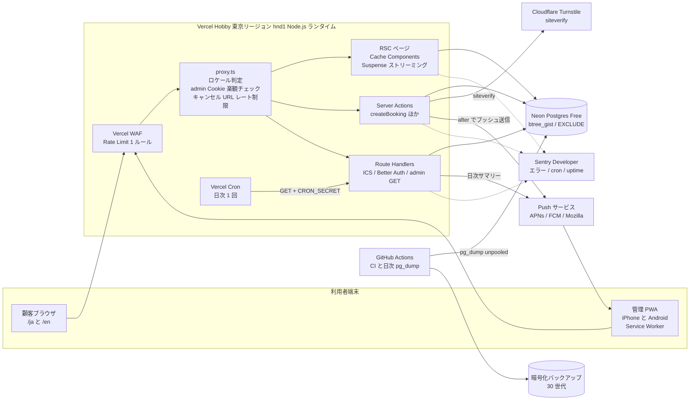

# 00 設計概要 — 設計方針・全体構成・ランタイム／キャッシュ・環境変数・リポジトリ構成

## 文書情報

| 項目 | 内容 |
|---|---|
| 文書 ID | DES-00 |
| 版 | v0.1 |
| 日付 | 2026-10-10 |
| 作成者 | 開発者（フリーランス） |
| 関連要件 | FR-S-01〜14、NFR-AV-01〜05、NFR-PF-01〜06、NFR-OP-01〜08、NFR-MG-01〜05、NFR-SC-01〜10、NFR-EN-01〜07、PRE-01〜08、CON-01〜08 |
| 上位文書 | `docs/02_requirements/requirements.md`（REQ-001 v0.2）、`docs/01_plan/project_plan.md`（PLAN-001 v0.3） |
| 凡例 | 【要確認】＝要件定義書 14 章の未決事項（OI-xx）に対応。ID は要件定義書の FR-/NFR-/S-/AT- をそのまま参照する |

### 変更履歴

| 版 | 日付 | 変更内容 |
|---|---|---|
| v0.1 | 2026-10-10 | 初版（WF 工程前の設計ドラフト。M3 で承認予定） |

---

## 1. 設計方針

| # | 方針 | 具体化 | 関連要件 |
|---|---|---|---|
| D-01 | **二重予約は DB が最終防衛線** | `bookings.during tstzrange` に `EXCLUDE USING gist`、半開区間 CHECK、冪等性キーの部分 UNIQUE。アプリの空き計算は UX のための前段に過ぎない | FR-S-01, FR-C-10 |
| D-02 | **書き込みは Server Action、読み取りは RSC** | 公開 REST API は作らない。Route Handler は ICS・Cron・認証・管理 PWA のポーリング用 GET に限定 | FR-C-10, NFR-SC-02, ADR-0004 |
| D-03 | **安価な検証を先に** | Zod → ハニーポット → レート制限 → Turnstile → トランザクション の順。高価な外部呼び出し（siteverify）と DB 書き込みは最後 | FR-C-10, FR-S-04, FR-S-05 |
| D-04 | **空き枠はキャッシュしない** | メニュー・営業時間・設定のみ `"use cache"`。空き枠と管理一覧は `<Suspense>` 配下で毎回 DB を読む | FR-S-12, FR-C-07 |
| D-05 | **タイムゾーンは Asia/Tokyo 固定** | DB は `timestamptz`（UTC 格納）、計算と表示は IANA 名 `Asia/Tokyo`。フォームは `+09:00` 付き ISO 文字列で送る | FR-C-08, NFR-EN-07, ADR-0005 |
| D-06 | **ドメイン非依存** | 絶対 URL はサーバー専用 `SITE_URL` から `absoluteUrl()` で組み立てる。DB にはトークンハッシュと相対パスだけを置く | FR-S-10, NFR-MG-01, ADR-0001 |
| D-07 | **ホスティングの最小公約数で設計** | Vercel Hobby の制約（cron 1 日 1 回 ±59 分、WAF 1 ルール、ログ 1 時間、ロールバック直前 1 件）の内側で全 Must が成立する設計にし、Pro／Cloudflare へは環境変数と DNS だけで移れるようにする | PRE-08, CON-02, ADR-0001 |
| D-08 | **通知は best-effort を前提に多層化** | Web Push（出荷版 Declarative 形式）＋未確認バッジ＋可視時 20 秒ポーリング＋日次サマリー | FR-A-09〜12, FR-S-03, ADR-0007 |
| D-09 | **個人情報は最小・分離・ログ禁止** | 氏名・電話は `customers` のみに保持（予約行には持たない）。ログ・通知ペイロード・監査ログに電話番号を書かない | NFR-SC-07, 10.3, ADR-0008 |
| D-10 | **設定はデータ、ルールはコード** | 営業時間・休業日・メニュー・枠ルールは DB（管理画面で変更）。空き計算・料金計算・状態遷移は純粋関数＋契約テスト | NFR-OP-06, FR-S-02 |
| D-11 | **feature 単位の凝集と境界の機械的担保** | `src/features/*` 間の import 禁止（共有ドメインは `src/domain/`）、DAL は `server-only`、`process.env` は `src/lib/env.ts` 経由のみ | NFR-OP-07, NFR-SC-02 |

---

## 2. 全体構成図



### 2.1 構成要素と責務

| 要素 | 責務 | 主な技術 | プラン・制約 | 関連 |
|---|---|---|---|---|
| 顧客サイト | トップ、予約フロー（S-C-02〜05）、キャンセル、ポリシー | Next.js 16.4 App Router、React 19、next-intl 4、Tailwind v4 | SW を登録しない | FR-C-01〜16 |
| 管理 PWA | 今日・週・受信箱・設定、手動予約、ブロック、通知購読 | 同上＋手書き最小 SW（`/public/sw.js`）、`app/manifest.ts` | `start_url: /admin`、`scope: /admin` | FR-A-01〜18 |
| proxy.ts | next-intl のロケール交渉、`/admin` の Cookie 有無チェック（楽観）、`/{locale}/cancel/*` と `/api/ics/*` の IP レート制限、`/admin` の CSP nonce 付与 | Node ランタイム固定 | 認可の本体ではない（各アクションで再検証） | FR-C-13, FR-S-04, NFR-SC-02 |
| Server Actions | 予約確定・キャンセル・管理操作のすべての書き込み | Zod 4、Drizzle、`after()` | 本文 1 MB、POST のみ、Origin/Host 照合 | 06_api.md |
| Route Handlers | ICS、Cron、Better Auth、管理 PWA のポーリング・サジェスト・重なり確認（GET） | — | `Cache-Control: no-store` | 06_api.md |
| Vercel Cron | 日次サマリー、保存期間ジョブ、ハウスキーピング | `vercel.json` の `crons` | Hobby: 1 日 1 回・±59 分・UTC | FR-A-12, FR-S-09 |
| Vercel WAF | `/{locale}/cancel/*`・予約 Server Action への IP 単位の粗い制限 | Rate Limiting ルール | Hobby: 1 ルール、固定窓 10 秒〜10 分 | FR-S-04 |
| Neon Postgres | 永続データ、排他制約、空き計算 SQL | PostgreSQL 17、`btree_gist`、ドライバ `pg`（プール接続） | Free: 100 CU-h/月、1 GB、5 分で scale to zero、履歴 6 時間 | FR-S-01, FR-S-02, NFR-AV-02 |
| Push サービス | 管理者端末への通知配信 | `web-push` 3.6.7（VAPID 固定） | iOS はホーム画面アプリのみ | FR-S-03 |
| Turnstile | Bot 判定（非対話型） | ウィジェット＋siteverify | トークン 300 秒・単回使用 | FR-S-05 |
| Sentry | 例外、cron モニタ、uptime モニタ | `@sentry/nextjs`、`tunnelRoute: /monitoring` | Developer（各モニタ 1） | FR-S-11 |
| GitHub Actions | CI（型・lint・テスト・E2E・axe・Lighthouse）、日次バックアップ | `pg_dump --format=custom` → `age` 暗号化 | Actions は SHA ピン留め | FR-S-08, NFR-OP-07 |

### 2.2 環境（ブランチと DB）

| 環境 | Git | URL | DB | 保護 | 用途 |
|---|---|---|---|---|---|
| production | `main` | `*.vercel.app`（後日独自ドメイン） | Neon `main` ブランチ | なし（公開） | 本番 |
| staging | `staging` | 固定 Preview URL（`*-git-staging-*.vercel.app`） | Neon `staging` ブランチ | Vercel Authentication | 検収（AT-01〜31） |
| preview | PR ごと | 自動生成 URL | Neon Preview ブランチ（Marketplace 連携で自動） | Vercel Authentication、E2E は `x-vercel-protection-bypass` | レビュー・CI E2E |
| local | — | `https://localhost:3000`（`next dev --experimental-https`） | Docker Postgres 17 または Neon dev ブランチ | — | 開発。iOS 実機テストは staging で行う |

関連: FR-S-13、NFR-SC-09。

---

## 3. ランタイム・レンダリング・キャッシュ方針

### 3.1 ランタイム

- 全ルート Node.js ランタイム（Next.js 16 で `proxy.ts` は Node 固定、`runtime: 'edge'` は使わない）。Node 24 LTS。
- 関数リージョン `hnd1`（東京）。Neon のリージョンも `aws-ap-northeast-1` に揃える。（Hobby でのリージョン指定は初回デプロイ時にダッシュボードで確認する）
- `next.config.ts`: `cacheComponents: true`、`partialPrefetching: true`（明示しないと警告）、`typedRoutes: true`、`serverActions.bodySizeLimit` は既定 1 MB のまま。

### 3.2 データ種別ごとのキャッシュ方針

| データ | 取得場所 | キャッシュ | 無効化 | 理由 | 関連 |
|---|---|---|---|---|---|
| メニュー一覧（公開分） | `features/settings/queries.ts` `getActiveMenus()` | `"use cache"` + `cacheTag('menus')` + `cacheLife('days')` | 管理アクションで `updateTag('menus')` | 変更は稀。トップ・メニュー表示を静的シェルに含める | FR-C-02, FR-A-08, FR-S-12 |
| 営業時間テンプレート・休業日オーバーライド | `getBusinessCalendar()` | `"use cache"` + `cacheTag('hours')` + `cacheLife('days')` | `updateTag('hours')` | トップの「受付時間」表示用 | FR-A-07, FR-S-12 |
| 設定（枠刻み・締切など表示用） | `getPublicSettings()` | `"use cache"` + `cacheTag('settings')` + `cacheLife('days')` | `updateTag('settings')` | 締切文言（「60 分前まで」）の表示用 | FR-C-07 |
| **空き枠** | `features/availability/queries.ts` `getAvailability()` | **キャッシュしない**。`<Suspense fallback={<SlotListSkeleton/>}>` 配下 | — | 鮮度が要件（他ブラウザの予約直後に消える） | FR-C-07, FR-S-12 |
| 予約確定時の枠再検証 | Server Action 内 | キャッシュしない（menus・hours も DB から直接 JOIN） | — | キャッシュ値で検証すると古い所要時間で予約できてしまう | FR-S-02 |
| 完了・キャンセル画面の予約内容 | `getBookingByToken()` | キャッシュしない（`await connection()`） | — | トークン依存・状態依存 | FR-C-11, FR-C-12 |
| 管理画面すべて | `features/admin-*/queries.ts` | キャッシュしない（`cookies()` 参照で動的） | 書き込み後は Server Action の戻りで `refresh()` | 常に最新 | FR-A-02〜14 |
| 未確認件数 | `GET /api/admin/inbox-count` | `Cache-Control: no-store`。クライアントは TanStack Query `refetchInterval: 20000`、`refetchIntervalInBackground: false` | — | ポーリング | FR-A-11 |

注意事項:

- `"use cache"` のランタイムキャッシュはサーバーレスではインスタンス内 LRU でリクエスト間に持続しない前提とし、効果の本体は「静的シェルへの焼き込み」とする。`updateTag` は Server Action 専用（即時失効）。`refresh()` はタグ付きデータを再検証しない。
- 空き枠ページの日付リンクは前後数日分のみ `<Link prefetch={true}>`（per-link prefetch はリンク 1 本につきサーバー呼び出し 1 回のため）。
- `"use cache"` 関数はビルド時に DB を読むため、Vercel の各環境に `DATABASE_URL` が必要（Neon Marketplace 連携で自動注入）。
- CI で `ensureStatic` を使い、公開ページのシェルが静的に保たれていることを検査する（管理画面は対象外）。

### 3.3 ルート別レンダリング

| ルート | 種別 | 静的シェル | 動的ホール | 関連画面 |
|---|---|---|---|---|
| `/{locale}` | 静的（`generateStaticParams` で ja/en） | ヘッダー、ヒーロー、メニュー概要、アクセス | なし | S-C-01 |
| `/{locale}/book` | 静的シェル＋クライアントフォーム | ステッパー、メニューカード（cache） | なし（入力はクライアント状態） | S-C-02 |
| `/{locale}/book/time` | PPR | ステッパー、凡例、締切文言 | 週ストリップの日状態・時間枠（Suspense） | S-C-03 |
| `/{locale}/book/confirm` | 静的シェル＋クライアント | 同意文言、ポリシーリンク | なし（下書きから描画） | S-C-04 |
| `/{locale}/book/done/[token]` | 動的 | 最小ヘッダー | 予約カード | S-C-05 |
| `/{locale}/cancel/[token]` | 動的 | 最小ヘッダー | 予約内容・締切判定 | S-C-06 |
| `/{locale}/privacy`・`/policy` | 静的 | 全文 | なし | S-C-08, S-C-09 |
| `/admin/**` | 動的（`connection()`） | AdminShell（タブ・ヘッダー） | 全データ | S-A-01〜12 |

---

## 4. 環境変数一覧

`src/lib/env.ts`（`@t3-oss/env-nextjs` + Zod）で検証し、`next.config.ts` 冒頭で import してビルド時に欠落を検出する。`process.env` を直接参照してよいのは `env.ts` のみ。`NEXT_PUBLIC_` はビルド時に固定されるため、公開値（VAPID 公開鍵・Turnstile サイトキー）も原則サーバーから props で渡す（CON-05）。

| 変数 | 区分 | 必須 | 設定先 | 用途 | 例・形式 | 関連 |
|---|---|---|---|---|---|---|
| `SITE_URL` | server | 本番・staging 必須 | Vercel（環境別） | 絶対 URL の生成（完了・キャンセル URL、ICS、通知の `navigate`、`metadataBase`、Better Auth `baseURL`、passkey `rpID`） | `https://xxxx.vercel.app`（末尾スラッシュなし） | FR-S-10 |
| `DATABASE_URL` | server | 必須 | Neon 連携で自動注入 | アプリの DB 接続（プール経由 `-pooler`） | `postgresql://…-pooler…/neondb?sslmode=require` | — |
| `DATABASE_URL_UNPOOLED` | server | 必須 | Neon 連携で自動注入／GitHub Secrets | マイグレーション、`pg_dump`/`pg_restore` | 直結エンドポイント | FR-S-08 |
| `BETTER_AUTH_SECRET` | server | 必須 | Vercel | セッション署名・暗号化 | 32 バイト以上の乱数 | FR-A-01 |
| `ADMIN_EMAIL` | server | seed 時 | ローカル／CI | 初回管理者ユーザーの作成（サインアップ無効のため） | — | FR-A-01 |
| `RESEND_API_KEY` | server | 任意【要確認: OI-12】 | Vercel | マジックリンク（フォールバック）送信 | — | FR-A-01 |
| `VAPID_PUBLIC_KEY` | server（クライアントへは props） | 必須 | Vercel | `applicationServerKey` | base64url | FR-A-09 |
| `VAPID_PRIVATE_KEY` | server | 必須 | Vercel | Push 署名。**一度生成したら変更しない**（変更すると全購読が無効） | base64url | FR-S-03 |
| `VAPID_SUBJECT` | server | 必須 | Vercel | VAPID の連絡先。Safari は `https://localhost` を拒否 | `mailto:…` または `https://…` | FR-S-03 |
| `CRON_SECRET` | server | 必須 | Vercel | Cron の `Authorization: Bearer` 照合 | 32 バイト以上 | FR-A-12 |
| `TURNSTILE_SITE_KEY` | server（クライアントへは props） | 必須 | Vercel | ウィジェット | — | FR-S-05 |
| `TURNSTILE_SECRET_KEY` | server | 必須 | Vercel | siteverify | — | FR-S-05 |
| `PII_HASH_SECRET` | server | 必須 | Vercel | IP・電話番号の HMAC（`rate_limits.key`、`audit_log` の電話末尾ハッシュ） | 32 バイト以上 | FR-S-04, FR-S-07 |
| `SENTRY_DSN` | server | 必須 | Vercel | サーバー側エラー送信 | — | FR-S-11 |
| `NEXT_PUBLIC_SENTRY_DSN` | public | 必須 | Vercel | ブラウザ側エラー送信（DSN は秘密ではないため例外的に `NEXT_PUBLIC_`） | — | FR-S-11 |
| `SENTRY_AUTH_TOKEN` | build | 必須 | Vercel（Build） | ソースマップのアップロード | — | FR-S-11 |
| `SENTRY_CSP_REPORT_URI` | server | 任意 | Vercel | CSP 違反レポートの送信先 | Sentry Security endpoint | NFR-SC-06 |
| `BACKUP_AGE_RECIPIENT` | CI | 必須 | GitHub Secrets（environment: backup） | バックアップの暗号化公開鍵 | `age1…` | FR-S-08 |
| `VERCEL_AUTOMATION_BYPASS_SECRET` | system/CI | 必須（CI） | Vercel 自動／GitHub Secrets | 保護された Preview への E2E | — | FR-S-13 |
| `VERCEL_ENV`・`VERCEL_PROJECT_PRODUCTION_URL` | system | 自動 | Vercel | `SITE_URL` 未設定時のフォールバック（ローカル・Preview） | — | FR-S-10 |

`SITE_URL` の解決順: `SITE_URL` → `https://${VERCEL_PROJECT_PRODUCTION_URL}`（production のみ）→ `https://${VERCEL_URL}`（preview）→ `http://localhost:3000`。staging・production では `SITE_URL` 未設定をビルドエラーにする。

---

## 5. リポジトリ構成

```text
barber-booking/
├── AGENTS.md                      # 正本（構成・規約・コマンド・禁止事項）。CLAUDE.md は @AGENTS.md を参照
├── CLAUDE.md
├── biome.json / eslint.config.mjs # Biome（format+基本 lint）＋ ESLint flat（next, jsx-a11y, 境界ルール）
├── drizzle.config.ts
├── drizzle/                       # SQL マイグレーション（生成＋手書き custom）
│   ├── 0000_init.sql
│   ├── 0001_custom_extensions_and_exclusion.sql
│   └── meta/
├── messages/                      # next-intl メッセージ（07_components.md 6 章）
│   ├── ja.json
│   └── en.json
├── next.config.ts                 # headers(), cacheComponents, partialPrefetching
├── vercel.json                    # crons
├── public/
│   ├── sw.js                      # 手書き最小 SW（push / notificationclick / pushsubscriptionchange）
│   ├── icons/                     # PWA アイコン（maskable 含む）
│   └── textures/kraft.webp
├── scripts/
│   ├── seed.ts                    # 管理者・menus・business_hours・settings の初期投入
│   └── restore-check.sh           # 復元リハーサル補助
├── e2e/                           # Playwright（予約完走 JA/EN、同時送信、管理当日一覧、axe）
├── .github/workflows/
│   ├── ci.yml
│   └── backup.yml
└── src/
    ├── proxy.ts
    ├── instrumentation.ts         # Sentry（server/edge 初期化）
    ├── instrumentation-client.ts
    ├── app/
    │   ├── (public)/[locale]/
    │   │   ├── layout.tsx         # <html lang>、NextIntlClientProvider、Header/Footer
    │   │   ├── page.tsx           # S-C-01
    │   │   ├── book/
    │   │   │   ├── layout.tsx     # BookingDraftProvider（クライアント状態を S-C-02〜04 で共有）
    │   │   │   ├── page.tsx       # S-C-02
    │   │   │   ├── time/page.tsx  # S-C-03
    │   │   │   ├── confirm/page.tsx      # S-C-04
    │   │   │   └── done/[token]/page.tsx # S-C-05
    │   │   ├── cancel/[token]/page.tsx   # S-C-06
    │   │   ├── privacy/page.tsx   # S-C-08
    │   │   ├── policy/page.tsx    # S-C-09（キャンセルポリシー＋特商法表記）
    │   │   ├── not-found.tsx      # S-C-10
    │   │   └── error.tsx          # S-C-10
    │   ├── (admin)/admin/
    │   │   ├── layout.tsx         # <html lang="ja">、AdminShell、QueryClientProvider、SW 登録
    │   │   ├── login/page.tsx     # S-A-01
    │   │   ├── install/page.tsx   # S-A-12
    │   │   ├── page.tsx           # S-A-02
    │   │   ├── week/page.tsx      # S-A-03
    │   │   ├── inbox/page.tsx     # S-A-07
    │   │   ├── bookings/new/page.tsx   # S-A-05
    │   │   ├── bookings/[id]/page.tsx  # S-A-04
    │   │   ├── blocks/new/page.tsx     # S-A-06
    │   │   ├── settings/hours/page.tsx # S-A-08
    │   │   ├── settings/menus/page.tsx # S-A-09
    │   │   ├── settings/notifications/page.tsx # S-A-10
    │   │   └── customers/{page.tsx,[id]/page.tsx} # S-A-11
    │   ├── api/
    │   │   ├── auth/[...all]/route.ts
    │   │   ├── ics/[token]/route.ts            # S-C-07
    │   │   ├── cron/daily-digest/route.ts
    │   │   ├── cron/retention/route.ts         # Should（FR-S-09）
    │   │   └── admin/{inbox-count,overlaps,customers/suggest}/route.ts
    │   ├── manifest.ts
    │   ├── robots.ts
    │   ├── sitemap.ts
    │   └── global-not-found.tsx   # ロケール外の 404
    ├── features/                  # 機能単位。features 間 import 禁止
    │   ├── booking/               # 予約確定・キャンセル・完了（顧客側）
    │   │   ├── actions.ts         # 'use server'（薄く、service に委譲）
    │   │   ├── schema.ts          # Zod（フォームとサーバーで共有）
    │   │   ├── service.ts         # server-only。トランザクション・エラー写像
    │   │   ├── queries.ts         # server-only。DAL（DTO を返す）
    │   │   ├── ics.ts
    │   │   ├── components/        # BookingForm 各ステップ、CheckAnswers、DoneCard …
    │   │   └── __tests__/
    │   ├── availability/          # 空き枠取得（SQL）と WeekStrip/SlotList
    │   ├── admin-calendar/        # 今日・週・受信箱・予約詳細・状態変更・手動予約
    │   ├── blocks/                # 時間ブロック
    │   ├── settings/              # 営業時間・休業日・メニュー・枠ルール
    │   ├── customers/             # 顧客一覧・名寄せ・エクスポート・匿名化（Should）
    │   ├── notifications/         # Push 送信・購読・日次サマリー・SW クライアント
    │   └── auth/                  # ログイン画面・セッション管理
    ├── domain/                    # 複数 feature が使う純粋ドメイン（依存なし・契約テスト対象）
    │   ├── availability.ts        # 候補枠生成・境界判定（SQL と同じ規則の TS 版。テスト用オラクル）
    │   ├── pricing.ts             # 学割適用
    │   ├── booking-status.ts      # 状態遷移表とガード
    │   ├── phone.ts               # 正規化・E.164
    │   ├── kana.ts                # カタカナ→ひらがな正規化
    │   └── time.ts                # Temporal（temporal-polyfill）による JST 変換・整形補助
    ├── components/ui/             # 汎用 UI プリミティブ（07_components.md）
    ├── lib/
    │   ├── db/{index.ts,schema.ts,custom-types.ts}
    │   ├── env.ts
    │   ├── auth.ts                # Better Auth 設定、requireAdmin()
    │   ├── i18n/{routing.ts,request.ts,navigation.ts}
    │   ├── rate-limit.ts
    │   ├── turnstile.ts
    │   ├── tokens.ts              # キャンセルトークン発行・照合
    │   ├── hash.ts                # HMAC（PII_HASH_SECRET）
    │   ├── site.ts                # SITE_URL, absoluteUrl()
    │   ├── audit.ts
    │   ├── pg-errors.ts           # 23P01 / 23505 の判別（制約名で区別）
    │   └── logger.ts              # PII マスキング付きロガー
    ├── config/shop.ts             # 店名・住所・電話・地図 URL・担当者名【要確認: OI-08/09/10】
    └── styles/globals.css         # デザイントークン 3 層（07_components.md 5 章）
```

### 5.1 依存ルール（lint で強制）

| from → to | 可否 | 手段 |
|---|---|---|
| `app/**` → `features/*`, `components/ui`, `lib`, `domain` | 可 | — |
| `features/A` → `features/B` | **不可** | ESLint `import/no-restricted-paths` |
| `features/*` → `domain`, `lib`, `components/ui` | 可 | — |
| `domain/*` → それ以外 | **不可**（純粋関数のみ。`temporal-polyfill` のみ許可） | 同上 |
| Client Component → `*/service.ts`, `*/queries.ts`, `lib/db` | **不可** | `import 'server-only'` |
| 任意 → `process.env` | `lib/env.ts` 以外は不可 | Biome `noProcessEnv` |

---

## 6. 品質ゲート（設計上の前提）

| ゲート | 内容 | 関連 |
|---|---|---|
| 型・lint | `tsc --noEmit`（TS 7）、`biome ci`、`eslint` | NFR-OP-07 |
| 契約テスト | `domain/availability.ts` と SQL の結果一致（営業時間境界・定休日・60/90 分・バッファ・JST/UTC 日付境界・リードタイム・上限日） | FR-S-02 |
| DB 統合 | `Promise.all` で同一枠 2 INSERT → 1 件が `23P01`。19:00 終了と 19:00 開始は両立 | FR-S-01, AT-03 |
| E2E | 予約完走 JA/EN、同時送信、キャンセル、管理当日一覧、axe（`wcag2a`/`wcag2aa`/`wcag22aa`） | AT-01〜10, AT-25 |
| 性能 | Lighthouse CI（performance ≥ 0.9 警告、accessibility = 1 エラー）、First Load JS 予算 | NFR-PF-01, 02 |

---

## 7. 設計書の読み方

| 順 | 文書 | 何が分かるか | 主な読者 |
|---|---|---|---|
| 1 | `00_overview.md`（本書） | 方針、構成、キャッシュ、環境変数、フォルダ | 全員 |
| 2 | `01_sitemap.md` | URL 体系、i18n ルーティング、SEO | 開発者・クライアント |
| 3 | `02_screens.md` | 画面一覧（ID・ルート・データ・アクション）、画面遷移図 | クライアント・WF 作成 |
| 4 | `03_screen_specs.md` | 主要画面の項目・検証・操作→処理・状態 | WF・実装・テスト |
| 5 | `04_data_model.md` | ER 図、完全 DDL、空き計算 SQL、匿名化 | 実装 |
| 6 | `05_state_and_flows.md` | 状態遷移、確定・キャンセル・Cron・Push のシーケンス | 実装・テスト |
| 7 | `06_api.md` | Server Action / Route Handler の入出力・エラー | 実装・テスト |
| 8 | `07_components.md` | コンポーネント、境界、トークン、メッセージ名前空間 | 実装・デザイン |
| 9 | `08_security.md` | 脅威モデル、ヘッダー、レート制限、バックアップ | 実装・運用 |
| 10 | `adr/` | 技術判断の理由と代替案 | 保守・引継ぎ |

読み方の約束:

- 要件 ID（FR-/NFR-/S-/AT-/OI-）は要件定義書の定義を正とする。本書群で ID を新設するのは設計要素（DES-xx、D-xx、コンポーネント名、エラーコード）のみ。
- 【要確認】は要件定義書 14 章の OI 番号を併記する。確定時は該当箇所と 04_data_model.md の seed 値を更新する。
- コード片は設計意図を示すための抜粋で、実装の正本はリポジトリとする。差分が生じた場合は ADR か本書の変更履歴に残す。

### 7.1 要件定義書との差分（設計で確定・補足したもの）

| # | 項目 | 要件定義書 | 設計での扱い | 根拠 |
|---|---|---|---|---|
| G-01 | 本番ホスティング | PRE-08 / 11 章: Vercel Pro 前提 | 計画書 v0.3 A-08（決定済み）に従い **Phase 1 本番は Vercel Hobby**。Hobby 制約内で全 Must が成立する設計とし、Pro／Cloudflare 移行は環境変数と DNS のみ | ADR-0001 |
| G-02 | 日次サマリーの時刻精度 | FR-A-12 受入基準: 21:00 ±1 分 | Hobby では 21:00〜21:59 JST（±59 分）。Pro 移行時に ±1 分を満たす。計画書 C-01 で受容済み | ADR-0001, ADR-0007 |
| G-03 | 冪等性キーの UNIQUE | FR-S-01: `idempotency_key` UNIQUE | **有効状態の予約に限定した部分 UNIQUE**（キャンセル後に同じ人が同じ枠を取り直せるようにする） | 04_data_model.md |
| G-04 | `23505` 時に既存予約を返す | FR-C-10 | 同一ブラウザの再送（`submission_nonce` 一致）のときだけ既存予約の完了 URL を返す。不一致なら `duplicate` を返し予約内容を開示しない（電話番号と枠を知る第三者によるキャンセル URL 取得を防ぐ） | 08_security.md T-05 |
| G-05 | 予約番号 | FR-C-11 で表示必須、10 章に列なし | `bookings.public_code`（推測困難な 8 文字、UNIQUE）を追加 | 04_data_model.md |
| G-06 | 予約行の顧客スナップショット | 10.1【要確認: ADR で決定】 | スナップショット列を持たない（`customers` が唯一の保持先） | ADR-0008 |
| G-07 | ブロックと予約の相互排他 | FR-A-06（同一トランザクションで確認） | 予約・ブロック作成の両トランザクションで `pg_advisory_xact_lock` を取り、write skew を防ぐ | 05_state_and_flows.md 4 章 |
| G-08 | 通知設定・オンボーディング画面の ID | 8.2: S-A-10（通知・端末）、S-A-12（インストール案内）、S-A-09 はメニュー設定 | ID は要件どおり。S-A-10 と S-A-12 を 03_screen_specs.md 9 章で一体の仕様として記述 | 02_screens.md, 03_screen_specs.md |
| G-09 | Push の `topic` | FR-S-03 / FR-A-10: `topic: booking-<id>` | Push サービスの制約（URL-safe base64 文字・32 文字以内）を満たすため `b` + base64url(UUID 16 バイト)（23 文字）に読み替える | 05_state_and_flows.md 7.1 |
