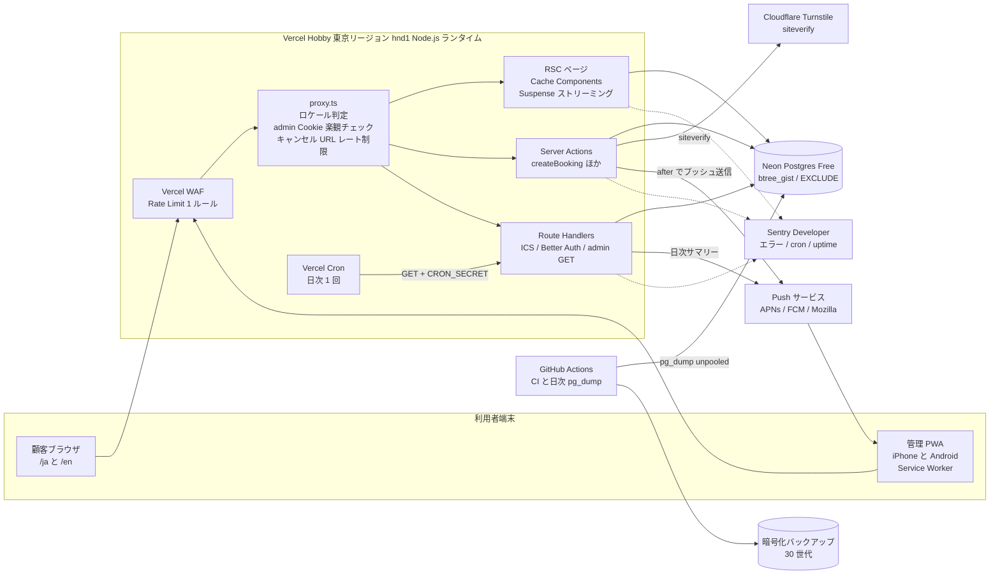

# 00 設計概要 — 設計方針・全体構成・ランタイム／キャッシュ・環境変数・リポジトリ構成

## 文書情報

| 項目 | 内容 |
|---|---|
| 文書 ID | DES-00 |
| 版 | v0.5 |
| 日付 | 2026-10-12 |
| 作成者 | 開発者（フリーランス） |
| 関連要件 | FR-S-01〜14、NFR-AV-01〜05、NFR-PF-01〜06、NFR-OP-01〜08、NFR-MG-01〜05、NFR-SC-01〜10、NFR-EN-01〜07、PRE-01〜08、CON-01〜08 |
| 上位文書 | `docs/02_requirements/requirements.md`（REQ-001 v0.7）、`docs/01_plan/project_plan.md`（PLAN-001 v0.5） |
| 凡例 | 【要確認】＝要件定義書 14 章の未決事項（OI-xx）に対応。ID は要件定義書の FR-/NFR-/S-/AT- をそのまま参照する |

### 変更履歴

| 版 | 日付 | 変更内容 |
|---|---|---|
| v0.1 | 2026-10-10 | 初版（WF 工程前の設計ドラフト。M3 で承認予定） |
| v0.2 | 2026-10-10 | 要件定義書 v0.4 の反映: 予約ルートに `/book/info`（S-C-02b）を追加（OI-19）、`RESEND_API_KEY` の用途をワンタイムコード送信に（OI-12） |
| v0.3 | 2026-10-12 | 要件定義書 v0.5 の反映: `/{locale}/book/time` の動的ホールを月カレンダーの日状態＋選択日の時間枠に（F2）、トップの静的シェルからヒーロー文言を外し写真のみに（F1）、`config/shop.ts` の電話を Instagram アカウントに置換（F3、OI-10 決定済み） |
| v0.5 | 2026-10-12 | レビュー修正の反映: キャッシュタグを `lib/cache-tags.ts` の `CACHE_TAGS`（`menus`・`settings`・`business-hours`）に統一（3.2 の不整合を解消）、空き状況 DAL の React `cache()` による同一リクエスト内の重複排除（TODO を解消）と JIT の無効化、`engines.node >=22.13.0`、CI が顧客 E2E を実行し Postgres を digest で固定（2.1・6 章）、4 章の環境変数を fail closed の必須判定（本番モードと Vercel preview。`src/lib/env-schema.ts`）に合わせ `ADMIN_EMAIL`・`RESEND_API_KEY`・`RESEND_FROM` を本番必須に、`CSP_ENFORCE`・`TURNSTILE_VERIFY_URL`（テスト専用）を追加、5 章に `0004_consent_ip_hash.sql`・`/api/csp-report` と新しい `lib`・`domain` モジュール、G-04 の不一致時の応答を `conflict: slot_taken` に |
| v0.4 | 2026-10-12 | 実装との同期: TypeScript 6.0・`engines.node >=22.12`（`.nvmrc` 24）・ドライバ `pg` のみ・happy-dom（ADR-0009、G-10）、manifest を Route Handler で配信、`experimental.globalNotFound`・`next/root-params`、3.2 のキャッシュタグと取得関数名、3.3 のルート（`/tokusho`・キャッチオール）、4 章の環境変数を `src/lib/env.ts`・`.env.example` に合わせ `RESEND_FROM` を追加、5 章のリポジトリ構成を現状に更新、6 章の品質ゲートの実装状況 |

---

## 1. 設計方針

| # | 方針 | 具体化 | 関連要件 |
|---|---|---|---|
| D-01 | **二重予約は DB が最終防衛線** | `bookings.during tstzrange` に `EXCLUDE USING gist`、半開区間 CHECK、冪等性キーの部分 UNIQUE。アプリの空き計算は UX のための前段に過ぎない | FR-S-01, FR-C-10 |
| D-02 | **書き込みは Server Action、読み取りは RSC** | 公開 REST API は作らない。Route Handler は ICS・Cron・認証・管理 PWA の GET（ポーリング・サジェスト・重なり・空き開始時刻）と SW からの購読置換 POST（`/api/admin/push/rotate`）に限定 | FR-C-10, NFR-SC-02, ADR-0004 |
| D-03 | **安価な検証を先に** | Zod → ハニーポット → レート制限 → Turnstile → トランザクション の順。高価な外部呼び出し（siteverify）と DB 書き込みは最後 | FR-C-10, FR-S-04, FR-S-05 |
| D-04 | **空き枠はキャッシュしない** | メニュー・営業時間・設定のみ `"use cache"`。空き枠と管理一覧は `<Suspense>` 配下で毎回 DB を読む | FR-S-12, FR-C-07 |
| D-05 | **タイムゾーンは Asia/Tokyo 固定** | DB は `timestamptz`（UTC 格納）、計算と表示は IANA 名 `Asia/Tokyo`。フォームは `+09:00` 付き ISO 文字列で送る | FR-C-08, NFR-EN-07, ADR-0005 |
| D-06 | **ドメイン非依存** | 絶対 URL はサーバー専用 `SITE_URL` から `absoluteUrl()` で組み立てる。DB にはトークンハッシュと相対パスだけを置く | FR-S-10, NFR-MG-01, ADR-0001 |
| D-07 | **ホスティングの最小公約数で設計** | Vercel Hobby の制約（cron 1 日 1 回 ±59 分、WAF 1 ルール、ログ 1 時間、ロールバック直前 1 件）の内側で全 Must が成立する設計にし、Pro／Cloudflare へは環境変数と DNS だけで移れるようにする | PRE-08, CON-02, ADR-0001 |
| D-08 | **通知は best-effort を前提に多層化** | Web Push（出荷版 Declarative 形式）＋未確認バッジ＋可視時 20 秒ポーリング＋日次サマリー | FR-A-09〜12, FR-S-03, ADR-0007 |
| D-09 | **個人情報は最小・分離・ログ禁止** | 氏名・電話は `customers` のみに保持（予約行には持たない）。ログ・通知ペイロード・監査ログに電話番号を書かない | NFR-SC-07, 10.3, ADR-0008 |
| D-10 | **設定はデータ、ルールはコード** | 営業時間・休業日・メニュー・枠ルールは DB（管理画面で変更）。空き計算・料金計算・状態遷移は純粋関数＋契約テスト | NFR-OP-06, FR-S-02 |
| D-11 | **feature 単位の凝集と境界の機械的担保** | `src/features/*` 間の import 禁止（共有ドメインは `src/domain/`）、DAL は `server-only`、`process.env` は `src/lib/env.ts` 経由のみ | NFR-OP-07, NFR-SC-02 |

---

## 2. 全体構成図



### 2.1 構成要素と責務

| 要素 | 責務 | 主な技術 | プラン・制約 | 関連 |
|---|---|---|---|---|
| 顧客サイト | トップ、予約フロー（S-C-02〜05）、キャンセル、ポリシー | Next.js 16.4 App Router、React 19、next-intl 4、Tailwind v4 | SW を登録しない | FR-C-01〜16 |
| 管理 PWA | 今日・週・受信箱・設定、手動予約、ブロック、通知購読 | 同上＋手書き最小 SW（`/public/sw.js`）、manifest は Route Handler（`app/manifest.webmanifest/route.ts`。管理レイアウトだけが `<link rel="manifest">` で参照） | `start_url: /admin`、`scope: /admin` | FR-A-01〜18 |
| proxy.ts | next-intl のロケール交渉、`/admin` の Cookie 有無チェック（楽観。login・install と Server Action の POST はリダイレクトしない）、`/{locale}/cancel/*`・`/{locale}/book/done/*` のページ表示の IP レート制限（`/api/ics/*` は matcher 外のため Route Handler 内で、キャンセルの Server Action は `cancelByToken` 内で同じキーを加算。proxy は Server Action の POST を数えない）、`/admin` の CSP nonce 付与 | Node ランタイム固定 | 認可の本体ではない（各アクションで再検証） | FR-C-13, FR-S-04, NFR-SC-02 |
| Server Actions | 予約確定・キャンセル・管理操作のすべての書き込み | Zod 4、Drizzle、`after()` | 本文 1 MB、POST のみ、Origin/Host 照合 | 06_api.md |
| Route Handlers | ICS、Cron、Better Auth、manifest、管理 PWA のポーリング・サジェスト・重なり確認・空き開始時刻（GET）、購読置換（POST） | — | `Cache-Control: no-store`（manifest を除く） | 06_api.md |
| Vercel Cron | 日次サマリー、保存期間ジョブ、ハウスキーピング | `vercel.json` の `crons` | Hobby: 1 日 1 回・±59 分・UTC | FR-A-12, FR-S-09 |
| Vercel WAF | `/{locale}/cancel/*`・`/{locale}/book/(confirm\|time)`（予約 Server Action・毎回 DB を読む空き表示）・`/api/ics/*` への IP 単位の粗い制限 | Rate Limiting ルール | Hobby: 1 ルール、固定窓 10 秒〜10 分 | FR-S-04 |
| Neon Postgres | 永続データ、排他制約、空き計算 SQL | PostgreSQL 17（ローカル・CI は 16。SQL は 16 以上で動く形にする）、`btree_gist`・`pg_trgm`、ドライバは `pg`（node-postgres の Pool）のみ（ADR-0002、ADR-0009） | Free: 100 CU-h/月、1 GB、5 分で scale to zero、履歴 6 時間 | FR-S-01, FR-S-02, NFR-AV-02 |
| Push サービス | 管理者端末への通知配信 | `web-push` 3.6.7（VAPID 固定） | iOS はホーム画面アプリのみ | FR-S-03 |
| Turnstile | Bot 判定（非対話型） | ウィジェット＋siteverify | トークン 300 秒・単回使用 | FR-S-05 |
| Sentry | 例外、cron モニタ、uptime モニタ | `@sentry/nextjs`、`tunnelRoute: /monitoring`（**未導入**。依存・`instrumentation.ts` は後続スライスで追加。現状はロガー `lib/logger.ts` の構造化ログのみ） | Developer（各モニタ 1） | FR-S-11 |
| GitHub Actions | CI（`npm audit`・型・lint・Vitest〔unit・DOM・DB 統合〕・build・顧客 E2E〔`test/e2e/run.mjs` を `NODE_ENV=production` の `next start` で実行。Playwright 1.56.1 は CI で `--no-save` 導入〕。axe・Lighthouse は未組み込み）、日次バックアップ（`backup.yml`、08_security.md 10 章） | `pg_dump --format=custom` → `age` 暗号化（`BACKUP_PASSPHRASE` があれば gpg 対称暗号に切替） | Actions は SHA ピン留め、Postgres 16 のサービスコンテナは digest（`postgres:16@sha256:…`）で固定 | FR-S-08, NFR-OP-07 |

### 2.2 環境（ブランチと DB）

| 環境 | Git | URL | DB | 保護 | 用途 |
|---|---|---|---|---|---|
| production | `main` | `*.vercel.app`（後日独自ドメイン） | Neon `main` ブランチ | なし（公開） | 本番 |
| staging | `staging` | 固定 Preview URL（`*-git-staging-*.vercel.app`） | Neon `staging` ブランチ | Vercel Authentication | 検収（AT-01〜31） |
| preview | PR ごと | 自動生成 URL | Neon Preview ブランチ（Marketplace 連携で自動） | Vercel Authentication、E2E は `x-vercel-protection-bypass` | レビュー・CI E2E |
| local | — | `http://localhost:3000`（`npm run dev`。HTTP のため管理 Cookie は `bb.*`、08_security.md 4 章） | `scripts/db-local.sh` のローカルクラスタ（`.local/pg`、ポート 54329、Docker 不要。`barber_dev` / `barber_test`）または Neon dev ブランチ | — | 開発。iOS 実機テストは staging で行う |

関連: FR-S-13、NFR-SC-09。

---

## 3. ランタイム・レンダリング・キャッシュ方針

### 3.1 ランタイム

- 全ルート Node.js ランタイム（Next.js 16 で `proxy.ts` は Node 固定、`runtime: 'edge'` は使わない）。本番・CI は Node 24 LTS（`.nvmrc`）、`package.json` の `engines.node` は `>=22.13.0`（ADR-0009）。
- 関数リージョン `hnd1`（東京）。Neon のリージョンも `aws-ap-northeast-1` に揃える。（Hobby でのリージョン指定は初回デプロイ時にダッシュボードで確認する）
- `next.config.ts`: `cacheComponents: true`、`partialPrefetching: true`（明示しないと警告）、`typedRoutes: true`、`poweredByHeader: false`、`experimental.globalNotFound: true`（ルートレイアウトが `(public)/[locale]` と `(admin)/admin` の 2 つあるため `app/global-not-found.tsx` を使う）、`serverActions.bodySizeLimit` は既定 1 MB のまま。`next.config.ts` は Next から渡されたフェーズを使い、`src/lib/env-schema.ts` の `parseServerEnv()` で環境変数を検証する（`next build` は秘密なしで通し、`next start`／`next dev` は完全に検証する。4 章）。
- ロケールは `next/root-params` の `locale()` で取得する（`setRequestLocale` の代わり。Cache Components と両立）。

### 3.2 データ種別ごとのキャッシュ方針

| データ | 取得場所 | キャッシュ | 無効化 | 理由 | 関連 |
|---|---|---|---|---|---|
| メニュー一覧（公開分） | `features/settings/queries.ts` `getActiveMenus()` | `"use cache"` + `cacheTag('menus')` + `cacheLife('days')` | 管理アクションで `updateTag('menus')` | 変更は稀。予約フロー（S-C-02〜04）のメニュー表示を静的シェルに含める | FR-C-02, FR-A-08, FR-S-12 |
| メニュー一覧（トップ用、非公開を含む全 9 件） | `features/booking/catalog.ts` `getMenuCatalog()` | `"use cache"` + `cacheTag('menus')` + `cacheLife('days')` | `updateTag('menus')` | トップの情報表示カード。価格未確定（`is_active=false`）は「¥—」で表示し予約不可 | FR-C-14 |
| 営業時間テンプレート（曜日 7 行） | `features/booking/catalog.ts` `getWeeklyHours()` | `"use cache"` + `cacheTag('business-hours')` + `cacheLife('days')` | 管理の営業時間・休業日アクションが `updateTag(CACHE_TAGS.businessHours)`（`'business-hours'`）を呼ぶ（v0.4 の `updateTag('hours')` との不一致は解消）。休業日オーバーライドはトップに出さない（空き計算 SQL が毎回読む） | トップの「受付時間」・JSON-LD 用 | FR-A-07, FR-S-12 |
| 設定（枠刻み・締切など表示用） | `getPublicSettings()` | `"use cache"` + `cacheTag('settings')` + `cacheLife('days')` | `updateTag('settings')` | 締切文言（「60 分前まで」）の表示用 | FR-C-07 |
| **空き枠** | `features/availability/queries.ts` `getMonthAvailability()`・`getDayAvailability()`（内部で `getAvailability()`） | **キャッシュしない**。`<Suspense fallback={<MonthCalendarSkeleton/>}>` 配下で `await connection()`。同じ引数（メニュー・月または日付・`now`）の呼び出しは React `cache()` で 1 リクエスト内だけ重複排除（リクエスト間では共有しない）。読み取り専用トランザクションで `SET LOCAL jit = off`（04_data_model.md 6 章） | — | 鮮度が要件（他ブラウザの予約直後に消える） | FR-C-07, FR-S-12 |
| 予約確定時の枠再検証 | `features/booking/service.ts`（トランザクション内） | キャッシュしない（menus・hours も DB から直接 JOIN。SQL は `lib/db/availability-sql.ts` を表示側と共有し、ロック直後に `SET LOCAL jit = off`） | — | キャッシュ値で検証すると古い所要時間で予約できてしまう | FR-S-02 |
| 完了・キャンセル画面の予約内容 | `getBookingByToken()` | キャッシュしない（`await connection()`） | — | トークン依存・状態依存 | FR-C-11, FR-C-12 |
| 管理画面すべて | `features/admin/queries.ts` | キャッシュしない（`instant = false`＋`headers()`・セッション参照で動的） | 予約・ブロック系は Server Action 内で `refresh()`、メニュー・営業時間・設定は `updateTag` | 常に最新 | FR-A-02〜14 |
| 未確認件数 | `GET /api/admin/inbox-count` | `Cache-Control: no-store`。クライアントは `InboxProvider`（`setInterval` 20 秒、可視時のみ。非表示で停止） | — | ポーリング | FR-A-11 |

注意事項:

- キャッシュタグ名は `lib/cache-tags.ts` の `CACHE_TAGS`（`menus`・`settings`・`business-hours`）だけで綴り、`cacheTag`・`updateTag` は必ずこの定数を使う（読み手と無効化のタグ集合の一致を `lib/cache-tags.test.ts` が検査。CR-03）。
- `"use cache"` のランタイムキャッシュはサーバーレスではインスタンス内 LRU でリクエスト間に持続しない前提とし、効果の本体は「静的シェルへの焼き込み」とする。`updateTag` は Server Action 専用（即時失効）。`refresh()` はタグ付きデータを再検証しない。
- 空き枠ページの日付リンクは `next/link` の既定のまま（明示の `prefetch` 指定はしない。per-link prefetch はリンク 1 本につきサーバー呼び出し 1 回のため増やさない）。
- `"use cache"` 関数はビルド時に DB を読むため、Vercel の各環境に `DATABASE_URL` が必要（Neon Marketplace 連携で自動注入）。CI はマイグレーションと seed を済ませたビルド用 DB（`barber_build`）を使う。
- CI で `ensureStatic` を使い、公開ページのシェルが静的に保たれていることを検査する（管理画面は対象外）。**未導入**（現状は `next build` の成功のみ）。

### 3.3 ルート別レンダリング

| ルート | 種別 | 静的シェル | 動的ホール | 関連画面 |
|---|---|---|---|---|
| `/{locale}` | 静的（`generateStaticParams` で ja/en） | ヘッダー、写真（ヒーロー）、メニュー概要、アクセス（受付時間・定休・予約締切を含む）、対応言語、Instagram | なし | S-C-01 |
| `/{locale}/book` | 静的シェル＋クライアント | ステッパー、メニューカード（cache） | なし（選択はクライアント状態） | S-C-02 |
| `/{locale}/book/time` | PPR | ヘッダー、ステッパー | 月カレンダーの日状態（`getMonthAvailability`）・選択日の時間枠（`getDayAvailability`）・凡例・締切文言（Suspense） | S-C-03 |
| `/{locale}/book/info` | 静的シェル＋クライアントフォーム | ステッパー、フォームの枠 | なし（要約と入力はクライアント状態） | S-C-02b |
| `/{locale}/book/confirm` | 静的シェル＋クライアント | 同意文言、ポリシーリンク | なし（下書きから描画） | S-C-04 |
| `/{locale}/book/done/[token]` | 動的 | 最小ヘッダー | 予約カード | S-C-05 |
| `/{locale}/cancel/[token]` | 動的 | 最小ヘッダー | 予約内容・締切判定 | S-C-06 |
| `/{locale}/privacy`・`/policy`・`/tokusho` | 静的 | 全文 | なし | S-C-08, S-C-09 |
| `/{locale}/[...rest]` | — | — | `notFound()` でロケール別の 404（S-C-10） | S-C-10 |
| `/admin/**` | 動的（`instant = false`＋ルートレイアウトで `headers()`。CSP nonce のため静的シェルを持たない） | なし（タブ・ヘッダーも要求時に描画） | 全データ | S-A-01〜12 |

---

## 4. 環境変数一覧

スキーマと必須判定は `src/lib/env-schema.ts`（`process.env` を読まない純粋関数。単体テスト対象）にあり、`src/lib/env.ts`（`@t3-oss/env-nextjs` + Zod）がそれで `process.env` を検証し、`next.config.ts` も Next から渡されたフェーズで同じスキーマを使う（`parseServerEnv()`）。`process.env` を直接参照してよいのは `env.ts` のみ（設定ファイル・`scripts/`・`vitest.config.mts` は例外。Biome `noProcessEnv`）。`NEXT_PUBLIC_` 変数は定義しない。公開値（VAPID 公開鍵・Turnstile サイトキー）もサーバーから props で渡す（CON-05）。表の「本番必須」は、本番モード（`NODE_ENV=production`。Vercel・Cloudflare・`next start`・Docker などプラットフォームを問わない）と Vercel preview（staging を含む）で必須という意味で、欠けていれば起動しない（fail closed。08_security.md 12 章）。`next build`（フェーズ `phase-production-build`）だけは秘密なしで通り、`SKIP_ENV_VALIDATION` は本番では無視する。ローカル・テストでは任意（`DATABASE_URL` だけで `npm run dev` / `npm test` が動く）で、未設定の `BETTER_AUTH_SECRET`・`PII_HASH_SECRET` はプロセスごとの乱数で補う（警告ログ。リポジトリに固定のフォールバック秘密は置かない）。雛形は `.env.example`、`npm run db:start` が最小の `.env.local` を書き出す。

| 変数 | 区分 | 必須 | 設定先 | 用途 | 例・形式 | 関連 |
|---|---|---|---|---|---|---|
| `SITE_URL` | server | 本番必須 | Vercel（環境別）、`.env.local` | 絶対 URL の生成（完了・キャンセル URL、ICS、通知の `navigate`、`metadataBase`、Better Auth `baseURL`、passkey `rpID`、Turnstile の `hostname` 照合）。`https://` かどうかで管理 Cookie の接頭辞が決まる | `https://xxxx.vercel.app`（末尾スラッシュなし。ローカル `http://localhost:3000`） | FR-S-10 |
| `DATABASE_URL` | server | 必須 | Neon 連携で自動注入、`.env.local` | アプリの DB 接続（プール経由 `-pooler`、またはローカルクラスタ） | `postgresql://…-pooler…/neondb?sslmode=require` | — |
| `DATABASE_URL_UNPOOLED` | server | 任意（未設定時は `DATABASE_URL`） | Neon 連携で自動注入／GitHub Secrets | マイグレーション、seed、`pg_dump`/`pg_restore` | 直結エンドポイント | FR-S-08 |
| `TEST_DATABASE_URL` | test | 任意（`npm test` が未設定ならローカルクラスタから補う） | `.env.local`、CI | DB 統合テスト（`*.db.test.ts`）の接続先。`env.ts` の対象外 | `postgresql://postgres@127.0.0.1:54329/barber_test` | — |
| `BETTER_AUTH_SECRET` | server | 本番必須（32 文字以上） | Vercel | セッション署名・暗号化、Undo トークンの HMAC 鍵の導出元。ローカル・テストで未設定ならプロセスごとの乱数（警告ログ） | 32 バイト以上の乱数 | FR-A-01 |
| `ADMIN_EMAIL` | server | 本番必須 | Vercel、`.env.local` | 唯一の管理者。`npm run db:seed-admin`（と `db:seed`）で `auth_user` を作成、ワンタイムコードの宛先（入力では受け取らない）、`requireAdmin()` でセッションのメールと照合（小文字で保存・照合） | `owner@example.com` | FR-A-01 |
| `RESEND_API_KEY` | server | 本番必須【要確認: OI-21】 | Vercel | ログインのフォールバック（アプリ内で入力するワンタイムコード）のメール送信（Resend HTTP API）。未設定の開発環境ではコードをサーバーログに表示、テストはメモリに保持 | — | FR-A-01 |
| `RESEND_FROM` | server | 本番必須 | Vercel | ワンタイムコードの送信元（Resend で検証済みの差出人）。開発で未設定なら `予約管理 <onboarding@resend.dev>` | `予約管理 <login@example.com>` | FR-A-01 |
| `VAPID_PUBLIC_KEY` | server（クライアントへは props） | 本番必須 | Vercel | `applicationServerKey` | base64url | FR-A-09 |
| `VAPID_PRIVATE_KEY` | server | 本番必須 | Vercel | Push 署名。**一度生成したら変更しない**（変更すると全購読が無効）。未設定（ローカル）なら送信をスキップ | base64url | FR-S-03 |
| `VAPID_SUBJECT` | server | 本番必須 | Vercel | VAPID の連絡先。Safari は `https://localhost` を拒否 | `mailto:…` または `https://…` | FR-S-03 |
| `CRON_SECRET` | server | 本番必須（32 文字以上） | Vercel | Cron の `Authorization: Bearer` 照合（未設定なら常に 401） | 32 バイト以上 | FR-A-12 |
| `TURNSTILE_SITE_KEY` | server（クライアントへは props） | 本番必須 | Vercel | ウィジェット | — | FR-S-05 |
| `TURNSTILE_SECRET_KEY` | server | 本番必須 | Vercel | siteverify。開発・テストで未設定なら検証をスキップしてログに記録（本番モードでは起動を拒否し、`verifyTurnstile` も fail closed） | — | FR-S-05 |
| `PII_HASH_SECRET` | server | 本番必須（32 文字以上） | Vercel | IP・電話番号の HMAC（`rate_limits.key`、`consents.ip_hash`、`audit_log` の電話末尾ハッシュ、`customers.phone_hash`）。変更しない。ローカル・テストで未設定ならプロセスごとの乱数（警告ログ） | 32 バイト以上 | FR-S-04, FR-S-07 |
| `SENTRY_DSN` | server | 任意（Sentry 導入まで未使用） | Vercel | サーバー側エラー送信 | — | FR-S-11 |
| `SENTRY_CSP_REPORT_URI` | server | 任意 | Vercel | CSP 違反レポートの送信先。未設定時は同一オリジンの `/api/csp-report`（08_security.md 8 章） | Sentry Security endpoint | NFR-SC-06 |
| `CSP_ENFORCE` | server | 任意 | Vercel | `1` で公開ページの CSP を Report-Only から強制（`Content-Security-Policy`）に切り替える。Report-Only で 1 週間違反 0 件を確認した後（AT-26）。コード変更不要 | `1` または空 | NFR-SC-06 |
| `TURNSTILE_VERIFY_URL` | test | 任意（**テスト専用**。本番には設定しない） | E2E（`test/e2e/run.mjs` が設定） | siteverify の代替エンドポイント（E2E のローカルスタブ。単回使用と `cdata` の返却を再現）。`VERCEL_ENV=production` では無視 | `http://127.0.0.1:<port>/siteverify` | FR-S-05 |
| `NEXT_PUBLIC_SENTRY_DSN`・`SENTRY_AUTH_TOKEN` | public / build | Sentry 導入時に追加（現状 `env.ts` に未定義） | Vercel | ブラウザ側エラー送信、ソースマップのアップロード | — | FR-S-11 |
| `PROD_DATABASE_URL`・`BACKUP_AGE_RECIPIENT`（または `BACKUP_PASSPHRASE`） | CI | バックアップに必須 | GitHub Secrets（environment: backup） | `backup.yml` の接続先（Neon の直結 URL、読み取り専用ロール推奨）と暗号化公開鍵（無ければパスフレーズで gpg 対称暗号） | `age1…` | FR-S-08 |
| `VERCEL_AUTOMATION_BYPASS_SECRET` | system/CI | 必須（Preview への E2E を CI に組み込む時） | Vercel 自動／GitHub Secrets | 保護された Preview への E2E | — | FR-S-13 |
| `VERCEL_ENV`・`VERCEL_URL`・`VERCEL_BRANCH_URL`・`VERCEL_PROJECT_PRODUCTION_URL` | system | 自動 | Vercel | 必須判定（`production` / `preview`）、`SITE_URL` 未設定時のフォールバック（ローカル・Preview）、preview での Turnstile の `hostname` 許可リスト（`VERCEL_URL`・`VERCEL_BRANCH_URL`） | — | FR-S-10 |
| `SKIP_ENV_VALIDATION` | tooling | 任意 | ローカル・CI | `1` で env 検証を省略（`npm run typecheck` の `next typegen` など）。本番モード・Vercel の deployed 環境では無視する | `1` | — |

`SITE_URL` の解決順（`lib/site.ts`）: `SITE_URL` → `https://${VERCEL_PROJECT_PRODUCTION_URL}`（production のみ）→ `https://${VERCEL_URL}`（preview）→ `http://localhost:3000`。本番モード・Vercel preview で `SITE_URL` が未設定なら起動時（`next start`・関数の初期化）の env 検証で失敗する（`next build` は秘密なしで通る）。

---

## 5. リポジトリ構成

```text
barber-booking/
├── AGENTS.md                      # 正本（構成・規約・コマンド・禁止事項）。CLAUDE.md は @AGENTS.md を参照
├── CLAUDE.md
├── README.md
├── .nvmrc                         # 24（本番・CI）。package.json の engines.node は >=22.13.0（ADR-0009）
├── .npmrc                         # save-exact / engine-strict / ignore-scripts
├── .env.example                   # 全環境変数の雛形（4 章）
├── biome.json / eslint.config.mjs # Biome（format+基本 lint、noProcessEnv）＋ ESLint flat（next、境界ルール import/no-restricted-paths）
├── drizzle.config.ts
├── drizzle/                       # SQL マイグレーション（04_data_model.md 3 章、ADR-0003）
│   ├── 0000_extensions.sql        # 手書き（btree_gist, pg_trgm）
│   ├── 0001_init.sql              # drizzle-kit generate（schema.ts から）
│   ├── 0002_constraints.sql       # 手書き（EXCLUDE、DEFERRABLE FK、updated_at トリガー）
│   ├── 0003_auth.sql              # drizzle-kit generate（Better Auth 1.7.7 の索引＋auth_rate_limit。追加のみ）
│   ├── 0004_consent_ip_hash.sql   # 手書き（consents.ip → ip_hash、HMAC。SR-15）
│   └── meta/
├── messages/                      # next-intl メッセージ（07_components.md 6 章。キー集合の一致をテストで強制）
│   ├── ja.json
│   └── en.json
├── next.config.ts                 # headers()、cacheComponents、partialPrefetching、typedRoutes、experimental.globalNotFound
├── vercel.json                    # crons（daily-digest 12:00 UTC、retention 18:00 UTC）
├── vitest.config.mts              # projects: unit（node）/ dom（happy-dom）/ db（実 Postgres、逐次）
├── public/
│   ├── sw.js                      # 手書き最小 SW（push / notificationclick / pushsubscriptionchange）
│   ├── icons/                     # PWA アイコン（192 / 512 / maskable 512 / apple-touch-icon）
│   └── brand/                     # エンブレム・ロゴ
├── scripts/
│   ├── db-local.sh                # ローカル Postgres（.local/pg、:54329）の start / stop / status / reset
│   ├── seed.ts                    # menus・business_hours・settings（--activate-menus でローカルのみ予約可）
│   ├── seed-admin.ts              # ADMIN_EMAIL から auth_user を 1 名作成
│   ├── test.sh                    # npm test（TEST_DATABASE_URL 未設定ならローカルクラスタを起動）
│   └── load-env.ts
├── test/
│   ├── db-global-setup.ts / db-setup.ts / db-helpers.ts   # マイグレーション適用、resetDb（truncate＋seed）
│   ├── dom-setup.ts / server-only-stub.ts
│   └── e2e/run.mjs                # E2E（Playwright ライブラリ。@playwright/test は依存にしない。CI でも実行）
├── .github/workflows/
│   ├── ci.yml
│   └── backup.yml                 # 日次の暗号化 pg_dump（08_security.md 10 章）
├── renovate.json                  # 依存更新（08_security.md 11 章）
└── src/
    ├── proxy.ts
    ├── app/
    │   ├── (public)/
    │   │   ├── [locale]/
    │   │   │   ├── layout.tsx     # <html lang>（next/root-params の locale()）、NextIntlClientProvider、next/font
    │   │   │   ├── page.tsx       # S-C-01（JSON-LD HairSalon）
    │   │   │   ├── book/
    │   │   │   │   ├── page.tsx   # S-C-02（1. メニュー）
    │   │   │   │   ├── time/page.tsx  # S-C-03（2. 日時）
    │   │   │   │   ├── info/page.tsx  # S-C-02b（3. お客様情報）
    │   │   │   │   ├── confirm/page.tsx      # S-C-04
    │   │   │   │   └── done/[token]/page.tsx # S-C-05
    │   │   │   ├── cancel/[token]/page.tsx   # S-C-06
    │   │   │   ├── privacy/page.tsx   # S-C-08
    │   │   │   ├── policy/page.tsx    # S-C-09（キャンセルポリシー・利用条件）
    │   │   │   ├── tokusho/page.tsx   # S-C-09 の特定商取引法に基づく表記（別ページ）
    │   │   │   ├── [...rest]/page.tsx # 未定義パス → notFound()（S-C-10）
    │   │   │   ├── not-found.tsx      # S-C-10
    │   │   │   └── error.tsx          # S-C-10
    │   │   ├── _components/       # Hero、AccessSection、DocPage、JsonLd
    │   │   └── _lib/seo.ts        # canonical・hreflang・OGP
    │   ├── (admin)/admin/
    │   │   ├── layout.tsx         # <html lang="ja">、instant = false＋headers()、manifest の参照
    │   │   ├── login/page.tsx     # S-A-01
    │   │   ├── install/page.tsx   # S-A-12
    │   │   └── (app)/             # 要ログインの画面群
    │   │       ├── layout.tsx     # requireAdminPage()、ToastProvider・InboxProvider・PushProvider・AdminBoot・TabBar
    │   │       ├── page.tsx       # S-A-02
    │   │       ├── week/page.tsx  # S-A-03
    │   │       ├── inbox/page.tsx # S-A-07
    │   │       ├── bookings/new/page.tsx   # S-A-05
    │   │       ├── bookings/[id]/page.tsx  # S-A-04
    │   │       ├── blocks/new/page.tsx     # S-A-06
    │   │       ├── settings/page.tsx       # → /admin/settings/hours へリダイレクト
    │   │       ├── settings/hours/page.tsx # S-A-08
    │   │       ├── settings/menus/page.tsx # S-A-09
    │   │       ├── settings/notifications/page.tsx # S-A-10
    │   │       └── customers/{page.tsx,[id]/page.tsx} # S-A-11
    │   ├── api/
    │   │   ├── auth/[...all]/route.ts
    │   │   ├── ics/[token]/route.ts            # S-C-07
    │   │   ├── cron/daily-digest/route.ts
    │   │   ├── cron/retention/route.ts         # Should（FR-S-09）。匿名化＋ハウスキーピング
    │   │   ├── csp-report/route.ts             # CSP 違反レポート（08_security.md 8 章）
    │   │   └── admin/{inbox-count,overlaps,free-starts,customers/suggest,push/rotate}/route.ts
    │   ├── manifest.webmanifest/route.ts       # 管理 PWA の manifest（顧客ページからは参照しない）
    │   ├── robots.ts
    │   ├── sitemap.ts
    │   └── global-not-found.tsx   # ルートレイアウト外の 404（日英併記）
    ├── features/                  # 機能単位。features 間 import 禁止
    │   ├── booking/               # 予約確定・キャンセル・完了・トップの参照データ（顧客側）
    │   │   ├── actions.ts         # 'use server'（薄く、service に委譲。after() で通知）
    │   │   ├── schema.ts          # Zod（フォームとサーバーで共有）
    │   │   ├── validate.ts        # S-C-02b の段階・項目検証（schema.ts を利用）
    │   │   ├── service.ts         # server-only。パイプライン・トランザクション・エラー写像
    │   │   ├── queries.ts         # server-only。getBookingByToken
    │   │   ├── catalog.ts         # server-only。getMenuCatalog・getWeeklyHours（"use cache"）
    │   │   ├── draft.ts           # 予約下書き（sessionStorage）と submission nonce
    │   │   ├── ics.ts / messages.ts
    │   │   └── components/        # MenuStep、BookingInfoForm、ConfirmForm、CancelFlow …（07_components.md 3 章）
    │   ├── availability/          # 空き枠 DAL（queries.ts）と MonthCalendar / SlotList
    │   ├── admin/                 # 管理 PWA 全体（今日・週・受信箱・予約詳細・手動予約・ブロック・設定・通知・顧客・ログイン）
    │   │   ├── actions.ts / schema.ts / service.ts / queries.ts / auth.ts（requireAdmin）
    │   │   ├── calendar.ts / undo.ts / strings.ts（管理画面の日本語文言） / types.ts
    │   │   └── components/
    │   ├── notifications/         # 日次サマリー（digest.ts）、保存期間ジョブ（retention.ts）、Cron 認証
    │   └── settings/              # 公開用の参照データ（getActiveMenus・getPublicSettings、"use cache"）
    ├── domain/                    # 純粋関数（I/O・外部依存なし、テスト対象）
    │   ├── booking-status.ts      # 状態遷移表とガード
    │   ├── pricing.ts             # 学割適用
    │   ├── phone.ts               # 正規化・E.164
    │   ├── kana.ts                # カタカナ→ひらがな正規化
    │   ├── hours.ts               # 受付時間の要約・JSON-LD の openingHoursSpecification・最終開始（lastStartMin）
    │   ├── push-endpoint.ts       # Push endpoint のホスト許可リスト（SR-18）
    │   ├── uuid.ts                # UUID 形式の検査（[id] パラメータ）
    │   ├── time.ts                # JST の暦日・月計算（Intl＋IANA 名。temporal-polyfill は使わない）
    │   └── jst-format.ts          # 管理画面・通知用の JST 整形（24:00 表記など）
    ├── components/ui/             # 汎用 UI プリミティブ（07_components.md 2 章）
    ├── lib/
    │   ├── db/{index.ts,schema.ts,auth-schema.ts,custom-types.ts,availability-sql.ts,scrub-errors.ts,seed.ts}
    │   ├── env.ts / env-schema.ts / secrets.ts   # 環境変数の検証（fail closed）・スキーマ・開発用の一時秘密
    │   ├── auth.ts / auth-cookie.ts / auth-email.ts / auth-client.ts   # Better Auth（08_security.md 4 章）
    │   ├── admin-csp.ts           # /admin の nonce CSP
    │   ├── i18n/{routing.ts,request.ts,navigation.ts,formats.ts,format.ts,display.ts}
    │   ├── action-result.ts       # ActionResult（06_api.md 1.1）
    │   ├── rate-limit.ts / client-ip.ts
    │   ├── turnstile.ts / turnstile-action.ts
    │   ├── tokens.ts              # キャンセルトークン・予約番号
    │   ├── hash.ts                # SHA-256、HMAC（PII_HASH_SECRET）
    │   ├── site.ts                # SITE_URL, absoluteUrl()
    │   ├── push.ts / push-payload.ts / notify.ts   # Web Push 送信・Declarative ペイロード・店主通知
    │   ├── audit.ts
    │   ├── pg-errors.ts           # 23P01 / 23505 の判別（制約名で区別）、errorFields()（ログ用）
    │   ├── unexpected-error.ts    # guardAction / guardRoute（予期しない例外は digest のみ返す）
    │   ├── cache-tags.ts          # CACHE_TAGS（menus / settings / business-hours）
    │   ├── csp-report.ts / passkey-uv.ts   # CSP レポートの要約、パスキーの UV 必須化
    │   └── logger.ts              # PII マスキング付きロガー
    ├── config/shop.ts             # 店名・住所・地図 URL・Instagram アカウント・担当者名・ポリシー版（電話番号は持たない: OI-10 決定済み）【要確認: OI-08】
    └── styles/{tokens.css,globals.css,admin.css}   # デザイントークン 3 層（07_components.md 5 章）
```

### 5.1 依存ルール（lint で強制）

| from → to | 可否 | 手段 |
|---|---|---|
| `app/**` → `features/*`, `components/ui`, `lib`, `domain` | 可 | — |
| `features/A` → `features/B` | **不可** | ESLint `import/no-restricted-paths` |
| `features/*` → `domain`, `lib`, `components/ui` | 可 | — |
| `domain/*` → それ以外 | **不可**（純粋関数のみ。外部パッケージにも依存しない） | 同上 |
| Client Component → `*/service.ts`, `*/queries.ts`, `lib/db` | **不可** | `import 'server-only'` |
| 任意 → `process.env` | `lib/env.ts` 以外は不可 | Biome `noProcessEnv` |

---

## 6. 品質ゲート（設計上の前提）

| ゲート | 内容 | 関連 |
|---|---|---|
| 型・lint | `next typegen && tsc --noEmit`（TypeScript 6.0、ADR-0009）、`biome ci`、`eslint --max-warnings=0` | NFR-OP-07 |
| 契約テスト | 空き計算 SQL を DB 統合テスト（`features/availability/availability.db.test.ts`）で期待値と直接照合（営業時間境界・定休日・臨時休業・60/90 分・リードタイム・上限日・ブロック・半開区間・キャンセル済み、日要約と日別結果の一致）。TS 版オラクル `domain/availability.ts` は作らない | FR-S-02 |
| DB 統合 | `Promise.all` で同一枠 2 INSERT → 1 件が `23P01`。19:00 終了と 19:00 開始は両立 | FR-S-01, AT-03 |
| E2E | `node test/e2e/run.mjs`（CI で build の後に実行。専用 DB、`NODE_ENV=production` の `next start`、使い捨ての秘密、Turnstile の siteverify スタブ。失敗時はスクリーンショットを保存）: 予約完走 JA/EN（`.ics`・キャンセルまで）、キーボードのみの月カレンダー、320px で横スクロールなし＋44px ターゲット、完了画面 ≤ 844px、セキュリティ（ドットを含むパスへのキャンセル操作の 11 回目が `rate_limited`、ドットを含む管理パスも proxy を通る）。同時送信は DB 統合テストで担保。管理当日一覧・axe（`wcag2a`/`wcag2aa`/`wcag22aa`）は未導入 | AT-01〜10, AT-25 |
| 性能 | Lighthouse CI（performance ≥ 0.9 警告、accessibility = 1 エラー）、First Load JS 予算。**未導入** | NFR-PF-01, 02 |

---

## 7. 設計書の読み方

| 順 | 文書 | 何が分かるか | 主な読者 |
|---|---|---|---|
| 1 | `00_overview.md`（本書） | 方針、構成、キャッシュ、環境変数、フォルダ | 全員 |
| 2 | `01_sitemap.md` | URL 体系、i18n ルーティング、SEO | 開発者・クライアント |
| 3 | `02_screens.md` | 画面一覧（ID・ルート・データ・アクション）、画面遷移図 | クライアント・WF 作成 |
| 4 | `03_screen_specs.md` | 主要画面の項目・検証・操作→処理・状態 | WF・実装・テスト |
| 5 | `04_data_model.md` | ER 図、完全 DDL、空き計算 SQL、匿名化 | 実装 |
| 6 | `05_state_and_flows.md` | 状態遷移、確定・キャンセル・Cron・Push のシーケンス | 実装・テスト |
| 7 | `06_api.md` | Server Action / Route Handler の入出力・エラー | 実装・テスト |
| 8 | `07_components.md` | コンポーネント、境界、トークン、メッセージ名前空間 | 実装・デザイン |
| 9 | `08_security.md` | 脅威モデル、ヘッダー、レート制限、バックアップ | 実装・運用 |
| 10 | `adr/` | 技術判断の理由と代替案 | 保守・引継ぎ |

読み方の約束:

- 要件 ID（FR-/NFR-/S-/AT-/OI-）は要件定義書の定義を正とする。本書群で ID を新設するのは設計要素（DES-xx、D-xx、コンポーネント名、エラーコード）のみ。
- 【要確認】は要件定義書 14 章の OI 番号を併記する。確定時は該当箇所と 04_data_model.md の seed 値を更新する。
- コード片は設計意図を示すための抜粋で、実装の正本はリポジトリとする。差分が生じた場合は ADR か本書の変更履歴に残す。

### 7.1 要件定義書との差分（設計で確定・補足したもの）

| # | 項目 | 要件定義書 | 設計での扱い | 根拠 |
|---|---|---|---|---|
| G-01 | 本番ホスティング | PRE-08 / 11 章: Vercel Pro 前提 | 計画書 v0.3 A-08（決定済み）に従い **Phase 1 本番は Vercel Hobby**。Hobby 制約内で全 Must が成立する設計とし、Pro／Cloudflare 移行は環境変数と DNS のみ | ADR-0001 |
| G-02 | 日次サマリーの時刻精度 | FR-A-12 受入基準: 21:00 ±1 分 | Hobby では 21:00〜21:59 JST（±59 分）。Pro 移行時に ±1 分を満たす。計画書 C-01 で受容済み | ADR-0001, ADR-0007 |
| G-03 | 冪等性キーの UNIQUE | FR-S-01: `idempotency_key` UNIQUE | **有効状態の予約に限定した部分 UNIQUE**（キャンセル後に同じ人が同じ枠を取り直せるようにする） | 04_data_model.md |
| G-04 | `23505` 時に既存予約を返す | FR-C-10 | 同一ブラウザの再送（`submission_nonce` 一致）のときだけ既存予約の完了 URL を返す。不一致なら満席と同じ `conflict: slot_taken` を返し、予約内容もその電話番号が枠を持つことも開示しない（電話番号と枠を知る第三者によるキャンセル URL 取得・在否の推測を防ぐ。v0.5 で `duplicate` から変更、SR-12） | 08_security.md T-05 |
| G-05 | 予約番号 | FR-C-11 で表示必須、10 章に列なし | `bookings.public_code`（推測困難な 8 文字、UNIQUE）を追加 | 04_data_model.md |
| G-06 | 予約行の顧客スナップショット | 10.1【要確認: ADR で決定】 | スナップショット列を持たない（`customers` が唯一の保持先） | ADR-0008 |
| G-07 | ブロックと予約の相互排他 | FR-A-06（同一トランザクションで確認） | 予約・ブロック作成の両トランザクションで `pg_advisory_xact_lock` を取り、write skew を防ぐ | 05_state_and_flows.md 4 章 |
| G-08 | 通知設定・オンボーディング画面の ID | 8.2: S-A-10（通知・端末）、S-A-12（インストール案内）、S-A-09 はメニュー設定 | ID は要件どおり。S-A-10 と S-A-12 を 03_screen_specs.md 9 章で一体の仕様として記述 | 02_screens.md, 03_screen_specs.md |
| G-09 | Push の `topic` | FR-S-03 / FR-A-10: `topic: booking-<id>` | Push サービスの制約（URL-safe base64 文字・32 文字以内）を満たすため `b` + base64url(UUID 16 バイト)（23 文字）に読み替える | 05_state_and_flows.md 7.1 |
| G-10 | 技術スタック | NFR-EN-01/02（v0.6 まで）: Node 24 LTS、TypeScript 7、Playwright 1.64。v0.7 で右欄の内容に更新済み | **TypeScript 6.0**（`typescript-eslint`・`eslint-config-next` の対応範囲 `<6.1.0`）、`engines.node >=22.13.0`（本番・CI は `.nvmrc` 24）、DB ドライバは `pg` のみ、DOM テストは happy-dom、E2E は Playwright ライブラリを直接使うスクリプト（`@playwright/test` は依存にしない。CI では Playwright 1.56.1 を `--no-save` で導入して実行） | ADR-0009 |
