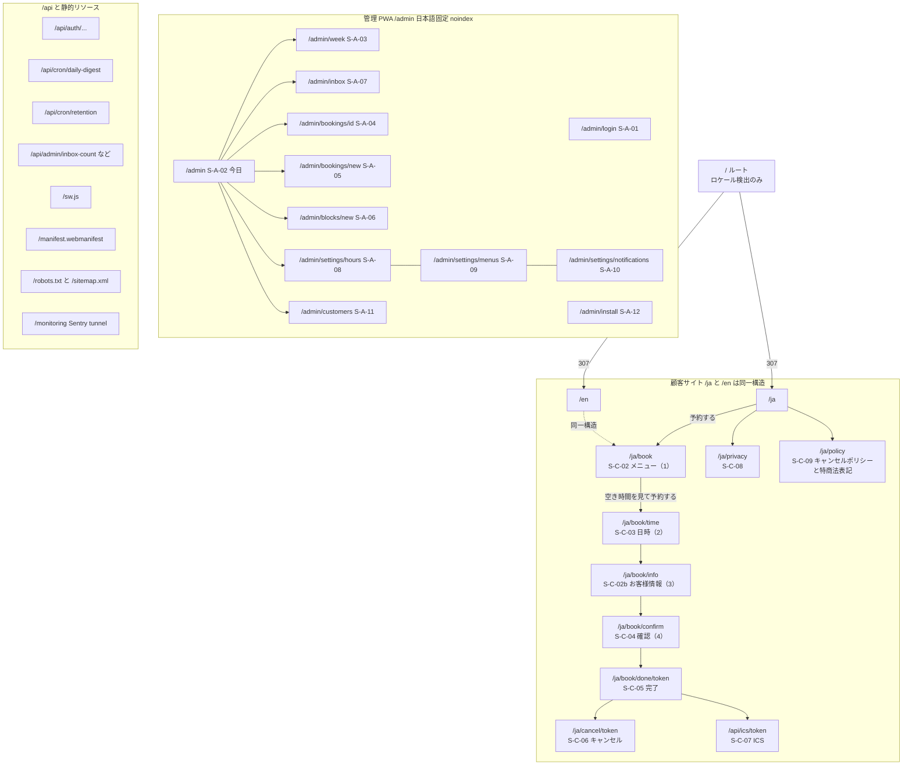
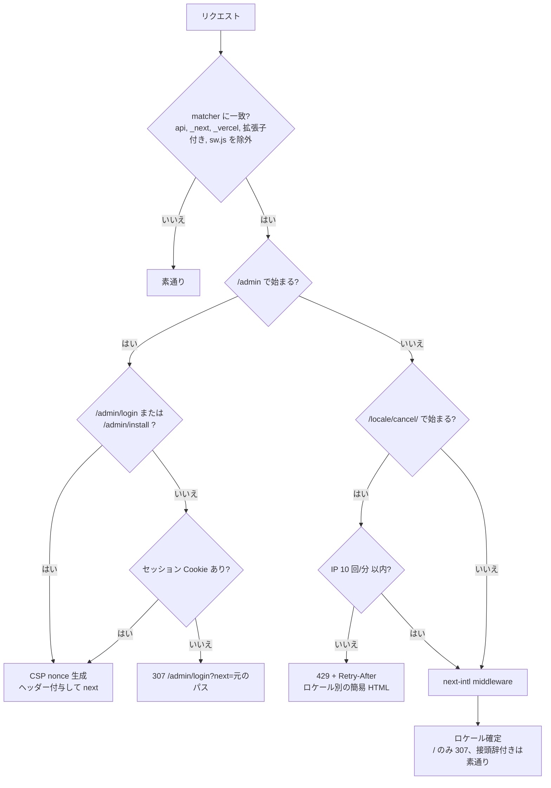

# 01 サイトマップ・URL 設計・i18n ルーティング・SEO

## 文書情報

| 項目 | 内容 |
|---|---|
| 文書 ID | DES-01 |
| 版 | v0.4 |
| 日付 | 2026-10-12 |
| 変更履歴 | v0.4（2026-10-12）: 要件定義書 v0.6 の反映。予約導線の 1 本化（OI-25）: トップから `/book/time` への直接リンクを置かないことを明記し、`/book` の `?menu=` はトップからは付けない（外部リンク用）。`/book/time` の `date` 未指定時は今日を選択（OI-24 決定済み）。v0.3（2026-10-12）: 要件定義書 v0.5 の反映。S-C-03 に月送りの `?month=` を追加（F2）、S-C-10 の電話リンクを Instagram リンクに変更、構造化データに `telephone` を出力しない（OI-10 決定済み、F3）。v0.2（2026-10-10）: 要件定義書 v0.4 の反映。予約ルートを日時先行に変更し `/book/info`（S-C-02b）を追加（OI-19）、構造化データに店名・住所（OI-09） |
| 関連要件 | FR-C-01, FR-C-07, FR-C-11〜16, FR-A-01, FR-A-15, FR-S-10, FR-S-14, NFR-EN-05, NFR-EN-07, NFR-MG-01, S-C-01〜10, S-C-02b, S-A-01〜12 |
| 関連 ADR | ADR-0001（ドメイン移行）、ADR-0005（i18n） |

---

## 1. サイトマップ



---

## 2. URL 一覧

| URL | 画面 ID | 公開 | インデックス | メソッド | クエリ | 備考 | 関連 FR |
|---|---|---|---|---|---|---|---|
| `/` | — | 公開 | — | GET | — | ロケール検出して `/ja` または `/en` へ 307 | FR-C-13 |
| `/{locale}` | S-C-01 | 公開 | index | GET | — | `generateStaticParams` で ja/en を静的生成 | FR-C-14 |
| `/{locale}/book` | S-C-02 | 公開 | index | GET | `?menu={slug}`（Instagram など外部からのディープリンク。選択済みで開始。トップの CTA は付けない） | ステップ 1（メニュー）。予約の唯一の入口（トップ・ヘッダー・404 の「予約する」の遷移先、OI-25）。メニュー選択後の CTA「空き時間を見て予約する」で `/book/time` へ | FR-C-01, 02, FR-S-14 |
| `/{locale}/book/time` | S-C-03 | 公開 | noindex | GET | `?menu={slug}&month=YYYY-MM&date=YYYY-MM-DD` | ステップ 2。月カレンダーの表示月（`month`）と選択日（`date`）は JST 暦日。`date` があれば `month` はその月、どちらも未指定は今月・今日を選択（OI-24 決定済み。今日が × でも今日を選択し空きなしの表示）。トップ（`/{locale}`）からはリンクしない（OI-25）。範囲外の `month` は今月へ寄せる。メニュー未選択なら `/book` へ戻す | FR-C-07, 08 |
| `/{locale}/book/info` | S-C-02b | 公開 | noindex | GET | `?step=name\|occupation\|phone`（段階計測用、任意） | ステップ 3。段階は `history.state` が正。クエリは計測と再読込時の復元補助。メニュー・日時が下書きに無ければ `/book` または `/book/time` へ戻す | FR-C-01, 03〜06, FR-S-14 |
| `/{locale}/book/confirm` | S-C-04 | 公開 | noindex | GET（確定は Server Action POST） | — | ステップ 4。下書きが無ければ `/book` へ、日時・お客様情報が欠けていれば該当ステップへ戻す | FR-C-09, 10 |
| `/{locale}/book/done/{token}` | S-C-05 | トークン保持者 | noindex | GET | — | トークンは 43 文字 base64url | FR-C-11 |
| `/{locale}/cancel/{token}` | S-C-06 | トークン保持者 | noindex | GET（副作用なし）／キャンセルは Server Action POST | — | IP 10 回/分（proxy.ts＋WAF） | FR-C-12, FR-S-04 |
| `/api/ics/{token}` | S-C-07 | トークン保持者 | noindex | GET | — | `text/calendar`。キャンセル URL と同じレート制限 | FR-C-11 |
| `/{locale}/privacy` | S-C-08 | 公開 | index | GET | — | — | FR-C-15 |
| `/{locale}/policy` | S-C-09 | 公開 | index | GET | — | キャンセルポリシー＋利用条件＋特定商取引法に基づく表記（`#tokushoho` アンカー） | FR-C-15 |
| `/{locale}/*`（未定義） | S-C-10 | 公開 | noindex | GET | — | 予約 CTA と Instagram リンク（電話リンクなし） | FR-C-16 |
| `/admin/login` | S-A-01 | 公開 | noindex | GET | `?next=/admin/...` | 同一オリジンの相対パスのみ許可 | FR-A-01 |
| `/admin/install` | S-A-12 | 公開 | noindex | GET | — | standalone でない場合の誘導先 | FR-A-09, 15 |
| `/admin` | S-A-02 | 管理者 | noindex | GET | `?date=YYYY-MM-DD` | `start_url` | FR-A-02, 11 |
| `/admin/week` | S-A-03 | 管理者 | noindex | GET | `?start=YYYY-MM-DD`（週の月曜） | — | FR-A-03 |
| `/admin/inbox` | S-A-07 | 管理者 | noindex | GET | — | — | FR-A-11 |
| `/admin/bookings/{id}` | S-A-04 | 管理者 | noindex | GET | — | 通知の `navigate` 先。開いた時点で既読化 | FR-A-04, 10 |
| `/admin/bookings/new` | S-A-05 | 管理者 | noindex | GET | `?start=ISO8601` | タイムラインの空き区間タップから時刻を引き継ぐ | FR-A-05 |
| `/admin/blocks/new` | S-A-06 | 管理者 | noindex | GET | `?start=ISO8601` | 期間指定用。プリセットは FAB から直接保存 | FR-A-06 |
| `/admin/settings/hours` | S-A-08 | 管理者 | noindex | GET | — | — | FR-A-07 |
| `/admin/settings/menus` | S-A-09 | 管理者 | noindex | GET | — | — | FR-A-08 |
| `/admin/settings/notifications` | S-A-10 | 管理者 | noindex | GET | — | — | FR-A-09, 16 |
| `/admin/customers`・`/admin/customers/{id}` | S-A-11 | 管理者 | noindex | GET | `?q=` | Should | FR-A-13, 14 |

---

## 3. URL 設計規則

| # | 規則 | 例 | 理由 |
|---|---|---|---|
| U-01 | 顧客向けは**常にロケール接頭辞**（`/ja` `/en`）を付ける | `/en/book/time` | QR・Instagram に貼る URL を固定。キャンセル URL の言語を一意にする（ADR-0005） |
| U-02 | パスは小文字 kebab-case、末尾スラッシュなし（`trailingSlash: false`） | `/admin/settings/hours` | 正規化と重複 URL 防止 |
| U-03 | 日付は JST の暦日 `YYYY-MM-DD` をクエリで渡す。日時は `+09:00` 付き ISO 8601 | `?date=2026-11-03`、`2026-11-03T18:00:00+09:00` | 端末 TZ に依存しない（NFR-EN-07） |
| U-04 | メニューは UUID ではなく `slug` で URL に出す | `?menu=cut` | 共有・計測で読める |
| U-05 | 秘密は**パスの 1 セグメント**（`/{token}`）に置き、クエリには置かない。形式 `^[A-Za-z0-9_-]{43}$` | `/ja/cancel/AbC…` | アクセスログ・解析のクエリ収集に載せない。形式で早期拒否 |
| U-06 | トークンを含むページは `Referrer-Policy: no-referrer`、`X-Robots-Tag: noindex, nofollow`、Web Analytics の `beforeSend` でパスを `/[locale]/book/done/[token]` に置換 | — | トークン漏えい防止（08_security.md） |
| U-07 | 管理画面は `/admin` 配下に集約し、ロケール接頭辞を付けない（日本語固定） | `/admin/week` | PWA の `scope` を顧客サイトと分離 |
| U-08 | ドメインをコード・DB に書かない。絶対 URL は `absoluteUrl(path)`（`SITE_URL` 基準） | `absoluteUrl('/ja/cancel/' + token)` | FR-S-10。ドメイン移行時にコード変更不要 |
| U-09 | 予約フローの段階は URL を分けて計測可能にする（S-C-02b 内の段階は `?step=` を `pushState`） | `/ja/book/info?step=phone` | FR-S-14 ファネル計測 |
| U-10 | 予約順序は「メニュー（`/book`）→ 日時（`/book/time`）→ お客様情報（`/book/info`）→ 確認（`/book/confirm`）」の 4 URL に 1 ステップずつ対応させる（OI-19 決定済み、2026-10-10）。v0.1 の「順序を設定で入れ替える」案は廃止 | `/en/book/info` | ステップ別のファネル計測、ブラウザの戻るとの対応 |

---

## 4. i18n ルーティング（proxy.ts + next-intl）

### 4.1 設定

```ts
// src/lib/i18n/routing.ts
import { defineRouting } from 'next-intl/routing'
export const routing = defineRouting({
  locales: ['ja', 'en'],
  defaultLocale: 'ja',
  localePrefix: 'always',
  localeDetection: true,          // 接頭辞なし（/ のみ）で Cookie → Accept-Language を使う
  localeCookie: { name: 'NEXT_LOCALE', maxAge: 60 * 60 * 24 * 365, sameSite: 'lax' },
  alternateLinks: true,           // Link ヘッダで hreflang を付与
})
```

```ts
// src/lib/i18n/request.ts（要点）
export default getRequestConfig(async ({ requestLocale }) => {
  const locale = hasLocale(routing.locales, await requestLocale) ? await requestLocale : routing.defaultLocale
  return {
    locale,
    timeZone: 'Asia/Tokyo',
    now: new Date(),
    messages: (await import(`../../../messages/${locale}.json`)).default,
    formats: {
      dateTime: {
        slotDate: { month: 'numeric', day: 'numeric', weekday: 'short' },
        slotTime: { hour: 'numeric', minute: '2-digit', hour12: locale === 'en' },
        full:     { year: 'numeric', month: 'long', day: 'numeric', weekday: 'short' },
      },
      number: { jpy: { style: 'currency', currency: 'JPY' } },
    },
  }
})
```

### 4.2 proxy.ts の処理順



| 項目 | 仕様 | 関連 |
|---|---|---|
| matcher | `['/((?!api\|_next\|_vercel\|monitoring\|sw\\.js\|manifest\\.webmanifest\|.*\\..*).*)']`（表中の `\|` は区切り記号のエスケープ） | — |
| 判定順 | パス → `NEXT_LOCALE` Cookie → `Accept-Language` → `ja` | FR-C-13 |
| 自動リダイレクト | `/` のみ検出結果へ 307。`/ja`・`/en` を開いた人を別言語へ飛ばすことはしない | FR-C-13 |
| 言語切替 | ヘッダー右上「EN」/「日本語」（相手言語名をネイティブ表記、国旗なし）。同じページの他ロケール URL へ遷移し、next-intl が `NEXT_LOCALE` を更新。予約フロー中は下書きを保持（`BookingDraftProvider` が `/book` 配下のレイアウトに居るため、ロケール切替でアンマウントされる → `sessionStorage` から復元） | FR-C-13 |
| `/admin` | next-intl を通さない。`<html lang="ja">` 固定。認証の本体は各 Server Action と DAL の `requireAdmin()`（proxy は楽観チェック） | FR-A-01, NFR-SC-02 |
| `/api/ics/*` | matcher 外のため、Route Handler 内で同じレート制限関数を呼ぶ | FR-S-04 |
| レート制限の DB 呼び出し | proxy は Node ランタイムなので `lib/rate-limit.ts` を直接使える。対象パスはキャンセルのみに限定し、他ページの遅延を増やさない | FR-S-04 |

### 4.3 ロケール別の表示規則

| 項目 | `/ja` | `/en` | 関連 |
|---|---|---|---|
| `<html lang>` | `ja` | `en`（英語ページ内の店名等は `<span lang="ja">`） | NFR-EN-05 |
| 日付 | 11/3(火) | Tue, Nov 3 | FR-C-13 |
| 時間枠 | 18:00–19:00 | 6:00 PM–7:00 PM JST | FR-C-07 |
| 24:00 の扱い | 終了が翌日 0:00 の場合「24:00」と表示（自前整形） | "12:00 AM (midnight)" | 【要確認: OI-02 英語表記】 |
| 料金 | 5,000 円（税込） ※数値は menus の値 | ¥5,000 (tax incl.) | FR-C-02 |
| ふりがな欄 | 表示・必須 | 描画しない【要確認: OI-13】 | FR-C-03 |
| 電話例 | 09012345678 | 090 1234 5678 or +44 7700 900123 | FR-C-05 |
| タイムゾーン注記 | 不要 | 「All times are Japan Standard Time (JST)」を S-C-03〜05 と S-C-02b（日時の要約）に表示 | NFR-EN-07 |

---

## 5. SEO・メタデータ・構造化データ

### 5.1 メタデータ

| 項目 | 仕様 |
|---|---|
| `metadataBase` | `new URL(SITE_URL)` |
| タイトル | 各ページ一意（Next.js のルートアナウンサーが `document.title` を読むため）。形式「{ページ名} ｜ {スタイリスト名} @ Neuer Barber」【要確認: OI-08 ブランド表記】 |
| `alternates` | `canonical: /{locale}/…`、`languages: { ja: '/ja/…', en: '/en/…', 'x-default': '/ja/…' }` |
| OGP | トップ・予約・ポリシーのみ。`og:locale` は `ja_JP` / `en_US`。画像は `opengraph-image.tsx` で静的生成 |
| `theme-color` | 顧客サイトはライト固定（`--paper-98` 相当） |

### 5.2 構造化データ（JSON-LD、トップのみ）

| プロパティ | 値の出所 | 備考 |
|---|---|---|
| `@type` | `HairSalon` | schema.org に BarberShop 型はないため HairSalon を使う |
| `name` / `alternateName` | `config/shop.ts` | 店名 Neuer Barber（OI-09 決定済み）。英語表記・スタイリスト名は【要確認: OI-08】 |
| `address`（`PostalAddress`） | `config/shop.ts` | 大阪市阿倍野区阿倍野筋2-4-48 金村ビル3階南（B）を出力する（OI-09 決定済み）。完了画面・ICS `LOCATION` と同じ値 |
| `telephone` | 出力しない | 電話番号は非掲載（OI-10 決定済み、2026-10-12）。連絡先は `sameAs` の Instagram URL |
| `openingHoursSpecification` | `business_hours`（cache） | 定休日は出力しない |
| `availableLanguage` | `["ja", "en"]` | — |
| `url` / `sameAs` | `absoluteUrl('/ja')`、Instagram URL | — |
| `makesOffer` | 出力しない | 価格は `menus` 確定後に検討（価格の推測値を構造化データに載せない） |

### 5.3 robots / sitemap / ヘッダー

```ts
// app/robots.ts
export default function robots(): MetadataRoute.Robots {
  return {
    rules: [{ userAgent: '*', allow: '/', disallow: ['/admin', '/api/'] }],
    sitemap: absoluteUrl('/sitemap.xml'),
  }
}
```

| 対象 | robots.txt | `X-Robots-Tag` | `<meta name="robots">` | sitemap.xml |
|---|---|---|---|---|
| `/{locale}`、`/book`、`/privacy`、`/policy` | allow | なし | index | 掲載（hreflang 付き） |
| `/{locale}/book/time`・`/info`・`/confirm` | allow | `noindex` | noindex | 非掲載 |
| `/{locale}/book/done/*`・`/cancel/*`・`/api/ics/*` | allow（未知の URL のためクロールされない前提） | `noindex, nofollow` | noindex | 非掲載 |
| `/admin/**` | disallow | `noindex, nofollow` | noindex | 非掲載 |
| staging / preview | Vercel Authentication で非公開 | `noindex`（`VERCEL_ENV !== 'production'` で全ページ付与） | — | 非公開 |

`/admin` は robots.txt で disallow しつつヘッダーでも `noindex` を返す（外部リンク経由でインデックスされた場合の二重対策）。

---

## 6. ドメイン移行時の URL 影響

| 影響 | 対応 | 関連 |
|---|---|---|
| 過去予約の完了・キャンセル URL | DB にはトークンハッシュのみ。`*.vercel.app` → 新ドメインを Vercel「Redirect to」で 308 設定し、旧 URL のパスをそのまま新ドメインへ | NFR-MG-01, AT-29 |
| hreflang・canonical・sitemap | `SITE_URL` 変更＋再デプロイで自動追従 | FR-S-10 |
| 管理 PWA | Web Push 購読とパスキーはオリジン（RP ID）単位のため、**新ドメインでホーム画面に追加し直し、パスキー再登録・通知の再購読が必要**（運用手順書に記載） | ADR-0001, ADR-0006 |
| Instagram・Google ビジネスプロフィールのリンク | 新 URL へ更新（リダイレクトで救済されるが正規 URL を推奨） | — |
