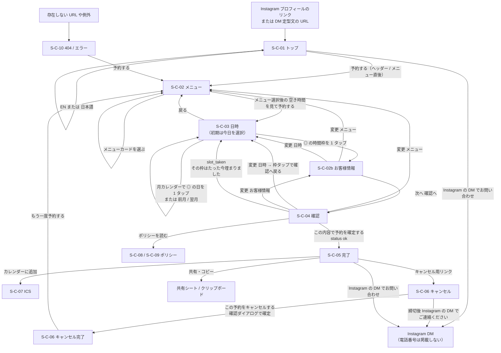
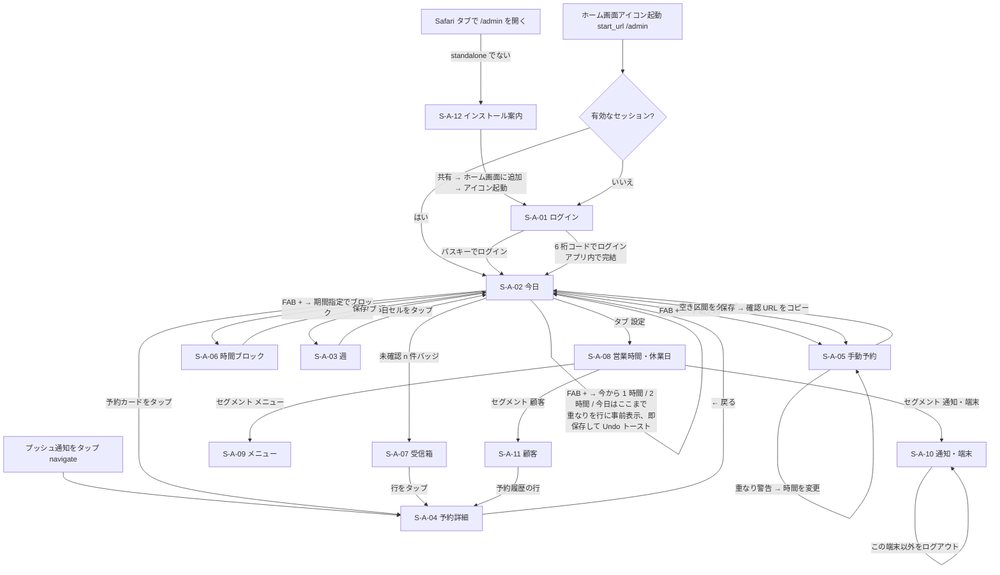

# 02 画面一覧・画面遷移図

## 文書情報

| 項目 | 内容 |
|---|---|
| 文書 ID | DES-02 |
| 版 | v0.5 |
| 日付 | 2026-10-12 |
| 変更履歴 | v0.5（2026-10-12）: 実装との同期。ルート（特商法表記 `/{locale}/tokusho`、キャッチオール `[...rest]`、`/admin/customers/{id}`、`/admin/install` への誘導条件）、データ取得関数名（`getMenuCatalog`・`getWeeklyHours`・`getDayAvailability`・`getWeek`・`getInbox`・`getAdminMenus`・`getAdminHours`・`getAdminSettings`・`listDevices`）、管理アクション（`moveMenu`・`unacknowledge`、`mergeCustomers` は未実装）、管理の共通レイアウト（`(app)/layout.tsx`、TanStack Query なし）。主要コンポーネント欄の実装名は 07_components.md v0.5 を参照。v0.4（2026-10-12）: 要件定義書 v0.6 の反映。予約導線の 1 本化（OI-25）: トップ・404 の CTA を「予約する」→ S-C-02 に統一し、「空き時間を見て予約する」は S-C-02 → S-C-03（CT-02）だけに（3 章の遷移図・CT-01）。S-C-01 の `MenuSummary` を 9 件の情報表示カードに。S-C-03 の初期の選択日 = 今日（OI-24）。v0.3（2026-10-12）: 要件定義書 v0.5 の反映。S-C-01 の構成簡素化（`HoursSection` を廃止し `AccessSection` に統合、`InstagramLink` 追加。F1）、S-C-03 の `WeekStrip` を `MonthCalendar` に置換（F2）、顧客向けの `tel:`／`PhoneFallback` を `InstagramLink` に置換し遷移図の電話アプリを Instagram DM に変更（F3）。v0.2（2026-10-10）: 要件定義書 v0.4 の反映。日時先行の順序と S-C-02b（お客様情報）、完了画面の共有・コピー、ログインのワンタイムコード、ブロックのプリセット変更、手動予約の「それでも保存」削除 |
| 関連要件 | 8 章 S-C-01〜10・S-C-02b / S-A-01〜12、FR-C-01〜17、FR-A-01〜19、FR-S-14、AT-01〜23 |
| 関連文書 | `03_screen_specs.md`（主要画面の詳細）、`06_api.md`（アクション）、`07_components.md`（コンポーネント） |

画面 ID は要件定義書 8 章の ID をそのまま使う。設計側では新設しない（S-C-02b は要件定義書 v0.4 で新設された枝番）。認証欄の「トークン」は URL 内のキャンセルトークン（256 bit）を保持していることを指す。「主要コンポーネント」欄は設計時の部品名で、実装のコンポーネント名・置き場所は 07_components.md（v0.5 で実装名に同期）を正とする。

---

## 1. 顧客サイト（`/{locale}`）

| 画面ID | 名称 | ルート | 認証 | 主要コンポーネント | データ取得 | Server Actions | 関連 FR |
|---|---|---|---|---|---|---|---|
| S-C-01 | トップ | `/{locale}` | なし | 上から `SiteHeader`（言語切替・予約 CTA「予約する」）、`Hero`（写真のみ）、`MenuSummary`（9 件の `MenuCard variant="info"`、リンクなし）、`BookCta`（「予約する」→ `/book`）、`AccessSection`（受付時間・定休・予約締切の 2〜3 行を含む）、`LanguagesNote`、`InstagramLink`、`SiteFooter`、JSON-LD（`telephone` なし） | `getMenuCatalog()`（非公開を含む 9 件）・`getWeeklyHours()`・`getPublicSettings()`（`"use cache"`） | なし | FR-C-13, 14, 16, 17 |
| S-C-02 | 予約（メニュー）ステップ 1 | `/{locale}/book` | なし | `BookingStepper`、`MenuStep`（`MenuCard`: 一般・学生の両価格）、`StickyCta`（「空き時間を見て予約する」。メニュー選択後に表示） | `getActiveMenus()`（cache）。選択はクライアント状態（`features/booking/draft.ts` の下書き＝`sessionStorage`、30 分で破棄）と `?menu=` | なし | FR-C-01, 02 |
| S-C-03 | 予約（日時選択）ステップ 2 | `/{locale}/book/time` | なし | `BookingStepper`、`MonthCalendar`（`DayCell`。◎ の日のみリンク、× と非活性の日は理由付きの非活性セル）、`SlotList`（◎ のみ `SlotButton`、× は非活性の `SlotRow`）、`SlotLegend`、`DeadlineNotice`、`MonthCalendarSkeleton`、`SlotListSkeleton`、`StickyCta`（選択済みで戻ってきたときのみ） | `getMonthAvailability({ menuSlug, month })`（日ごとの状態）＋`getDayAvailability({ menuSlug, date })`（選択日の時間枠）。いずれも RSC、非キャッシュ、Suspense。メニュー表示と締切文言に `getActiveMenus()`・`getPublicSettings()`（cache） | なし（選択はクライアント状態） | FR-C-07, 08 |
| S-C-02b | 予約（お客様情報）ステップ 3 | `/{locale}/book/info` | なし | `BookingStepper`、`SelectionSummary`（メニュー・日時の要約と「変更」）、`BookingForm`（`NameStep`、`KanaField`（ja のみ）、`OccupationStep`、`PhoneStep`（＋ご要望 `NoteField`））、`StepSummary`、`StickyCta` | 下書き（クライアント）。表示用に `getActiveMenus()`（cache）。入力値は `draft.ts` の下書き（`sessionStorage`）＋`history.state`・`?step=` | なし（検証はクライアントで共有 Zod スキーマ） | FR-C-01, 03〜06 |
| S-C-04 | 予約（確認）ステップ 4 | `/{locale}/book/confirm` | なし | `CheckAnswers`（職業に応じた料金を再計算）、`PolicyDigest`、`ConsentCheckbox`、`TurnstileWidget`、`Honeypot`、`SubmitButton`、`ErrorSummary` | 下書き（クライアント）。料金表示用に `getActiveMenus()`（cache） | `createBooking` | FR-C-09, 10, 15, FR-S-05 |
| S-C-05 | 予約完了 | `/{locale}/book/done/{token}` | トークン | `DoneCard`（店名・住所）、`CopyButton`（予約番号）、`ShareCopyButton`（キャンセルリンク）、`AddToCalendar`（ICS / Google）、`ScreenshotNotice`、`MapLink`、`InstagramLink` | `getBookingByToken(token)`（非キャッシュ） | なし | FR-C-11, 16 |
| S-C-06 | キャンセル | `/{locale}/cancel/{token}` | トークン | `BookingSummary`、`CancelPanel`、`ConfirmDialog`、`InstagramLink`（締切後）、`NotFoundPanel` | `getBookingByToken(token)`（締切判定込み） | `cancelBooking` | FR-C-12, 16 |
| S-C-07 | ICS ダウンロード | `/api/ics/{token}` | トークン | —（Route Handler） | `getBookingByToken(token)` | — | FR-C-11 |
| S-C-08 | プライバシーポリシー | `/{locale}/privacy` | なし | `PolicyArticle`、`TableOfContents` | 静的（messages の `privacy`） | なし | FR-C-15 |
| S-C-09 | キャンセルポリシー・利用条件／特定商取引法に基づく表記 | `/{locale}/policy`、`/{locale}/tokusho`（特商法表記は別ページ） | なし | `PolicyArticle`、`TokushohoTable` | 静的（messages の `policy`・`tokusho`）＋`getPublicSettings()`（締切時間の差し込み） | なし | FR-C-15 |
| S-C-10 | 404 / エラー | `[locale]/not-found.tsx`（未定義パスは `[locale]/[...rest]` が `notFound()`）、`[locale]/error.tsx`、`app/global-not-found.tsx`（ロケール外） | なし | `ErrorPanel`、`BookCta`、`InstagramLink` | なし | なし | FR-C-16, FR-S-11 |

### 1.1 予約順序（OI-19 決定済み）

順序は「1. メニューを選ぶ（`/book`）→ 2. 日時を選ぶ（`/book/time`）→ 3. お客様情報（`/book/info`）→ 4. 確認（`/book/confirm`）」に決定した（2026-10-10）。段階定義は `BOOKING_SEQUENCE = ['menu','time','name','occupation','phone','confirm']`（備考は `phone` 段に同居）で固定し、v0.1 の「設定で入れ替える」仕組みは持たない。お客様情報の段（S-C-02b）は上部に `SelectionSummary`（メニュー・日時と「変更」）を出す。学生価格はメニューカードに併記し、職業選択後に要約と確認画面で再計算する。

---

## 2. 管理 PWA（`/admin`、日本語固定）

| 画面ID | 名称 | ルート | 認証 | 主要コンポーネント | データ取得 | Server Actions | 関連 FR |
|---|---|---|---|---|---|---|---|
| S-A-01 | ログイン | `/admin/login` | なし | `PasskeyLoginButton`、`OtpFallbackForm`（6 桁コード 1 欄、`autocomplete="one-time-code"`。OI-12 決定済み）、`StandaloneGate` | なし | Better Auth（`/api/auth/*`）。`signIn.passkey()`、フォールバックは `requestAdminOtp`・`verifyAdminOtp` | FR-A-01 |
| S-A-02 | 今日 | `/admin` | 管理者 | `AdminHeader`（日付送り・`InboxBadge`）、`Timeline`、`BookingCard`、`BlockCard`、`NowLine`、`Fab`（`QuickActionSheet`）、`BottomTabs`、`Toast`（Undo）、`OfflineBanner`（Should）、`ResubscribeBanner` | `getDayAgenda(date)`（非キャッシュ）、`GET /api/admin/inbox-count`（20 秒ポーリング） | `createTimeBlock`（FAB プリセット）、`deleteTimeBlock`、`restoreTimeBlock`、`updateBookingStatus` | FR-A-02, 06, 10, 11, 17 |
| S-A-03 | 週 | `/admin/week` | 管理者 | `WeekGrid`、`DayCell`（件数・空き時間・定休/ブロック・未確認の表示）、`BottomTabs` | `getWeek(start)`（月曜始まりの 7 日。予約件数・空き時間〔分〕・ブロック数・未確認数・定休） | なし | FR-A-03 |
| S-A-04 | 予約詳細 | `/admin/bookings/{id}` | 管理者 | `BackButton`（standalone 用「←」）、`BookingDetail`、`StatusActions`、`ConfirmUrlPanel`、`OwnerNoteField`、`AuditTrail` | `getBookingDetail(id)` | `acknowledgeBooking`（表示時）、`updateBookingStatus`、`undoBookingChange`、`reissueConfirmationUrl`、`updateOwnerNote` | FR-A-04, 05, 10, 11 |
| S-A-05 | 手動予約 | `/admin/bookings/new` | 管理者 | `ManualBookingForm`、`CustomerCombobox`、`MenuSelect`、`DateTimeField`、`SourceSelect`、`OverlapAlert`、`SavedSheet`（確認 URL コピー） | `getAdminMenus()`、`GET /api/admin/customers/suggest`、`GET /api/admin/overlaps`、`GET /api/admin/free-starts`（空き開始時刻のチップ） | `createManualBooking` | FR-A-05, 10 |
| S-A-06 | 時間ブロック | `/admin/blocks/new` | 管理者 | `BlockForm`（プリセット・期間指定）、`KindSelect`、`OverlapAlert` | `GET /api/admin/overlaps` | `createTimeBlock` | FR-A-06 |
| S-A-07 | 受信箱（未確認） | `/admin/inbox` | 管理者 | `InboxList`（新規・キャンセル）、`AcknowledgeAllButton` | `getInbox()`（未確認と確認済み） | `acknowledgeAll`、`unacknowledge`（「すべて確認済み」の Undo）。個別の既読化は S-A-04 を開いたとき | FR-A-11 |
| S-A-08 | 設定: 営業時間・休業日 | `/admin/settings/hours` | 管理者 | `WeeklyHoursEditor`、`OverrideList`、`OverrideSheet`、`SlotRulesForm` | `getAdminHours()`、`getAdminSettings()` | `updateBusinessHours`、`upsertHourOverride`、`deleteHourOverride`、`updateSettings` | FR-A-07 |
| S-A-09 | 設定: メニュー | `/admin/settings/menus` | 管理者 | `MenuList`（並べ替え）、`MenuEditSheet` | `getAdminMenus()` | `upsertMenu`、`moveMenu`（上下ボタン）、`setMenuActive` | FR-A-08 |
| S-A-10 | 設定: 通知・端末 | `/admin/settings/notifications` | 管理者 | `PushOnboarding`、`PushStatusCard`、`TestPushPanel`、`DeviceList`、`LogoutOthersButton` | `listDevices()`（セッションと購読）、`countPasskeys()` | `subscribePush`、`unsubscribePush`、`touchPushSubscription`、`sendTestPush`、`logoutOtherDevices`。パスキーの追加とログアウトは Better Auth クライアント | FR-A-09, 16 |
| S-A-11 | 顧客一覧・詳細 | `/admin/customers`、`/admin/customers/{id}` | 管理者 | `CustomerSearch`、`CustomerList`、`CustomerDetail`、`RestrictionSelect`、`ExportButton`、`AnonymizeDialog`、`MergeDialog` | `searchCustomers(q)`、`getCustomerDetail(id)` | `updateCustomerRestriction`、`exportCustomer`、`anonymizeCustomer`（`mergeCustomers` は未実装） | FR-A-13, 14（Should） |
| S-A-12 | インストール案内 | `/admin/install` | なし | `InstallGuide`（iOS 図解・Android `beforeinstallprompt`） | なし | なし | FR-A-09, 15 |

共通: ログイン後の画面（S-A-02〜11）は `(admin)/admin/(app)/layout.tsx` で `requireAdminPage()` を通し、`ToastProvider`・`InboxProvider`（未確認件数の 20 秒ポーリング）・`PushProvider`（SW 登録・`getSubscription()` 確認・`touchPushSubscription`）・`AdminBoot`（iPhone の Safari タブなら S-A-12 へ、起動時のセッション更新、SW からの遷移メッセージ）・`TabBar`（「今日・週・受信箱・設定」）で包む。TanStack Query は使わない。S-A-01・S-A-12 はこのレイアウトの外（ルートレイアウト `(admin)/admin/layout.tsx` のみ）。タブ「設定」は `/admin/settings`（→ `/admin/settings/hours`）。

---

## 3. 画面遷移図（顧客）

矢印ラベルは遷移トリガー（ボタン名・操作）。予約の入口は 1 本（要件定義書 OI-25）: トップ・404 からは「予約する」で必ず S-C-02 に入り、S-C-01 から S-C-03 への直接の遷移はない。

| # | 遷移元 | トリガー | 遷移先 | 処理・条件 | 関連 |
|---|---|---|---|---|---|
| CT-01 | S-C-01 | 「予約する / Book」（ヘッダーとメニュー直後の 2 か所。全ページのヘッダー・S-C-10 も同じ文言） | S-C-02 | 予約の唯一の入口（OI-25）。トップのメニューカードはリンクにしないので `?menu=` は付けない。外部リンク（Instagram 等）の `?menu=` 付き URL は当該メニューを選択済みで開始 | FR-C-01, 14 |
| CT-02 | S-C-02 | メニュー選択後の「空き時間を見て予約する」（この文言の CTA はここだけ） | S-C-03 | メニューの Zod 検証 OK。`router.push('/book/time?menu=…')`。S-C-03 は `date` なしで開き、今日を選択した状態で表示（OI-24） | FR-C-01, 07 |
| CT-03 | S-C-03 | ◎ の時間枠タップ（× の行は操作不可） | S-C-02b（お客様情報が入力済みで確認画面から戻った場合は S-C-04） | 選択表示 150 ms → 選択した `startsAt`（`+09:00`）を下書きへ保存して遷移。選択済みで戻ってきたときだけ固定バー「この日時で進む」を出す | FR-C-07 |
| CT-03b | S-C-02b | 電話段の「次へ 確認へ」 | S-C-04 | お客様情報の全段の Zod 検証 OK。`router.push('/book/confirm')` | FR-C-01 |
| CT-04 | S-C-04 | 「この内容で予約を確定する」 | S-C-05 | `createBooking` が `ok` → `router.replace(doneUrl)`（戻るで確認画面に戻らない）、下書き破棄 | FR-C-10, 11 |
| CT-05 | S-C-04 | 同上で `conflict: slot_taken` | S-C-03 | 選択枠を解除、空き枠を再取得、メッセージ表示 | FR-C-10, AT-03 |
| CT-06 | S-C-04 | 同上で `invalid`／`rate_limited`／`bot` | S-C-04 | エラーサマリーにフォーカス。入力は保持 | FR-C-09 |
| CT-07 | S-C-05 | 「キャンセル用リンク」 | S-C-06 | 同一トークン | FR-C-12 |
| CT-08 | S-C-06 | 確認ダイアログ「キャンセルする」 | S-C-06（完了状態） | `cancelBooking` が `ok` | FR-C-12 |

---

## 4. 画面遷移図（管理 PWA）

| # | 遷移元 | トリガー | 遷移先 | 処理・条件 | 関連 |
|---|---|---|---|---|---|
| MT-01 | 任意 | iPhone で `display-mode: standalone` でない状態でログイン後の画面を開く（S-A-12 で「閲覧だけ」を選んだ端末を除く） | S-A-12 | 購読 UI を出さない。ログインは可能（閲覧のみの利用を妨げない） | FR-A-09, AT-11 |
| MT-02 | 通知タップ | `notification.navigate` | S-A-04 | iOS で既存ウィンドウ＋スリープ後に `/admin` へ戻る現象（WebKit 268797）が出た場合、S-A-02 の受信箱バッジで吸収 | FR-A-10, AT-14 |
| MT-03 | S-A-02 | FAB →「今から 1 時間」（ほかに「2 時間」「今日はここまで」） | S-A-02 | シートを開いた時点で重なりを判定し行に表示。`createTimeBlock` 即時保存、トーストに顧客サイトへの影響を 1 行、5 秒 Undo。2 タップで完了 | FR-A-06, AT-21 |
| MT-04 | S-A-04 | 状態ボタン（来店・施術開始・完了・無断キャンセル・管理者キャンセル・遅刻キャンセル） | S-A-04 | `updateBookingStatus`。キャンセル系・無断は 5 秒 Undo | FR-A-04 |
| MT-05 | S-A-05 | 「保存」→ `conflict: overlap` | S-A-05 | 「19:00–20:00 の○○様と重なります」赤表示。操作は `[時間を変更]` のみ（「それでも保存」は置かない。OI-11 決定済み） | FR-A-05, US-04 |

---

## 5. 画面と受入基準の対応

| 画面 | 主な受入基準 |
|---|---|
| S-C-02 | AT-09, AT-10 |
| S-C-03 | AT-04, AT-09, AT-10 |
| S-C-02b | AT-06, AT-09, AT-10 |
| S-C-04 | AT-03, AT-05, AT-06, AT-08 |
| S-C-05 / S-C-07 | AT-01, AT-02 |
| S-C-06 | AT-07 |
| S-A-01 | AT-13, AT-17, AT-27 |
| S-A-02 / S-A-07 | AT-15, AT-18 |
| S-A-05 / S-A-06 | AT-21 |
| S-A-08 / S-A-09 | AT-22 |
| S-A-10 / S-A-12 | AT-11〜14b, AT-16, AT-17, AT-19, AT-20 |
| S-A-11 | AT-30 |
