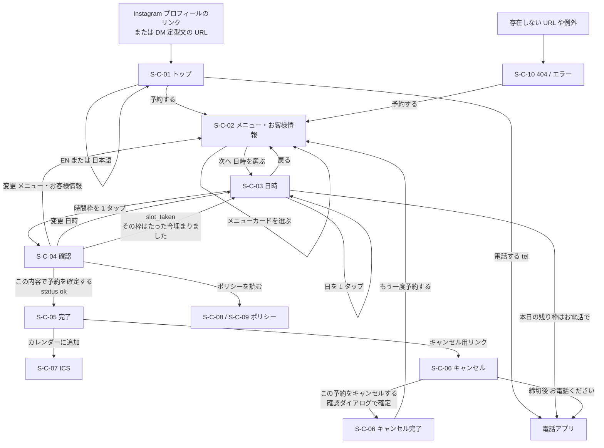
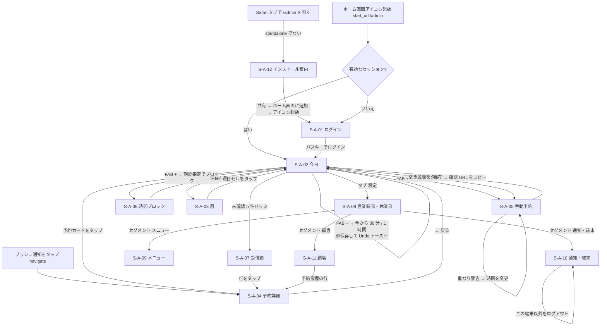

# 02 画面一覧・画面遷移図

## 文書情報

| 項目 | 内容 |
|---|---|
| 文書 ID | DES-02 |
| 版 | v0.1 |
| 日付 | 2026-10-10 |
| 関連要件 | 8 章 S-C-01〜10 / S-A-01〜12、FR-C-01〜17、FR-A-01〜19、FR-S-14、AT-01〜23 |
| 関連文書 | `03_screen_specs.md`（主要画面の詳細）、`06_api.md`（アクション）、`07_components.md`（コンポーネント） |

画面 ID は要件定義書 8 章の ID をそのまま使う。新設はしない。認証欄の「トークン」は URL 内のキャンセルトークン（256 bit）を保持していることを指す。

---

## 1. 顧客サイト（`/{locale}`）

| 画面ID | 名称 | ルート | 認証 | 主要コンポーネント | データ取得 | Server Actions | 関連 FR |
|---|---|---|---|---|---|---|---|
| S-C-01 | トップ | `/{locale}` | なし | `SiteHeader`（言語切替・`tel:`）、`Hero`、`BookCta`、`MenuSummary`、`AccessSection`、`HoursSection`、`SiteFooter`、JSON-LD | `getActiveMenus()`・`getBusinessCalendar()`（`"use cache"`） | なし | FR-C-13, 14, 16, 17 |
| S-C-02 | 予約（メニュー・お客様情報） | `/{locale}/book` | なし | `BookingStepper`、`BookingForm`（`MenuStep`、`NameStep`、`KanaField`（ja のみ）、`OccupationStep`、`PhoneStep`、`NoteStep`）、`StepSummary`、`StickyCta` | `getActiveMenus()`（cache）。入力値はクライアント状態（`BookingDraftProvider`＋`history.state`＋`sessionStorage`） | なし（検証はクライアントで共有 Zod スキーマ） | FR-C-01〜06 |
| S-C-03 | 予約（日時選択） | `/{locale}/book/time` | なし | `BookingStepper`、`WeekStrip`、`SlotList`、`SlotLegend`、`DeadlineNotice`、`PhoneFallback`、`SlotListSkeleton` | `getAvailability({ menuSlug, from, to })`（RSC、非キャッシュ、Suspense） | なし（選択はクライアント状態） | FR-C-07, 08 |
| S-C-04 | 予約（確認） | `/{locale}/book/confirm` | なし | `CheckAnswers`、`PolicyDigest`、`ConsentCheckbox`、`TurnstileWidget`、`Honeypot`、`SubmitButton`、`ErrorSummary` | 下書き（クライアント）。料金表示用に `getActiveMenus()`（cache） | `createBooking` | FR-C-09, 10, 15, FR-S-05 |
| S-C-05 | 予約完了 | `/{locale}/book/done/{token}` | トークン | `DoneCard`、`CopyButton`、`AddToCalendar`（ICS / Google）、`ScreenshotNotice`、`MapLink` | `getBookingByToken(token)`（非キャッシュ） | なし | FR-C-11 |
| S-C-06 | キャンセル | `/{locale}/cancel/{token}` | トークン | `BookingSummary`、`CancelPanel`、`ConfirmDialog`、`PhoneFallback`、`NotFoundPanel` | `getBookingByToken(token)`（締切判定込み） | `cancelBooking` | FR-C-12 |
| S-C-07 | ICS ダウンロード | `/api/ics/{token}` | トークン | —（Route Handler） | `getBookingByToken(token)` | — | FR-C-11 |
| S-C-08 | プライバシーポリシー | `/{locale}/privacy` | なし | `PolicyArticle`、`TableOfContents` | 静的（MDX または messages） | なし | FR-C-15 |
| S-C-09 | キャンセルポリシー（特商法表記・利用条件を兼ねる） | `/{locale}/policy` | なし | `PolicyArticle`、`TokushohoTable` | 静的＋`getPublicSettings()`（締切分数の差し込み） | なし | FR-C-15 |
| S-C-10 | 404 / エラー | `not-found.tsx`、`error.tsx`、`global-not-found.tsx` | なし | `ErrorPanel`、`BookCta`、`PhoneFallback` | なし | なし | FR-C-16, FR-S-11 |

### 1.1 予約順序の切替（OI-19）

`BookingForm` の段階定義は配列 `BOOKING_SEQUENCE` で持ち、既定は `['menu','name','occupation','phone','note','time','confirm']`（クライアント要望）。OI-19 で「日時先行」に決まった場合は `['menu','time','name','occupation','phone','note','confirm']` に差し替える。URL（`/book`、`/book/time`、`/book/confirm`）とステッパーのラベル（「1. メニューを選ぶ → 2. お客様情報 → 3. 日時を選ぶ → 4. 確認」）の順序だけが変わり、コンポーネントとアクションは変わらない。【要確認: OI-19】

---

## 2. 管理 PWA（`/admin`、日本語固定）

| 画面ID | 名称 | ルート | 認証 | 主要コンポーネント | データ取得 | Server Actions | 関連 FR |
|---|---|---|---|---|---|---|---|
| S-A-01 | ログイン | `/admin/login` | なし | `PasskeyLoginButton`、`MagicLinkForm`（OI-12）、`StandaloneGate` | なし | Better Auth（`/api/auth/*`）。`signIn.passkey()` | FR-A-01 |
| S-A-02 | 今日 | `/admin` | 管理者 | `AdminHeader`（日付送り・`InboxBadge`）、`Timeline`、`BookingCard`、`BlockCard`、`NowLine`、`Fab`（`QuickActionSheet`）、`BottomTabs`、`Toast`（Undo）、`OfflineBanner`（Should）、`ResubscribeBanner` | `getDayAgenda(date)`（非キャッシュ）、`GET /api/admin/inbox-count`（20 秒ポーリング） | `createTimeBlock`（FAB プリセット）、`deleteTimeBlock`、`restoreTimeBlock`、`updateBookingStatus` | FR-A-02, 06, 10, 11, 17 |
| S-A-03 | 週 | `/admin/week` | 管理者 | `WeekGrid`、`DayCell`（件数・空き枠数・定休/ブロック表示）、`BottomTabs` | `getWeekSummary(start)`（空き枠数は availability と同じ SQL を週範囲で実行） | なし | FR-A-03 |
| S-A-04 | 予約詳細 | `/admin/bookings/{id}` | 管理者 | `BackButton`（standalone 用「←」）、`BookingDetail`、`StatusActions`、`ConfirmUrlPanel`、`OwnerNoteField`、`AuditTrail` | `getBookingDetail(id)` | `acknowledgeBooking`（表示時）、`updateBookingStatus`、`undoBookingChange`、`reissueConfirmationUrl`、`updateOwnerNote` | FR-A-04, 05, 10, 11 |
| S-A-05 | 手動予約 | `/admin/bookings/new` | 管理者 | `ManualBookingForm`、`CustomerCombobox`、`MenuSelect`、`DateTimeField`、`SourceSelect`、`OverlapAlert`、`SavedSheet`（確認 URL コピー） | `getActiveMenusForAdmin()`、`GET /api/admin/customers/suggest`、`GET /api/admin/overlaps` | `createManualBooking` | FR-A-05, 10 |
| S-A-06 | 時間ブロック | `/admin/blocks/new` | 管理者 | `BlockForm`（プリセット・期間指定）、`KindSelect`、`OverlapAlert` | `GET /api/admin/overlaps` | `createTimeBlock` | FR-A-06 |
| S-A-07 | 受信箱（未確認） | `/admin/inbox` | 管理者 | `InboxList`（新規・キャンセル）、`AcknowledgeAllButton` | `getUnacknowledged()` | `acknowledgeBooking`、`acknowledgeAll` | FR-A-11 |
| S-A-08 | 設定: 営業時間・休業日 | `/admin/settings/hours` | 管理者 | `WeeklyHoursEditor`、`OverrideList`、`OverrideSheet`、`SlotRulesForm` | `getBusinessCalendarForAdmin()`、`getSettings()` | `updateBusinessHours`、`upsertHourOverride`、`deleteHourOverride`、`updateSettings` | FR-A-07 |
| S-A-09 | 設定: メニュー | `/admin/settings/menus` | 管理者 | `MenuList`（並べ替え）、`MenuEditSheet` | `getAllMenus()` | `upsertMenu`、`reorderMenus`、`setMenuActive` | FR-A-08 |
| S-A-10 | 設定: 通知・端末 | `/admin/settings/notifications` | 管理者 | `PushOnboarding`、`PushStatusCard`、`TestPushPanel`、`DeviceList`、`LogoutOthersButton` | `getPushSubscriptions()`、`getSessions()` | `subscribePush`、`unsubscribePush`、`touchPushSubscription`、`sendTestPush`、`logoutOtherDevices` | FR-A-09, 16 |
| S-A-11 | 顧客一覧・詳細 | `/admin/customers`、`/admin/customers/{id}` | 管理者 | `CustomerSearch`、`CustomerList`、`CustomerDetail`、`RestrictionSelect`、`ExportButton`、`AnonymizeDialog`、`MergeDialog` | `searchCustomers(q)`、`getCustomerDetail(id)` | `updateCustomerRestriction`、`mergeCustomers`、`exportCustomer`、`anonymizeCustomer` | FR-A-13, 14（Should） |
| S-A-12 | インストール案内 | `/admin/install` | なし | `InstallGuide`（iOS 図解・Android `beforeinstallprompt`） | なし | なし | FR-A-09, 15 |

共通: `/admin` 配下はすべて `AdminShell`（`AdminHeader`＋`BottomTabs`「今日・週・受信箱・設定」）で包み、`(admin)/admin/layout.tsx` で SW 登録・`getSubscription()` 確認・ポーリング用 `QueryClientProvider` を行う。

---

## 3. 画面遷移図（顧客）

矢印ラベルは遷移トリガー（ボタン名・操作）。

| # | 遷移元 | トリガー | 遷移先 | 処理・条件 | 関連 |
|---|---|---|---|---|---|
| CT-01 | S-C-01 | 「予約する」（全ページ最上部の CTA） | S-C-02 | `?menu=` 付きなら当該メニューを選択済みで開始 | FR-C-14 |
| CT-02 | S-C-02 | 備考ステップの「次へ 日時を選ぶ」 | S-C-03 | 段階 1〜5 の Zod 検証 OK。`router.push('/book/time?menu=…')` | FR-C-01 |
| CT-03 | S-C-03 | 時間枠タップ | S-C-04 | 選択した `startsAt`（`+09:00`）を下書きへ保存して遷移 | FR-C-07 |
| CT-04 | S-C-04 | 「この内容で予約を確定する」 | S-C-05 | `createBooking` が `ok` → `router.replace(doneUrl)`（戻るで確認画面に戻らない）、下書き破棄 | FR-C-10, 11 |
| CT-05 | S-C-04 | 同上で `conflict: slot_taken` | S-C-03 | 選択枠を解除、空き枠を再取得、メッセージ表示 | FR-C-10, AT-03 |
| CT-06 | S-C-04 | 同上で `invalid`／`rate_limited`／`bot` | S-C-04 | エラーサマリーにフォーカス。入力は保持 | FR-C-09 |
| CT-07 | S-C-05 | 「キャンセル用リンク」 | S-C-06 | 同一トークン | FR-C-12 |
| CT-08 | S-C-06 | 確認ダイアログ「キャンセルする」 | S-C-06（完了状態） | `cancelBooking` が `ok` | FR-C-12 |

---

## 4. 画面遷移図（管理 PWA）

| # | 遷移元 | トリガー | 遷移先 | 処理・条件 | 関連 |
|---|---|---|---|---|---|
| MT-01 | 任意 | `display-mode: standalone` でない状態で `/admin/*` を開く | S-A-12 | 購読 UI を出さない。ログインは可能（閲覧のみの利用を妨げない） | FR-A-09, AT-11 |
| MT-02 | 通知タップ | `notification.navigate` | S-A-04 | iOS で既存ウィンドウ＋スリープ後に `/admin` へ戻る現象（WebKit 268797）が出た場合、S-A-02 の受信箱バッジで吸収 | FR-A-10, AT-14 |
| MT-03 | S-A-02 | FAB →「今から 1 時間」 | S-A-02 | `createTimeBlock` 即時保存、5 秒 Undo。2 タップで完了 | FR-A-06, AT-21 |
| MT-04 | S-A-04 | 状態ボタン（来店・施術開始・完了・無断キャンセル・管理者キャンセル・遅刻キャンセル） | S-A-04 | `updateBookingStatus`。キャンセル系・無断は 5 秒 Undo | FR-A-04 |
| MT-05 | S-A-05 | 「保存」→ `conflict: overlap` | S-A-05 | 「19:00–20:00 の○○様と重なります」赤表示。既定は `[時間を変更]` | FR-A-05, US-04 |

---

## 5. 画面と受入基準の対応

| 画面 | 主な受入基準 |
|---|---|
| S-C-02 | AT-06, AT-09, AT-10 |
| S-C-03 | AT-04, AT-10 |
| S-C-04 | AT-03, AT-05, AT-06, AT-08 |
| S-C-05 / S-C-07 | AT-01, AT-02 |
| S-C-06 | AT-07 |
| S-A-01 | AT-13, AT-17, AT-27 |
| S-A-02 / S-A-07 | AT-15, AT-18 |
| S-A-05 / S-A-06 | AT-21 |
| S-A-08 / S-A-09 | AT-22 |
| S-A-10 / S-A-12 | AT-11〜14b, AT-16, AT-17, AT-19, AT-20 |
| S-A-11 | AT-30 |
