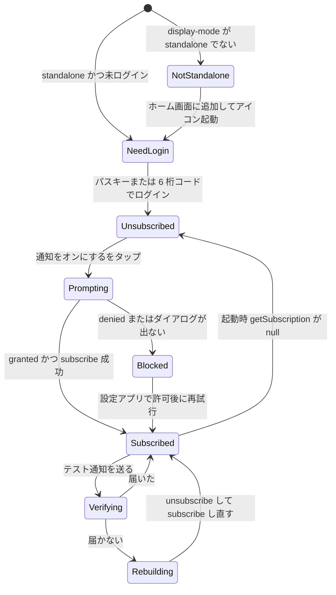

# 03 画面仕様書（主要画面）

## 文書情報

| 項目 | 内容 |
|---|---|
| 文書 ID | DES-03 |
| 版 | v1.0 |
| 日付 | 2026-10-18 |
| 変更履歴 | v1.0（2026-10-18）: プラスアルファ（ADR-0012）。13 章を新設（予約欄の動き、予約リンク、自動ステータス、カルテ、次のお客様、ストーリー画像、そろそろ来店、毎週の休み、カレンダー購読）。v0.9（2026-10-13）: クライアント依頼による管理 PWA の簡素化（ADR-0011）。12 章を新設し、6〜9 章・11 章の管理画面の記述のうち 12 章と食い違う部分は 12 章を優先。v0.8（2026-10-13）: クライアント依頼による導線の簡素化（ADR-0010）。S-C-02 メニュー・S-C-03 日時・S-C-02b お客様情報をトップページの予約欄（`#book`）に統合: ① メニュー（1 行の選択リスト）→ ② 日時（月カレンダー＋空き時刻ボタン）→ ③ お客様情報（全項目と備考を最初から表示）。選ぶとそのステップは「選択中」の 1 行（［変更］付き）に畳まれ次が開く。途中の決定ボタンはなく、③ が開くと画面下に「この内容で予約する」→ 確認ページ（S-C-04）→ 完了。各ステップは履歴に積み、戻るで 1 つ前へ。旧 URL `/book`・`/book/time`・`/book/info` は `/{locale}?step=…#book` へ 308。空き状況は `GET /api/availability` で月単位に一括取得し、日付切替は通信なし。ボタン・カレンダーを小型化（主ボタン 50px、日セル 44px、44px のタップ領域は維持）。トップの「予約する」区画・各ページの進行表示・凡例を削除。確認ページは送信失敗（通信断・再公開直後）時に入力を保ったまま再読み込みを案内。アクセス欄は案内地図＋住所カード＋「地図を開く」のみ（道順・駅一覧は削除）。v0.7（2026-10-13）: クライアント確認による住所の確定（〒545-0052 阿倍野筋2丁目4-48 金村ビル3F（南B））。地図リンクを住所の文字検索から建物の座標（国土地理院の住所検索＋OSM の建物）に変更（文字検索では隣のビルに当たっていた）。トップのアクセスを、OSM から生成した目印入りの SVG 案内地図（JR天王寺駅 中央口からの徒歩ルート、あべのハルカス・あべのキューズモール・あべの筋・路面電車・常盤通・地下鉄阿倍野駅）＋最寄り駅 4 件の徒歩分数＋道順 3 ステップ＋Google/Apple マップのボタンに。徒歩分数は OSM の道のり 80m/分で再計算し「天王寺駅徒歩 5 分」を「JR天王寺駅徒歩約 7 分」に修正（`config/shop.ts`、`scripts/access-map/build.py`）。v0.6（2026-10-12）: レビュー修正の反映。2 章 S-C-03 に S-C-04 から戻ったときのバナー（`?taken=1` 埋まった／`?taken=deadline` 予約できなくなった）と `allow_same_day` OFF の当日を「締切」に、3 章 S-C-04 の `not_bookable` を時間選択へ戻す・`duplicate` の廃止（`slot_taken` に統一）・Turnstile の `cData`・学生料金ラベルの判定、4・5 章の締切「◯時間前まで」を予約ごとの締切から算出、5 章 S-C-06 のキャンセルの冪等化（二重タップ・再送も完了表示）とキャンセル操作のレート制限、11 章を新設（S-A-04「直前の状態に戻す」、S-A-08 の日次サマリー時刻は表示のみ・サマリーの「臨時休業日」の文面、S-A-09 の最終開始プレビューを枠刻みに揃える）。v0.5（2026-10-12）: 実装との同期。4 章 S-C-05 の見出しを「ご予約を承りました」＋スタンプ「予約確定 CONFIRMED」に（デザインガイド DG-001 U-05 決定。4.1・4.4）。1.4 の「完了段を要約に畳む」は実装どおりで、展開カンプ Q-01 は畳む側に決定。0.2 のデータ出所を `getWeeklyHours()` に、1.4 の下書きの保持先を `draft.ts`（`sessionStorage`）に。v0.4（2026-10-12）: 要件定義書 v0.6（決定事項 G1〜G4）の反映。0 章 S-C-01 のメニューを 9 件の情報表示カード（`MenuCard variant="info"`、リンクなし）にし「全 9 メニュー」導線を廃止、予約 CTA（ヘッダー＋メニュー直後）の文言を「予約する / Book」（`/book` へ）に統一し「空き時間を見て予約する」をメニュー段の CTA 専用に（OI-25）、2 章 S-C-03 の初期の選択日を今日に決定（OI-24）、Instagram `@neuer.kento` 確定（OI-23）。v0.3（2026-10-12）: 要件定義書 v0.5（クライアントフィードバック F1〜F3）の反映。0 章 S-C-01 トップの構成を新設（写真のみのヒーロー、受付時間・定休・予約締切をアクセスに統合）、2 章 S-C-03 を月カレンダー（grid・状態・キーボード操作）＋時間枠リストに変更し週ストリップを廃止、顧客向けの `tel:` / 電話案内をすべて Instagram DM 導線に置換（S-C-02/02b/04/05/06）、10 章 S-A-11 の予約制限 `dm_only` を新設。v0.2（2026-10-10）: 要件定義書 v0.4 の反映。日時先行の順序と S-C-02b（要約ブロック付きお客様情報）、× 行の表示規則と凡例、枠タップで次段へ、完了画面の店名・住所と共有・コピー、手動予約の「それでも保存」削除、ブロックのプリセット変更、ログインのワンタイムコード（9.4） |
| 関連要件 | FR-C-01〜12, FR-C-14, FR-C-16, FR-A-01, FR-A-02, FR-A-05, FR-A-06, FR-A-09〜11, FR-A-13, FR-A-15, FR-A-16, FR-S-05, FR-S-06, NFR-EN-03〜07, AT-01〜21 |
| 対象画面 | S-C-01, S-C-02, S-C-02b, S-C-03, S-C-04, S-C-05, S-C-06, S-A-02, S-A-05, S-A-06, S-A-10, S-A-11（＋S-A-01, S-A-12）。S-A-04・S-A-08・S-A-09 は 11 章で変更点のみ |

### 共通規約

- ワイヤーは 390×844（iPhone 標準）想定のテキスト表現。`[ ]` はボタン、`( )` はラジオ、`[x]` はチェック、`▸` は折りたたみ、`┃` は固定バー。正式な WF は `docs/04_wireframes/`。
- 検証タイミング: **blur 後**（入力中は出さない）と「次へ」押下時。エラー文は GOV.UK 形式（何をすればよいかを書く。「必須です」単独は禁止）。
- エラー表示: フィールド直下に `id` 付きメッセージ、入力に `aria-invalid="true"` と `aria-describedby`。送信時に複数エラーがあれば `ErrorSummary`（`role="alert"`、各エラーへのリンク）へフォーカス。
- 段階遷移時は次段の見出し（`tabIndex={-1}`）へ `focus()`、`aria-live="polite"` 領域で「ステップ 3/4: お客様情報」を通知（順序は「1. メニュー → 2. 日時 → 3. お客様情報 → 4. 確認」。OI-19 決定済み）。
- ターゲット 44×44 px 以上（下限 24 px＋間隔 4 px）、本文 16 px、入力欄 16 px 以上（iOS ズーム回避）。固定 CTA バーは `padding-bottom: max(16px, env(safe-area-inset-bottom))`、`scroll-padding-bottom` で入力欄を隠さない（WCAG 2.4.11）。
- 時刻はすべて JST。`/en` は S-C-03〜06 と S-C-02b（日時の要約）に「All times are Japan Standard Time (JST)」を表示。
- 顧客向け画面には電話番号・`tel:` リンクを置かない（要件定義書 v0.5 FR-C-16、OI-10 決定済み）。問い合わせ・締切後の連絡は `InstagramLink`（`@neuer.kento`。OI-23 決定済み。アカウント名は `config/shop.ts` の 1 か所）で案内する。
- **予約 CTA の文言**（要件定義書 v0.6 FR-C-01/14、OI-25 決定済み）: 予約の入口は 1 本。トップ（ヘッダー＋メニュー直後）・全ページのヘッダー・404 の予約 CTA は「予約する / Book」で `/{locale}/book`（S-C-02）へ。「空き時間を見て予約する / See available times」は S-C-02 でメニュー選択後に出す CTA だけに使う。

---

## 0. S-C-01 トップ

**目的**: 写真と 9 メニューで店の雰囲気と料金を伝え、1 タップで予約（S-C-02 メニュー）に進ませる。店舗情報はアクセスに集約する（FR-C-14、クライアント決定 F1、2026-10-12）。

### 0.1 構成（上から）

```text
┌──────────────────────────── 390 ─┐
│ Neuer Barber 長田  EN [予約する]  │  ← SiteHeader（言語切替・予約 CTA。電話リンクなし）
│ ┌──────────────────────────┐ │
│ │        （写真）            │ │  ← Hero（写真のみ。キャッチコピー・リード文なし）
│ └──────────────────────────┘ │
│ メニュー                           │  ← MenuSummary（9 件の MenuCard variant="info"）
│ カット / Cut              ¥—       │  ← 名称 JA/EN・一般価格・所要時間（リンクなし）
│ シャンプー・眉カット込み   60分     │  ← 一言説明はあるものだけ 1 行
│ …（9 件すべて。「全 9 メニュー」ボタンなし）│
│ [ 予約する → ]                      │  ← BookCta（/book へ。ヘッダーと同じ文言）
│ アクセス                           │  ← AccessSection
│ Neuer Barber                       │
│ 大阪市阿倍野区阿倍野筋2-4-48       │
│ 金村ビル3F（南B） JR天王寺駅徒歩約7分 [地図] │
│ 受付時間 18:00–24:00 ／ 定休 月曜   │  ← 2〜3 行（単独の受付時間カードは置かない）
│ 予約締切 ご来店の 60 分前まで       │
│ 対応言語  日本語 / English          │  ← LanguagesNote
│ Instagram  @neuer.kento  [DM]      │  ← InstagramLink
│ フッター（ポリシー・特商法表記・Instagram）│  ← SiteFooter
└──────────────────────────────────┘
```

| 要素 | 内容 | 出所 |
|---|---|---|
| ヘッダー | 店名、言語切替（EN / 日本語）、予約 CTA「予約する / Book」→ `/{locale}/book` | messages、FR-C-13, 14 |
| 写真（ヒーロー） | 写真 1 枚。`next/image` の `priority`（LCP 要素）、`alt` は店内・施術の内容を記述。テキストブロックは重ねない | 静的アセット |
| メニュー | 公開メニュー 9 件すべてを `sort_order` 順に `MenuCard variant="info"` で表示: 名称（JA/EN）・一般価格・所要時間、一言説明は `description_*` があるものだけ 1 行。カードはリンク・ボタンにしない（フォーカス対象外）。学生価格はメニュー段（S-C-02）で併記する | `getActiveMenus()`（`"use cache"`）、FR-C-02, 14 |
| 予約 CTA | 「予約する / Book」→ `/{locale}/book`（メニューの直後に全幅で 1 つ）。「空き時間を見て予約する」はトップでは使わない | FR-C-01, 14、OI-25 |
| アクセス | 店名・住所・最寄り駅・地図リンク、「受付時間 18:00–24:00 ／ 定休 月曜」「予約締切 ご来店の 60 分前まで」。曜日別の時間は `business_hours`、締切は `settings.lead_time_min` から生成（【要確認: OI-02, OI-03, OI-06】） | `config/shop.ts`、`getWeeklyHours()`、`getPublicSettings()` |
| 対応言語 | 「日本語 / English」 | messages |
| Instagram | `InstagramLink`（アカウント名＋「DM でお問い合わせ」） | `config/shop.ts`（`@neuer.kento`、OI-23 決定済み） |
| フッター | ポリシー・特商法表記・Instagram リンク。電話番号は載せない | FR-C-15, 16 |

トップから `/book/time` へ直接遷移するリンクは置かない（OI-25）。構造化データ `LocalBusiness`（`name`・`address`・`openingHoursSpecification`・`sameAs` に Instagram URL）。`telephone` は出力しない。対応決済手段の掲載位置は OI-14 の回答後に決める。

---

## 1. S-C-02 予約（メニュー）／ S-C-02b 予約（お客様情報）

**目的**: S-C-02（`/book`、ステップ 1）でメニューを選び、日時（S-C-03、ステップ 2）を決めたあと、S-C-02b（`/book/info`、ステップ 3）の 1 ページ内の段階開示で連絡先を確定させる（FR-C-01〜06）。順序は OI-19 で決定済み。

S-C-02 はステッパー（現在: ①）、メニューカードのラジオグループ（各カードに一般・学生の両価格、所要時間）、固定 CTA「空き時間を見て予約する / See available times」だけの画面。トップ・ヘッダー・404 の「予約する」の遷移先で、予約の唯一の入口（OI-25）。固定 CTA はメニューを選んだ後にだけ表示する（WF-C v0.4・DG-001 v0.3 と同じ。v0.3 の「選ぶまで `aria-disabled` で表示」から変更）。この文言を使う CTA はこれだけ。

### 1.1 レイアウト概略（S-C-02b、/ja、職業を入力中）

```text
┌────────────────────────────── 390 ─┐
│ Neuer Barber 長田   EN                  │  ← SiteHeader（v0.3 で電話リンクを削除）
│ ① メニュー ─ ② 日時 ─ ③ お客様情報 ─ ④ 確認 │  ← BookingStepper（現在: ③）
├────────────────────────────────────┤
│ カット 60分  ¥—              [変更] │  ← SelectionSummary（→ /book）
│ 11月4日(水) 18:00–19:00      [変更] │  ← SelectionSummary（→ /book/time）
├────────────────────────────────────┤
│ ✓ お名前  山田 太郎（やまだ たろう）[変更]│  ← StepSummary（畳まれた完了段階）
│ ── ご職業 ──────────────────── │  ← 現在の段階（見出しにフォーカス）
│ ( ) 学生                             │
│ ( ) 社会人                           │
│ 学生料金の判定に使用します           │  ← 対象・学生証の要否を 1 行【要確認: OI-20】
│ ▸ 電話番号（未開示）                │
├────────────────────────────────────┤
┃ [          次へ          ]          ┃  ← StickyCta（段階ごとに文言変化）
└────────────────────────────────────┘
```
（`¥—` は価格未確定のプレースホルダ。実値は `menus.price_jpy`【要確認: OI-01】。要約は職業の選択前は一般価格、学生を選ぶと学生価格に切り替わる）

### 1.2 項目定義

| # | 段階 | 項目 | 要素・属性 | 必須 | 制約・正規化 | 初期値 | 関連 |
|---|---|---|---|---|---|---|---|
| 1 | menu（S-C-02） | メニュー | `MenuCard` のラジオグループ（`role="radiogroup"`）。カードに名称・一般価格・学生価格（設定時）・所要時間・一言説明 | 必須 | `menus.is_active = true` の中から 1 つ（`slug`） | `?menu=` があれば選択済み | FR-C-02 |
| 2 | name | お名前 | `<input name="name" autocomplete="name">` | 必須 | `trim`、1〜50 文字、制御文字禁止 | 空 | FR-C-03 |
| 3 | name | ふりがな（/ja のみ） | `<input name="full-name-phonetic">`、ラベル「ふりがな」、`autocomplete` は付けない | 必須（/ja） | NFKC → カタカナをひらがなへ変換 → `^[ぁ-ゖー\s　]+$`、1〜50 文字 | 空 | FR-C-03、【要確認: OI-13】 |
| 4 | occupation | ご職業 | ラジオ 2 択 `student` / `worker`（「学生」「社会人」/ "Student" "Working adult"） | 必須 | enum | 未選択 | FR-C-04 |
| 5 | phone | 電話番号 | `<input type="tel" inputmode="tel" autocomplete="tel" name="phone">` | 必須 | NFKC → 空白・ハイフン・類似ダッシュ（‐ - ‒ – — ― ー −）除去 → `0` 始まり 10〜11 桁は `+81` 付与 → E.164 `^\+[1-9]\d{7,14}$`。JP は `^\+81[1-9]\d{8,9}$` を追加検証 | 空 | FR-C-05 |
| 6 | phone（同居） | 備考 | 電話段の下の「＋ご要望を追加（任意）」で開く `<textarea name="note">`（`maxlength` は付けず残り文字数を表示）。独立した段にしない（CW-11） | 任意 | 0〜500 文字（改行可） | 空 | FR-C-06 |
| 7 | — | ハニーポット | `<input name="website" tabindex="-1" autocomplete="off">` を視覚的に隠す（`aria-hidden` の親内） | — | 空であること（S-C-04 で送信） | 空 | FR-S-05 |

### 1.3 バリデーション規則とエラー文

| 項目 | 条件 | JA | EN |
|---|---|---|---|
| メニュー | 未選択 | メニューを選んでください | Select a menu |
| お名前 | 空 | お名前を入力してください（例: 山田 太郎） | Enter your full name |
| お名前 | 51 文字以上 | お名前は 50 文字以内で入力してください | Name must be 50 characters or fewer |
| ふりがな | 空 | ふりがなを入力してください（例: やまだ たろう） | — |
| ふりがな | ひらがな以外 | ふりがなはひらがなで入力してください（例: やまだ たろう） | — |
| ご職業 | 未選択 | 「学生」か「社会人」を選んでください | Select Student or Working adult |
| 電話番号 | 空 | 電話番号を入力してください（例: 09012345678） | Enter your phone number, like 090 1234 5678 or +44 7700 900123 |
| 電話番号 | 形式不正 | 電話番号を正しい形式で入力してください（例: 09012345678） | Enter a phone number in the correct format, like 090 1234 5678 or +44 7700 900123 |
| 備考 | 501 文字以上 | 備考は 500 文字以内で入力してください（現在 {count} 文字） | Notes must be 500 characters or fewer (currently {count}) |

スキーマは `features/booking/schema.ts` の `bookingDraftSchema`（段階別に `.pick()`）をクライアントとサーバーで共有し、メッセージは next-intl の `booking.errors.*` キーで解決する（`z.config` の customError でキーを返す）。

### 1.4 要約表示と段階管理

| 操作 | 処理 |
|---|---|
| S-C-02: メニューカードをタップ | 選択 → 下書きに `menuSlug` を保存 → 固定 CTA「空き時間を見て予約する」を表示（未選択のあいだは出さない） |
| S-C-02: 「空き時間を見て予約する」 | `router.push('/{locale}/book/time?menu={slug}')`（CT-02） |
| S-C-02b: 表示時 | 下書きにメニュー・`startsAt` が無ければ `/book`・`/book/time` へ `replace`。あれば `SelectionSummary` を描画し、段階 `name` を開示して見出しへフォーカス。`history.replaceState({ bookingStep: 'name' }, '', '?step=name')` |
| 「次へ」（氏名・電話） | 当該段階の `safeParse` → OK なら要約に畳み次段を開示＋`pushState`。NG ならエラー表示 |
| 職業ラジオを選ぶ | 「次へ」なしで要約に畳み、電話段を開示＋`pushState`（「変更」で戻れる。CW-11） |
| 要約の「変更」 | 当該段階を再展開（後続の入力値は保持）。`pushState` |
| `SelectionSummary` の「変更」 | メニュー → `/book?menu={slug}`、日時 → `/book/time?menu={slug}&date={date}`。お客様情報の入力値は保持 |
| ブラウザ「戻る」 | `popstate` の `event.state.bookingStep` に従い前段を再展開。最初の段からの「戻る」は `/book/time`。入力値は React state と `features/booking/draft.ts` の下書き（`sessionStorage`）が保持 |
| 再読込・ロケール切替 | `sessionStorage['bb.bookingDraft.v1']`（電話を含むため同一タブ限定。完了・30 分無操作で破棄）から復元 |
| 電話段の「次へ 確認へ」 | お客様情報の全段階を再検証 → `router.push('/{locale}/book/confirm')`（CT-03b） |

学生選択時、要約と以降の画面の料金は `domain/pricing.ts` の `applicablePrice(menu, occupation)`（学生価格が NULL なら一般価格）で再計算する（FR-C-04, AT-05）。

### 1.5 状態

| 状態 | 表示 |
|---|---|
| loading | メニューは静的シェルに含まれるためスケルトン不要。フォームのハイドレーション前はカードを `<label>` ＋ネイティブラジオで操作可能（JS 前でも選べる） |
| empty | S-C-02: 公開メニュー 0 件: 「現在オンライン予約を受け付けていません。Instagram の DM でお問い合わせください」＋`InstagramLink`。S-C-02b: 下書きにメニュー・日時が無い場合は該当ステップへ戻す |
| error | 予期しない例外は `error.tsx`（S-C-10）。入力値は `sessionStorage` に残る |

### 1.6 アクセシビリティ要点

- メニューカードは `<input type="radio">` を内包した `<label>`。選択状態は色＋チェックアイコン＋太字で示す（色のみに頼らない）。
- 未開示の段階は `hidden`（読み上げ対象外）。ステッパーは `<ol>`、現在段に `aria-current="step"`。
- ふりがな欄はラベルをひらがな表記（Chrome がラベルのカタカナでカタカナ自動入力するため）。`/en` では描画しない。

---

## 2. S-C-03 予約（日時選択）

**目的**: 予約できる日・時刻だけを操作可能にし（埋まった日・時刻は × の非活性表示で示す）、日 1 タップ＋時間 1 タップでお客様情報（S-C-02b）へ進める（FR-C-07, 08, US-01）。v0.3 で横スクロールの週ストリップを廃止し、HPB 型の月カレンダー（`MonthCalendar`）に変更した（クライアント決定 F2、2026-10-12）。

### 2.1 レイアウト概略（/ja、今日 = 11/3(火)、11/4(水) をタップした後。初期表示では今日 11/3 が選択される）

```text
┌──────────────────────────────────── 390 ─┐
│ ① ─ ② 日時を選ぶ ─ ③ ─ ④                  │
│ カット（60分）を予約します  [メニューを変更] │
│ [‹]          2026年11月           [›]     │  ← MonthCalendar 見出し（月送り）
│  月    火    水    木    金    土    日     │
│                                     1     │  ← 過去日: 記号なし・非活性
│  2   ┌3┐  ■4■    5     6     7     8     │  ← ┌3┐=今日（枠線） ■4■=選択（塗り）
│       ◎    ◎     ×     ◎     ◎     ◎     │
│                  満席                      │
│  9    10    11    12    13    14    15    │
│  ×    ◎    ◎     ◎     ◎     ×     ◎     │
│ 定休                          休業         │
│  …（30 日まで同じ。月により 5〜6 行）      │
│ 11月4日(水) の時間                          │
│ [ ◎ 18:00–19:00 ]                          │  ← SlotButton（タップで次段へ）
│   × 19:00–20:00  満席                       │  ← SlotRow（非活性・フォーカスなし）
│ [ ◎ 19:30–20:30 ]                          │
│ [ ◎ 21:00–22:00 ]                          │
│ ◎ 予約できます ／ × 予約できません          │  ← SlotLegend（直下）
│ 予約締切: ご来店の 60 分前まで              │  ← DeadlineNotice（settings.lead_time_min）
└──────────────────────────────────────────┘
```

v0.2 の「本日の残り枠はお電話で」（`PhoneFallback`）は削除した（F3。電話番号は掲載しない、OI-10 決定済み）。

/en の時間枠: `◎ 6:00 PM–7:00 PM JST`、見出し "November 2026"、曜日 "Mon … Sun"、理由ラベル "Closed"（定休・休業）/ "Full" / "Booking closed"、締切: "Bookings close 60 minutes before the start time"、凡例: "◎ Available ／ × Not available"（◎ はこの時刻から施術開始の意味である旨を補足）。

### 2.2 表示項目と状態

| 要素 | 状態 | 表示 | 判定 |
|---|---|---|---|
| 月見出し | 常時 | 「‹ 2026年11月 ›」。‹ › は前月・翌月へのリンク（44×44） | 今月では ‹ を、翌月の 1 日が `today + max_advance_days` より後なら › を `aria-disabled` にし表示は残す |
| 曜日行 | 常時 | 月〜日の 7 列（月曜始まり）。土日の色分けはしない（記号と文字で状態を示す） | — |
| 日セル（`DayCell`） | available | 日付・◎、青系（`--status-open`）、タップ可（`<a href="?date=…">`） | その日に空き枠が 1 つ以上 |
| | full | 日付・×・理由「満席」、グレー＋取り消し線。リンクにせずフォーカス対象外 | 営業日だが空き枠 0 |
| | deadline | 日付・×・理由「締切」 | 今日で、残りの候補がすべてリードタイム内（または `allow_same_day` が OFF の今日） |
| | closed | 日付・×・理由「定休」または「休業」 | `business_hours.is_closed`（定休）またはオーバーライド `is_closed`（休業） |
| | disabled | 日付のみ（記号・理由なし）、薄いグレー。リンクにせずフォーカス対象外 | 今日より前、または `today + max_advance_days` より後（61 日以降） |
| | today | 日付を枠線で囲む（状態の表示とは独立に重ねる）、`aria-current="date"` | 今日（JST） |
| | selected | えんじの塗り＋白文字（`--accent`）、`aria-selected="true"` | 選択中（`?date=`） |
| | today＋selected | 今日の枠線（2px `--fg`）の内側に紙色の線、えんじの塗り（DG-001 §5.5） | 初期表示（`date` 未指定）で今日が ◎ のとき |
| 初期の選択日 | `date` 未指定 | **今日**（JST）を選択し、今日の時間枠リストを出す。今日が ×（定休・休業・満席・締切）でも今日を選択したまま、2.5 の empty（選択日）を出す。他の日へ自動で移らない | OI-24 決定済み（2026-10-12） |
| | 月外 | 空セル（前月・翌月の日付は出さない） | 月初の前・月末の後の埋め草 |
| 時間枠 ◎（`SlotButton`） | available | 「◎ 18:00–19:00」（開始–終了）のボタン。終了は `start + duration_min`（バッファは表示に含めない） | その時刻から所要時間を連続確保できる |
| 時間枠 ×（`SlotRow`） | full / deadline | 「× 19:00–20:00 満席」「× 18:00–19:00 締切」。グレー＋取り消し線。**ボタン・リンクにせず `tabindex` も付けない**（フォーカス・操作の対象外）。読み上げは行テキストのまま | 営業時間内の候補時刻のうち、予約・ブロックと重なる（満席）またはリードタイム内・当日受付なしの今日（締切）。閉店をまたぐ時刻は候補にしないため表示しない |
| 凡例 | 常時 | 「◎ 予約できます ／ × 予約できません」。◎・× の 2 記号のみ（○・△は使わない） | FR-C-07 |
| 固定バー「この日時で進む」 | 選択済みで戻ってきたとき | S-C-04 の「変更」やブラウザの戻るで戻った場合だけ、選択中の枠を強調し固定バーを出す（再選択なしで進める） | EVAL-001 論点 2 |
| 締切文言 | 常時 | `lead_time_min` を差し込み | 【要確認: OI-06】 |
| 戻りのバナー | `?taken=1` / `?taken=deadline` | ページ先頭に `role="alert"` のバナー。`taken=1`:「選んだ時間は埋まりました」＋「申し訳ありません。その枠はたった今埋まりました。別の時間をお選びください。」、`taken=deadline`:「選んだ時間は予約できなくなりました」＋「受付の締切を過ぎたなどの理由で、その時間は予約できません。別の時間をお選びください。」 | S-C-04 から `conflict`（`taken=1`）または `invalid: not_bookable`（`taken=deadline`）で戻ったとき（CR-14） |

### 2.3 空き取得

| 項目 | 仕様 |
|---|---|
| 取得（日状態） | RSC `getMonthAvailability({ menuSlug, month })`。表示月の各日の状態（available / full / deadline / closed / disabled）を、時間枠と同じ空き計算 SQL を月範囲で集約して 1 回で返す（04_data_model.md 6 章、06_api.md 2.2） |
| 取得（時間枠） | RSC `getAvailability({ menuSlug, from: date, to: date })`。選択日の時間枠（◎ と × の両方、× は理由付き） |
| 月送り | ‹ › は `?month=YYYY-MM` を変える `<Link>`（選択日は解除し、月を移った後は日付未選択。月送りの仕様は OI-24 の決定で変更なし）。`prefetch` は翌月のみ |
| 鮮度 | 非キャッシュ（リクエスト内のみ React `cache()` で重複排除）。`<Suspense fallback={<MonthCalendarSkeleton/>}>` と `<Suspense fallback={<SlotListSkeleton/>}>` を分ける。日付タップは `?date=` を変える `<Link>`（RSC ナビゲーション、URL で共有可） |
| 再取得 | S-C-04 から `conflict`・`not_bookable` で戻る場合は `/book/time?menu=…&date=…&taken=1\|deadline&return=confirm` へ `router.push` する（新しい RSC 描画のため空き状況は最新）。ページ先頭に 2.2 の「戻りのバナー」を出す（CR-14） |
| 枠ルール | 営業時間テンプレート、休業日オーバーライド、時間ブロック、有効予約、リードタイム、先行予約上限、閉店をまたがない、Asia/Tokyo（FR-C-08） |

### 2.4 操作→処理

| 操作 | 処理 | 関連 |
|---|---|---|
| ◎ の日セルをタップ | `?date=YYYY-MM-DD` へ遷移（スクロール位置は保持）。時間枠リストがその日の枠に更新され、リスト見出しへフォーカス | FR-C-07 |
| × ・非活性の日セル | 何も起きない（リンクではない） | FR-C-07 |
| ‹ / › | 前月・翌月へ（`?month=`）。範囲外は `aria-disabled` で無反応 | FR-C-07, FR-C-08 |
| ◎ の時間枠をタップ | 選択表示（150 ms）→ 下書きに `startsAt`（例 `2026-11-04T18:00:00+09:00`）を保存 → `/book/info` へ。お客様情報が入力済み（確認画面から日時の「変更」で来た）なら `/book/confirm` へ | FR-C-07, CT-03 |
| × の行 | 何も起きない（ボタンではない） | FR-C-07 |
| 固定バー「この日時で進む」 | 選択中の `startsAt` のまま CT-03 と同じ遷移 | EVAL-001 論点 2 |
| 「メニューを変更」 | `/book?menu={slug}`（選択済みで開く） | — |
| 空の日で「次に空いている日へ」 | `nextAvailableDate` へ `?date=` 遷移（翌月なら `?month=` も変える） | — |

### 2.5 状態

| 状態 | 表示 |
|---|---|
| loading | 月カレンダー（曜日行＋6 行 × 7 列、高さ固定）と時間枠 3 行のスケルトン（CLS 0）。Neon 冷起動（数百 ms）を吸収（NFR-AV-02） |
| empty（選択日） | 「この日は空きがありません」＋「次に空いている日: 11/6(金)」ボタン。初期表示で今日が × のときもこの表示（OI-24） |
| empty（表示月すべて） | 「この月は空きがありません」＋「翌月を見る」（範囲内のとき）＋「ご不明な点は Instagram の DM でお問い合わせください」＋`InstagramLink` |
| error | 「空き状況を読み込めませんでした」＋「再読み込み」＋`InstagramLink`。Sentry に `digest` 付きで送信 |

### 2.6 アクセシビリティ要点

- 月カレンダーは `<table role="grid" aria-labelledby="{月見出しの id}">`。曜日は `<th scope="col" abbr="月曜日">月</th>`、各日は `role="gridcell"`。月見出しは `aria-live="polite"` で月送り時に「2026年12月」を通知。
- キーボード（ロービング tabindex）: グリッドの Tab 停止点は 1 つ（選択日、未選択なら最初の ◎ の日）で `tabindex="0"`、他の ◎ の日は `tabindex="-1"`。← → で前後の ◎ の日へ、↑ ↓ で 7 日前後（その日が ◎ でなければ同じ方向に週単位で次の ◎ の日へ）、Home / End で月内の最初・最後の ◎ の日へ、PageUp / PageDown で前月・翌月へ移動。Enter / Space で選択（`?date=` 遷移）。× の日・非活性の日はリンクにせず `tabindex` を付けない（Tab でも矢印キーでもフォーカスしない。FR-C-07）が、グリッドのセルとして読み上げ（仮想カーソル）では内容を読める。ドラッグ・スワイプ操作に依存しない（2.5.7）。
- 日セルのラベル: `aria-label="11月5日 木曜日 満席"` / `"11月4日 水曜日 予約できます 選択中"` のように日付・曜日・状態を読み上げる。今日は `aria-current="date"`、選択日は `aria-selected="true"`。
- サイズ: 日セル幅は 7 等分（320 px 幅・左右 16 px の余白で約 41 px、390 px 幅で約 51 px）、高さ 56 px（日付・記号・理由ラベル）。320 px でも WCAG 2.5.8 の 24 px を満たし、390 px 以上で 44 px 以上。時間枠ボタン高さ 48 px、間隔 8 px。
- ◎/× は記号＋文字ラベル＋色。× の行・日はフォーカス順に入れない（Tab はグリッドの 1 停止点 → ◎ の枠の順に辿る）。

---

## 3. S-C-04 予約（確認）

**目的**: 全入力を再入力なしで確認し、同意のうえ確定する（FR-C-09, 10、WCAG 3.3.7）。

### 3.1 レイアウト概略

```text
┌──────────────────────────────── 390 ─┐
│ ① ─ ② ─ ③ ─ ④ 確認                    │
│ ご予約内容の確認                       │
│ メニュー     カット            [変更] │
│ 料金         ¥— 学生料金      [変更] │
│ 所要時間     60分                     │
│ 日時         11月4日(水) 18:00–19:00 [変更] │
│ お名前       山田 太郎（やまだ たろう）[変更] │
│ ご職業       学生              [変更] │
│ 電話番号     090-1234-5678     [変更] │
│ 備考         （なし）          [変更] │
│ ─ キャンセルについて ─                │
│ ご来店の2時間前までは予約完了画面のリンク │
│ から、それ以降は Instagram の DM でご連絡ください。 │
│ [x] プライバシーポリシーとキャンセル     │
│     ポリシーに同意します（リンク）      │
│ （Turnstile: 非対話・不可視）          │
┃ [ この内容で予約を確定する ]          ┃
└──────────────────────────────────────┘
```

### 3.2 表示項目

| 行 | 値の出所 | 書式 |
|---|---|---|
| メニュー・所要時間 | 下書き `menuSlug` → `getActiveMenus()` | 名称（ロケール別） |
| 料金 | `applicablePrice()` | `Intl` 通貨。お客様情報（S-C-02b）で選んだ職業に応じて再計算し、学生価格適用時は「学生料金」ラベル（`isStudentRateApplied()`。学生でも学生価格のないメニューには付けない。保存値 `is_student` と同じ判定。CR-06）。確定値はサーバー側で再計算しスナップショット |
| 日時 | 下書き `startsAt` | 「11月4日(水) 18:00–19:00」/ "Wed, Nov 4, 6:00 PM–7:00 PM JST" |
| お名前（ふりがな） | 下書き | /ja は `<ruby>` ではなく括弧併記（入力値の確認のため） |
| 電話番号 | 下書き（表示は入力時の書式） | — |
| 同意文 | messages `confirm.consent` ＋ `policy_version` | 「ご入力いただいた氏名・電話番号は、ご予約の管理・確認連絡のために利用し、第三者には提供しません。プライバシーポリシーとキャンセルポリシーに同意します」/ "I agree to the Privacy Policy and Cancellation Policy" |

### 3.3 操作→処理

| 操作 | 処理 | 関連 |
|---|---|---|
| 「変更」 | 該当段階（メニュー → `/book`、日時 → `/book/time`、お客様情報 → `/book/info?step=…`）へ。他の値は保持し、日時の変更は枠タップで確認画面へ直接戻る | FR-C-09 |
| 同意チェック | 状態のみ。未チェックで確定 → 「プライバシーポリシーとキャンセルポリシーへの同意にチェックしてください / Select the checkbox to agree to the policies」 | FR-C-09 |
| 「この内容で予約を確定する」 | `useActionState(createBooking)`。送信値: 下書き全項目＋`consent`＋`turnstileToken`＋`website`（ハニーポット）＋`submissionNonce`（画面表示時に `crypto.randomUUID()`、`sessionStorage` に保持。Turnstile ウィジェットにも `cData` として渡し、サーバーが一致を確認する。SR-03）。送信中はボタンを `aria-disabled` にし「確定しています…」 | FR-C-10 |
| 結果 `ok` | `router.replace(result.doneUrl)`、下書き破棄 | CT-04 |
| 結果 `conflict` | `/book/time?menu=…&date=…&taken=1&return=confirm` へ戻し「申し訳ありません。その枠はたった今埋まりました。別の時間をお選びください / Sorry, that time was just booked. Please choose another time.」 | AT-03 |
| 結果 `invalid` | `reason: 'not_bookable'`（締切・当日受付なし・休業など）は `/book/time?menu=…&date=…&taken=deadline&return=confirm` へ戻し、S-C-03 に「選んだ時間は予約できなくなりました」バナー（CR-14）。それ以外は `ErrorSummary` にフィールドエラー | FR-S-02 |
| 結果 `rate_limited` | 「短時間に操作が集中しました。しばらくしてからお試しいただくか、Instagram の DM でご連絡ください」＋`InstagramLink` | FR-S-04 |
| 結果 `bot_check_failed` | Turnstile を `reset()` し「確認に失敗しました。もう一度お試しください」 | FR-S-05 |
| 結果 `restricted`（Should） | 「お手数ですが、ご予約は Instagram の DM で承ります」＋`InstagramLink`（`booking_restriction = dm_only`。`blocked` も同じ文言で理由を区別しない） | FR-A-13 |
| 結果 `duplicate`（2026-10-12 のレビュー修正で廃止） | サーバーは同じ冪等性キーで nonce が一致しない送信にも `conflict: slot_taken` を返す（電話番号がその枠を持つことを明かさない。SR-12）。型に残る `duplicate` を受け取った場合も `conflict` と同じく `taken=1` で S-C-03 へ戻す | 00_overview G-04 |
| Turnstile 期限切れ（300 秒） | `expired-callback` で自動 `reset()` | FR-S-05 |

### 3.4 状態

| 状態 | 表示 |
|---|---|
| loading | 静的シェル。下書き復元までの 1 フレームのみ行スケルトン |
| empty | 下書きなし（直リンク・期限切れ）→ `/book` へ `replace` し「入力内容の有効期限が切れました」トースト |
| error | 予期しない例外は `status: 'error'` ＋ `digest`。「予約を確定できませんでした。時間をおいて再度お試しいただくか、Instagram の DM でご連絡ください」 |

### 3.5 アクセシビリティ要点

- 確認リストは `<dl>`。「変更」リンクは `aria-label="メニューを変更"` のように対象を含める。
- 同意チェックは 44 px 以上のタップ領域（ラベル全体）。リンクは新しいタブで開かず、戻ったときに下書きが残る。
- Turnstile は非対話型（画像 CAPTCHA なし、WCAG 3.3.8）。

---

## 4. S-C-05 予約完了

**目的**: 唯一の証憑として、1 画面に予約内容・ICS・キャンセルリンクを収める（FR-C-11）。

### 4.1 レイアウト概略（縦スクロールなしで 390×844 に収める）

```text
┌──────────────────────────── 390 ─┐
│ Neuer Barber 長田            EN  │  ← 最小ヘッダー（48px）
│ ［予約確定 CONFIRMED］ ← スタンプ    │
│ ご予約を承りました                 │
│ この画面をスクリーンショットで保存して │
│ ください（確認メールは送信されません）│
│ ┌──────────────────────────┐ │
│ │ 予約番号  K7Q2-M9XD   [コピー] │ │
│ │ 11月4日(水)                    │ │
│ │ 18:00–19:00                    │ │
│ │ カット  ¥— 学生料金            │ │
│ │ 担当  長田 健豊                │ │
│ │ Neuer Barber                   │ │
│ │ 大阪市阿倍野区阿倍野筋2-4-48   │ │  ← OI-09 決定済み
│ │ 金村ビル3F（南B）  [地図を開く] │ │
│ └──────────────────────────┘ │
│ [ カレンダーに追加（.ics）]         │
│ [ Google カレンダー ]（Should）     │
│ キャンセル・変更用リンク             │
│ https://…/ja/cancel/AbC… [共有・コピー]│  ← ShareCopyButton
│ カレンダーの予定からもキャンセルできます │
│ ご来店の2時間前まで。以降は Instagram DM で │
│ [Instagram @neuer.kento]  キャンセルポリシー │  ← InstagramLink（v0.3 で電話を置換）
└──────────────────────────────────┘
```

### 4.2 表示項目・操作

| 項目 | 出所 | 操作→処理 |
|---|---|---|
| 予約番号 | `bookings.public_code`（8 文字、紛らわしい文字を除いた英数） | 「コピー」→ `navigator.clipboard.writeText`、失敗時はテキスト選択。`aria-live` で「コピーしました」 |
| 日付・時刻・メニュー・料金 | `getBookingByToken()`（`price_jpy` スナップショット） | — |
| 店名・住所・担当 | `config/shop.ts`（店名 Neuer Barber、住所 〒545-0052 大阪市阿倍野区阿倍野筋2丁目4-48 金村ビル3F（南B）。OI-09 決定済み） | 「地図を開く」→ 地図 URL（新規タブ、`rel="noopener noreferrer"`） |
| カレンダーに追加 | `/api/ics/{token}` | ダウンロード（`SUMMARY`/`LOCATION` に店名＋住所/`DESCRIPTION` にキャンセル URL 全文/`VALARM` 前日・1 時間前） |
| Google カレンダー（Should） | `calendar.google.com/calendar/render?action=TEMPLATE…` | 新規タブ |
| キャンセル用リンク | `absoluteUrl('/{locale}/cancel/{token}')` | 「共有・コピー」（`ShareCopyButton`）: `navigator.share` があれば `{ title, text, url }` で共有シート（LINE・メモ等へ送れる）、無い・失敗（`AbortError` 以外）ならクリップボードにコピーして `aria-live` で「コピーしました」。リンク自体もタップ可。下に「カレンダーの予定からもキャンセルできます」を 1 行（CW-15）。ボタンは置き換えで増やさず 844px 以内を保つ |
| キャンセル締切の案内 | `getBookingByToken()` の `cancelDeadlineHours`（予約ごとの `start − cancel_token_expires_at`。予約後に設定が変わっても、その予約の締切で表示。CR-17） | 「キャンセル用リンク（ご来店の {hours} 時間前まで）」。レイアウト図の「2時間前」は既定値の例 |
| お問い合わせ | `config/shop.ts` の Instagram アカウント（`@neuer.kento`。OI-23 決定済み） | `InstagramLink` → Instagram のプロフィール（新規タブ）。v0.2 の `tel:` ボタンを置き換え、行数は増やさない（FR-C-11, 16） |

### 4.3 状態

| 状態 | 表示 |
|---|---|
| loading | カードのスケルトン（同じ高さ） |
| not found | 無効・キャンセル済み・閲覧期限（終了 24 時間後）切れ: 「この予約は見つかりません」＋予約 CTA＋`InstagramLink` |
| error | S-C-10 |

### 4.4 アクセシビリティ要点

- 見出しは「ご予約を承りました」（/en は “Your booking is confirmed”）。確定であることは見出しの上の二重枠のスタンプ「予約確定 CONFIRMED」（/en は “Confirmed BOOKED”）で示す（DG-001 U-05 決定、2026-10-12）。見出し（`tabIndex={-1}`）に初期フォーカス（`FocusOnMount`。Next.js ルートアナウンサーと重複しないよう `document.title` は「予約完了 ｜ Neuer Barber」）。
- 折りたたみ・カルーセル不使用。コントラストは本文 AAA 相当。

---

## 5. S-C-06 キャンセル

**目的**: トークンリンクから副作用なしで内容を再表示し、締切前のみセルフキャンセルさせる（FR-C-12）。

### 5.1 レイアウト概略（締切前）

```text
┌──────────────────────────── 390 ─┐
│ ご予約のキャンセル                 │
│ 予約番号 K7Q2-M9XD                 │
│ 11月4日(水) 18:00–19:00  カット     │
│ キャンセルは 11月4日(水) 16:00 まで │
│ [ この予約をキャンセルする ]        │  ← 破壊的操作色（えんじではなく警告トークン）
│ 日時の変更は、キャンセル後に        │
│ もう一度ご予約ください               │
└──────────────────────────────────┘
  ↓ タップ
┌ ConfirmDialog ─────────────────────┐
│ 本当にキャンセルしますか？           │
│ この操作は取り消せません。           │
│ [ 戻る ]   [ キャンセルする ]        │
└────────────────────────────────────┘
```

### 5.2 状態と表示

| 状態 | 条件 | 表示 |
|---|---|---|
| cancellable | トークン一致、`status = confirmed`、`now < cancel_token_expires_at` | 上図。締切時刻を明示 |
| past_deadline | トークン一致、`confirmed`、締切後、予約終了前 | 「キャンセル締切（ご来店の {hours} 時間前。`cancelDeadlineHours` で予約ごとの締切から算出。CR-17）を過ぎています。Instagram の DM でご連絡ください / The cancellation deadline has passed. Please contact us via Instagram DM.」＋大きな `InstagramLink` ボタン（`tel:` は置かない。F3）【要確認: OI-05, OI-23】 |
| cancelled（直後） | `cancelBooking` が `ok`（二重タップ・同じリンクの再送で `alreadyCancelled: true` が返った場合も同じ表示。通知は 1 回だけ。CR-09） | 「キャンセルしました」＋「もう一度予約する」→ `/book` |
| not found | 形式不正・ハッシュ不一致・キャンセル済み・完了済み・閲覧期限切れ | 「この予約は見つかりません」（理由を区別しない。列挙対策） |
| rate limited | ページ表示: proxy で IP 10 回/分超過。キャンセル操作: `cancelBooking` が `rate_limited`（同じキーをサービスで判定。SR-01） | ページ表示は 429 の簡易ページ「しばらくしてからお試しください」。キャンセル操作はページ内の `role="alert"`「処理できませんでした。時間をおいてお試しいただくか、Instagram の DM でご連絡ください」 |
| loading | — | 内容スケルトン |

### 5.3 操作→処理

| 操作 | 処理 | 関連 |
|---|---|---|
| ページ表示（GET） | トークン形式チェック → ハッシュ照合 → 表示のみ。**副作用なし**（リンクプレビューの誤キャンセル防止） | FR-C-12, FR-S-06 |
| 「この予約をキャンセルする」 | `ConfirmDialog`（`<dialog>`、初期フォーカスは「戻る」） | — |
| 「キャンセルする」 | `cancelBooking({ token })`（送信中は `onSubmit` で再送を止める）: IP 制限 → ロックなしのトークン存在確認 → ロック下で再照合 → 締切再判定 → `status = cancelled_by_customer`（`cancel_token_hash` は残す）→ `after()` で管理者へ Push。キャンセル済みの同じリンクは `ok`＋`alreadyCancelled: true`（05_state_and_flows.md 3 章） | FR-C-12, FR-A-10 |
| 結果 `past_deadline` | 締切後表示へ切替 | — |

アクセシビリティ: ダイアログは `aria-modal`、Esc で閉じる、閉じたらトリガーへフォーカスを戻す。

---

## 6. S-A-02 今日（管理 PWA の start_url）

**目的**: 当日の予約・ブロックを時系列で把握し、電話・状態変更・ブロックを片手で行う（FR-A-02, 11）。

### 6.1 レイアウト概略（ダーク追従）

```text
┌──────────────────────────── 390 ─┐
│ ◀ 11/4(水) 今日 ▶      [未確認 2] │  ← AdminHeader（InboxBadge）
│ 18:00 ┬───────────────────────── │
│       │┌ 18:00–19:00 ───────┐    │  ← BookingCard（≥56px）
│ 18:15 ││山田 太郎（やまだ） ● │    │     ●=未確認
│ 18:30 ││カット  web  [電話] 備考あり│   │
│ 18:45 │└────────────────────┘    │
│ 19:00 ┼─ 19:10 ━━━━━━━━━ 現在 ━ │  ← NowLine
│ 19:30 │░ 休憩 19:30–20:00 ░░░░░  │  ← BlockCard（斜線）
│ 20:00 │（空き：タップで追加）     │
│  …    │                           │
│ 24:00 ┴                           │
│                              [＋] │  ← Fab
├──────────────────────────────────┤
│ [今日] [週] [受信箱 2] [設定]     │  ← BottomTabs
└──────────────────────────────────┘
```

### 6.2 表示項目

| 要素 | 内容 | 出所 |
|---|---|---|
| 時間軸 | 当日の受付時間（仮 18:00〜24:00）を 15 分刻み。営業時間外の予約があれば軸を拡張 | `business_hours`／オーバーライド |
| `BookingCard` | 開始–終了、氏名（ふりがな）、メニュー、`source` バッジ、状態チップ、`tel:` ボタン（`phone_e164` があれば）、備考有無アイコン、未確認ドット | `getDayAgenda(date)` |
| `BlockCard` | 種別（休憩/私用/臨時休業）、ラベル、区間 | `time_blocks` |
| `NowLine` | 現在時刻（JST）。1 分ごとに位置更新 | クライアント |
| 未確認バッジ | `acknowledged_at IS NULL` かつ（新規 web 予約 or 顧客キャンセル）の件数 | `/api/admin/inbox-count` |

### 6.3 操作→処理

| 操作 | 処理 | 関連 |
|---|---|---|
| カードタップ | `/admin/bookings/{id}`（詳細。開いた時点で `acknowledgeBooking`） | FR-A-04, 11 |
| [電話] | `tel:`（カードタップと分離した 44 px ボタン） | FR-A-02 |
| ◀ ▶ | `?date=` 前後日 | FR-A-02 |
| 空き区間タップ | `QuickActionSheet`（その時刻で「手動予約」「ここからブロック」） | FR-A-05, 06 |
| FAB ＋ | `QuickActionSheet`: 「手動予約」「今から 1 時間ブロック」「今から 2 時間ブロック」「今日はここまで（閉店まで）」「期間を指定してブロック」。開いた時点で各プリセット区間の重なりを `GET /api/admin/overlaps` で判定し、行に区間・種別（「休憩として」等）・重なり（「19:40–20:40・山田様と重なります」）を出す。「今から 30 分」「終日」は置かない（v0.2） | FR-A-06 |
| プリセットブロック | 重なりのない行: `createTimeBlock({ preset })` 即保存 → `Toast`「19:10–20:10 をブロックしました（20:00 までの受付を止めました）[取り消す]」5 秒 →「取り消す」で `deleteTimeBlock`（作成の取り消し）。重なりのある行: S-A-06 の警告付きフォームを開く（「それでもブロック」で保存、予約は残る） | FR-A-06, AT-21 |
| ポーリング | 起動時・`visibilitychange`・可視中 20 秒で `inbox-count` を取得。`latestChangeAt` が変わったら `router.refresh()` | FR-A-11, AT-15 |

### 6.4 状態

| 状態 | 表示 |
|---|---|
| loading | 時間軸は即描画、カード部をスケルトン |
| empty | 「今日の予約はまだありません」＋空き区間はタップ可能のまま |
| closed day | 「定休日です」帯＋手動予約は可能 |
| offline（Should） | `OfflineBanner`「オフラインです。最後に取得した内容を表示しています（11/4 19:05）」＋書き込み系ボタンを無効化 |
| error | 「読み込めませんでした」＋再試行。通知とポーリングは継続 |
| push 未購読 | `ResubscribeBanner`「この端末の通知がオフになっています [通知をオンにする]」（`getSubscription()` が null のとき） |

アクセシビリティ: タイムラインは視覚表現と別に、カードを時系列の `<ol>` として読み上げ順を保証。色だけで状態を示さない（チップに文字）。

---

## 7. S-A-05 手動予約

**目的**: 電話・店頭・DM の予約を同じカレンダーに入れ、重なりを保存前に検出する（FR-A-05, US-04）。

### 7.1 レイアウト概略

```text
┌──────────────────────────── 390 ─┐
│ ← 手動予約                         │
│ お名前*   [ 山田           ▾]      │  ← CustomerCombobox（候補: 山田 太郎 090-…1234）
│ 電話番号  [ 09012345678       ]    │
│ メニュー* [ カット 60分        ▾]  │
│ 日付*     [ 11/4(水) ]  開始* [19:00▾]│
│ 経路*     (電話)(店頭)(Instagram)(LINE)(その他)│
│ メモ      [                     ]  │
│ ┌ 重なりがあります ─────────────┐ │  ← OverlapAlert（赤、role=alert）
│ │ 19:00–20:00 の佐藤様と重なります │ │
│ └──────────────────────────────┘ │
┃ [ 時間を変更 ]   （重なり中は保存不可）┃
└──────────────────────────────────┘
```

### 7.2 項目定義

| 項目 | 必須 | 制約 | 備考 |
|---|---|---|---|
| お名前 | 必須 | 1〜50 文字 | 入力 2 文字以上で `/api/admin/customers/suggest?q=`（かな部分一致・電話完全一致）。候補選択で `customerId` を確定 |
| 電話番号 | 任意 | S-C-02 と同じ正規化 | 入力時は `phone_unverified = true` |
| メニュー | 必須 | 非公開メニューも選択可 | 所要時間＋バッファで終了を算出 |
| 日付・開始 | 必須 | 15 分刻み。営業時間外は黄色の注意「営業時間外です」（保存は可能） | `?start=` で初期値 |
| 経路 `source` | 必須 | `phone` / `walk_in` / `instagram` / `line` / `manual` | — |
| メモ | 任意 | 0〜500 文字 | `owner_note` |

### 7.3 操作→処理

| 操作 | 処理 | 関連 |
|---|---|---|
| 日時・メニュー変更 | 300 ms デバウンスで `GET /api/admin/overlaps?start&end` → 重なる予約・ブロックを表示 | FR-A-05 |
| 「保存」 | `createManualBooking`。サーバーで再判定（advisory lock 下）。`23P01` → `conflict: overlap` と重なり詳細を返す | FR-S-01 |
| 重なり時 | 「保存」は出さず、操作は「時間を変更」（開始欄へフォーカス）のみ。「それでも保存」は置かない（OI-11 決定済み: Phase 1 は意図的な重複を許容しない。掛け持ちの運用が必要になった場合は理由付きの補助操作＋audit_log として再検討） | FR-A-05, US-04 |
| 保存成功 | `SavedSheet`: 「保存しました」＋確認 URL（`/{locale}/book/done/{token}`、ロケールは選択式 ja/en）[コピー]＋「DM 用の文面をコピー」（JA/EN 定型文＋URL） | FR-A-05 |
| 下書き | 入力ごとに `sessionStorage['bb.draft.manual']` へ保存し、バックグラウンド復帰のリロードで復元。保存成功で破棄 | FR-A-10, AT-17 |

状態: loading（メニュー取得中はセレクトを無効）、error（「保存できませんでした」＋入力保持）、offline（保存ボタン無効＋バナー）。アクセシビリティ: Combobox は WAI-ARIA combobox パターン、`OverlapAlert` は `role="alert"`。

---

## 8. S-A-06 時間ブロック

**目的**: 休憩・私用・臨時休業を数タップで空き枠から外す（FR-A-06）。

### 8.1 レイアウト概略（期間指定画面。プリセットは S-A-02 の FAB から直接保存）

```text
┌──────────────────────────── 390 ─┐
│ ← 時間をブロック                   │
│ [今から1時間] [2時間] [今日はここまで]│  ← プリセット（この画面でも選べる）
│ 種別  (休憩) (私用) (臨時休業)      │
│ 開始  [11/4(水)] [19:10]            │
│ 終了  [11/4(水)] [20:10]            │
│ ラベル [                ]（任意）    │
│ ┌ 予約と重なっています ─────────┐ │
│ │ 19:30–20:30 山田様（予約は残ります）│ │
│ └──────────────────────────────┘ │
┃ [ ブロックする ]                    ┃
└──────────────────────────────────┘
```

### 8.2 規則と操作→処理

| 項目 | 規則 |
|---|---|
| 今から 1 時間 / 2 時間 | 開始 = 現在時刻を 5 分単位で切り捨て、終了 = 開始 + 60/120 分。種別 `break`（行に「休憩として」） |
| 今日はここまで | 開始 = 現在時刻を 5 分単位で切り捨て、終了 = 当日の閉店時刻（`business_hours`／オーバーライド）。種別 `closed`（行に「臨時休業として」） |
| 30 分・終日プリセット | 置かない。30 分はリードタイム（仮 60 分）より短く顧客サイトに影響しない（EVAL-001 CW-19）。終日・複数日は期間指定で行う |
| 期間指定 | 開始 < 終了、最大 60 日。複数日の臨時休業は `closed`（`holiday` は将来の祝日休業用に予約） |
| 顧客サイトへの影響 | シートとトーストに 1 行（例「20:00 までの受付を止めました」）。区間がリードタイム内に収まり影響がない場合は「顧客サイトの受付には影響しません」 |
| 重なり | シート表示時と保存前に `GET /api/admin/overlaps`。有効予約と重なる場合は警告し「それでもブロック」で保存（ブロックは予約を消さない） |
| 保存 | `createTimeBlock` → `time_blocks` INSERT（advisory lock 下）→ `audit_log` → 顧客サイトの該当枠は次回取得から消える（非キャッシュ） |
| 削除 | ブロックカードの詳細から「削除」→ `deleteTimeBlock`（`deleted_at`）→ 5 秒 Undo（`restoreTimeBlock`） |

状態: loading／error（入力保持）／offline（無効）。アクセシビリティ: プリセットは `<button>` 群、種別はラジオ、時刻はネイティブ `<input type="time" step="300">`。

---

## 9. S-A-10 通知設定・端末（＋S-A-12 インストール案内のオンボーディング）

**目的**: iOS の制約下で「ホーム画面に追加 → 起動 → ログイン → 通知オン → テスト」を一本道で完了させ、失効を検知して直せるようにする（FR-A-09, 15, 16）。

### 9.1 オンボーディング状態遷移



### 9.2 状態別レイアウトと文言

| 状態 | 判定 | 表示・操作 |
|---|---|---|
| NotStandalone | `!matchMedia('(display-mode: standalone)').matches` かつ `navigator.standalone !== true` | S-A-12 へ誘導。iOS: 「共有ボタン → ホーム画面に追加 → ホーム画面のアイコンから開く」の 3 枚図解。Android: `beforeinstallprompt` を保持して「アプリをインストール」ボタン（`prompt()` は 1 回のみ）。通知ボタンは出さない（AT-11） |
| Unsubscribed | standalone、ログイン済み、`getSubscription()` が null | 「通知をオンにする」ボタン（ユーザー操作内で `Notification.requestPermission()` → `pushManager.subscribe({ userVisibleOnly: true, applicationServerKey })` → `subscribePush`）。`Notification.permission` は判定の主条件にしない（iOS の OFF でも `default` を返す） |
| Blocked | `requestPermission()` が `granted` 以外／ダイアログが出ない | 「iPhone の 設定 > 通知 > Neuer 予約管理 で通知を許可してから、もう一度お試しください」＋集中モードの確認案内（AT-14b）【要確認: アプリ名 OI-08】 |
| Subscribed | 購読あり | 「この端末で通知を受け取ります」、登録日時、`last_success_at`。起動のたびに `touchPushSubscription(endpoint)` で `last_seen_at` 更新 |
| Verifying | 「テスト通知を送る」 | `sendTestPush` → 各購読の HTTP ステータス（例「iPhone: 201 送信済み」）を表示し「通知は届きましたか？ [届いた] [届かない]」 |
| Rebuilding | 「届かない」 | 「購読を作り直す」→ `unsubscribe()` → `subscribe()` → `subscribePush({ replaceEndpoint })`（APNs 201 なのに未達のケース、AT-14） |

### 9.3 端末一覧・その他

| 要素 | 内容 | 操作→処理 |
|---|---|---|
| ログイン中の端末 | Better Auth `session`（UA から機種名、最終利用、この端末の印） | 「この端末以外をログアウト」→ `logoutOtherDevices`（他セッション失効＋紐づく購読削除、FR-A-16） |
| 通知を受け取る端末 | `push_subscriptions`（platform、`last_seen_at`、`fail_count`） | 個別「削除」→ `unsubscribePush` |
| 日次サマリー | 「毎日 21 時台に明日の予約をお知らせ」（Hobby 期間の表記。Pro 移行後は「21:00」） | 表示のみ（`settings.digest_hour_jst`） |
| ログアウト | — | `unsubscribe()`＋`unsubscribePush`＋`signOut()` |

状態: loading（カードのスケルトン）、error（「通知の設定を保存できませんでした」＋再試行）。アクセシビリティ: 状態変化は `aria-live`、図解には代替テキスト、ボタンは 48 px。

### 9.4 S-A-01 ログインのフォールバック（アプリ内ワンタイムコード）

OI-12 で「アプリ内で入力する 6 桁コード」に決定（2026-10-10）。マジックリンクは使わない: iOS のホーム画面アプリは Safari とストレージが分かれており、メールのリンクは Safari で開くため、セッションが Safari 側にでき PWA に入らない。コード入力ならログインが PWA 内で完結する（EVAL-001 論点 4）。

| 要素 | 内容 | 操作→処理 |
|---|---|---|
| 主ボタン | 「Face ID でログイン」（パスキー） | `authClient.signIn.passkey()` |
| フォールバックの入口 | 「パスキーが使えない場合」リンク | コード送信画面を開く |
| コード送信 | 「確認コードを送る」 | `requestAdminOtp()` → 管理者メール宛に 6 桁コード（Resend）。配信経路は【要確認: OI-21】（メールを使わない場合はリカバリーコード入力に切り替え）。結果は送信の有無にかかわらず同じ文言「登録済みの宛先に確認コードを送りました」（列挙対策） |
| コード入力 | 1 欄の `<input inputmode="numeric" autocomplete="one-time-code" pattern="\d{6}" maxlength="6">`（6 マス分割にしない。貼り付け・自動入力のため。CW-28） | 6 桁で `verifyAdminOtp({ code })` → 成功でセッション Cookie（30 日ローリング）を発行し `?next=` または `/admin` へ。初回はパスキー登録を促す |
| 失敗 | 「コードが正しくないか、有効期限が切れています」 | 有効期限（仮 10 分）・失敗 5 回（仮）でコード失効。ログイン試行制限（08_security.md 4 章） |

関連受入基準: AT-11, AT-12, AT-13, AT-14, AT-14b, AT-16, AT-17, AT-19, AT-20。

---

## 10. S-A-11 顧客詳細: 予約制限（Should、抜粋）

**目的**: 無断キャンセル・直前キャンセルが続いた顧客の web 予約を止め、Instagram DM での受付に切り替える（FR-A-13、OI-16）。v0.3 で `phone_only`（電話のみ受付）を `dm_only`（Instagram DM のみ受付）に置き換えた（F3）。

| 要素 | 内容 | 操作→処理 |
|---|---|---|
| カウンタ | `no_show_count`・`late_cancel_count`、直近の該当予約 | 表示のみ |
| 予約制限 | ラジオ 3 択「制限なし（`none`）/ Instagram DM のみ受付（`dm_only`）/ 受付停止（`blocked`）」。適用する回数（仮 2 回目以降）と手動・自動の別は【要確認: OI-16】 | `updateCustomerRestriction({ customerId, restriction })` → `audit_log` |
| 顧客側の表示 | `dm_only` / `blocked` の顧客が web で確定すると `restricted`。S-C-04 は「お手数ですが、ご予約は Instagram の DM で承ります」＋`InstagramLink`（3.3） | — |
| 電話 | 管理者から顧客への発信用 `tel:` ボタン（`phone_e164` があれば）は維持する（顧客向けに電話番号を出さない方針とは別。管理側のみ） | `tel:` |

判定は電話番号（`phone_e164`）で顧客に紐づけて行う（05_state_and_flows.md 2 章の `createBooking`）。

---

## 11. S-A-04・S-A-08・S-A-09 の補足（v0.6、レビュー修正）

管理画面のうち、レビュー修正（2026-10-12）で操作・表示が変わった要素だけを記す。画面の構成は 02_screens.md、コンポーネントは 07_components.md 4 章。

### 11.1 S-A-04 予約詳細: 「直前の状態に戻す」

| 要素 | 内容 | 操作→処理 |
|---|---|---|
| 「直前の状態（{状態名}）に戻す」ボタン | 状態が `arrived`・`in_progress`・`completed` で、削除されていない予約に表示（進行ボタンの下、ゴーストボタン＋戻る矢印）。ラベルは戻り先の状態名（例「直前の状態（来店）に戻す」）。来店・施術開始・完了の押し間違いを 1 段ずつ戻す（CR-24、FR-A-04） | `stepBackBookingStatusAction({ bookingId })`（06_api.md 3.1）→ 成功で `refresh()` とトースト「「{状態名}」に戻しました」。`arrived` → `confirmed` は遅刻分を消去、`completed` → `in_progress` は最終来店日を残りの完了予約から再計算（05_state_and_flows.md 1.1）。`conflict: undo_blocked`（完了から戻す間に同じ枠が埋まった）などの失敗はトーストで表示 |

キャンセル系・無断キャンセルからの復帰は従来どおり 5 秒の Undo トーストだけで、このボタンは出さない。

### 11.2 S-A-08 設定: 営業時間・休業日（枠ルール）

| 要素 | 内容 | 操作→処理 |
|---|---|---|
| 日次サマリーの時刻 | 枠ルールの末尾に読み取り専用の行「日次サマリーの時刻　毎日 21:00 前後」＋補足「Hobby プランでは 21:00 前後に固定（変更できません）」。入力欄は置かない | 表示のみ。`updateSettingsAction` は `digestHourJst` を受け付けない（送っても無視。06_api.md 3.1）。Vercel Hobby の Cron は 1 日 1 回の固定時刻（`vercel.json` の 12:00 UTC）のため（FR-A-07、FR-A-12） |
| 日次サマリーの文面（参考） | 0 件の日の本文は、明日が定休なら「明日は定休日です（予約 0 件）」、休業日オーバーライドによる臨時休業なら「明日は臨時休業日です（予約 0 件）」、それ以外は「明日の予約はありません」（CR-16、05_state_and_flows.md 5 章） | — |
| 当日の web 予約を受け付ける | スイッチ（`allow_same_day`）。OFF にすると顧客側の今日の枠がすべて ×「締切」になり、確定時の再検証でも `not_bookable`（CR-02、04_data_model.md 6 章） | 保存で `updateTag(CACHE_TAGS.settings)` |

### 11.3 S-A-09 設定: メニュー（編集シートの「最終開始」プレビュー）

| 要素 | 内容 | 操作→処理 |
|---|---|---|
| 最終開始のプレビュー | 「{閉店} 終了の日は、最終開始が {時刻} になります（所要 {d} 分＋バッファ {b} 分）」。所要時間・バッファの入力に追従 | 営業日のうち最も多い営業時間（開店〜閉店）と `settings.slot_step_min` をページから渡し、`domain/hours.ts#lastStartMin` で計算する: 開店から枠刻みで並べた開始時刻のうち、`開始 + 所要 + バッファ ≤ 閉店` を満たす最後の時刻（空き計算 SQL と同じ格子。CR-15）。v0.5 までの「閉店 − 所要 − バッファ」（枠刻みに揃わない）は廃止。収まらない場合は開店時刻を表示 |

## 12. 管理 PWA の簡素化（v0.9、ADR-0011）

6〜9 章・11 章の管理画面の記述より本章を優先する。サーバー側（Server Action、SQL、監査）は変更なし。

### 12.1 タブ

```
┃ [予約] [お知らせ (未確認バッジ)] [設定] ┃   高さ 64px、3 等分
```

### 12.2 S-A-02 予約（start_url）

```
10月                         [今日へ]   ← 今日以外を表示中だけ
‹  月 火 水 木 金 土 日  ›             ← 週ストリップ。件数 / 休 を小さく表示、押すとその日
   13 14 15 16 17 18 19
10月13日（火） 今日
┌ 18:00  山田 太郎 様  新着        ┐  ← 押すと予約詳細
│ 19:00  カット（60分）            │
└──────────────────┘
┌ 21:00  休憩（斜線）              ┐  ← 押すと削除の確認
空き  [＋ 20:00〜] [＋ 22:00〜]       ← 30 分以上の空き。押すとその時刻で予約追加
                           (＋ 追加)  ← シート: 予約を追加 / 休みを入れる
```

- `/admin?date=YYYY-MM-DD` で任意の日。`/admin/week` は `/admin?date=` へ転送。
- キャンセル済みは一覧に出さず「キャンセル n 件」の注記のみ。

### 12.3 S-A-04 予約詳細

- カード: 日付・時刻（大）、お名前（ふりがな）、メニュー・料金、受付経路、お客様のメモ、電話ボタン。
- 操作: 状態に応じた主ボタン 1 つ（来店した → 施術を始める → 施術が終わった）、［キャンセル・無断…］→ シート（店からキャンセル／無断キャンセル／遅刻のため取消、web 以外は記録の削除）、［1 つ前の状態に戻す］、店用メモ。
- 「くわしい情報」（折りたたみ）: 予約コード、作成日時、同意、お客様の来店履歴へのリンク、履歴。
- 「お客様に予約確認ページを送る」（確定中のみ、折りたたみ）: ［確認 URL を発行する］→ URL（リンク）・［確認 URL をコピー］・［開いて確かめる］・［もう一度発行する］。発行とコピーは別のタップにする（iOS はサーバー往復の後のクリップボード書き込みを拒否し、失敗すると前の・すでに無効な URL がクリップボードに残っていた）。発行するたびに前の URL は無効（ハッシュのみ保存のため再表示不可）。

### 12.4 S-A-05 予約を追加 ／ S-A-06 休みを入れる

- 予約を追加: ① いつ・メニュー（日付・メニュー・開始時刻）② お客様（電話番号で候補・お名前・ふりがな）③ 受けた方法・メモ。保存後のシートは「予約の一覧に戻る」が主ボタン、URL・DM 文面は折りたたみ。
- 休みを入れる: 種類（休憩が既定）、日付、［終日］スイッチ（オンで最終日、オフで 30 分刻みの開始・終了。24:00 は翌日 0:00）。

### 12.5 S-A-07 お知らせ

- 未確認を新しい順に「新しい予約／キャンセル」の札・何分前・日時・お名前・メニューで表示。右上［すべて確認済み］（元に戻す付き）。確認済み（直近 7 日）は薄く下に。

### 12.6 S-A-08〜11 設定

- 設定トップは 4 行の一覧（メニュー・料金／営業時間・予約のルール／通知・ログイン／お客様）。各画面は「←」で一覧へ。
- 営業時間: 毎週の受付時間と予約のルールのみ（臨時の営業時間の編集・枠の刻み・プレビューは非表示。特定日の休みは「休みを入れる」で行う）。
- メニュー: 説明 1 行＋一覧（公開スイッチ）＋追加。並べ替えは廃止。
- 通知・ログイン（S-A-10）: 状態（通知はオン／オフ）＋状態に応じた 1 ボタン（通知をオンにする／ホーム画面に追加する方法／設定アプリでの 3 手順＋もう一度試す）、オンのときはテスト通知。送信に失敗したとき、または「届かないときはこちら」で購読を作り直す。ログインは［Face ID を登録する］［この端末からログアウト］と、下に小さく「端末をなくしたとき（ほかの端末をすべてログアウト）」。端末一覧・ログイン一覧・日次サマリーの説明は表示しない。

## 13. プラスアルファ（v1.0、ADR-0012）

### 13.1 お客様側の動き

- 予約欄: 選んだステップは 0.3 秒で畳まれ、次のステップが開く（`bstep-anim`）。メニュー行・日付・時刻は押すと小さく縮み、選ぶと軽く弾む。
- アクセス地図: 画面に入ると駅からの道順が描かれ、最後に店のピンが落ちる。
- 読み込み中（空き状況・送信中・管理画面）はバーバーポールのストライプ。
- `prefers-reduced-motion: reduce` ではすべて止める。JS なしでも完成状態を表示。

### 13.2 予約リンク（B1）

- 入口: ＋追加 →「予約リンクを送る」、または予約一覧の空き時間の下「この空き時間をお客様に送る」。
- シート: メニュー → その日の空き時刻（顧客と同じ API）→ 言語 → DM 文面（プレビュー）［DM 用の文面をコピー］［リンクだけコピー］［開いて確かめる］。
- リンク `/{locale}?menu={slug}&start=YYYY-MM-DDTHH:MM#book`: メニュー・日時が「選択中」でお客様情報が開く。予約できない時刻なら日時ステップに「選んだ時間は埋まりました」。

### 13.3 自動ステータス（B2）

- 開始時刻で「施術中」、終了時刻で「終了」（日・予約を開いたとき、毎晩 3 時）。一覧に札（施術中＝塗り、終了＝枠）。
- 予約詳細: 施術中・終了に「お客様が来なかった（無断キャンセルにする）」。開始後に「1 つ前に戻す」で戻した予約は以後自動で進めない。

### 13.4 カルテ（B3）・次のお客様（B4）

- 予約詳細の並び: 状態ボタン → カルテ（前回のカルテ／今回の施術メモ／写真 最大 6 枚・初回だけ了承のチェック）→ 予約メモ → 確認 URL → くわしい情報。
- お客様ページ: Instagram のユーザーネーム（［Instagram の DM を開く］）、カルテの履歴。
- 今日の一覧の上: 「次のお客様」（施術中なら「施術中のお客様」）カード — 時刻・お名前・メニュー・前回のカルテ。

### 13.5 そろそろ来店（B6）

- お客様画面の上: 期間（4/5/6/8 週）切替、各行に［DM 文面をコピー］［Instagram］［送った］。「送った」は元に戻せる。

### 13.6 毎週の休み（B7）・カレンダー（B8）・ストーリー画像（B5）

- 休みを入れる: ［毎週くり返す］→ 曜日（月〜日）＋開始・終了。営業時間画面の下に「毎週の休み」一覧と［やめる］。
- 設定 →「iPhone のカレンダーに表示」: ［カレンダーに追加する］→［iPhone のカレンダーに登録する］（webcal）。URL はその場でだけ表示。［やめる］。
- ＋追加 →「今週の空きを画像にする」: プレビュー →［画像を保存・共有する］（共有シート → Instagram ストーリー）。
