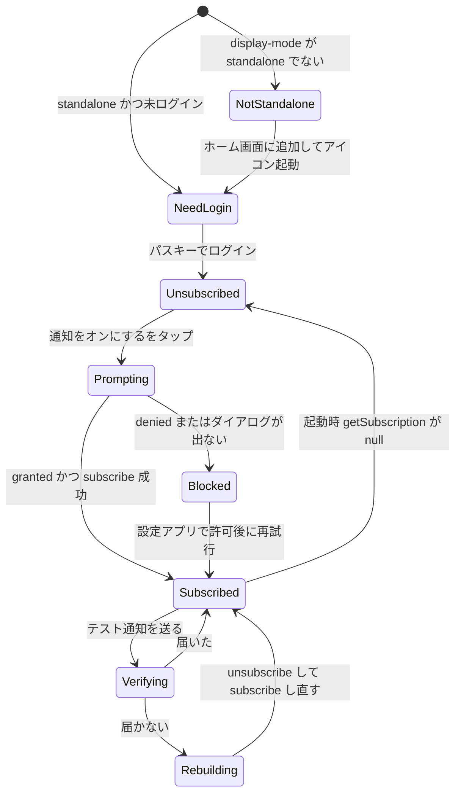

# 03 画面仕様書（主要画面）

## 文書情報

| 項目 | 内容 |
|---|---|
| 文書 ID | DES-03 |
| 版 | v0.1 |
| 日付 | 2026-10-10 |
| 関連要件 | FR-C-01〜12, FR-A-02, FR-A-05, FR-A-06, FR-A-09〜11, FR-A-15, FR-A-16, FR-S-05, FR-S-06, NFR-EN-03〜07, AT-01〜21 |
| 対象画面 | S-C-02, S-C-03, S-C-04, S-C-05, S-C-06, S-A-02, S-A-05, S-A-06, S-A-10（＋S-A-12） |

### 共通規約

- ワイヤーは 390×844（iPhone 標準）想定のテキスト表現。`[ ]` はボタン、`( )` はラジオ、`[x]` はチェック、`▸` は折りたたみ、`┃` は固定バー。正式な WF は `docs/04_wireframes/`。
- 検証タイミング: **blur 後**（入力中は出さない）と「次へ」押下時。エラー文は GOV.UK 形式（何をすればよいかを書く。「必須です」単独は禁止）。
- エラー表示: フィールド直下に `id` 付きメッセージ、入力に `aria-invalid="true"` と `aria-describedby`。送信時に複数エラーがあれば `ErrorSummary`（`role="alert"`、各エラーへのリンク）へフォーカス。
- 段階遷移時は次段の見出し（`tabIndex={-1}`）へ `focus()`、`aria-live="polite"` 領域で「ステップ 2/4: お客様情報」を通知。
- ターゲット 44×44 px 以上（下限 24 px＋間隔 4 px）、本文 16 px、入力欄 16 px 以上（iOS ズーム回避）。固定 CTA バーは `padding-bottom: max(16px, env(safe-area-inset-bottom))`、`scroll-padding-bottom` で入力欄を隠さない（WCAG 2.4.11）。
- 時刻はすべて JST。`/en` は S-C-03〜06 に「All times are Japan Standard Time (JST)」を表示。

---

## 1. S-C-02 予約（メニュー・お客様情報）

**目的**: 入力最少・1 ページ内の段階開示で、メニューと連絡先を確定させる（FR-C-01〜06）。

### 1.1 レイアウト概略（/ja、段階 3 を入力中）

```text
┌────────────────────────────── 390 ─┐
│ Neuer Barber 長田   EN  [電話]          │  ← SiteHeader（tel リンクはアイコン＋「電話」）
│ ① メニュー ─ ② お客様情報 ─ ③ 日時 ─ ④ 確認 │  ← BookingStepper（現在: ②）
├────────────────────────────────────┤
│ ✓ メニュー  カット 60分 ¥—  [変更] │  ← StepSummary（畳まれた完了段階）
│ ✓ お名前  山田 太郎（やまだ たろう）[変更]│
│ ── ご職業 ──────────────────── │  ← 現在の段階（見出しにフォーカス）
│ ( ) 学生                             │
│ ( ) 社会人                           │
│ 学生料金の判定に使用します           │
│ ▸ 電話番号（未開示）                │
│ ▸ 備考（未開示）                    │
├────────────────────────────────────┤
┃ [          次へ          ]          ┃  ← StickyCta（段階ごとに文言変化）
└────────────────────────────────────┘
```
（`¥—` は価格未確定のプレースホルダ。実値は `menus.price_jpy`【要確認: OI-01】）

### 1.2 項目定義

| # | 段階 | 項目 | 要素・属性 | 必須 | 制約・正規化 | 初期値 | 関連 |
|---|---|---|---|---|---|---|---|
| 1 | menu | メニュー | `MenuCard` のラジオグループ（`role="radiogroup"`）。カードに名称・一般価格・学生価格（設定時）・所要時間・一言説明 | 必須 | `menus.is_active = true` の中から 1 つ（`slug`） | `?menu=` があれば選択済み | FR-C-02 |
| 2 | name | お名前 | `<input name="name" autocomplete="name">` | 必須 | `trim`、1〜50 文字、制御文字禁止 | 空 | FR-C-03 |
| 3 | name | ふりがな（/ja のみ） | `<input name="full-name-phonetic">`、ラベル「ふりがな」、`autocomplete` は付けない | 必須（/ja） | NFKC → カタカナをひらがなへ変換 → `^[ぁ-ゖー\s　]+$`、1〜50 文字 | 空 | FR-C-03、【要確認: OI-13】 |
| 4 | occupation | ご職業 | ラジオ 2 択 `student` / `worker`（「学生」「社会人」/ "Student" "Working adult"） | 必須 | enum | 未選択 | FR-C-04 |
| 5 | phone | 電話番号 | `<input type="tel" inputmode="tel" autocomplete="tel" name="phone">` | 必須 | NFKC → 空白・ハイフン・類似ダッシュ（‐ - ‒ – — ― ー −）除去 → `0` 始まり 10〜11 桁は `+81` 付与 → E.164 `^\+[1-9]\d{7,14}$`。JP は `^\+81[1-9]\d{8,9}$` を追加検証 | 空 | FR-C-05 |
| 6 | note | 備考 | `<textarea name="note" maxlength` は付けず残り文字数を表示 | 任意 | 0〜500 文字（改行可） | 空 | FR-C-06 |
| 7 | — | ハニーポット | `<input name="website" tabindex="-1" autocomplete="off">` を視覚的に隠す（`aria-hidden` の親内） | — | 空であること（S-C-04 で送信） | 空 | FR-S-05 |

### 1.3 バリデーション規則とエラー文

| 項目 | 条件 | JA | EN |
|---|---|---|---|
| メニュー | 未選択 | メニューを選んでください | Select a menu |
| お名前 | 空 | お名前を入力してください（例: 山田 太郎） | Enter your full name |
| お名前 | 51 文字以上 | お名前は 50 文字以内で入力してください | Name must be 50 characters or fewer |
| ふりがな | 空 | ふりがなを入力してください（例: やまだ たろう） | — |
| ふりがな | ひらがな以外 | ふりがなはひらがなで入力してください（例: やまだ たろう） | — |
| ご職業 | 未選択 | 「学生」か「社会人」を選んでください | Select Student or Working adult |
| 電話番号 | 空 | 電話番号を入力してください（例: 09012345678） | Enter your phone number, like 090 1234 5678 or +44 7700 900123 |
| 電話番号 | 形式不正 | 電話番号を正しい形式で入力してください（例: 09012345678） | Enter a phone number in the correct format, like 090 1234 5678 or +44 7700 900123 |
| 備考 | 501 文字以上 | 備考は 500 文字以内で入力してください（現在 {count} 文字） | Notes must be 500 characters or fewer (currently {count}) |

スキーマは `features/booking/schema.ts` の `bookingDraftSchema`（段階別に `.pick()`）をクライアントとサーバーで共有し、メッセージは next-intl の `booking.errors.*` キーで解決する（`z.config` の customError でキーを返す）。

### 1.4 要約表示と段階管理

| 操作 | 処理 |
|---|---|
| メニューカードをタップ | 選択 → 料金・所要時間を要約に反映 → 段階 `name` を開示し見出しへフォーカス。`history.pushState({ bookingStep: 'name' }, '', '?step=name')` |
| 「次へ」（各段階） | 当該段階の `safeParse` → OK なら要約に畳み次段を開示＋`pushState`。NG ならエラー表示 |
| 要約の「変更」 | 当該段階を再展開（後続の入力値は保持）。`pushState` |
| ブラウザ「戻る」 | `popstate` の `event.state.bookingStep` に従い前段を再展開。入力値は `BookingDraftProvider`（React state）が保持 |
| 再読込・ロケール切替 | `sessionStorage['bb.bookingDraft.v1']`（電話を含むため同一タブ限定。完了・30 分無操作で破棄）から復元 |
| 備考の「次へ 日時を選ぶ」 | 全段階を再検証 → `router.push('/{locale}/book/time?menu={slug}')` |

学生選択時、要約と以降の画面の料金は `domain/pricing.ts` の `applicablePrice(menu, occupation)`（学生価格が NULL なら一般価格）で再計算する（FR-C-04, AT-05）。

### 1.5 状態

| 状態 | 表示 |
|---|---|
| loading | メニューは静的シェルに含まれるためスケルトン不要。フォームのハイドレーション前はカードを `<label>` ＋ネイティブラジオで操作可能（JS 前でも選べる） |
| empty | 公開メニュー 0 件: 「現在オンライン予約を受け付けていません。お電話ください」＋`tel:` |
| error | 予期しない例外は `error.tsx`（S-C-10）。入力値は `sessionStorage` に残る |

### 1.6 アクセシビリティ要点

- メニューカードは `<input type="radio">` を内包した `<label>`。選択状態は色＋チェックアイコン＋太字で示す（色のみに頼らない）。
- 未開示の段階は `hidden`（読み上げ対象外）。ステッパーは `<ol>`、現在段に `aria-current="step"`。
- ふりがな欄はラベルをひらがな表記（Chrome がラベルのカタカナでカタカナ自動入力するため）。`/en` では描画しない。

---

## 2. S-C-03 予約（日時選択）

**目的**: 空いている時刻だけを見せ、日 1 タップ＋時間 1 タップで確認へ進める（FR-C-07, 08, US-01）。

### 2.1 レイアウト概略（/ja）

```text
┌──────────────────────────────────── 390 ─┐
│ ① ─ ② ─ ③ 日時を選ぶ ─ ④                  │
│ カット（60分）を予約します  [メニューを変更] │
│ ◀ 2026年11月                         ▶   │
│ ┌──┬──┬──┬──┬──┬──┬──┐  ← 横スクロール    │
│ │今日│ 4 │ 5 │ 6 │ 7 │ 8 │ 9 │             │
│ │ 火 │ 水 │ 木 │ 金 │ 土 │ 日 │ 月 │       │
│ │ ◎ │ ◎ │ × │ ◎ │ ◎ │ ◎ │ ×  │           │
│ │    │    │満席│    │    │    │定休│       │
│ └──┴──┴──┴──┴──┴──┴──┘                   │
│ 11月4日(水) の空き時間                      │
│ [ ◎ 18:00–19:00 ]                          │
│ [ ◎ 19:30–20:30 ]                          │
│ [ ◎ 21:00–22:00 ]                          │
│ ◎：予約できます（この時刻から施術開始）     │  ← SlotLegend（直下 2 行）
│ ×：予約できません                           │
│ 本日の残り枠はお電話で [電話] 06-xxxx-xxxx      │  ← PhoneFallback【要確認: OI-10】
│ 予約締切: ご来店の 60 分前まで              │  ← DeadlineNotice（settings.lead_time_min）
└──────────────────────────────────────────┘
```

/en の時間枠: `◎ 6:00 PM–7:00 PM JST`、締切: "Bookings close 60 minutes before the start time"、凡例: "◎ Available (treatment starts at this time) / × Not available"。

### 2.2 表示項目と状態

| 要素 | 状態 | 表示 | 判定 |
|---|---|---|---|
| 日セル（`DayCell`） | available | 日付・曜日・◎、青系（`--status-open`）、タップ可 | その日に空き枠が 1 つ以上 |
| | full | 日付・曜日・×・「満席」、グレー＋取り消し線、`aria-disabled="true"` | 営業日だが空き枠 0 |
| | closed | 日付・曜日・×・「定休日」または「休業」 | `business_hours.is_closed` またはオーバーライドで休業 |
| | selected | えんじの枠線＋太字（`--accent`）、`aria-pressed="true"` | 選択中 |
| | 範囲外 | 表示しない | 今日より前／`max_advance_days` 超 |
| 時間枠（`SlotButton`） | available のみ | 「◎ 18:00–19:00」（開始–終了）。終了は `start + duration_min`（バッファは表示に含めない） | 空き枠のみボタン化。埋まった時刻は描画しない |
| 凡例 | 常時 | ◎・× の 2 記号のみ（○・△は使わない） | FR-C-07 |
| 締切文言 | 常時 | `lead_time_min` を差し込み | 【要確認: OI-06】 |

### 2.3 空き取得

| 項目 | 仕様 |
|---|---|
| 取得 | RSC `getAvailability({ menuSlug, from: today, to: today + 13 日 })`。週ストリップの日状態と選択日の時間枠を 1 回の SQL で返す（04_data_model.md 6 章） |
| 期間外の日 | ストリップを右へスクロールして 14 日先に達したら次の 14 日を `?from=` で取得（`<Link prefetch={true}>` は前後 1 区間のみ） |
| 鮮度 | 非キャッシュ。`<Suspense fallback={<SlotListSkeleton/>}>`。日付タップは `?date=` を変える `<Link>`（RSC ナビゲーション、URL で共有可） |
| 再取得 | S-C-04 から `slot_taken` で戻った場合は `router.refresh()` 済みの状態で表示し、`aria-live` で「選んだ時間は埋まりました。別の時間をお選びください」 |
| 枠ルール | 営業時間テンプレート、休業日オーバーライド、時間ブロック、有効予約、リードタイム、先行予約上限、閉店をまたがない、Asia/Tokyo（FR-C-08） |

### 2.4 操作→処理

| 操作 | 処理 | 関連 |
|---|---|---|
| 日セルをタップ | `?date=YYYY-MM-DD` へ遷移（スクロール位置は保持）。時間枠リスト見出しへフォーカス | FR-C-07 |
| 時間枠をタップ | 下書きに `startsAt`（例 `2026-11-04T18:00:00+09:00`）を保存 → `/book/confirm` へ | FR-C-07, CT-03 |
| 「メニューを変更」 | `/book?step=menu` | — |
| 「本日の残り枠はお電話で」 | `tel:` | FR-C-16 |
| 空の日で「次に空いている日へ」 | `nextAvailableDate` へ `?date=` 遷移 | — |

### 2.5 状態

| 状態 | 表示 |
|---|---|
| loading | ストリップ 7 セルと時間枠 3 行のスケルトン（高さ固定で CLS 0）。Neon 冷起動（数百 ms）を吸収（NFR-AV-02） |
| empty（選択日） | 「この日は空きがありません」＋「次に空いている日: 11/6(金)」ボタン |
| empty（14 日すべて） | 「2 週間以内に空きがありません。お電話でお問い合わせください」＋`tel:`＋「さらに先を見る」 |
| error | 「空き状況を読み込めませんでした」＋「再読み込み」＋`tel:`。Sentry に `digest` 付きで送信 |

### 2.6 アクセシビリティ要点

- ストリップは `role="listbox"` ではなくボタン列（`<ul>` 内の `<a>`）。左右矢印キーで日移動、Enter で選択。ドラッグ操作に依存しない（2.5.7）。
- 日セル 44×44 以上（7 列 × 44 = 308 px < 320 px）、時間枠ボタン高さ 48 px、間隔 8 px。
- ◎/× は記号＋文字ラベル＋色。`aria-label="11月5日 木曜日 満席"` のように状態を読み上げる。

---

## 3. S-C-04 予約（確認）

**目的**: 全入力を再入力なしで確認し、同意のうえ確定する（FR-C-09, 10、WCAG 3.3.7）。

### 3.1 レイアウト概略

```text
┌──────────────────────────────── 390 ─┐
│ ① ─ ② ─ ③ ─ ④ 確認                    │
│ ご予約内容の確認                       │
│ メニュー     カット            [変更] │
│ 料金         ¥— 学生料金      [変更] │
│ 所要時間     60分                     │
│ 日時         11月4日(水) 18:00–19:00 [変更] │
│ お名前       山田 太郎（やまだ たろう）[変更] │
│ ご職業       学生              [変更] │
│ 電話番号     090-1234-5678     [変更] │
│ 備考         （なし）          [変更] │
│ ─ キャンセルについて ─                │
│ ご来店の2時間前までは予約完了画面のリンク │
│ から、それ以降はお電話でご連絡ください。 │
│ [x] プライバシーポリシーとキャンセル     │
│     ポリシーに同意します（リンク）      │
│ （Turnstile: 非対話・不可視）          │
┃ [ この内容で予約を確定する ]          ┃
└──────────────────────────────────────┘
```

### 3.2 表示項目

| 行 | 値の出所 | 書式 |
|---|---|---|
| メニュー・所要時間 | 下書き `menuSlug` → `getActiveMenus()` | 名称（ロケール別） |
| 料金 | `applicablePrice()` | `Intl` 通貨、学生価格適用時は「学生料金」ラベル。確定値はサーバー側で再計算しスナップショット |
| 日時 | 下書き `startsAt` | 「11月4日(水) 18:00–19:00」/ "Wed, Nov 4, 6:00 PM–7:00 PM JST" |
| お名前（ふりがな） | 下書き | /ja は `<ruby>` ではなく括弧併記（入力値の確認のため） |
| 電話番号 | 下書き（表示は入力時の書式） | — |
| 同意文 | messages `confirm.consent` ＋ `policy_version` | 「ご入力いただいた氏名・電話番号は、ご予約の管理・確認連絡のために利用し、第三者には提供しません。プライバシーポリシーとキャンセルポリシーに同意します」/ "I agree to the Privacy Policy and Cancellation Policy" |

### 3.3 操作→処理

| 操作 | 処理 | 関連 |
|---|---|---|
| 「変更」 | 該当段階（`/book?step=…` または `/book/time`）へ。他の値は保持 | FR-C-09 |
| 同意チェック | 状態のみ。未チェックで確定 → 「プライバシーポリシーとキャンセルポリシーへの同意にチェックしてください / Select the checkbox to agree to the policies」 | FR-C-09 |
| 「この内容で予約を確定する」 | `useActionState(createBooking)`。送信値: 下書き全項目＋`consent`＋`turnstileToken`＋`website`（ハニーポット）＋`submissionNonce`（画面表示時に `crypto.randomUUID()`、`sessionStorage` に保持）。送信中はボタンを `aria-disabled` にし「確定しています…」 | FR-C-10 |
| 結果 `ok` | `router.replace(result.doneUrl)`、下書き破棄 | CT-04 |
| 結果 `conflict` | `/book/time?date=…` へ戻し「申し訳ありません。その枠はたった今埋まりました。別の時間をお選びください / Sorry, that time was just booked. Please choose another time.」 | AT-03 |
| 結果 `invalid` | `ErrorSummary` にフィールドエラー。営業時間外・リードタイム切れは「その時間は予約できません。日時を選び直してください」 | FR-S-02 |
| 結果 `rate_limited` | 「短時間に操作が集中しました。しばらくしてからお試しいただくか、お電話ください」＋`tel:` | FR-S-04 |
| 結果 `bot_check_failed` | Turnstile を `reset()` し「確認に失敗しました。もう一度お試しください」 | FR-S-05 |
| 結果 `restricted`（Should） | 「お手数ですが、お電話でご予約ください」＋`tel:` | FR-A-13 |
| 結果 `duplicate` | 「同じ内容のご予約がすでにあります。完了画面を保存していない場合はお電話ください」 | 00_overview G-04 |
| Turnstile 期限切れ（300 秒） | `expired-callback` で自動 `reset()` | FR-S-05 |

### 3.4 状態

| 状態 | 表示 |
|---|---|
| loading | 静的シェル。下書き復元までの 1 フレームのみ行スケルトン |
| empty | 下書きなし（直リンク・期限切れ）→ `/book` へ `replace` し「入力内容の有効期限が切れました」トースト |
| error | 予期しない例外は `status: 'error'` ＋ `digest`。「予約を確定できませんでした。時間をおいて再度お試しいただくか、お電話ください」 |

### 3.5 アクセシビリティ要点

- 確認リストは `<dl>`。「変更」リンクは `aria-label="メニューを変更"` のように対象を含める。
- 同意チェックは 44 px 以上のタップ領域（ラベル全体）。リンクは新しいタブで開かず、戻ったときに下書きが残る。
- Turnstile は非対話型（画像 CAPTCHA なし、WCAG 3.3.8）。

---

## 4. S-C-05 予約完了

**目的**: 唯一の証憑として、1 画面に予約内容・ICS・キャンセルリンクを収める（FR-C-11）。

### 4.1 レイアウト概略（縦スクロールなしで 390×844 に収める）

```text
┌──────────────────────────── 390 ─┐
│ Neuer Barber 長田            EN  │  ← 最小ヘッダー（48px）
│ ✓ ご予約が確定しました             │
│ この画面をスクリーンショットで保存して │
│ ください（確認メールは送信されません）│
│ ┌──────────────────────────┐ │
│ │ 予約番号  K7Q2-M9XD   [コピー] │ │
│ │ 11月4日(水)                    │ │
│ │ 18:00–19:00                    │ │
│ │ カット  ¥— 学生料金            │ │
│ │ 担当  長田 健豊                │ │
│ │ Neuer BARBERSHOP               │ │
│ │ 大阪市阿倍野区…  [地図を開く]  │ │  ← 【要確認: OI-09】
│ └──────────────────────────┘ │
│ [ カレンダーに追加（.ics）]         │
│ [ Google カレンダー ]（Should）     │
│ キャンセル・変更用リンク             │
│ https://…/ja/cancel/AbC…  [コピー] │
│ ご来店の2時間前まで。以降はお電話で  │
│ [電話] 06-xxxx-xxxx   キャンセルポリシー │
└──────────────────────────────────┘
```

### 4.2 表示項目・操作

| 項目 | 出所 | 操作→処理 |
|---|---|---|
| 予約番号 | `bookings.public_code`（8 文字、紛らわしい文字を除いた英数） | 「コピー」→ `navigator.clipboard.writeText`、失敗時はテキスト選択。`aria-live` で「コピーしました」 |
| 日付・時刻・メニュー・料金 | `getBookingByToken()`（`price_jpy` スナップショット） | — |
| 店名・住所・担当 | `config/shop.ts` | 「地図を開く」→ 地図 URL（新規タブ、`rel="noopener noreferrer"`） |
| カレンダーに追加 | `/api/ics/{token}` | ダウンロード（`SUMMARY`/`LOCATION`/`DESCRIPTION` にキャンセル URL 全文/`VALARM` 前日・1 時間前） |
| Google カレンダー（Should） | `calendar.google.com/calendar/render?action=TEMPLATE…` | 新規タブ |
| キャンセル用リンク | `absoluteUrl('/{locale}/cancel/{token}')` | 「コピー」。リンク自体もタップ可 |

### 4.3 状態

| 状態 | 表示 |
|---|---|
| loading | カードのスケルトン（同じ高さ） |
| not found | 無効・キャンセル済み・閲覧期限（終了 24 時間後）切れ: 「この予約は見つかりません」＋予約 CTA＋`tel:` |
| error | S-C-10 |

### 4.4 アクセシビリティ要点

- 見出し「ご予約が確定しました」に初期フォーカス（Next.js ルートアナウンサーと重複しないよう `document.title` も「予約完了」）。
- 折りたたみ・カルーセル不使用。コントラストは本文 AAA 相当。

---

## 5. S-C-06 キャンセル

**目的**: トークンリンクから副作用なしで内容を再表示し、締切前のみセルフキャンセルさせる（FR-C-12）。

### 5.1 レイアウト概略（締切前）

```text
┌──────────────────────────── 390 ─┐
│ ご予約のキャンセル                 │
│ 予約番号 K7Q2-M9XD                 │
│ 11月4日(水) 18:00–19:00  カット     │
│ キャンセルは 11月4日(水) 16:00 まで │
│ [ この予約をキャンセルする ]        │  ← 破壊的操作色（えんじではなく警告トークン）
│ 日時の変更は、キャンセル後に        │
│ もう一度ご予約ください               │
└──────────────────────────────────┘
  ↓ タップ
┌ ConfirmDialog ─────────────────────┐
│ 本当にキャンセルしますか？           │
│ この操作は取り消せません。           │
│ [ 戻る ]   [ キャンセルする ]        │
└────────────────────────────────────┘
```

### 5.2 状態と表示

| 状態 | 条件 | 表示 |
|---|---|---|
| cancellable | トークン一致、`status = confirmed`、`now < cancel_token_expires_at` | 上図。締切時刻を明示 |
| past_deadline | トークン一致、`confirmed`、締切後、予約終了前 | 「キャンセル締切（ご来店の 2 時間前）を過ぎています。お電話でご連絡ください」＋大きな `tel:` ボタン【要確認: OI-05, OI-10】 |
| cancelled（直後） | `cancelBooking` が `ok` | 「キャンセルしました」＋「もう一度予約する」→ `/book` |
| not found | 形式不正・ハッシュ不一致・キャンセル済み・完了済み・閲覧期限切れ | 「この予約は見つかりません」（理由を区別しない。列挙対策） |
| rate limited | proxy で IP 10 回/分超過 | 429 の簡易ページ「しばらくしてからお試しください」 |
| loading | — | 内容スケルトン |

### 5.3 操作→処理

| 操作 | 処理 | 関連 |
|---|---|---|
| ページ表示（GET） | トークン形式チェック → ハッシュ照合 → 表示のみ。**副作用なし**（リンクプレビューの誤キャンセル防止） | FR-C-12, FR-S-06 |
| 「この予約をキャンセルする」 | `ConfirmDialog`（`<dialog>`、初期フォーカスは「戻る」） | — |
| 「キャンセルする」 | `cancelBooking({ token })`: 再照合 → 締切再判定 → `status = cancelled_by_customer`、`cancel_token_hash = NULL` → `after()` で管理者へ Push | FR-C-12, FR-A-10 |
| 結果 `past_deadline` | 締切後表示へ切替 | — |

アクセシビリティ: ダイアログは `aria-modal`、Esc で閉じる、閉じたらトリガーへフォーカスを戻す。

---

## 6. S-A-02 今日（管理 PWA の start_url）

**目的**: 当日の予約・ブロックを時系列で把握し、電話・状態変更・ブロックを片手で行う（FR-A-02, 11）。

### 6.1 レイアウト概略（ダーク追従）

```text
┌──────────────────────────── 390 ─┐
│ ◀ 11/4(水) 今日 ▶      [未確認 2] │  ← AdminHeader（InboxBadge）
│ 18:00 ┬───────────────────────── │
│       │┌ 18:00–19:00 ───────┐    │  ← BookingCard（≥56px）
│ 18:15 ││山田 太郎（やまだ） ● │    │     ●=未確認
│ 18:30 ││カット  web  [電話] 備考あり│   │
│ 18:45 │└────────────────────┘    │
│ 19:00 ┼─ 19:10 ━━━━━━━━━ 現在 ━ │  ← NowLine
│ 19:30 │░ 休憩 19:30–20:00 ░░░░░  │  ← BlockCard（斜線）
│ 20:00 │（空き：タップで追加）     │
│  …    │                           │
│ 24:00 ┴                           │
│                              [＋] │  ← Fab
├──────────────────────────────────┤
│ [今日] [週] [受信箱 2] [設定]     │  ← BottomTabs
└──────────────────────────────────┘
```

### 6.2 表示項目

| 要素 | 内容 | 出所 |
|---|---|---|
| 時間軸 | 当日の受付時間（仮 18:00〜24:00）を 15 分刻み。営業時間外の予約があれば軸を拡張 | `business_hours`／オーバーライド |
| `BookingCard` | 開始–終了、氏名（ふりがな）、メニュー、`source` バッジ、状態チップ、`tel:` ボタン（`phone_e164` があれば）、備考有無アイコン、未確認ドット | `getDayAgenda(date)` |
| `BlockCard` | 種別（休憩/私用/臨時休業）、ラベル、区間 | `time_blocks` |
| `NowLine` | 現在時刻（JST）。1 分ごとに位置更新 | クライアント |
| 未確認バッジ | `acknowledged_at IS NULL` かつ（新規 web 予約 or 顧客キャンセル）の件数 | `/api/admin/inbox-count` |

### 6.3 操作→処理

| 操作 | 処理 | 関連 |
|---|---|---|
| カードタップ | `/admin/bookings/{id}`（詳細。開いた時点で `acknowledgeBooking`） | FR-A-04, 11 |
| [電話] | `tel:`（カードタップと分離した 44 px ボタン） | FR-A-02 |
| ◀ ▶ | `?date=` 前後日 | FR-A-02 |
| 空き区間タップ | `QuickActionSheet`（その時刻で「手動予約」「ここからブロック」） | FR-A-05, 06 |
| FAB ＋ | `QuickActionSheet`: 「手動予約」「今から 30 分ブロック」「今から 1 時間ブロック」「終日ブロック」「期間を指定してブロック」 | FR-A-06 |
| プリセットブロック | `createTimeBlock({ preset })` 即保存 → `Toast`「19:10–20:10 をブロックしました [取り消す]」5 秒 →「取り消す」で `deleteTimeBlock`（作成の取り消し） | FR-A-06, AT-21 |
| ポーリング | 起動時・`visibilitychange`・可視中 20 秒で `inbox-count` を取得。`latestChangeAt` が変わったら `router.refresh()` | FR-A-11, AT-15 |

### 6.4 状態

| 状態 | 表示 |
|---|---|
| loading | 時間軸は即描画、カード部をスケルトン |
| empty | 「今日の予約はまだありません」＋空き区間はタップ可能のまま |
| closed day | 「定休日です」帯＋手動予約は可能 |
| offline（Should） | `OfflineBanner`「オフラインです。最後に取得した内容を表示しています（11/4 19:05）」＋書き込み系ボタンを無効化 |
| error | 「読み込めませんでした」＋再試行。通知とポーリングは継続 |
| push 未購読 | `ResubscribeBanner`「この端末の通知がオフになっています [通知をオンにする]」（`getSubscription()` が null のとき） |

アクセシビリティ: タイムラインは視覚表現と別に、カードを時系列の `<ol>` として読み上げ順を保証。色だけで状態を示さない（チップに文字）。

---

## 7. S-A-05 手動予約

**目的**: 電話・店頭・DM の予約を同じカレンダーに入れ、重なりを保存前に検出する（FR-A-05, US-04）。

### 7.1 レイアウト概略

```text
┌──────────────────────────── 390 ─┐
│ ← 手動予約                         │
│ お名前*   [ 山田           ▾]      │  ← CustomerCombobox（候補: 山田 太郎 090-…1234）
│ 電話番号  [ 09012345678       ]    │
│ メニュー* [ カット 60分        ▾]  │
│ 日付*     [ 11/4(水) ]  開始* [19:00▾]│
│ 経路*     (電話)(店頭)(Instagram)(LINE)(その他)│
│ メモ      [                     ]  │
│ ┌ 重なりがあります ─────────────┐ │  ← OverlapAlert（赤、role=alert）
│ │ 19:00–20:00 の佐藤様と重なります │ │
│ └──────────────────────────────┘ │
┃ [ 時間を変更 ]（既定）  [保存]      ┃
└──────────────────────────────────┘
```

### 7.2 項目定義

| 項目 | 必須 | 制約 | 備考 |
|---|---|---|---|
| お名前 | 必須 | 1〜50 文字 | 入力 2 文字以上で `/api/admin/customers/suggest?q=`（かな部分一致・電話完全一致）。候補選択で `customerId` を確定 |
| 電話番号 | 任意 | S-C-02 と同じ正規化 | 入力時は `phone_unverified = true` |
| メニュー | 必須 | 非公開メニューも選択可 | 所要時間＋バッファで終了を算出 |
| 日付・開始 | 必須 | 15 分刻み。営業時間外は黄色の注意「営業時間外です」（保存は可能） | `?start=` で初期値 |
| 経路 `source` | 必須 | `phone` / `walk_in` / `instagram` / `line` / `manual` | — |
| メモ | 任意 | 0〜500 文字 | `owner_note` |

### 7.3 操作→処理

| 操作 | 処理 | 関連 |
|---|---|---|
| 日時・メニュー変更 | 300 ms デバウンスで `GET /api/admin/overlaps?start&end` → 重なる予約・ブロックを表示 | FR-A-05 |
| 「保存」 | `createManualBooking`。サーバーで再判定（advisory lock 下）。`23P01` → `conflict: overlap` と重なり詳細を返す | FR-S-01 |
| 重なり時 | 「保存」は無効化され、既定ボタンは「時間を変更」（開始欄へフォーカス）。`[それでも保存]` は OI-11 で許容が決まった場合のみ表示 | 【要確認: OI-11】 |
| 保存成功 | `SavedSheet`: 「保存しました」＋確認 URL（`/{locale}/book/done/{token}`、ロケールは選択式 ja/en）[コピー]＋「DM 用の文面をコピー」（JA/EN 定型文＋URL） | FR-A-05 |
| 下書き | 入力ごとに `sessionStorage['bb.draft.manual']` へ保存し、バックグラウンド復帰のリロードで復元。保存成功で破棄 | FR-A-10, AT-17 |

状態: loading（メニュー取得中はセレクトを無効）、error（「保存できませんでした」＋入力保持）、offline（保存ボタン無効＋バナー）。アクセシビリティ: Combobox は WAI-ARIA combobox パターン、`OverlapAlert` は `role="alert"`。

---

## 8. S-A-06 時間ブロック

**目的**: 休憩・私用・臨時休業を数タップで空き枠から外す（FR-A-06）。

### 8.1 レイアウト概略（期間指定画面。プリセットは S-A-02 の FAB から直接保存）

```text
┌──────────────────────────── 390 ─┐
│ ← 時間をブロック                   │
│ [今から30分] [今から1時間] [終日]   │  ← プリセット（この画面でも選べる）
│ 種別  (休憩) (私用) (臨時休業)      │
│ 開始  [11/4(水)] [19:10]            │
│ 終了  [11/4(水)] [20:10]            │
│ ラベル [                ]（任意）    │
│ ┌ 予約と重なっています ─────────┐ │
│ │ 19:30–20:30 山田様（予約は残ります）│ │
│ └──────────────────────────────┘ │
┃ [ ブロックする ]                    ┃
└──────────────────────────────────┘
```

### 8.2 規則と操作→処理

| 項目 | 規則 |
|---|---|
| 今から 30 分 / 1 時間 | 開始 = 現在時刻を 5 分単位で切り捨て、終了 = 開始 + 30/60 分。種別 `break` |
| 終日 | 選択日の 00:00〜翌 00:00 JST。種別 `closed` |
| 期間指定 | 開始 < 終了、最大 60 日。複数日の臨時休業は `closed`（`holiday` は将来の祝日休業用に予約） |
| 重なり | 有効予約と重なる場合は警告し「それでもブロック」で保存（ブロックは予約を消さない）。保存前に `GET /api/admin/overlaps` |
| 保存 | `createTimeBlock` → `time_blocks` INSERT（advisory lock 下）→ `audit_log` → 顧客サイトの該当枠は次回取得から消える（非キャッシュ） |
| 削除 | ブロックカードの詳細から「削除」→ `deleteTimeBlock`（`deleted_at`）→ 5 秒 Undo（`restoreTimeBlock`） |

状態: loading／error（入力保持）／offline（無効）。アクセシビリティ: プリセットは `<button>` 群、種別はラジオ、時刻はネイティブ `<input type="time" step="300">`。

---

## 9. S-A-10 通知設定・端末（＋S-A-12 インストール案内のオンボーディング）

**目的**: iOS の制約下で「ホーム画面に追加 → 起動 → ログイン → 通知オン → テスト」を一本道で完了させ、失効を検知して直せるようにする（FR-A-09, 15, 16）。

### 9.1 オンボーディング状態遷移



### 9.2 状態別レイアウトと文言

| 状態 | 判定 | 表示・操作 |
|---|---|---|
| NotStandalone | `!matchMedia('(display-mode: standalone)').matches` かつ `navigator.standalone !== true` | S-A-12 へ誘導。iOS: 「共有ボタン → ホーム画面に追加 → ホーム画面のアイコンから開く」の 3 枚図解。Android: `beforeinstallprompt` を保持して「アプリをインストール」ボタン（`prompt()` は 1 回のみ）。通知ボタンは出さない（AT-11） |
| Unsubscribed | standalone、ログイン済み、`getSubscription()` が null | 「通知をオンにする」ボタン（ユーザー操作内で `Notification.requestPermission()` → `pushManager.subscribe({ userVisibleOnly: true, applicationServerKey })` → `subscribePush`）。`Notification.permission` は判定の主条件にしない（iOS の OFF でも `default` を返す） |
| Blocked | `requestPermission()` が `granted` 以外／ダイアログが出ない | 「iPhone の 設定 > 通知 > Neuer 予約管理 で通知を許可してから、もう一度お試しください」＋集中モードの確認案内（AT-14b）【要確認: アプリ名 OI-08】 |
| Subscribed | 購読あり | 「この端末で通知を受け取ります」、登録日時、`last_success_at`。起動のたびに `touchPushSubscription(endpoint)` で `last_seen_at` 更新 |
| Verifying | 「テスト通知を送る」 | `sendTestPush` → 各購読の HTTP ステータス（例「iPhone: 201 送信済み」）を表示し「通知は届きましたか？ [届いた] [届かない]」 |
| Rebuilding | 「届かない」 | 「購読を作り直す」→ `unsubscribe()` → `subscribe()` → `subscribePush({ replaceEndpoint })`（APNs 201 なのに未達のケース、AT-14） |

### 9.3 端末一覧・その他

| 要素 | 内容 | 操作→処理 |
|---|---|---|
| ログイン中の端末 | Better Auth `session`（UA から機種名、最終利用、この端末の印） | 「この端末以外をログアウト」→ `logoutOtherDevices`（他セッション失効＋紐づく購読削除、FR-A-16） |
| 通知を受け取る端末 | `push_subscriptions`（platform、`last_seen_at`、`fail_count`） | 個別「削除」→ `unsubscribePush` |
| 日次サマリー | 「毎日 21 時台に明日の予約をお知らせ」（Hobby 期間の表記。Pro 移行後は「21:00」） | 表示のみ（`settings.digest_hour_jst`） |
| ログアウト | — | `unsubscribe()`＋`unsubscribePush`＋`signOut()` |

状態: loading（カードのスケルトン）、error（「通知の設定を保存できませんでした」＋再試行）。アクセシビリティ: 状態変化は `aria-live`、図解には代替テキスト、ボタンは 48 px。

関連受入基準: AT-11, AT-12, AT-13, AT-14, AT-14b, AT-16, AT-17, AT-19, AT-20。
