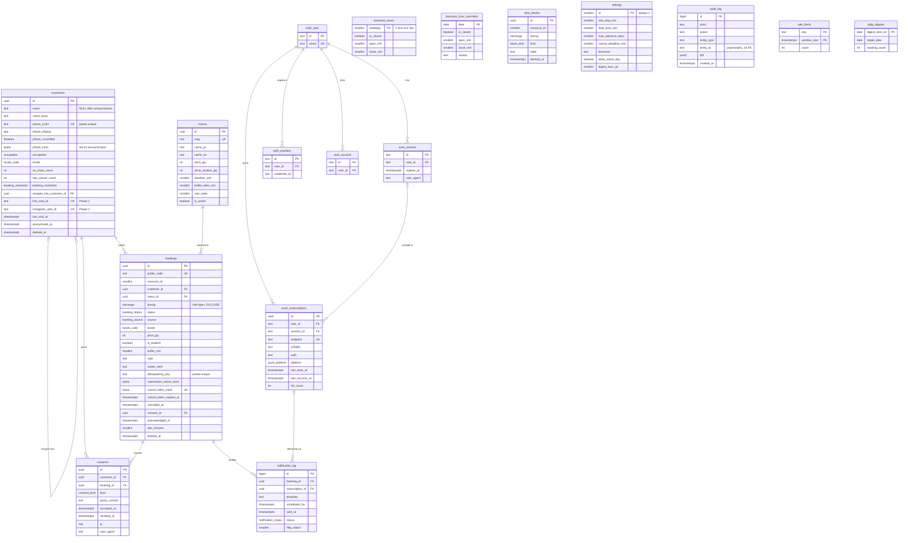

# 04 データモデル — ER 図・DDL・空き計算 SQL・Drizzle・匿名化

## 文書情報

| 項目 | 内容 |
|---|---|
| 文書 ID | DES-04 |
| 版 | v0.2 |
| 日付 | 2026-10-10 |
| 変更履歴 | v0.2（2026-10-10）: 要件定義書 v0.4 の反映。空き計算 SQL が × の候補も状態付きで返す（FR-C-07）、`auth_verification` の用途をワンタイムコードに（OI-12）、意図的重複の拡張点の扱い（OI-11 決定済み） |
| 関連要件 | 10 章（10.1〜10.3）、FR-S-01, FR-S-02, FR-S-06, FR-S-07, FR-S-09, FR-C-08, FR-C-10, FR-C-11, FR-A-04〜08, FR-A-11〜14, NFR-PF-05, NFR-MG-02, NFR-SC-05, NFR-SC-07, NFR-EN-07 |
| 関連 ADR | ADR-0002（Neon）、ADR-0003（EXCLUDE を生 SQL で）、ADR-0006（Better Auth テーブル）、ADR-0008（顧客スナップショットを持たない） |

---

## 1. 設計原則

| # | 原則 | 内容 |
|---|---|---|
| M-01 | 時刻は `timestamptz`（UTC 格納） | 区間は `tstzrange` の半開区間 `[)`。暦日は JST の `date`、営業時間は「0 時からの分」（`smallint`、0〜1440） |
| M-02 | 二重予約は制約で禁止 | `EXCLUDE USING gist (resource_id WITH =, during WITH &&) WHERE (status IN ('confirmed','arrived','in_progress'))` |
| M-03 | 個人情報は `customers` のみ | 予約行は `customer_id` で参照し、氏名・電話のスナップショットを持たない（ADR-0008）。匿名化は `customers` 1 行の更新で完結 |
| M-04 | 金額は確定時スナップショット | `bookings.price_jpy`・`is_student`・`buffer_min` を確定時に保存し、後のメニュー改定の影響を受けない |
| M-05 | 秘密はハッシュのみ | キャンセルトークンは SHA-256（`bytea`）、レート制限キーと監査ログの電話番号は HMAC（`PII_HASH_SECRET`） |
| M-06 | 列挙は Postgres ENUM | 値の追加は `ALTER TYPE … ADD VALUE` で容易。削除は行わない |
| M-07 | ソフトデリートは誤操作復旧用 | `deleted_at` は 5 秒 Undo のため。法的消去は `anonymized_at`（実データを消す） |
| M-08 | 拡張点を先に置く | `resource_id`（複数席）、`customers.line_user_id`/`instagram_user_id`（Phase 2）、`consents.kind` の Phase 3 値 |

---

## 2. ER 図



`audit_log` は多態参照（`entity_type`＋`entity_id`）のため FK を張らない。`time_blocks`・`business_hours`・`business_hour_overrides`・`settings` は空き計算 SQL で結合する（FK なし）。

---

## 3. 完全 DDL

マイグレーション構成（ADR-0003）:

| ファイル | 生成方法 | 内容 |
|---|---|---|
| `drizzle/0000_extensions.sql` | `drizzle-kit generate --custom --name=extensions` に手書き | `btree_gist`、`pg_trgm` |
| `drizzle/0001_init.sql` | `drizzle-kit generate`（`src/lib/db/schema.ts` から） | ENUM、全テーブル、CHECK、通常インデックス、部分 UNIQUE |
| `drizzle/0002_constraints.sql` | `drizzle-kit generate --custom --name=constraints` に手書き | `EXCLUDE` 制約、DEFERRABLE FK、`updated_at` トリガー |

以下は 3 ファイルを統合した論理 DDL（PostgreSQL 17）。

```sql
-- ===== 0000_extensions.sql =====
CREATE EXTENSION IF NOT EXISTS btree_gist;   -- EXCLUDE で smallint の = と tstzrange の && を併用
CREATE EXTENSION IF NOT EXISTS pg_trgm;      -- 顧客のかな部分一致検索（FR-A-13, Should）

-- ===== 0001_init.sql =====
CREATE TYPE booking_status AS ENUM (
  'confirmed', 'arrived', 'in_progress', 'completed',
  'cancelled_by_customer', 'cancelled_by_owner', 'cancelled_late', 'no_show');
CREATE TYPE booking_source AS ENUM ('web', 'phone', 'walk_in', 'instagram', 'line', 'manual');
CREATE TYPE occupation AS ENUM ('student', 'worker');
CREATE TYPE locale_code AS ENUM ('ja', 'en');
CREATE TYPE booking_restriction AS ENUM ('none', 'phone_only', 'blocked');
CREATE TYPE block_kind AS ENUM ('break', 'private', 'closed', 'holiday');
CREATE TYPE consent_kind AS ENUM (
  'booking_policy', 'privacy', 'health_notes', 'photo_karte', 'photo_sns', 'marketing');
CREATE TYPE push_platform AS ENUM ('ios', 'android', 'desktop', 'other');
CREATE TYPE notification_status AS ENUM ('sent', 'failed', 'expired');

CREATE TABLE customers (
  id                      uuid PRIMARY KEY DEFAULT gen_random_uuid(),
  name                    text CHECK (name IS NULL OR char_length(name) BETWEEN 1 AND 50),
  name_kana               text CHECK (name_kana IS NULL OR char_length(name_kana) <= 50),
  phone_e164              text CHECK (phone_e164 IS NULL OR phone_e164 ~ '^\+[1-9][0-9]{7,14}$'),
  phone_display           text CHECK (phone_display IS NULL OR char_length(phone_display) <= 32),
  phone_unverified        boolean NOT NULL DEFAULT false,
  phone_hash              bytea,                       -- 匿名化時に HMAC(phone_e164) を残す（再来の名寄せ・統計用）
  occupation              occupation,
  locale                  locale_code NOT NULL DEFAULT 'ja',
  no_show_count           integer NOT NULL DEFAULT 0 CHECK (no_show_count >= 0),
  late_cancel_count       integer NOT NULL DEFAULT 0 CHECK (late_cancel_count >= 0),
  booking_restriction     booking_restriction NOT NULL DEFAULT 'none',
  merged_into_customer_id uuid REFERENCES customers(id),
  line_user_id            text UNIQUE,                 -- Phase 2（NULL）
  instagram_user_id       text UNIQUE,                 -- Phase 2（NULL）
  last_visit_at           timestamptz,
  anonymized_at           timestamptz,
  created_at              timestamptz NOT NULL DEFAULT now(),
  updated_at              timestamptz NOT NULL DEFAULT now(),
  deleted_at              timestamptz,
  CONSTRAINT customers_name_present CHECK (anonymized_at IS NOT NULL OR name IS NOT NULL),
  CONSTRAINT customers_anonymized_clean CHECK (
    anonymized_at IS NULL OR (name IS NULL AND name_kana IS NULL AND phone_e164 IS NULL
                              AND phone_display IS NULL AND line_user_id IS NULL AND instagram_user_id IS NULL)),
  CONSTRAINT customers_not_self_merged CHECK (merged_into_customer_id IS DISTINCT FROM id)
);
CREATE UNIQUE INDEX customers_phone_e164_uidx ON customers (phone_e164)
  WHERE phone_e164 IS NOT NULL AND deleted_at IS NULL AND merged_into_customer_id IS NULL;
CREATE INDEX customers_name_kana_trgm_idx ON customers USING gin (name_kana gin_trgm_ops);
CREATE INDEX customers_retention_idx ON customers (last_visit_at) WHERE anonymized_at IS NULL;

CREATE TABLE menus (
  id                uuid PRIMARY KEY DEFAULT gen_random_uuid(),
  slug              text NOT NULL UNIQUE CHECK (slug ~ '^[a-z0-9]+(-[a-z0-9]+)*$'),
  name_ja           text NOT NULL CHECK (char_length(name_ja) BETWEEN 1 AND 40),
  name_en           text NOT NULL CHECK (char_length(name_en) BETWEEN 1 AND 60),
  description_ja    text CHECK (char_length(description_ja) <= 120),
  description_en    text CHECK (char_length(description_en) <= 200),
  price_jpy         integer NOT NULL CHECK (price_jpy >= 0),              -- 税込
  price_student_jpy integer CHECK (price_student_jpy IS NULL OR price_student_jpy BETWEEN 0 AND price_jpy),
  duration_min      smallint NOT NULL CHECK (duration_min BETWEEN 15 AND 480 AND duration_min % 5 = 0),
  buffer_after_min  smallint NOT NULL DEFAULT 0 CHECK (buffer_after_min BETWEEN 0 AND 120 AND buffer_after_min % 5 = 0),
  sort_order        smallint NOT NULL DEFAULT 0,
  is_active         boolean NOT NULL DEFAULT false,                      -- 価格確定まで非公開
  created_at        timestamptz NOT NULL DEFAULT now(),
  updated_at        timestamptz NOT NULL DEFAULT now()
);

CREATE TABLE business_hours (
  weekday    smallint PRIMARY KEY CHECK (weekday BETWEEN 0 AND 6),      -- 0=日 … 6=土（extract(dow) と一致）
  is_closed  boolean NOT NULL DEFAULT false,
  open_min   smallint CHECK (open_min BETWEEN 0 AND 1440),
  close_min  smallint CHECK (close_min BETWEEN 0 AND 1440),               -- 1440 = 24:00
  updated_at timestamptz NOT NULL DEFAULT now(),
  CONSTRAINT business_hours_valid CHECK (
    is_closed OR (open_min IS NOT NULL AND close_min IS NOT NULL AND open_min < close_min))
);

CREATE TABLE business_hour_overrides (
  date       date PRIMARY KEY,                                            -- JST 暦日
  is_closed  boolean NOT NULL DEFAULT true,
  open_min   smallint CHECK (open_min BETWEEN 0 AND 1440),
  close_min  smallint CHECK (close_min BETWEEN 0 AND 1440),
  reason     text CHECK (char_length(reason) <= 100),
  created_at timestamptz NOT NULL DEFAULT now(),
  updated_at timestamptz NOT NULL DEFAULT now(),
  CONSTRAINT overrides_valid CHECK (
    is_closed OR (open_min IS NOT NULL AND close_min IS NOT NULL AND open_min < close_min))
);

CREATE TABLE settings (
  id                  smallint PRIMARY KEY DEFAULT 1 CHECK (id = 1),     -- 単一行
  slot_step_min       smallint NOT NULL DEFAULT 30  CHECK (slot_step_min IN (10, 15, 20, 30, 60)),
  lead_time_min       smallint NOT NULL DEFAULT 60  CHECK (lead_time_min BETWEEN 0 AND 2880),
  max_advance_days    smallint NOT NULL DEFAULT 60  CHECK (max_advance_days BETWEEN 1 AND 365),
  cancel_deadline_min smallint NOT NULL DEFAULT 120 CHECK (cancel_deadline_min BETWEEN 0 AND 10080),
  timezone            text     NOT NULL DEFAULT 'Asia/Tokyo' CHECK (timezone = 'Asia/Tokyo'),
  allow_same_day      boolean  NOT NULL DEFAULT true,
  digest_hour_jst     smallint NOT NULL DEFAULT 21  CHECK (digest_hour_jst BETWEEN 0 AND 23),
  updated_at          timestamptz NOT NULL DEFAULT now()
);

CREATE TABLE consents (
  id             uuid PRIMARY KEY DEFAULT gen_random_uuid(),
  customer_id    uuid NOT NULL REFERENCES customers(id),
  booking_id     uuid,                                                    -- FK は 0002 で DEFERRABLE 付与
  kind           consent_kind NOT NULL,
  policy_version text NOT NULL CHECK (char_length(policy_version) <= 32),
  accepted_at    timestamptz NOT NULL DEFAULT now(),
  revoked_at     timestamptz,
  ip             inet,                                                    -- 1 年で NULL 化
  user_agent     text CHECK (char_length(user_agent) <= 512),             -- 1 年で NULL 化
  created_at     timestamptz NOT NULL DEFAULT now()
);
CREATE INDEX consents_customer_idx ON consents (customer_id, accepted_at DESC);
CREATE INDEX consents_pii_purge_idx ON consents (accepted_at) WHERE ip IS NOT NULL OR user_agent IS NOT NULL;

CREATE TABLE bookings (
  id                      uuid PRIMARY KEY DEFAULT gen_random_uuid(),
  public_code             text NOT NULL UNIQUE CHECK (public_code ~ '^[0-9A-HJKMNP-TV-Z]{8}$'), -- Crockford base32
  resource_id             smallint NOT NULL DEFAULT 1 CHECK (resource_id >= 1),
  customer_id             uuid NOT NULL REFERENCES customers(id),
  menu_id                 uuid NOT NULL REFERENCES menus(id),
  during                  tstzrange NOT NULL,                             -- [start, start + duration + buffer)
  status                  booking_status NOT NULL DEFAULT 'confirmed',
  source                  booking_source NOT NULL,
  locale                  locale_code NOT NULL DEFAULT 'ja',
  price_jpy               integer NOT NULL CHECK (price_jpy >= 0),        -- 適用価格スナップショット
  is_student              boolean NOT NULL DEFAULT false,
  buffer_min              smallint NOT NULL DEFAULT 0 CHECK (buffer_min >= 0), -- 表示上の終了 = upper(during) - buffer_min
  note                    text CHECK (char_length(note) <= 500),
  owner_note              text CHECK (char_length(owner_note) <= 500),
  idempotency_key         text CHECK (idempotency_key IS NULL OR idempotency_key ~ '^[0-9a-f]{64}$'),
  submission_nonce_hash   bytea,                                          -- 同一ブラウザ再送の判定（G-04）
  cancel_token_hash       bytea UNIQUE CHECK (cancel_token_hash IS NULL OR octet_length(cancel_token_hash) = 32),
  cancel_token_expires_at timestamptz,                                    -- セルフキャンセル締切
  cancelled_at            timestamptz,
  cancel_reason           text CHECK (char_length(cancel_reason) <= 200),
  consent_id              uuid,                                           -- FK は 0002 で DEFERRABLE 付与
  acknowledged_at         timestamptz,                                    -- 未確認バッジ（NULL = 未確認）
  late_minutes            smallint CHECK (late_minutes >= 0),
  status_changed_at       timestamptz NOT NULL DEFAULT now(),
  created_at              timestamptz NOT NULL DEFAULT now(),
  updated_at              timestamptz NOT NULL DEFAULT now(),
  deleted_at              timestamptz,
  CONSTRAINT bookings_during_half_open CHECK (
    lower_inc(during) AND NOT upper_inc(during) AND NOT isempty(during)
    AND NOT lower_inf(during) AND NOT upper_inf(during)),
  CONSTRAINT bookings_cancel_consistency CHECK (
    (status IN ('cancelled_by_customer', 'cancelled_by_owner', 'cancelled_late')) = (cancelled_at IS NOT NULL)),
  CONSTRAINT bookings_web_has_consent CHECK (source <> 'web' OR consent_id IS NOT NULL),
  CONSTRAINT bookings_web_has_idempotency CHECK (source <> 'web' OR idempotency_key IS NOT NULL),
  CONSTRAINT bookings_deleted_inactive CHECK (
    deleted_at IS NULL OR status NOT IN ('confirmed', 'arrived', 'in_progress'))
);
-- 冪等性キーは「有効な予約」の中で一意（キャンセル後に同じ人が同じ枠を取り直せる。G-03）
CREATE UNIQUE INDEX bookings_idempotency_active_uidx ON bookings (idempotency_key)
  WHERE idempotency_key IS NOT NULL AND status IN ('confirmed', 'arrived', 'in_progress');
CREATE INDEX bookings_start_idx    ON bookings (lower(during));
CREATE INDEX bookings_customer_idx ON bookings (customer_id, lower(during) DESC);
CREATE INDEX bookings_unack_idx    ON bookings (created_at DESC) WHERE acknowledged_at IS NULL;

CREATE TABLE time_blocks (
  id          uuid PRIMARY KEY DEFAULT gen_random_uuid(),
  resource_id smallint NOT NULL DEFAULT 1,
  during      tstzrange NOT NULL,
  kind        block_kind NOT NULL,
  label       text CHECK (char_length(label) <= 50),
  created_at  timestamptz NOT NULL DEFAULT now(),
  updated_at  timestamptz NOT NULL DEFAULT now(),
  deleted_at  timestamptz,
  CONSTRAINT time_blocks_during_half_open CHECK (
    lower_inc(during) AND NOT upper_inc(during) AND NOT isempty(during)
    AND NOT lower_inf(during) AND NOT upper_inf(during)),
  CONSTRAINT time_blocks_max_span CHECK (upper(during) - lower(during) <= interval '60 days')
);
CREATE INDEX time_blocks_during_gist ON time_blocks USING gist (resource_id, during) WHERE deleted_at IS NULL;

-- Better Auth（ADR-0006）。modelName を auth_* に変更して予約語 "user" を避ける。列は CLI 生成に従う
--   auth_user(id, name, email UNIQUE, email_verified, image, created_at, updated_at)
--   auth_session(id, user_id FK, token UNIQUE, expires_at, ip_address, user_agent, created_at, updated_at)
--   auth_account(id, user_id FK, account_id, provider_id, …)
--   auth_verification(id, identifier, value, expires_at, …)       -- ログインのワンタイムコード（emailOTP、OI-12 決定済み。v0.1 のマジックリンク案は不採用）
--   auth_passkey(id, user_id FK, name, public_key, credential_id, counter, device_type, backed_up, transports, created_at)

CREATE TABLE push_subscriptions (
  id              uuid PRIMARY KEY DEFAULT gen_random_uuid(),
  user_id         text NOT NULL REFERENCES auth_user(id) ON DELETE CASCADE,
  session_id      text REFERENCES auth_session(id) ON DELETE SET NULL,
  endpoint        text NOT NULL UNIQUE CHECK (endpoint ~ '^https://'),
  p256dh          text NOT NULL,
  auth            text NOT NULL,
  platform        push_platform NOT NULL DEFAULT 'other',
  user_agent      text CHECK (char_length(user_agent) <= 512),
  last_seen_at    timestamptz NOT NULL DEFAULT now(),
  last_success_at timestamptz,
  fail_count      integer NOT NULL DEFAULT 0 CHECK (fail_count >= 0),
  created_at      timestamptz NOT NULL DEFAULT now()
);

CREATE TABLE notification_log (
  id              bigint GENERATED ALWAYS AS IDENTITY PRIMARY KEY,
  booking_id      uuid REFERENCES bookings(id),
  subscription_id uuid REFERENCES push_subscriptions(id) ON DELETE SET NULL,
  channel         text NOT NULL DEFAULT 'push' CHECK (channel IN ('push')),
  template        text NOT NULL CHECK (template IN ('booking_created', 'booking_cancelled', 'daily_digest', 'test')),
  scheduled_for   timestamptz NOT NULL,                                   -- 起点（予約確定時刻など）。KPI-07 の計測
  sent_at         timestamptz,                                            -- Push サービスが 201 を返した時刻
  status          notification_status NOT NULL,
  http_status     smallint,
  error           text CHECK (char_length(error) <= 500),                 -- PII を含めない
  created_at      timestamptz NOT NULL DEFAULT now()
);
CREATE INDEX notification_log_booking_idx ON notification_log (booking_id);

CREATE TABLE audit_log (
  id          bigint GENERATED ALWAYS AS IDENTITY PRIMARY KEY,
  actor       text NOT NULL CHECK (actor ~ '^(owner|system|customer:[0-9a-f-]{36})$'),
  action      text NOT NULL CHECK (action ~ '^[a-z_]+\.[a-z_]+$'),        -- 例 booking.create, block.delete
  entity_type text NOT NULL CHECK (entity_type IN (
                'booking', 'customer', 'time_block', 'menu', 'business_hours',
                'override', 'settings', 'push_subscription', 'session')),
  entity_id   text NOT NULL,
  diff        jsonb NOT NULL DEFAULT '{}'::jsonb,                         -- 氏名・電話は入れない（08_security.md 7 章）
  created_at  timestamptz NOT NULL DEFAULT now()
);
CREATE INDEX audit_log_entity_idx ON audit_log (entity_type, entity_id, created_at DESC);

CREATE TABLE rate_limits (
  key          text NOT NULL CHECK (char_length(key) <= 128),             -- 例 book:ip:<hmac>, book:phone:<hmac>
  window_start timestamptz NOT NULL,
  count        integer NOT NULL DEFAULT 0,
  PRIMARY KEY (key, window_start)
);
CREATE INDEX rate_limits_window_idx ON rate_limits (window_start);

CREATE TABLE daily_digests (
  digest_sent_on date PRIMARY KEY,                                        -- 送信日（JST）。同日 2 回目を防ぐ
  target_date    date NOT NULL,
  booking_count  integer NOT NULL,
  sent_at        timestamptz NOT NULL DEFAULT now()
);

-- ===== 0002_constraints.sql（Drizzle DSL で表現できないもの） =====
ALTER TABLE bookings ADD CONSTRAINT bookings_no_overlap
  EXCLUDE USING gist (resource_id WITH =, during WITH &&)
  WHERE (status IN ('confirmed', 'arrived', 'in_progress'));

ALTER TABLE bookings ADD CONSTRAINT bookings_consent_fk
  FOREIGN KEY (consent_id) REFERENCES consents(id) DEFERRABLE INITIALLY DEFERRED;
ALTER TABLE consents ADD CONSTRAINT consents_booking_fk
  FOREIGN KEY (booking_id) REFERENCES bookings(id) DEFERRABLE INITIALLY DEFERRED;

CREATE FUNCTION set_updated_at() RETURNS trigger LANGUAGE plpgsql AS $$
BEGIN NEW.updated_at := now(); RETURN NEW; END $$;
CREATE TRIGGER customers_updated_at BEFORE UPDATE ON customers FOR EACH ROW EXECUTE FUNCTION set_updated_at();
CREATE TRIGGER bookings_updated_at  BEFORE UPDATE ON bookings  FOR EACH ROW EXECUTE FUNCTION set_updated_at();
CREATE TRIGGER menus_updated_at     BEFORE UPDATE ON menus     FOR EACH ROW EXECUTE FUNCTION set_updated_at();
CREATE TRIGGER time_blocks_updated_at BEFORE UPDATE ON time_blocks FOR EACH ROW EXECUTE FUNCTION set_updated_at();
```

### 3.1 制約とエラーコードの対応

| 制約・インデックス | SQLSTATE | アプリでの扱い（`lib/pg-errors.ts` は `constraint` 名で判別） | 関連 |
|---|---|---|---|
| `bookings_no_overlap` | `23P01` | `conflict: slot_taken`（顧客）／`conflict: overlap`（管理） | FR-C-10, FR-A-05 |
| `bookings_idempotency_active_uidx` | `23505` | 同一ブラウザ再送なら既存予約を返す、そうでなければ `duplicate` | FR-C-10, G-04 |
| `bookings_public_code_key`・`bookings_cancel_token_hash_key` | `23505` | 生成し直して 1 回だけ再試行（衝突は実質発生しない） | — |
| `customers_phone_e164_uidx` | `23505` | upsert（`ON CONFLICT … DO UPDATE`）で発生させない | ADR-0008 |
| CHECK 違反 | `23514` | バグとして `error`（Zod を通過した値で起きないこと） | — |

---

## 4. 列挙値

| ENUM | 値 | 意味・遷移 | 関連 |
|---|---|---|---|
| `booking_status` | `confirmed` / `arrived` / `in_progress` / `completed` / `cancelled_by_customer` / `cancelled_by_owner` / `cancelled_late` / `no_show` | 05_state_and_flows.md 1 章。排他対象は前 3 つ | 6.3 |
| `booking_source` | `web` / `phone` / `walk_in` / `instagram` / `line` / `manual` | `web` のみ同意・冪等性キー必須 | FR-A-05 |
| `occupation` | `student` / `worker` | 学割判定 | FR-C-04 |
| `booking_restriction` | `none` / `phone_only` / `blocked` | web 予約時に判定（Should）【要確認: OI-16】 | FR-A-13 |
| `block_kind` | `break`（休憩）/ `private`（私用）/ `closed`（臨時休業）/ `holiday`（将来の祝日休業） | UI は前 3 つ | FR-A-06 |
| `consent_kind` | Phase 1: `booking_policy`, `privacy`。Phase 3: `health_notes`, `photo_karte`, `photo_sns`。任意: `marketing` | Phase 1 は 1 チェックで 2 行作成 | 12.3 |
| `push_platform` | `ios` / `android` / `desktop` / `other` | UA から推定 | FR-A-09 |
| `notification_status` | `sent` / `failed` / `expired`（404/410 で購読削除） | — | FR-S-03 |

---

## 5. 初期データ（seed）

| テーブル | 内容 | 状態 |
|---|---|---|
| `settings` | `slot_step_min=30, lead_time_min=60, max_advance_days=60, cancel_deadline_min=120, allow_same_day=true, digest_hour_jst=21` | 【要確認: OI-05, OI-06】 |
| `business_hours` | 0（日）・2〜6（火〜土）: `open_min=1080, close_min=1440`。1（月）: `is_closed=true` | 【要確認: OI-02, OI-03】 |
| `menus` | 下表 9 件。**価格は第 2 回打ち合わせで確定するまで `price_jpy=0`・`is_active=false`**（推測値を入れない） | 【要確認: OI-01, OI-07】 |
| `auth_user` | `ADMIN_EMAIL` で 1 名。初回はワンタイムコードでログインし、パスキーを登録 | コードの配信経路【要確認: OI-21】 |

| sort | slug | name_ja | name_en（仮） | duration_min | buffer_after_min |
|---|---|---|---|---|---|
| 1 | `cut` | カット | Haircut | 60 | 0 |
| 2 | `cut-perm` | カットパーマ | Cut & Perm | 60 | 0 |
| 3 | `cut-color` | カットカラー | Cut & Color | 60 | 0 |
| 4 | `special-perm` | 特殊パーマ | Special Perm | 60 | 0 |
| 5 | `bleach` | ブリーチ | Bleach | 60 | 0 |
| 6 | `retouch` | リタッチ | Root Retouch | 60 | 0 |
| 7 | `bleach-extra` | ブリーチ 2 回目以上 | Additional Bleach (2nd+) | 60 | 0 |
| 8 | `braids-special` | 編み込み・特殊ヘア | Braids & Special Styling | 60 | 0 |
| 9 | `iron-perm` | アイロンパーマ（濡れパン） | Iron Perm (Nurepan) | 60 | 0 |

---

## 6. 空き計算 SQL（FR-S-02）

1 回のクエリで「期間内の各日の状態」と「候補開始時刻とその状態（`available` / `full` / `deadline`）の配列」を返す。JST で候補を生成 → `tstzrange` に変換 → リードタイム内を `deadline`、有効予約・未削除ブロックと `&&` で重なるものを `full` に分類する（v0.2: FR-C-07 の「× の行も表示し操作不可」に合わせ、埋まった候補も返す。閉店をまたぐ時刻は候補にしない）。

```sql
-- getAvailability: $1 menu_slug text, $2 from_date date (JST), $3 to_date date (JST), $4 now timestamptz
WITH s AS (
  SELECT slot_step_min, lead_time_min, max_advance_days FROM settings WHERE id = 1
), m AS (
  SELECT duration_min, buffer_after_min FROM menus WHERE slug = $1 AND is_active
), p AS (
  SELECT m.duration_min, m.buffer_after_min, s.slot_step_min,
         $4::timestamptz + make_interval(mins => s.lead_time_min)          AS not_before,
         ($4::timestamptz AT TIME ZONE 'Asia/Tokyo')::date + s.max_advance_days AS last_date
  FROM m CROSS JOIN s
), days AS (
  SELECT d::date AS d FROM generate_series($2::date, $3::date, interval '1 day') AS d
), hours AS (
  SELECT days.d,
         COALESCE(o.is_closed, h.is_closed) AS is_closed,
         COALESCE(o.is_closed, false)       AS override_closed,
         COALESCE(o.open_min,  h.open_min)  AS open_min,
         COALESCE(o.close_min, h.close_min) AS close_min
  FROM days
  JOIN business_hours h ON h.weekday = extract(dow FROM days.d)
  LEFT JOIN business_hour_overrides o ON o.date = days.d
), cand AS (
  SELECT hr.d,
         (hr.d::timestamp + make_interval(mins => g.m)) AT TIME ZONE 'Asia/Tokyo' AS start_at
  FROM hours hr
  CROSS JOIN p
  CROSS JOIN LATERAL generate_series(
       hr.open_min,
       hr.close_min - p.duration_min - p.buffer_after_min,   -- 閉店をまたぐ枠を出さない
       p.slot_step_min) AS g(m)
  WHERE NOT hr.is_closed AND hr.d <= p.last_date
), slots AS (
  SELECT c.d, c.start_at,
         tstzrange(c.start_at,
                   c.start_at + make_interval(mins => p.duration_min + p.buffer_after_min), '[)') AS r,
         c.start_at < p.not_before AS in_lead_time               -- リードタイム内（× 締切）
  FROM cand c CROSS JOIN p
), classified AS (
  SELECT sl.d, sl.start_at,
         CASE WHEN sl.in_lead_time THEN 'deadline'
              WHEN EXISTS (SELECT 1 FROM bookings b
                           WHERE b.resource_id = 1
                             AND b.status IN ('confirmed', 'arrived', 'in_progress')
                             AND b.during && sl.r)
                OR EXISTS (SELECT 1 FROM time_blocks t
                           WHERE t.resource_id = 1 AND t.deleted_at IS NULL
                             AND t.during && sl.r)
              THEN 'full'
              ELSE 'available' END AS slot_status
  FROM slots sl
)
SELECT hr.d AS date,
       CASE WHEN hr.d > (SELECT last_date FROM p)                         THEN 'out_of_range'
            WHEN hr.is_closed                                             THEN 'closed'
            WHEN count(*) FILTER (WHERE c.slot_status = 'available') > 0 THEN 'available'
            WHEN count(*) FILTER (WHERE c.slot_status = 'full') > 0      THEN 'full'
            WHEN count(c.start_at) > 0                                    THEN 'deadline'
            ELSE 'full' END                                               AS day_status,
       CASE WHEN hr.override_closed THEN 'override'
            WHEN hr.is_closed       THEN 'regular' END                    AS closed_reason,
       COALESCE(json_agg(json_build_object('startsAt', c.start_at, 'status', c.slot_status)
                         ORDER BY c.start_at) FILTER (WHERE c.start_at IS NOT NULL),
                '[]'::json)                                               AS slots
FROM hours hr
LEFT JOIN classified c ON c.d = hr.d
GROUP BY hr.d, hr.is_closed, hr.override_closed
ORDER BY hr.d;
```

| 確認ケース（契約テスト） | 期待 | 関連 |
|---|---|---|
| 60 分・18:00〜24:00・30 分刻み | 18:00 … 23:00 の 11 枠。23:30 は出ない | FR-C-08, AT-04 |
| 90 分メニュー | 最終開始 22:30 | FR-A-08 |
| 月曜 | `closed` | FR-C-08 |
| `now` = 19:01 JST、リードタイム 60 分 | `not_before` = 20:01 のため 20:00 開始以前は `deadline`、20:30 開始以降のみ `available`（「現在時刻 + 59 分の枠が予約可能として表示されない」を満たす） | FR-C-08 |
| 61 日後 | `out_of_range` | FR-C-08 |
| 19:00–20:00 の有効予約 | 18:30・19:00・19:30 開始が `full`（18:00 は 19:00 終了で `[)` のため `available` のまま） | FR-S-01 |
| キャンセル済み予約 | 枠に影響しない | 6.3 |
| 臨時休業オーバーライド | `closed` | FR-A-07 |
| 時間ブロック（`deleted_at` あり） | 影響しない | FR-A-06 |
| JST 0:00 前後（UTC 15:00） | 日付の帰属が JST 暦日 | NFR-EN-07 |

同じ規則を `src/domain/availability.ts`（純粋関数）にも実装し、契約テストで SQL の結果と突き合わせる（テストのオラクル兼、管理画面の重なり表示に使う）。予約確定時の再検証は同じ SQL を `$2 = $3 = 対象日` で実行し、`startsAt` が `slots` に `status = 'available'` で含まれることを確認する（トランザクション内・advisory lock 下。05_state_and_flows.md 2 章）。

---

## 7. Drizzle での表現

```ts
// src/lib/db/custom-types.ts
import { customType } from 'drizzle-orm/pg-core'

/** 常に有限・半開区間 [start, end) として扱う */
export type TstzRange = { start: Date; end: Date }

export const tstzrange = customType<{ data: TstzRange; driverData: string }>({
  dataType: () => 'tstzrange',
  toDriver: ({ start, end }) => `[${start.toISOString()},${end.toISOString()})`,
  fromDriver: (value) => {
    // 例: ["2026-11-04 09:00:00+00","2026-11-04 10:00:00+00")  ※接続の TimeZone は UTC に固定
    const m = /^\["?([^",]+)"?,"?([^",)]+)"?\)$/.exec(value)
    if (!m) throw new Error('unexpected tstzrange literal')
    const iso = (s: string) => s.replace(' ', 'T').replace(/([+-]\d\d)$/, '$1:00')
    return { start: new Date(iso(m[1])), end: new Date(iso(m[2])) }
  },
})
```

```ts
// src/lib/db/schema.ts（抜粋）
export const bookingStatus = pgEnum('booking_status', [
  'confirmed', 'arrived', 'in_progress', 'completed',
  'cancelled_by_customer', 'cancelled_by_owner', 'cancelled_late', 'no_show'])
export const ACTIVE_STATUSES = ['confirmed', 'arrived', 'in_progress'] as const

export const bookings = pgTable('bookings', {
  id: uuid('id').primaryKey().defaultRandom(),
  publicCode: text('public_code').notNull().unique(),
  resourceId: smallint('resource_id').notNull().default(1),
  customerId: uuid('customer_id').notNull().references(() => customers.id),
  menuId: uuid('menu_id').notNull().references(() => menus.id),
  during: tstzrange('during').notNull(),
  status: bookingStatus('status').notNull().default('confirmed'),
  // … 省略 …
  idempotencyKey: text('idempotency_key'),
  cancelTokenHash: bytea('cancel_token_hash').unique(),
}, (t) => [
  check('bookings_during_half_open', sql`lower_inc(${t.during}) and not upper_inc(${t.during}) and not isempty(${t.during})`),
  uniqueIndex('bookings_idempotency_active_uidx').on(t.idempotencyKey)
    .where(sql`${t.idempotencyKey} is not null and ${t.status} in ('confirmed','arrived','in_progress')`),
  // EXCLUDE 制約は DSL 非対応のため drizzle/0002_constraints.sql に手書き（ADR-0003）
])
```

運用ルール:

| # | ルール | 理由 |
|---|---|---|
| DZ-01 | 区間の読み取りは原則 `lower(during)` / `upper(during)` を `timestamptz` 列として SELECT し、`fromDriver` の文字列解析に頼らない | 出力形式がセッション TimeZone に依存するため |
| DZ-02 | DB 接続は `options=-c TimeZone=UTC` を付ける | 範囲リテラルの解析を安定させる |
| DZ-03 | `drizzle-kit push` は使わない。全環境 `drizzle-kit migrate` のみ | push は手書き制約（EXCLUDE・DEFERRABLE FK）を把握しない |
| DZ-04 | DB 統合テストで `pg_constraint` に `bookings_no_overlap` が存在することをアサート | マイグレーション漏れの検出 |
| DZ-05 | ドライバは `pg`（node-postgres）の Pool を Neon のプール接続文字列で使い、Fluid compute では `attachDatabasePool` で解放を保証 | 対話的トランザクション（advisory lock・再検証・INSERT）を 1 接続で行うため |

---

## 8. 匿名化・保存期間（10.3 の実装）

| 対象 | 契機 | 処理 | 残すもの | 関連 |
|---|---|---|---|---|
| 顧客（保存期間） | `last_visit_at < now() - interval '3 years'` かつ未来の有効予約なし（`/api/cron/retention`、日次、Should） | `name, name_kana, phone_e164, phone_display, line_user_id, instagram_user_id` を NULL、`phone_hash = HMAC(phone_e164)`、`anonymized_at = now()` | 予約の日時・メニュー・状態・金額、`no_show_count` 等の統計、`consents` の事実 | FR-S-09 |
| 顧客（削除依頼） | 管理者が S-A-11 で `anonymizeCustomer`（電話＋折り返しで本人確認後、7 日以内） | 同上＋`audit_log`（`customer.anonymize`）。未来の有効予約は先に `cancelled_by_owner` | 同上 | FR-A-14, AT-30 |
| 予約の備考 | 顧客匿名化と同時 | `bookings.note`、`owner_note` を NULL（自由記述に個人情報が混入しうるため） | — | 10.3 |
| 同意記録の IP・UA | `accepted_at < now() - interval '1 year'`（日次 cron） | `ip`, `user_agent` を NULL | 同意の種類・版・日時 | 10.3 |
| `rate_limits` | `window_start < now() - interval '2 days'`（日次 cron） | DELETE | — | FR-S-04 |
| `notification_log` | 1 年超（日次 cron） | DELETE | — | NFR-OP-02 |
| ソフトデリート | 5 秒 Undo 経過後もそのまま保持（履歴） | 予約: `deleted_at` を持つ行は一覧から除外。ブロック: 同 | — | FR-A-04 |
| バックアップ | 30 世代で自動消滅 | 匿名化後も最大 30 日はバックアップに残る旨をプライバシーポリシーに記載 | — | FR-S-08 |

匿名化は 1 トランザクションで行い、`customers_anonymized_clean` CHECK により部分的な匿名化をコミットできないようにする。

---

## 9. Phase 2 / 3 の拡張

| フェーズ | 追加 | Phase 1 で用意済みの拡張点 |
|---|---|---|
| 複数席（将来） | `resources(id, name)` テーブル、UI | `bookings.resource_id`・`time_blocks.resource_id`、EXCLUDE が `resource_id WITH =` を含む |
| Phase 2 チャット | `chat_threads(id, customer_id, channel, external_thread_id, access_token_hash, last_message_at)`、`chat_messages(id bigint, thread_id, sender, body, read_at, created_at)` | `customers.line_user_id`・`instagram_user_id`（UNIQUE, NULL） |
| Phase 2 顧客通知 | `notification_log.channel` に `line` / `email` を追加、`template` に `reminder` | `notification_log` の構造 |
| Phase 3 カルテ | `karte_records(id, customer_id, booking_id, visited_at, menu_id, body jsonb, created_at)`、`karte_photos(id, karte_id, object_key, consent_id)`。要配慮情報は別テーブル・別同意 | `consents.kind` に `health_notes`/`photo_karte`/`photo_sns` |
| 意図的重複（OI-11 は「Phase 1 は許容しない」に決定済み。クライアントが掛け持ちを求めた場合のみ） | `bookings.overlap_allowed boolean` を追加し、EXCLUDE を `WHERE (status IN (…) AND NOT overlap_allowed)` で張り直す | 制約は 0002 の 1 文で再作成可能 |
