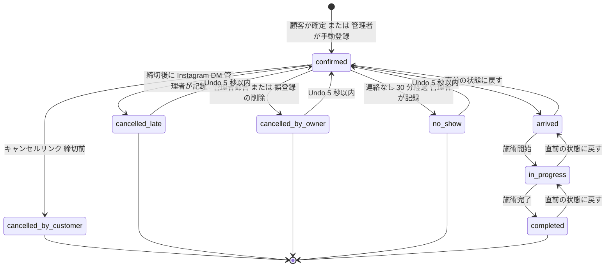
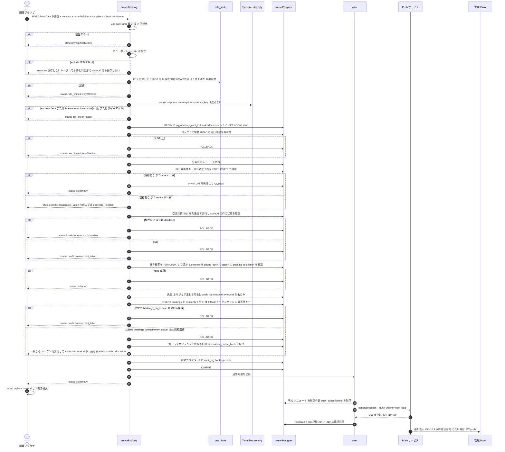
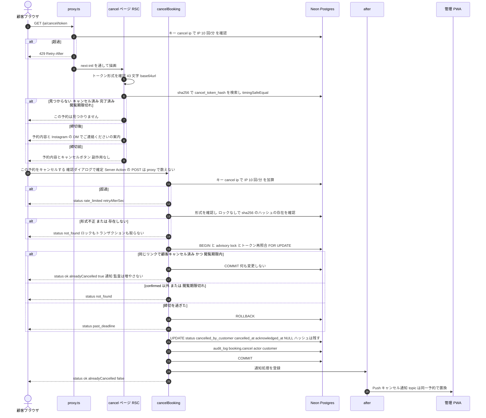
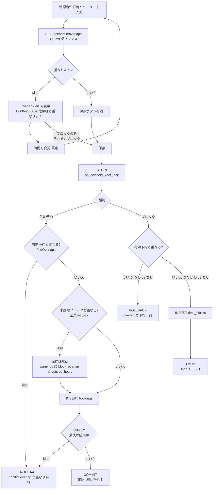
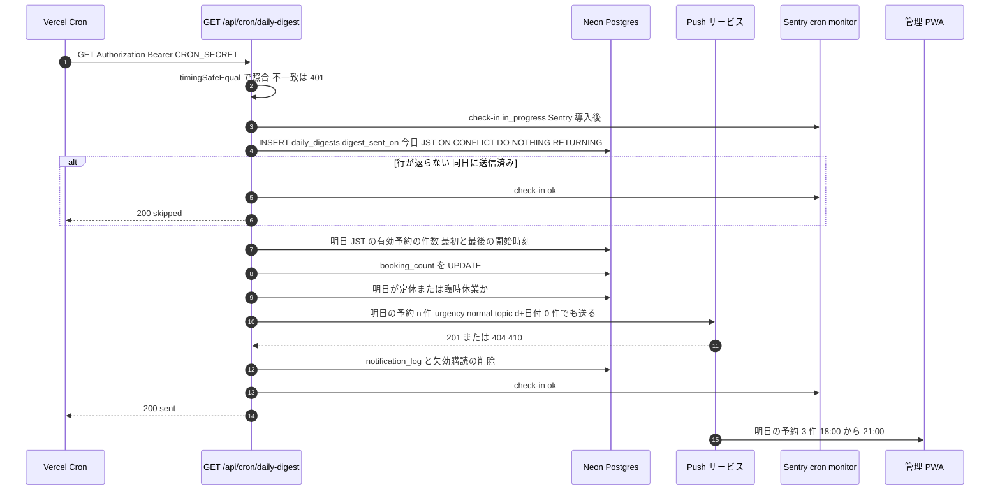
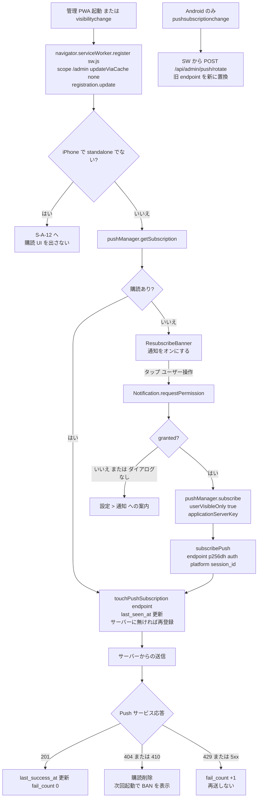

# 05 状態遷移・処理フロー

## 文書情報

| 項目 | 内容 |
|---|---|
| 文書 ID | DES-05 |
| 版 | v0.5 |
| 日付 | 2026-10-12 |
| 変更履歴 | v0.5（2026-10-12）: レビュー修正の反映。1 章に「直前の状態に戻す」（arrived→confirmed、in_progress→arrived、completed→in_progress。監査 `booking.step_back`、枠が埋まっていれば `undo_blocked`）を追加し状態遷移図を更新、2 章の電話の日次上限をロック下で判定・加算、Turnstile の `cdata` 照合（`idempotency_key` は送らない）、冪等性キー不一致を `conflict: slot_taken` に、顧客の上書き監査、ハニーポットの `doneUrl`、3 章のキャンセルを「レート制限 → ロックなしのトークン存在確認 → ロック」に変更し冪等化（`alreadyCancelled`）、4 章の顧客予約×ブロックの応答、5 章の 0 件時の臨時休業の文面・ハウスキーピングの移動・`digest_hour_jst` の扱い。v0.4（2026-10-12）: 実装との同期。2 章の確定シーケンス（冪等性の判定と枠の再検証をロック下で先に行い、`23P01`・`23505` は最後の防衛線）、Undo トークンの中身（10 秒、確認リンクの復元）、4 章の手動予約の事前判定、5 章の日次サマリーの文面・0 件時・ハウスキーピング・Sentry 未導入、6 章の起動時のセッション更新と SW 登録順、7.1 の Push ペイロード（氏名を含めない）、7.2 の `public/sw.js` を実ファイルに合わせる、8 章のポーリング実装（`InboxProvider`）。v0.3（2026-10-12）: 締切後の顧客連絡を電話から Instagram DM に変更（要件定義書 v0.5 FR-C-12・6.3、F3）。1 章の状態遷移ラベルと 3 章のキャンセル締切後の表示。v0.2（2026-10-10）: 手動予約の重なりに上書き保存を置かないことを確定（OI-11 決定済み、要件定義書 v0.4） |
| 関連要件 | 6.3, FR-C-10, FR-C-12, FR-A-04〜06, FR-A-09〜12, FR-A-16, FR-S-01〜07, NFR-AV-03, AT-03, AT-07, AT-13〜17, AT-20, AT-21, AT-23 |
| 関連 ADR | ADR-0003, ADR-0004, ADR-0007 |

---

## 1. 予約の状態遷移

要件定義書 6.3 を正とし、管理者の Undo（トーストの表示 5 秒。サーバー側のトークン有効期限は 10 秒）による復帰と、進行段階（来店・施術開始・完了）の押し間違いを 1 段ずつ戻す「直前の状態に戻す」（v0.5、CR-24）を加えた。



### 1.1 遷移表（`src/domain/booking-status.ts`）

| from | to | 実行者 | 経路 | 副作用（同一トランザクション） | Undo | 関連 |
|---|---|---|---|---|---|---|
| — | `confirmed` | 顧客 | `createBooking` | `customers` upsert、`consents` 2 行、`audit_log booking.create`、`acknowledged_at = NULL` → after: Push | — | FR-C-10 |
| — | `confirmed` | 管理者 | `createManualBooking` | `customers` 作成/紐付け、`audit_log`、`acknowledged_at = now()`（自分で入れたため未確認にしない） | 削除で取消 | FR-A-05 |
| `confirmed` | `cancelled_by_customer` | 顧客 | `cancelBooking` | `cancelled_at`、`acknowledged_at = NULL`（受信箱に再浮上）、`status_changed_at`、`audit_log` → after: Push。`cancel_token_hash` は残す（同じリンクの再送は `ok`＋`alreadyCancelled: true` で、通知・監査は 1 回だけ。CR-09） | なし | FR-C-12 |
| `confirmed` | `cancelled_late` | 管理者 | `updateBookingStatus` | `cancelled_at`、`customers.late_cancel_count + 1`、`cancel_token_hash = NULL` | 5 秒（カウンタを戻す） | FR-A-04 |
| `confirmed` | `cancelled_by_owner` | 管理者 | `updateBookingStatus` / `deleteBooking`（`deleted_at` も設定） | `cancelled_at`、`cancel_token_hash = NULL` | 5 秒 | FR-A-04 |
| `confirmed` | `no_show` | 管理者 | `updateBookingStatus` | `customers.no_show_count + 1` | 5 秒（−1） | FR-A-04, AT-21 |
| `confirmed` | `arrived` | 管理者 | `updateBookingStatus` | `late_minutes`（任意入力） | 「直前の状態に戻す」（`stepBackBookingStatus`、下の 3 行） | FR-A-04 |
| `arrived` | `in_progress` | 管理者 | 同上 | — | 同上 | — |
| `in_progress` | `completed` | 管理者 | 同上 | `customers.last_visit_at = GREATEST(last_visit_at, upper(during))` | 同上 | FR-S-09 |
| `arrived` | `confirmed` | 管理者 | `stepBackBookingStatus` | `late_minutes = NULL`、`status_changed_at`、`audit_log booking.step_back`（`diff: { from, to }`） | — | FR-A-04 |
| `in_progress` | `arrived` | 管理者 | 同上 | `status_changed_at`、`audit_log booking.step_back` | — | FR-A-04 |
| `completed` | `in_progress` | 管理者 | 同上 | `customers.last_visit_at` を残りの `completed` 予約の `max(upper(during))` で再計算（無ければ NULL）、`audit_log booking.step_back`。排他制約の対象に戻るため、その間に同じ枠が埋まっていれば `23P01` → `conflict: undo_blocked` | — | FR-A-04, FR-S-09 |
| `cancelled_by_owner`・`cancelled_late`・`no_show` | `confirmed` | 管理者 | `undoBookingChange(undoToken)` | 状態・カウンタ・元の `cancel_token_hash`（顧客の確認リンク）を復元し、`cancelled_at`・`cancel_reason`・`deleted_at` を NULL。**`23P01` の場合は復元不可**（その間に同じ枠が埋まった）→「この枠は別の予約で埋まったため元に戻せません」 | — | FR-A-04 |

- 排他制約の対象は `confirmed` / `arrived` / `in_progress`（`ACTIVE_STATUSES`）。
- 無断キャンセルの自動判定は行わない（30 分経過で詳細シートに「無断キャンセルにする」を強調表示するのみ）【要確認: 6.3 の 30 分】。
- Undo は `undoToken`（`features/admin/undo.ts`。`{ b: 予約 ID, prev: 直前状態, next: 変更後の状態, exp: 発行 + 10 秒, h?: 変更前の cancel_token_hash, d?: 削除フラグ }` を base64url にし、`BETTER_AUTH_SECRET` から導出した鍵で HMAC-SHA256 署名）で実装する。DB には保存せず、サーバー側で署名・期限と「予約がまだ `next` の状態か」を検証する。ブロックの削除の Undo は `restoreTimeBlock`（削除後 10 秒以内）。
- 「直前の状態に戻す」は `domain/booking-status.ts` の `stepBackTarget()`（`TRANSITIONS` とは別の表）で決め、`stepBackBookingStatus()` だけが使う（`updateBookingStatus` の `to: 'confirmed'` は引き続き不可）。期限はなく、S-A-04 のボタンで 1 段ずつ戻す。キャンセル系・`no_show` からの復帰は Undo のみ。
- 遷移はすべて advisory lock 下で対象行を `FOR UPDATE` してから行う（`updateBookingStatus`・`stepBackBookingStatus`・`deleteBooking`・`undoBookingChange`）。

---

## 2. 予約確定シーケンス（createBooking）



### 2.1 処理段階と失敗時の応答

| # | 段階 | 実装 | 失敗時 `status` | HTTP 相当 | 根拠 |
|---|---|---|---|---|---|
| 1 | 入力検証 | `createBookingSchema.safeParse`（構文・長さ・E.164・ISO+09:00・`consent === 'on'`・ふりがな必須は `locale === 'ja'`） | `invalid` | 400 | FR-C-10(1), NFR-SC-03 |
| 2 | ハニーポット | `website !== ''` → 成功を装い破棄（保存しない 43 文字のトークンで本物と同じ形の `doneUrl` を返す。SR-24。ログはイベント名のみ） | `ok`（ダミー） | 200 | FR-S-05 |
| 3 | レート制限 | `book:ip:{hmac(ip)}` 5/10 分（毎回加算）、`book:phone:{hmac(phone)}` 3/日（JST 暦日）。ここでの電話の判定は早期拒否で、段階 5 のロック下で再判定し、**成功時に同じトランザクションで加算**（同時送信でも 3 件を超えない。SR-02） | `rate_limited` | 429 | FR-S-04 |
| 4 | Turnstile | siteverify（`remoteip`。`idempotency_key` は送らずトークンは単回使用、タイムアウト 5 秒で fail closed）。`success`・`action`・`hostname`（許可リスト）・`cdata`（= submissionNonce）をすべて照合（SR-03、08_security.md 7 章） | `bot_check_failed` | 403 | FR-S-05 |
| 5 | 冪等性 | advisory lock を取得して `SET LOCAL jit = off`、電話の当日件数を再判定（3 件以上は `rate_limited`）、公開中のメニューを読み（無ければ `not_bookable`）、同じ冪等性キーの有効な予約を `FOR UPDATE` で探す。nonce 一致ならトークンを再発行して `ok`（旧リンクは無効）、不一致なら満席と同じ `conflict: slot_taken`（電話番号がその枠を持つかを明かさない。内部はログ `booking.duplicate_rejected`。SR-12） | `ok` / `rate_limited` / `conflict` | 200 / 429 / 409 | FR-C-10, FR-S-04, G-04 |
| 6 | 枠の再検証 | lock 下で空き計算 SQL（04_data_model.md 6 章）を対象日で実行。枠が無い・`deadline` → `not_bookable`、`full` → `slot_taken` | `invalid`（`not_bookable`）/ `conflict` | 422 / 409 | FR-S-02 |
| 7 | 顧客 | 既存顧客を `FOR UPDATE` で読み、`INSERT … ON CONFLICT (phone_e164) WHERE … DO UPDATE SET name, name_kana = COALESCE(excluded.name_kana, customers.name_kana), occupation, locale`（ADR-0008。ふりがな欄のない /en で消さない。CR-05）。氏名・ふりがなが変わる場合は `audit_log customer.overwrite`（`diff.fields` に列名のみ。SR-14）。`booking_restriction <> 'none'` なら中断してロールバック（Should） | `restricted` | 403 | FR-A-13 |
| 8 | INSERT | `bookings`（`during = [startsAt, startsAt + duration + buffer)`、`price_jpy = applicablePrice()`、`is_student = isStudentRateApplied()`、`public_code`、`cancel_token_hash = sha256(raw)`、`cancel_token_expires_at = startsAt − cancel_deadline_min`、`idempotency_key = sha256(startsAt\|menuId\|phone)`、`submission_nonce_hash`）＋`consents`（`booking_policy`・`privacy`、`policy_version`、`ip_hash`（HMAC）、`user_agent`）＋電話カウンタ＋`audit_log`。`23P01` → `slot_taken`、`23505`（冪等性）→ 段階 5 の判定をやり直す、`public_code`・トークンの衝突 → 1 回だけ再試行 | `conflict` | 409 | FR-S-01, FR-S-06 |
| 9 | 応答 | `{ status: 'ok', data: { doneUrl } }`（`absoluteUrl` ではなく相対パス `/{locale}/book/done/{raw}`） | — | 200 | FR-C-10(6) |
| 10 | 通知 | `after()` で `notifyOwner('booking_created', bookingId)`。失敗しても予約は確定済み | — | — | FR-S-03 |

トランザクションは READ COMMITTED。`pg_advisory_xact_lock(hashtext('calendar'), resource_id)` は暦を変える全書き込み（顧客の予約・キャンセル、手動予約、状態変更・削除・Undo、ブロックの作成・削除・復元、顧客の匿名化）で取得し、`time_blocks`（排他制約の外）との write skew を防ぐ。1 席・低頻度のため直列化による待ちは無視できる。SERIALIZABLE の再試行ループは使わない（ADR-0003）。

---

## 3. キャンセルシーケンス（cancelBooking）



| 判定 | 条件 | 表示 | 関連 |
|---|---|---|---|
| 閲覧可 | ハッシュ一致かつ `status = confirmed` かつ `now < upper(during) + 24h` | 予約内容 | FR-C-12 |
| キャンセル可 | 上記かつ `now < cancel_token_expires_at` | ボタン | FR-S-06 |
| 締切後 | 閲覧可かつ `now >= cancel_token_expires_at` | Instagram DM 案内（`InstagramLink`。`tel:` は置かない） | FR-C-12, 16 |
| 再送（冪等） | ハッシュ一致かつ `status = cancelled_by_customer` かつ `now < upper(during) + 24h`（キャンセル操作のみ。ページの GET は「無効」と同じ） | キャンセル完了の表示（`ok`＋`alreadyCancelled: true`。通知・監査は増えない） | CR-09 |
| 無効 | 上記以外 | 「この予約は見つかりません」（理由を区別しない） | FR-S-06 |

- `cancelBooking` の IP 制限（`cancel:ip`、10 回/分）はサービス（`cancelByToken`）の先頭で判定する。Server Action はどの URL にも POST できるため proxy.ts だけでは数えきれず、proxy.ts は Server Action の POST を数えない（二重加算しない。SR-01、CR-21）。
- 存在しないトークンは advisory lock もトランザクションも取らずに `not_found` を返し、総当たりで暦のロックや接続を占有させない（SR-01）。
- 締切の「◯時間前まで」の表示は予約ごとの `start − cancel_token_expires_at`（DTO の `cancelDeadlineHours`）から求め、予約後に変わりうる現在の設定値は使わない（CR-17）。

---

## 4. 手動予約・時間ブロックの重なり判定



| ケース | 判定の正 | 既定動作 | 上書き | 関連 |
|---|---|---|---|---|
| 手動予約 × 有効予約 | lock 下の `findOverlaps`（最後の防衛線は DB の `EXCLUDE`、`23P01`） | 保存しない。`[時間を変更]` | なし（OI-11 決定済み: Phase 1 は意図的な重複を許容せず、v0.1 で検討した上書き保存のボタンは置かない。将来許容する場合は 04_data_model.md 9 章の制約変更と ADR が必要） | FR-A-05, US-04 |
| 手動予約 × ブロック・営業時間外 | アプリ判定（lock 下） | 保存し、`warnings`（`block_overlap`・`outside_hours`）を表示（管理者が意図してブロック内・時間外に入れる運用を妨げない） | — | FR-A-05 |
| ブロック × 有効予約 | アプリ判定（lock 下） | 警告して保存しない | `force: true`（「それでもブロック」）で保存。予約は残る | FR-A-06 |
| 顧客予約 × ブロック | 空き計算 SQL（lock 下の再検証） | 予約不可（枠は `full` のため `conflict: slot_taken`） | — | FR-C-08 |
| ブロック × ブロック | なし | 重複を許容 | — | — |

---

## 5. 日次サマリー（Vercel Cron）

`vercel.json`:

```json
{
  "crons": [
    { "path": "/api/cron/daily-digest", "schedule": "0 12 * * *" },
    { "path": "/api/cron/retention",    "schedule": "0 18 * * *" }
  ]
}
```

`0 12 * * *` は UTC 12:00 = **21:00 JST**。Hobby では 21:00〜21:59 のいずれかで実行（±59 分）、Pro 移行後は毎分精度で 21:00（00_overview.md G-02）。`retention` は 03:00 JST 台。



| 項目 | 仕様 | 関連 |
|---|---|---|
| 実装 | `features/notifications/digest.ts` の `runDailyDigest(now)`。Route Handler は認証して呼ぶだけ | FR-A-12 |
| 0 件の日 | **0 件でも必ず送る**（生存確認を兼ねる）。本文は「明日の予約はありません」、明日が定休なら「明日は定休日です（予約 0 件）」、オーバーライドによる臨時休業なら「明日は臨時休業日です（予約 0 件）」（CR-16） | FR-A-12 |
| タイトル・本文 | タイトル「明日 11/5(木) の予約 3 件」、本文「18:00〜21:00 開始」（1 件または最初と最後が同時刻なら「18:00 開始」）。件数と時刻のみで氏名・電話・メニューは含めない | NFR-SC-07 |
| その他の項目 | `navigate`: `absoluteUrl('/admin?date=2026-11-05')`、`tag`: `digest-2026-11-05`、`data`: `{ kind: 'digest', date, count }`、`app_badge`: 送信時点の未確認件数、送信オプション `urgency: 'normal'`・`topic: d20261105` | FR-A-10 |
| 重複防止 | `daily_digests.digest_sent_on`（PK＝送信日 JST）への `INSERT … ON CONFLICT DO NOTHING RETURNING` を最初に行い、行が返らなければ送らず `skipped`。先に記録するため、送信の途中で例外が起きても同日は再送しない（at-most-once） | FR-A-12, AT-23 |
| 失敗時 | Push 失敗は `notification_log` に記録し 200 を返す（Cron の再実行に頼らない）。予期しない例外は `guardRoute` が digest だけをログに残して 500 を返す。ハウスキーピングは v0.5 で保存期間ジョブへ移した（SR-15）。例外の Sentry 送信と cron モニタの「missed」検知は Sentry 導入後（未実装） | FR-S-11 |
| 送信時刻 | `vercel.json` の固定スケジュール（12:00 UTC）。`settings.digest_hour_jst` は管理画面（S-A-08）で表示のみとし、`updateSettingsAction` は受け付けない（Hobby の Cron は 1 日 1 回の固定時刻のため。v0.4 の不整合を解消）。Pro 移行時に設定値で送信時刻を変えるかを決める | FR-A-12 |
| `retention`（Should） | `GET /api/cron/retention`（18:00 UTC＝03:00 JST）。04_data_model.md 8 章の匿名化（基準は最終利用）と、その後のハウスキーピング（`rate_limits`・`notification_log`・同意の `ip_hash`/UA・`auth_verification`。失敗はログのみ）。対象件数を `audit_log`（`system`、`customer.anonymize`、`entity_id = 'retention'`）に 1 行記録 | FR-S-09 |

---

## 6. Push 購読ライフサイクル



| プラットフォーム | 特有の挙動 | 設計上の対処 | 関連 |
|---|---|---|---|
| iOS（16.4+、ホーム画面アプリ） | 購読が無言で失効しうる。`pushsubscriptionchange` 未実装。設定で OFF でも `Notification.permission` が `default`。APNs 201 でも未達がある。サイレント push で許可取り消し | 起動ごとの `getSubscription()`＋`touchPushSubscription`、購読の有無を主条件、テスト通知＋「届かない」→作り直し、SW は必ず `showNotification` | FR-A-09, CON-01, AT-14, AT-14b, AT-17 |
| iOS 18.4+ | `web_push: 8030` の JSON は SW を起動せず宣言的に表示（`mutable: false`） | ペイロードを出荷版形式に固定。SW の `push` ハンドラは旧版・他ブラウザ用 | FR-S-03, NFR-MG-05 |
| iOS セッション | ホーム画面アプリは Safari と別ストレージ。セッション Cookie はリセットされうる（WebKit 272325 未修正） | アプリ内でログイン、`Max-Age` 付き永続 Cookie（30 日ローリング）。起動時と可視化時に `AdminBoot` が `authClient.getSession()` を呼び（`sessionStorage` で 1 時間に 1 回まで）、Better Auth が `updateAge`（1 日）を過ぎたセッションの期限と Cookie を延長する。セッションが無ければ `/admin/login?next=` へ | FR-A-01, AT-17 |
| Android Chrome | `beforeinstallprompt`、`pushsubscriptionchange` あり、`topic`・`tag` による置換が効く | インストールボタン、rotate エンドポイント | FR-A-15, AT-20 |
| 全般 | 端末紛失 | `logoutOtherDevices` で他セッションに紐づく購読を削除 | FR-A-16, AT-19 |

---

## 7. Service Worker のイベント処理

### 7.1 出荷版 Declarative Web Push ペイロード（送信する JSON）

`web-push` の既定（`Content-Type: application/octet-stream`、`Content-Encoding: aes128gcm`）のまま、この JSON 文字列を payload として送る。Content-Type の変更は不要（かつ web-push では不可）。組み立ては `lib/push-payload.ts` の `buildDeclarativePayload()`、新規・キャンセルの文面は `lib/notify.ts` の `notifyOwner()`（`after()` から呼び、例外は投げない）、日次サマリーは `features/notifications/digest.ts`。

```json
{
  "web_push": 8030,
  "notification": {
    "title": "新規予約 11/4(水) 18:00 カット",
    "body": "18:00–19:00（web）・未確認 2 件",
    "lang": "ja",
    "navigate": "https://<SITE_URL>/admin/bookings/<booking-id>",
    "tag": "booking-<booking-id>",
    "silent": false,
    "data": { "bookingId": "<booking-id>", "kind": "created" },
    "app_badge": 2
  },
  "app_badge": 2,
  "mutable": false
}
```

| キー | 規則 | 根拠 |
|---|---|---|
| `web_push` | 常に `8030`（宣言的解析のマジック値） | WebKit 出荷版 |
| `notification.title` / `navigate` | 必須。`navigate` は `absoluteUrl()` で同一オリジンの `/admin/...` | FR-A-10 |
| `notification.title` の形式 | `{新規予約\|キャンセル} {M/D(曜)} {HH:mm} {メニュー名}`（半角括弧） | FR-A-10 |
| `notification.body` | 時刻範囲（バッファを除く表示上の終了）・経路・未確認件数のみ。**氏名・電話番号・備考を含めない**（AGENTS.md 規則 6）。キャンセルは「お客様がキャンセルしました（18:00–19:00）・未確認 n 件」 | NFR-SC-07 |
| `app_badge` | 送信時点の未確認件数。**トップレベルと `notification` 内の両方**に入れ、iOS 26.x 実機で効いた側を残す（実装済み。数値でないときは両方とも省く） | FR-A-10, AT-14 |
| `mutable` | トップレベルのみ `false`（SW を起動させない） | 09_gap_push_notifications §3.1 |
| `tag` | `booking-<id>`（日次サマリーは `digest-<date>`、テストは `test-<epoch ms>`）。iOS では置換されないため重複表示を許容 | FR-S-03 |
| 送信オプション | `TTL: 21600`、`urgency: 'high'`（日次サマリーは `'normal'`）、`timeout: 8000`、`topic` | FR-S-03 |
| `topic` | Push サービスの制約（URL-safe base64 文字・32 文字以内）のため `b` + base64url(UUID 16 バイト) = 23 文字。日次サマリーは `d20261105`。要件の `booking-<id>`（44 文字）は上限超過のためこの形に読み替える | FR-S-03 |
| 種類 | `data.kind`: `created`（新規 web 予約）/ `cancelled`（顧客キャンセル。タイトル「キャンセル 11/4(水) 18:00 カット」）/ `digest`（5 章）/ `test`（タイトル「テスト通知」）。手動予約・管理者の操作では送らない | FR-A-10, 12 |

### 7.2 `public/sw.js`（最小構成）

```js
/* Admin PWA service worker (05_state_and_flows.md §7.2, ADR-0007). SW_VERSION 2026-10-12.1
 * push / notificationclick / pushsubscriptionchange only — no caching (FR-A-17 is later).
 * Registered from /admin with scope /admin; served with Cache-Control: no-cache (next.config.ts).
 * iOS 18.4+ shows `mutable:false` Declarative Web Push payloads without running this file; it
 * handles every other browser and older iOS with the same JSON. */

self.addEventListener('install', () => self.skipWaiting())
self.addEventListener('activate', (event) => event.waitUntil(self.clients.claim()))

self.addEventListener('push', (event) => {
  // Always show a notification (iOS revokes permission after silent pushes; Chrome shows a
  // generic one). Never throw before showNotification.
  event.waitUntil(
    (async () => {
      let msg = null
      try {
        msg = event.data ? event.data.json() : null
      } catch {
        msg = null
      }
      const n = msg?.notification || {}
      try {
        await self.registration.showNotification(n.title || '予約管理', {
          body: n.body || '新しいお知らせがあります',
          lang: n.lang || 'ja',
          tag: n.tag,
          icon: '/icons/icon-192.png',
          data: Object.assign({ url: n.navigate || '/admin' }, n.data || {}),
        })
      } catch {
        await self.registration.showNotification('予約管理', { body: '新しいお知らせがあります' })
      }
      const badge = msg && (typeof msg.app_badge === 'number' ? msg.app_badge : n.app_badge)
      if (typeof badge === 'number' && 'setAppBadge' in self.navigator) {
        try {
          if (badge > 0) await self.navigator.setAppBadge(badge)
          else await self.navigator.clearAppBadge()
        } catch {}
      }
    })(),
  )
})

self.addEventListener('notificationclick', (event) => {
  event.notification.close()
  let target
  try {
    target = new URL(event.notification.data?.url || '/admin', self.location.origin)
  } catch {
    target = new URL('/admin', self.location.origin)
  }
  // Open-redirect guard (T-11): same origin and under /admin only.
  if (target.origin !== self.location.origin || !target.pathname.startsWith('/admin')) {
    target = new URL('/admin', self.location.origin)
  }
  event.waitUntil(
    (async () => {
      const wins = await self.clients.matchAll({ type: 'window', includeUncontrolled: true })
      // Do not match by URL: in an SPA client.url can be stale.
      const client = wins[0]
      if (client) {
        try {
          const navigated = await client.navigate(target.href)
          await (navigated || client).focus()
          return
        } catch {}
        try {
          client.postMessage({ type: 'NAVIGATE', path: target.pathname + target.search })
          await client.focus()
          return
        } catch {}
      }
      await self.clients.openWindow(target.href)
    })(),
  )
})

self.addEventListener('pushsubscriptionchange', (event) => {
  // Android / Chrome only (iOS never fires it; the app re-checks getSubscription() on launch).
  event.waitUntil(
    (async () => {
      const old = event.oldSubscription
      const sub = event.newSubscription || (old && (await self.registration.pushManager.subscribe(old.options)))
      if (!sub) return
      await fetch('/api/admin/push/rotate', {
        method: 'POST',
        credentials: 'same-origin',
        headers: { 'content-type': 'application/json' },
        body: JSON.stringify({ oldEndpoint: old ? old.endpoint : undefined, subscription: sub.toJSON() }),
      })
    })(),
  )
})
```

| イベント | 必須条件 | 受入基準 |
|---|---|---|
| `push` | 例外が起きても `showNotification` を必ず呼ぶ（`waitUntil` に Promise を渡す。JSON 解析や表示に失敗したら既定の「予約管理／新しいお知らせがあります」を表示）。`app_badge` があれば `setAppBadge`（0 は `clearAppBadge`） | AT-14, AT-15 |
| `notificationclick` | `client.navigate` → 失敗時 `postMessage` → `openWindow`。ページ側は `AdminBoot` が `navigator.serviceWorker` の `message` を受けて `router.push(path)`（`/admin` 配下のみ） | FR-A-10, AT-14 |
| `pushsubscriptionchange` | Android のみ。新しい購読（無ければ旧購読の `options` で再購読）を `POST /api/admin/push/rotate` へ送る。iOS は起動時の `getSubscription()` で補う | AT-20 |
| 配信 | `/sw.js` は `Cache-Control: no-cache, no-store, must-revalidate`、`Service-Worker-Allowed` は付けない（scope `/admin` は `/sw.js` の配下のため不要） | FR-A-15 |
| インストール・更新 | `install` で `skipWaiting()`、`activate` で `clients.claim()`。起動時・可視化時の登録処理のたびに `registration.update()`。版数は先頭コメントの `SW_VERSION` で管理 | — |

---

## 8. 未確認バッジとポーリング（Push 不達時の検知）

| 契機 | 処理 | 関連 |
|---|---|---|
| PWA 起動 | 初期件数はサーバー（`(app)/layout.tsx` の `getInboxCount()`）から props で渡し、`setAppBadge` に反映 | FR-A-11 |
| `visibilitychange`（visible） | 即時に `GET /api/admin/inbox-count` → `{ unacknowledged, latestChangeAt }`（`latestChangeAt` は `bookings.updated_at` の最大値） | FR-A-11 |
| 可視中 | `InboxProvider`（`features/admin/components/inbox-provider.tsx`）が `setInterval` で 20 秒ごとに取得し、非表示時は停止して Neon の CU を節約（TanStack Query は使わない）。401 なら `/admin/login?next=` へ | NFR-PF-06 |
| `latestChangeAt` の変化 | `router.refresh()` で表示中の画面を再描画。未確認件数が増えたときだけアプリ内トースト「新しい予約があります」（前面で通知バナーが出ない場合の代替） | FR-A-10, AT-15 |
| 予約詳細を開く | `acknowledgeBooking(id)` → `navigator.setAppBadge(残数)` | FR-A-11 |
| 「すべて確認済みにする」 | `acknowledgeAll()` → `clearAppBadge()`。トーストの「元に戻す」で `unacknowledge(ids)` | FR-A-11 |
| 未確認の定義 | `acknowledged_at IS NULL AND deleted_at IS NULL` かつ（web 予約で有効状態、または `cancelled_by_customer`）。手動予約は作成時に確認済み（`lib/notify.ts` の `UNACKNOWLEDGED_WHERE`） | FR-A-11 |
