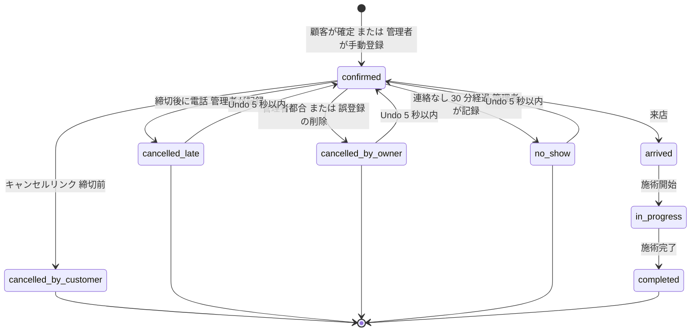
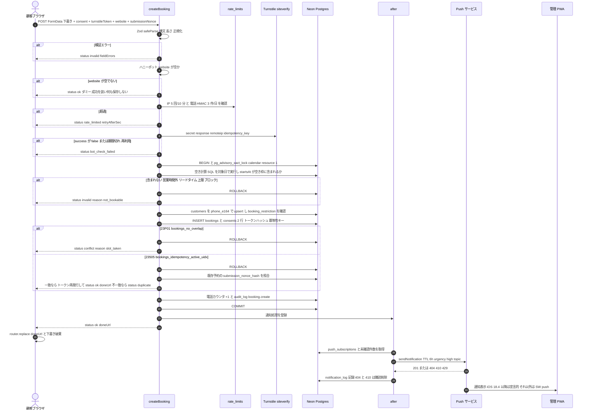
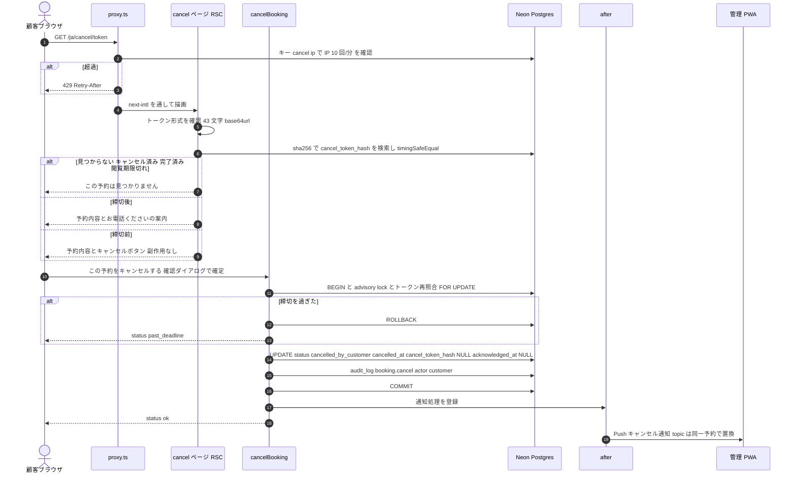
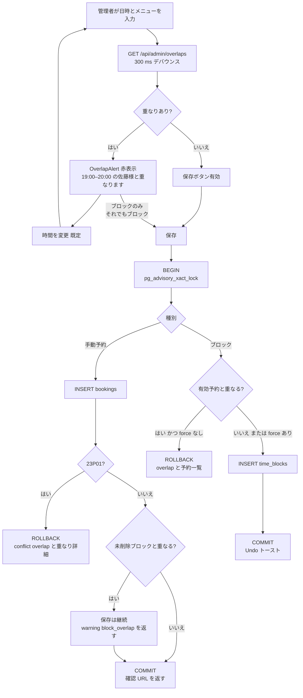
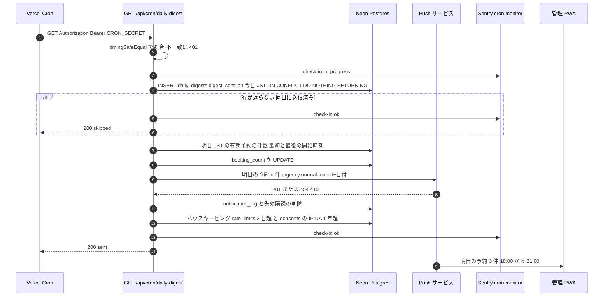
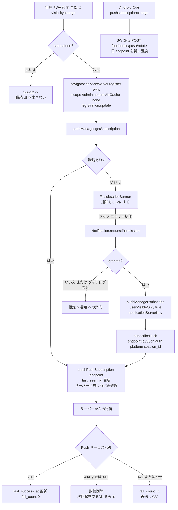

# 05 状態遷移・処理フロー

## 文書情報

| 項目 | 内容 |
|---|---|
| 文書 ID | DES-05 |
| 版 | v0.2 |
| 日付 | 2026-10-10 |
| 変更履歴 | v0.2（2026-10-10）: 手動予約の重なりに上書き保存を置かないことを確定（OI-11 決定済み、要件定義書 v0.4） |
| 関連要件 | 6.3, FR-C-10, FR-C-12, FR-A-04〜06, FR-A-09〜12, FR-A-16, FR-S-01〜07, NFR-AV-03, AT-03, AT-07, AT-13〜17, AT-20, AT-21, AT-23 |
| 関連 ADR | ADR-0003, ADR-0004, ADR-0007 |

---

## 1. 予約の状態遷移

要件定義書 6.3 を正とし、管理者の Undo（5 秒）による復帰を加えた。



### 1.1 遷移表（`src/domain/booking-status.ts`）

| from | to | 実行者 | 経路 | 副作用（同一トランザクション） | Undo | 関連 |
|---|---|---|---|---|---|---|
| — | `confirmed` | 顧客 | `createBooking` | `customers` upsert、`consents` 2 行、`audit_log booking.create`、`acknowledged_at = NULL` → after: Push | — | FR-C-10 |
| — | `confirmed` | 管理者 | `createManualBooking` | `customers` 作成/紐付け、`audit_log`、`acknowledged_at = now()`（自分で入れたため未確認にしない） | 削除で取消 | FR-A-05 |
| `confirmed` | `cancelled_by_customer` | 顧客 | `cancelBooking` | `cancelled_at`、`cancel_token_hash = NULL`、`acknowledged_at = NULL`（受信箱に再浮上）、`audit_log` → after: Push | なし | FR-C-12 |
| `confirmed` | `cancelled_late` | 管理者 | `updateBookingStatus` | `cancelled_at`、`customers.late_cancel_count + 1`、`cancel_token_hash = NULL` | 5 秒（カウンタを戻す） | FR-A-04 |
| `confirmed` | `cancelled_by_owner` | 管理者 | `updateBookingStatus` / `deleteBooking`（`deleted_at` も設定） | `cancelled_at`、`cancel_token_hash = NULL` | 5 秒 | FR-A-04 |
| `confirmed` | `no_show` | 管理者 | `updateBookingStatus` | `customers.no_show_count + 1` | 5 秒（−1） | FR-A-04, AT-21 |
| `confirmed` | `arrived` | 管理者 | `updateBookingStatus` | `late_minutes`（任意入力） | 直前状態へ戻すボタン | FR-A-04 |
| `arrived` | `in_progress` | 管理者 | 同上 | — | 同上 | — |
| `in_progress` | `completed` | 管理者 | 同上 | `customers.last_visit_at = upper(during)` | 同上 | FR-S-09 |
| キャンセル系・`no_show` | `confirmed` | 管理者 | `undoBookingChange(undoToken)` | 状態・カウンタを復元。**`23P01` の場合は復元不可**（5 秒の間に同じ枠が埋まった）→「この枠は別の予約で埋まったため元に戻せません」 | — | FR-A-04 |

- 排他制約の対象は `confirmed` / `arrived` / `in_progress`（`ACTIVE_STATUSES`）。
- 無断キャンセルの自動判定は行わない（30 分経過で詳細シートに「無断キャンセルにする」を強調表示するのみ）【要確認: 6.3 の 30 分】。
- Undo は `undoToken`（予約 ID＋直前状態＋有効期限 10 秒を HMAC 署名したもの）で実装し、サーバー側で期限を検証する。

---

## 2. 予約確定シーケンス（createBooking）



### 2.1 処理段階と失敗時の応答

| # | 段階 | 実装 | 失敗時 `status` | HTTP 相当 | 根拠 |
|---|---|---|---|---|---|
| 1 | 入力検証 | `createBookingSchema.safeParse`（構文・長さ・E.164・ISO+09:00・`consent === 'on'`・ふりがな必須は `locale === 'ja'`） | `invalid` | 400 | FR-C-10(1), NFR-SC-03 |
| 2 | ハニーポット | `website !== ''` → 成功を装い破棄（ログはカウンタのみ） | `ok`（ダミー） | 200 | FR-S-05 |
| 3 | レート制限 | `book:ip:{hmac(ip)}` 5/10 分、`book:phone:{hmac(phone)}` 3/日（JST 暦日）。電話は**成功時のみ加算** | `rate_limited` | 429 | FR-S-04 |
| 4 | Turnstile | siteverify（`remoteip`、`idempotency_key` = submissionNonce）、`hostname` 照合 | `bot_check_failed` | 403 | FR-S-05 |
| 5 | 枠の再検証 | advisory lock 下で空き計算 SQL（04_data_model.md 6 章）を対象日で実行 | `invalid`（`not_bookable`） | 422 | FR-S-02 |
| 6 | 顧客 | `INSERT … ON CONFLICT (phone_e164) WHERE … DO UPDATE SET name, name_kana, occupation, locale`（ADR-0008）。`booking_restriction <> 'none'` なら中断（Should） | `restricted` | 403 | FR-A-13 |
| 7 | INSERT | `bookings`（`during = [startsAt, startsAt + duration + buffer)`、`price_jpy = applicablePrice()`、`public_code`、`cancel_token_hash = sha256(raw)`、`cancel_token_expires_at = startsAt − cancel_deadline_min`、`idempotency_key = sha256(startsAt\|menuId\|phone)`、`submission_nonce_hash`）＋`consents`（`booking_policy`・`privacy`、`policy_version`、`ip`、`user_agent`） | `conflict` / `duplicate` | 409 | FR-S-01, FR-S-06 |
| 8 | 応答 | `{ status: 'ok', doneUrl }`（`absoluteUrl` ではなく相対パス `/{locale}/book/done/{raw}`） | — | 200 | FR-C-10(6) |
| 9 | 通知 | `after()` で `notifyOwner('booking_created', bookingId)`。失敗しても予約は確定済み | — | — | FR-S-03 |

トランザクションは READ COMMITTED。`pg_advisory_xact_lock(hashtext('calendar'), resource_id)` は予約・手動予約・ブロック作成・Undo の全書き込みで取得し、`time_blocks`（排他制約の外）との write skew を防ぐ。1 席・低頻度のため直列化による待ちは無視できる。

---

## 3. キャンセルシーケンス（cancelBooking）



| 判定 | 条件 | 表示 | 関連 |
|---|---|---|---|
| 閲覧可 | ハッシュ一致かつ `status = confirmed` かつ `now < upper(during) + 24h` | 予約内容 | FR-C-12 |
| キャンセル可 | 上記かつ `now < cancel_token_expires_at` | ボタン | FR-S-06 |
| 締切後 | 閲覧可かつ `now >= cancel_token_expires_at` | 電話案内（`tel:`） | FR-C-12 |
| 無効 | 上記以外 | 「この予約は見つかりません」（理由を区別しない） | FR-S-06 |

---

## 4. 手動予約・時間ブロックの重なり判定



| ケース | 判定の正 | 既定動作 | 上書き | 関連 |
|---|---|---|---|---|
| 手動予約 × 有効予約 | DB の `EXCLUDE`（`23P01`） | 保存しない。`[時間を変更]` | なし（OI-11 決定済み: Phase 1 は意図的な重複を許容せず、v0.1 で検討した上書き保存のボタンは置かない。将来許容する場合は 04_data_model.md 9 章の制約変更と ADR が必要） | FR-A-05, US-04 |
| 手動予約 × ブロック | アプリ判定（lock 下） | 保存し、警告を表示（管理者が意図してブロック内に入れる運用を妨げない） | — | FR-A-05 |
| ブロック × 有効予約 | アプリ判定（lock 下） | 警告して保存しない | `force: true`（「それでもブロック」）で保存。予約は残る | FR-A-06 |
| 顧客予約 × ブロック | 空き計算 SQL（lock 下の再検証） | 予約不可（`not_bookable`） | — | FR-C-08 |
| ブロック × ブロック | なし | 重複を許容 | — | — |

---

## 5. 日次サマリー（Vercel Cron）

`vercel.json`:

```json
{
  "crons": [
    { "path": "/api/cron/daily-digest", "schedule": "0 12 * * *" },
    { "path": "/api/cron/retention",    "schedule": "0 18 * * *" }
  ]
}
```

`0 12 * * *` は UTC 12:00 = **21:00 JST**。Hobby では 21:00〜21:59 のいずれかで実行（±59 分）、Pro 移行後は毎分精度で 21:00（00_overview.md G-02）。`retention` は 03:00 JST 台。



| 項目 | 仕様 | 関連 |
|---|---|---|
| 0 件の日 | 「明日の予約はありません」を送る（生存確認を兼ねる）。定休日前日は「明日は定休日です（予約 0 件）」 | FR-A-12 |
| 本文 | 「明日 11/5(木) の予約 3 件（18:00〜21:00 開始）」。氏名・電話は含めない | NFR-SC-07 |
| `navigate` | `absoluteUrl('/admin?date=2026-11-05')` | FR-A-10 |
| 重複防止 | `daily_digests.digest_sent_on`（PK）への INSERT を最初に行い、失敗したら送らない | FR-A-12, AT-23 |
| 失敗時 | Push 失敗は `notification_log` に記録し 200 を返す（Cron の再実行に頼らない）。例外は Sentry、cron モニタが「missed」を検知 | FR-S-11 |
| `retention`（Should） | 04_data_model.md 8 章の匿名化。対象件数を `audit_log system customer.anonymize` に記録 | FR-S-09 |

---

## 6. Push 購読ライフサイクル



| プラットフォーム | 特有の挙動 | 設計上の対処 | 関連 |
|---|---|---|---|
| iOS（16.4+、ホーム画面アプリ） | 購読が無言で失効しうる。`pushsubscriptionchange` 未実装。設定で OFF でも `Notification.permission` が `default`。APNs 201 でも未達がある。サイレント push で許可取り消し | 起動ごとの `getSubscription()`＋`touchPushSubscription`、購読の有無を主条件、テスト通知＋「届かない」→作り直し、SW は必ず `showNotification` | FR-A-09, CON-01, AT-14, AT-14b, AT-17 |
| iOS 18.4+ | `web_push: 8030` の JSON は SW を起動せず宣言的に表示（`mutable: false`） | ペイロードを出荷版形式に固定。SW の `push` ハンドラは旧版・他ブラウザ用 | FR-S-03, NFR-MG-05 |
| iOS セッション | ホーム画面アプリは Safari と別ストレージ。セッション Cookie はリセットされうる（WebKit 272325 未修正） | アプリ内でログイン、`Max-Age` 付き永続 Cookie（30 日ローリング） | FR-A-01, AT-17 |
| Android Chrome | `beforeinstallprompt`、`pushsubscriptionchange` あり、`topic`・`tag` による置換が効く | インストールボタン、rotate エンドポイント | FR-A-15, AT-20 |
| 全般 | 端末紛失 | `logoutOtherDevices` で他セッションに紐づく購読を削除 | FR-A-16, AT-19 |

---

## 7. Service Worker のイベント処理

### 7.1 出荷版 Declarative Web Push ペイロード（送信する JSON）

`web-push` の既定（`Content-Type: application/octet-stream`、`Content-Encoding: aes128gcm`）のまま、この JSON 文字列を payload として送る。Content-Type の変更は不要（かつ web-push では不可）。

```json
{
  "web_push": 8030,
  "notification": {
    "title": "新規予約 11/4(水) 18:00 カット",
    "body": "山田様 18:00–19:00（web）",
    "lang": "ja",
    "navigate": "https://<SITE_URL>/admin/bookings/<booking-id>",
    "tag": "booking-<booking-id>",
    "silent": false,
    "data": { "bookingId": "<booking-id>", "kind": "created" },
    "app_badge": 2
  },
  "app_badge": 2,
  "mutable": false
}
```

| キー | 規則 | 根拠 |
|---|---|---|
| `web_push` | 常に `8030`（宣言的解析のマジック値） | WebKit 出荷版 |
| `notification.title` / `navigate` | 必須。`navigate` は `absoluteUrl()` で同一オリジンの `/admin/...` | FR-A-10 |
| `notification.body` | 氏名（敬称付き）・時刻・経路のみ。**電話番号を含めない** | NFR-SC-07 |
| `app_badge` | 送信時点の未確認件数。**トップレベルと `notification` 内の両方**に入れ、iOS 26.x 実機で効いた側を残す | FR-A-10, AT-14 |
| `mutable` | トップレベルのみ `false`（SW を起動させない） | 09_gap_push_notifications §3.1 |
| `tag` | `booking-<id>`。iOS では置換されないため重複表示を許容 | FR-S-03 |
| 送信オプション | `TTL: 21600`、`urgency: 'high'`（日次サマリーは `'normal'`）、`timeout: 8000`、`topic` | FR-S-03 |
| `topic` | Push サービスの制約（URL-safe base64 文字・32 文字以内）のため `b` + base64url(UUID 16 バイト) = 23 文字。日次サマリーは `d20261105`。要件の `booking-<id>`（44 文字）は上限超過のためこの形に読み替える | FR-S-03 |
| 種類 | `kind`: `created`（新規 web 予約）/ `cancelled`（顧客キャンセル。タイトル「キャンセル 11/4(水) 18:00 カット」）/ `digest` / `test` | FR-A-10, 12 |

### 7.2 `public/sw.js`（最小構成）

```js
// public/sw.js — push / notificationclick / pushsubscriptionchange のみ。キャッシュはしない（FR-A-17 は後付け）
self.addEventListener('install', () => self.skipWaiting())
self.addEventListener('activate', (event) => event.waitUntil(self.clients.claim()))

self.addEventListener('push', (event) => {
  // iOS 18.4+ で mutable:false の宣言的通知はここに来ない。来た場合は必ず通知を表示する（サイレント禁止）
  event.waitUntil((async () => {
    let msg = null
    try { msg = event.data ? event.data.json() : null } catch (_) { msg = null }
    const n = (msg && msg.notification) || {}
    await self.registration.showNotification(n.title || '予約管理', {
      body: n.body || '',
      lang: n.lang || 'ja',
      tag: n.tag,
      icon: '/icons/icon-192.png',
      data: { url: n.navigate || '/admin', ...(n.data || {}) },
    })
    const badge = msg && (typeof msg.app_badge === 'number' ? msg.app_badge : n.app_badge)
    if (typeof badge === 'number' && 'setAppBadge' in self.navigator) {
      try { badge > 0 ? await self.navigator.setAppBadge(badge) : await self.navigator.clearAppBadge() } catch (_) {}
    }
  })())
})

self.addEventListener('notificationclick', (event) => {
  event.notification.close()
  let target = new URL((event.notification.data && event.notification.data.url) || '/admin', self.location.origin)
  if (target.origin !== self.location.origin || !target.pathname.startsWith('/admin')) {
    target = new URL('/admin', self.location.origin)            // オープンリダイレクト防止
  }
  event.waitUntil((async () => {
    const wins = await self.clients.matchAll({ type: 'window', includeUncontrolled: true })
    const client = wins[0]                                       // URL 一致ではフォーカスしない（SPA では client.url が古い）
    if (client) {
      try { const c = await client.navigate(target.href); await (c || client).focus(); return } catch (_) {}
      try { client.postMessage({ type: 'NAVIGATE', path: target.pathname + target.search }); await client.focus(); return } catch (_) {}
    }
    await self.clients.openWindow(target.href)
  })())
})

self.addEventListener('pushsubscriptionchange', (event) => {
  // Android/Chrome のみ発火（iOS は未実装）。Cookie 認証の Route Handler で置換する
  event.waitUntil((async () => {
    const sub = event.newSubscription
      || (event.oldSubscription && await self.registration.pushManager.subscribe(event.oldSubscription.options))
    if (!sub) return
    await fetch('/api/admin/push/rotate', {
      method: 'POST',
      credentials: 'same-origin',
      headers: { 'content-type': 'application/json' },
      body: JSON.stringify({ oldEndpoint: event.oldSubscription && event.oldSubscription.endpoint, subscription: sub.toJSON() }),
    })
  })())
})
```

| イベント | 必須条件 | 受入基準 |
|---|---|---|
| `push` | 例外が起きても `showNotification` を必ず呼ぶ（`waitUntil` に Promise を渡す） | AT-14, AT-15 |
| `notificationclick` | `client.navigate` → 失敗時 `postMessage` → `openWindow`。ページ側は `navigator.serviceWorker` の `message` で `router.push(path)` | FR-A-10, AT-14 |
| `pushsubscriptionchange` | Android のみ。iOS は起動時の `getSubscription()` で補う | AT-20 |
| 配信 | `/sw.js` は `Cache-Control: no-cache, no-store, must-revalidate`、`Service-Worker-Allowed` は付けない（scope `/admin` は `/sw.js` の配下のため不要） | FR-A-15 |
| 更新 | ページ読み込みごとに `registration.update()`。版数は `SW_VERSION` コメントで管理 | — |

---

## 8. 未確認バッジとポーリング（Push 不達時の検知）

| 契機 | 処理 | 関連 |
|---|---|---|
| PWA 起動・`visibilitychange`（visible） | `GET /api/admin/inbox-count` → `{ unacknowledged, latestChangeAt }` | FR-A-11 |
| 可視中 | TanStack Query `refetchInterval: 20000`、`refetchIntervalInBackground: false`（非表示時は停止し Neon の CU を節約） | NFR-PF-06 |
| `latestChangeAt` の変化 | `router.refresh()` で今日ビューを再描画、アプリ内トースト「新しい予約があります」（前面で通知バナーが出ない場合の代替） | FR-A-10, AT-15 |
| 予約詳細を開く | `acknowledgeBooking(id)` → `navigator.setAppBadge(残数)` | FR-A-11 |
| 「すべて確認済みにする」 | `acknowledgeAll()` → `clearAppBadge()` | FR-A-11 |
