# 管理 PWA ワイヤーフレーム（WF-A）

## 文書情報

| 項目 | 内容 |
|---|---|
| 文書 ID | WF-A |
| 版 | v0.1 |
| 日付 | 2026-10-10 |
| 対象画面 | S-A-01〜S-A-12（管理 PWA `/admin`、日本語固定） |
| 関連要件 | FR-A-01〜19、FR-S-01〜03, 07, 12、AT-11〜23, AT-30 |
| 関連文書 | `../03_design/02_screens.md`（画面一覧・遷移 MT-01〜05）、`../03_design/03_screen_specs.md`（6〜9 章: S-A-02 / 05 / 06 / 10）、`customer_flow.md`（WF-C） |
| 共通キット | `wf.css`（グレースケール、390×844 アートボード、8px グリッド）。ページ内 CSS はレイアウトのみ |

### 表記ルール

- グレースケールの構造図。実装では重なり警告などに赤（`#7c0000` 系）を使うが、WF では太枠＋「!」で表す。
- 黄色の番号付き付箋は「振る舞い」の注記。各アートボード下の一覧で FR ID と合わせて説明する（番号は画面ファイルごとの通し番号）。
- 時刻はすべて JST。今日 = 2026-10-10(土)、現在 19:40。受付 18:00〜24:00、定休日 = 月曜（OI-02, OI-03 の仮値）。
- 価格・所要時間・バッファは見た目を確かめるための仮の値（OI-01, OI-07）。例: カット ¥4,400／学生 ¥3,300・60 分、カットパーマ ¥8,800・120 分。
- 管理 PWA の骨格はボトムタブ「今日 / 週 / 受信箱 / 設定」と FAB「+」。設定の中は 営業時間 / メニュー / 通知 / 顧客 のセグメントで切り替える。
- 押せる要素は 44px 以上（主要ボタン・入力 48px、タブ 56px、FAB 56px、予約カード 56px 以上）。キットの `.toggle`（52×32）は、見た目を変えずにタップ領域を 44px に広げている。

---

## 1. 画面一覧

| # | 画面 ID | 画面 | 収録している状態 | HTML | 画像 |
|---|---|---|---|---|---|
| 1 | S-A-01 / S-A-12 | ログイン、インストール案内 | パスキーログイン、フォールバック（6 桁コード）、iOS Safari タブの 3 ステップ図解、Android インストールプロンプト | [admin_01_login_install.html](screens/admin_01_login_install.html) | [jpg](screens/admin_01_login_install.jpg) |
| 2 | S-A-02 | 今日 | 通常日（予約 4＋ブロック 1）、予約のない日、オフライン（読み取り専用）、詳細シート | [admin_02_today.html](screens/admin_02_today.html) | [jpg](screens/admin_02_today.jpg) |
| 3 | S-A-03 | 週 | 今週＋今週 KPI（Could）、次週（祝日・臨時休業・ブロック）、読み込み中 | [admin_03_week.html](screens/admin_03_week.html) | [jpg](screens/admin_03_week.jpg) |
| 4 | S-A-04 | 予約詳細（全画面） | 確定済み、管理者キャンセル直後（5 秒 Undo） | [admin_04_booking_detail.html](screens/admin_04_booking_detail.html) | [jpg](screens/admin_04_booking_detail.jpg) |
| 5 | S-A-05 | 手動予約 | 未入力、既存顧客サジェスト、重なり警告、保存後の確認 URL コピー | [admin_05_manual_booking.html](screens/admin_05_manual_booking.html) | [jpg](screens/admin_05_manual_booking.jpg) |
| 6 | S-A-06 | 時間ブロック | FAB クイック操作、プリセット保存直後、期間指定、予約との重なり、ブロック詳細、削除直後 | [admin_06_time_block.html](screens/admin_06_time_block.html) | [jpg](screens/admin_06_time_block.jpg) |
| 7 | S-A-07 | 受信箱 | 未確認 3 件、空状態（すべて確認済み直後）、前面表示中のアプリ内通知 | [admin_07_inbox.html](screens/admin_07_inbox.html) | [jpg](screens/admin_07_inbox.jpg) |
| 8 | S-A-08 / S-A-09 | 営業時間・休業日、メニュー | 曜日テンプレート＋臨時休業、枠ルール、臨時休業の追加シート、メニュー一覧、メニュー編集シート | [admin_08_settings_hours_menus.html](screens/admin_08_settings_hours_menus.html) | [jpg](screens/admin_08_settings_hours_menus.jpg) |
| 9 | S-A-10 | 通知・端末 | 未購読（オンボーディング最終段）、購読済み＋テスト通知＋端末一覧、再購読バナー、通知が許可されていない | [admin_09_settings_notifications.html](screens/admin_09_settings_notifications.html) | [jpg](screens/admin_09_settings_notifications.jpg) |
| 10 | S-A-11 | 顧客一覧・詳細（Should） | 一覧・検索、詳細（制限・履歴）、匿名化の確認ダイアログ、匿名化後 | [admin_10_customers.html](screens/admin_10_customers.html) | [jpg](screens/admin_10_customers.jpg) |

全画面を縦に並べた一覧: [admin_contact_sheet.jpg](screens/admin_contact_sheet.jpg)

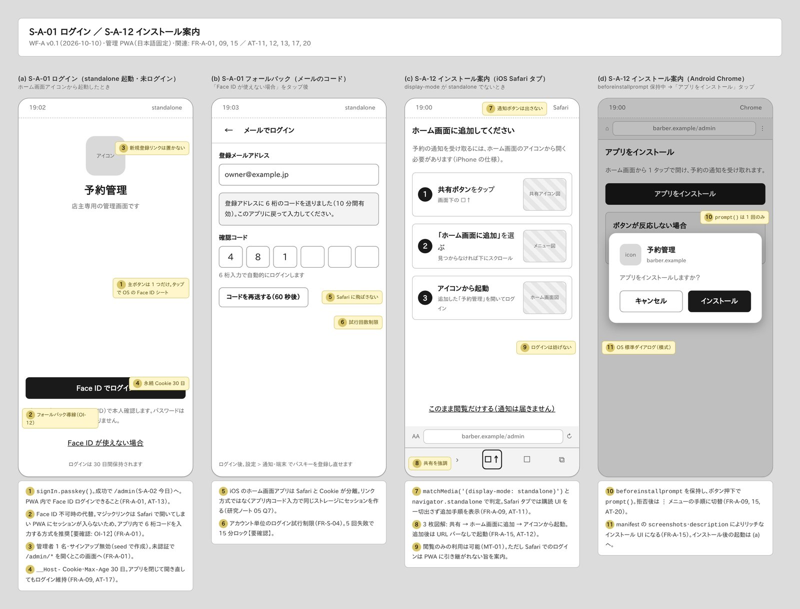
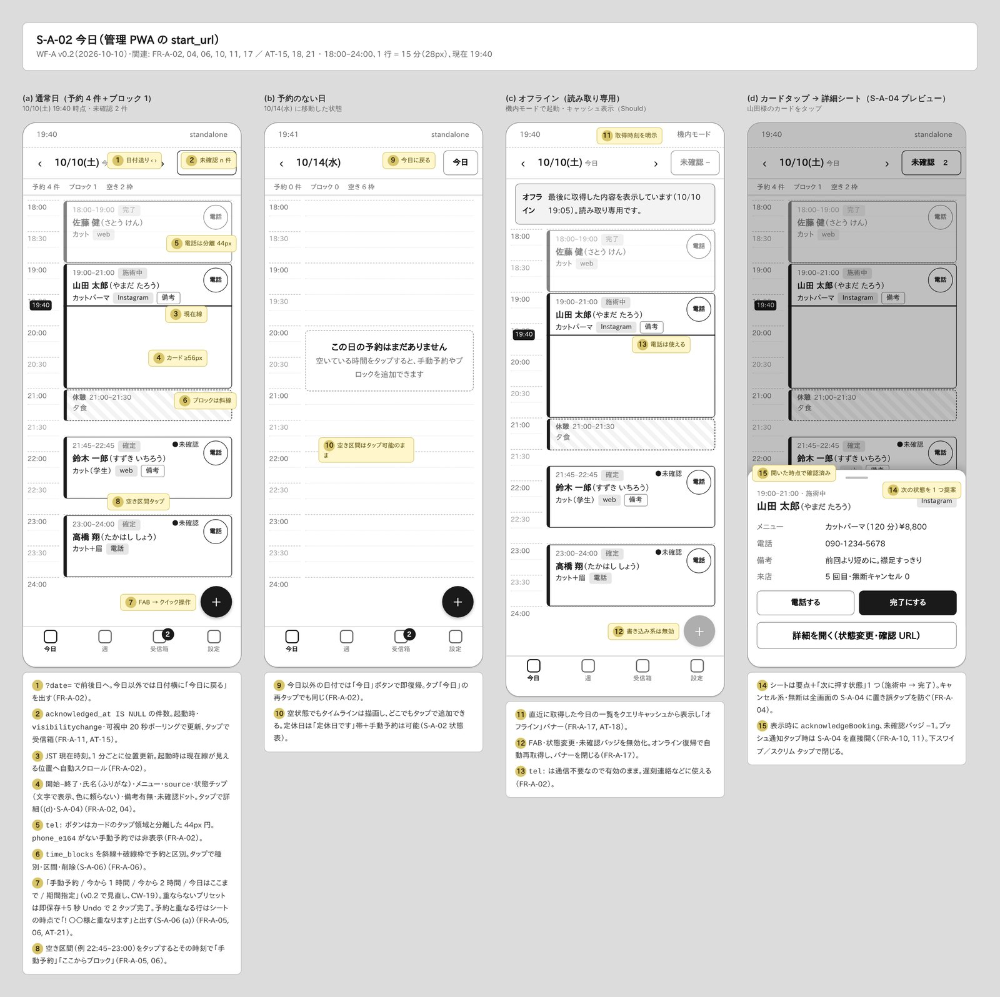
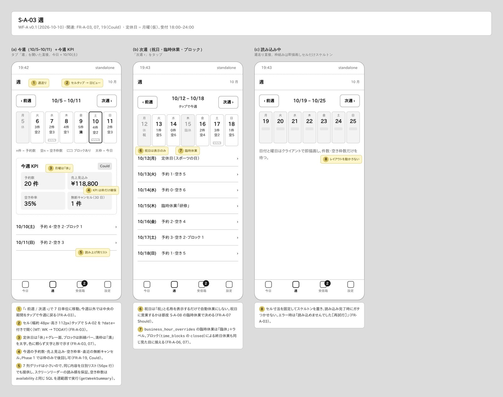
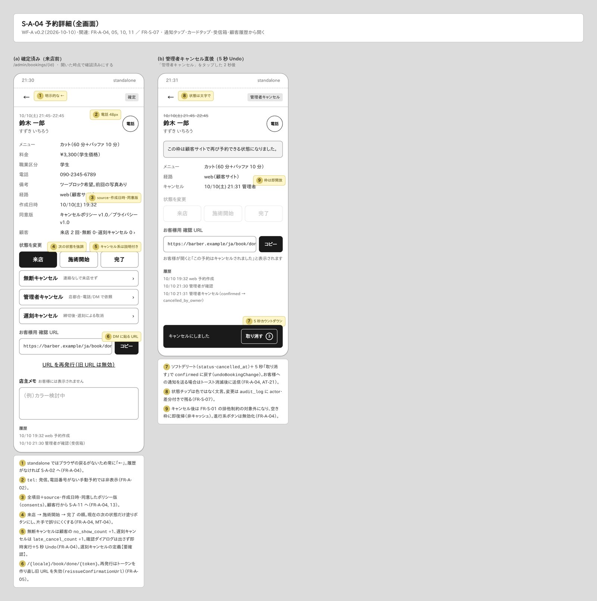
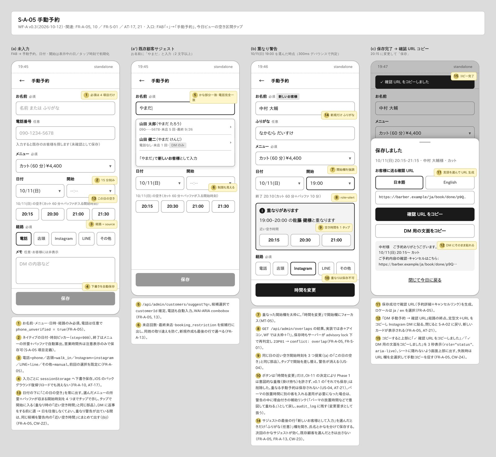
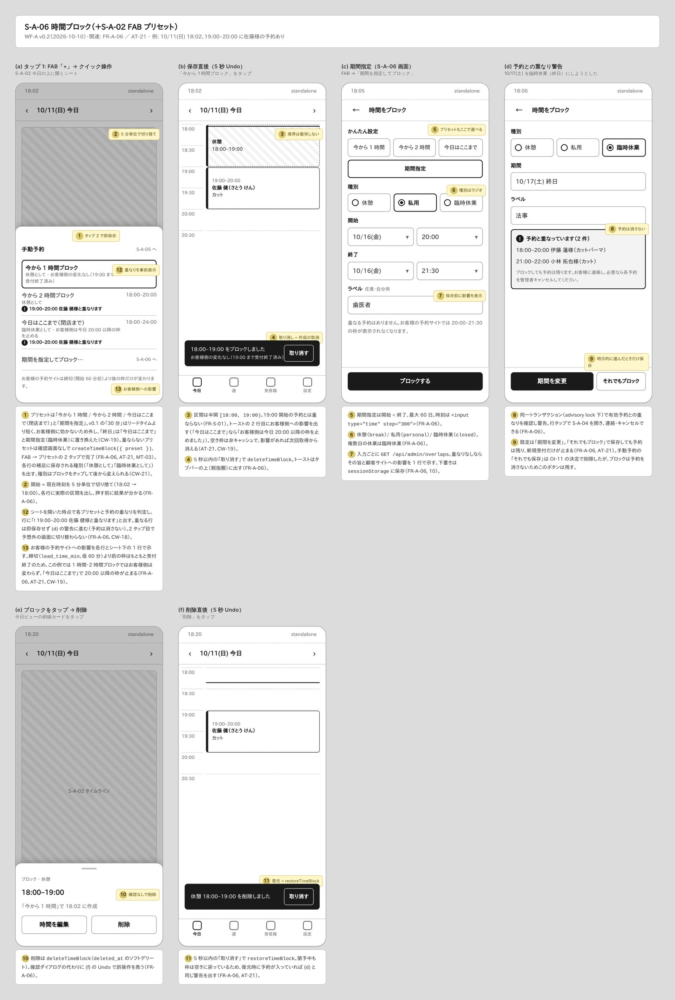
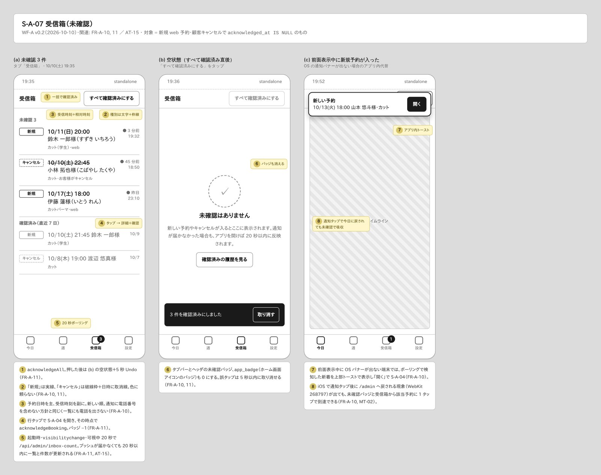
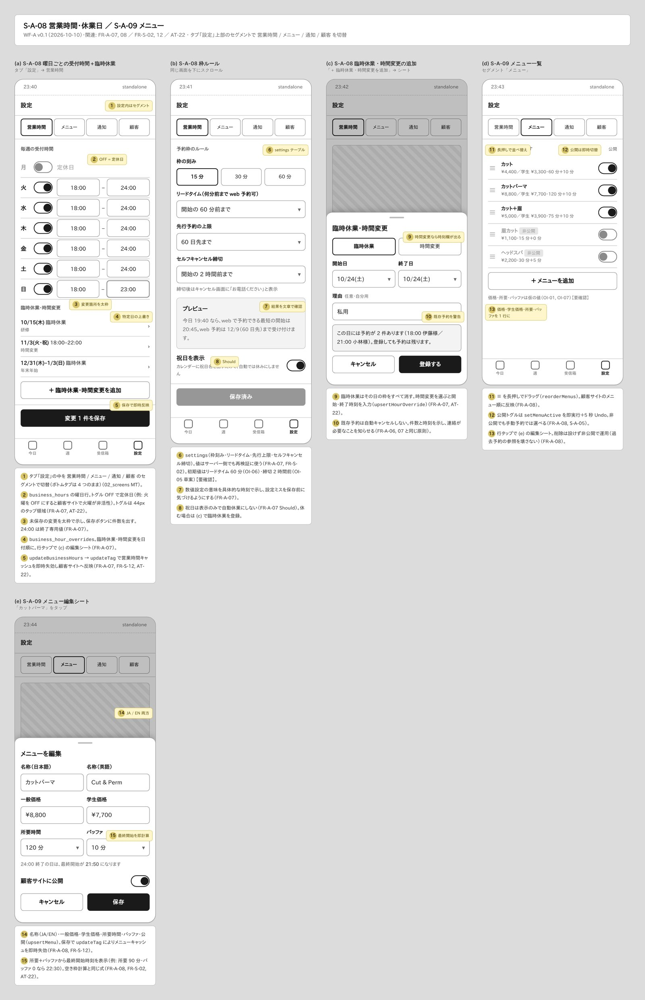
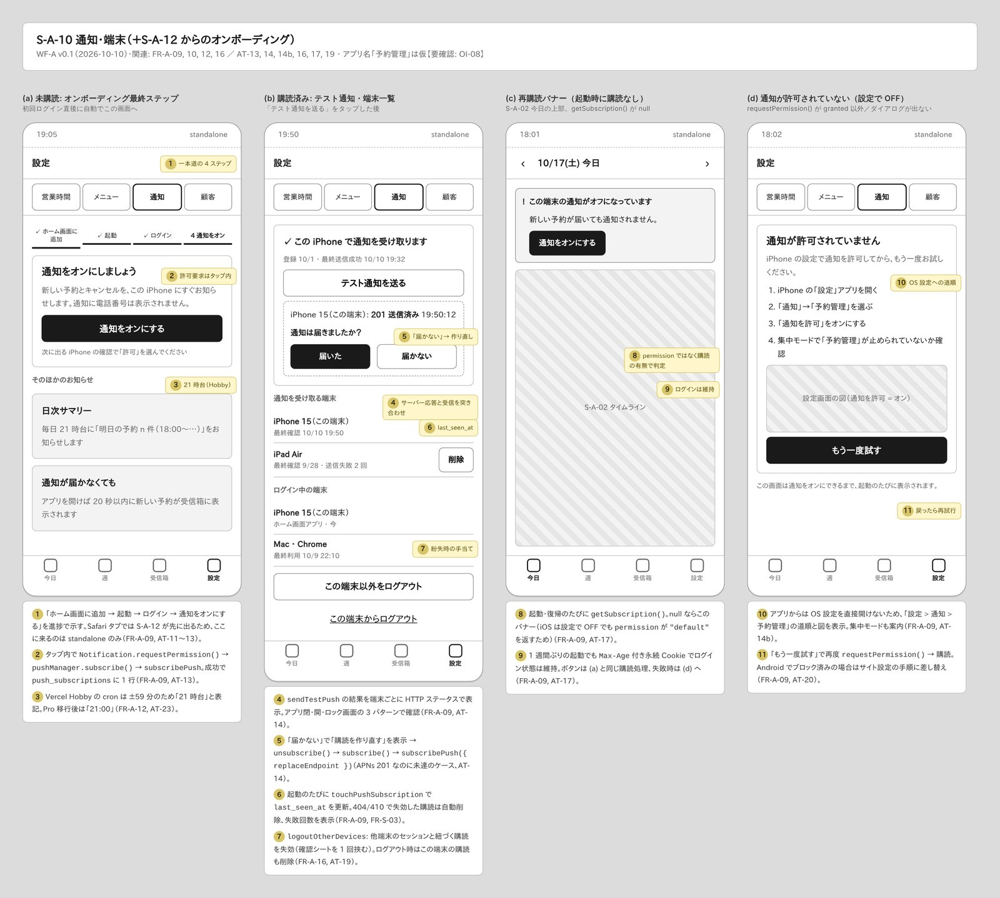
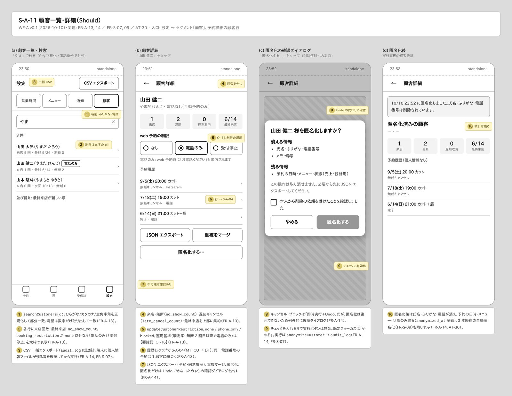

---

## 2. 画面フロー

矢印ラベルはトリガー。点線は例外・復旧の経路。

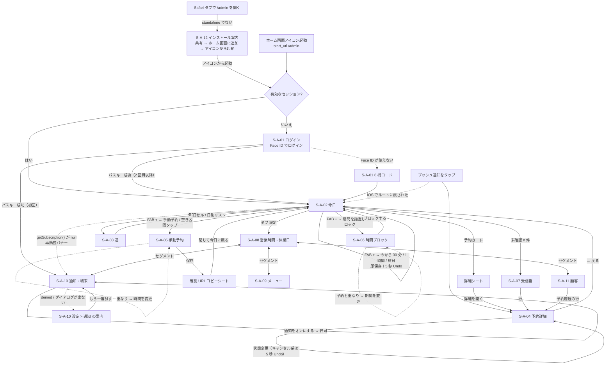

### 2.1 特に短くした 2 つの経路

**A. 2 タップで「今から 1 時間」をブロック（FR-A-06, AT-21, MT-03）**

| 手順 | 画面 | 操作 | 結果 |
|---|---|---|---|
| 1 | S-A-02 今日 | FAB「+」をタップ | クイック操作シート。各プリセットに実際の区間（例「今から 1 時間ブロック 18:00–19:00」）を表示 |
| 2 | シート | 「今から 1 時間ブロック」をタップ | 確認画面なしで `createTimeBlock({ preset })`。トースト「18:00–19:00 をブロックしました［取り消す］」5 秒。顧客サイトの該当枠は次回取得から消える |

- 開始は現在時刻を 5 分単位で切り捨て。区間は半開 `[18:00, 19:00)` なので 19:00 開始の予約とは重ならない。
- 予約と重なる場合だけ即保存せず、S-A-06 (d) の警告に切り替える。

**B. Instagram DM の予約を手動で入れて確認 URL を返す（FR-A-05, AT-21）**

| 手順 | 画面 | 操作 | 結果 |
|---|---|---|---|
| 1 | S-A-02 今日 | FAB「+」→「手動予約」、または空き区間をタップ | S-A-05。日付・開始が初期値で入る |
| 2 | S-A-05 | お名前（かなで既存顧客をサジェスト）・メニュー・開始・経路「Instagram」 | 300ms デバウンスで重なり判定。重なれば「19:00–20:00 の佐藤 健様と重なります」＋近い空き時間 3 つ |
| 3 | S-A-05 | 「保存」 | サーバーが advisory lock 下で再判定して保存 |
| 4 | 確認 URL シート | ja / en を選び「確認 URL をコピー」または「DM 用の文面をコピー」 | 定型文＋URL を DM に貼る。お客様はリンクから予約内容の確認とキャンセルができる |
| 5 | シート | 「閉じて今日に戻る」 | 今日ビューに新しいカードが出る |

- 入力中の内容は `sessionStorage` に下書き保存し、iOS のバックグラウンド復帰によるリロードでも消えない（FR-A-10, AT-17）。

---

## 3. 画面ごとの設計意図

### S-A-01 ログイン ／ S-A-12 インストール案内

- 主ボタンは「Face ID でログイン」の 1 つだけ。パスワード欄と新規登録は置かない（管理者 1 名、サインアップ無効）（FR-A-01, AT-13）。
- フォールバックは、メールで受け取った 6 桁コードをアプリ内で入力する方式を推奨する。マジックリンクは Safari で開いてしまい、ストレージが分かれた PWA にセッションが入らないため【要確認: OI-12】（FR-A-01）。
- Safari タブで開いたときは通知ボタンを出さず、「共有 → ホーム画面に追加 → アイコンから起動」の 3 ステップ図解だけを示す（FR-A-09, AT-11, AT-12）。
- Android は `beforeinstallprompt` を保持して「アプリをインストール」ボタンを出す。`prompt()` は 1 回だけで、拒否後は ⋮ メニューの手順に切り替える（FR-A-15, AT-20）。
- Cookie は `Max-Age` 30 日のローリングで、アプリを閉じて開き直してもログインが続く（FR-A-09, AT-17）。

### S-A-02 今日

- 18:00〜24:00 を 1 行 15 分（28px）の縦タイムラインで表示する。現在線は 1 分ごとに動き、起動時はその位置までスクロールする（FR-A-02）。
- 予約カードは高さ 56px 以上（60 分 = 110px）。氏名（ふりがな）・メニュー・`source`・状態チップ（文字）・備考の有無・未確認ドットを載せ、`tel:` ボタンはカードとは別の 44px 円にする（FR-A-02）。
- ブロックは斜線＋破線枠で、予約と形で区別する。空き区間をタップすると、その時刻で手動予約またはブロックを始められる（FR-A-05, 06）。
- ヘッダの「未確認 n 件」は起動時・`visibilitychange`・表示中 20 秒ごとに更新する。プッシュが届かなくても 20 秒以内に気づける（FR-A-11, AT-15）。
- オフライン時はキャッシュを読み取り専用で表示し、取得時刻を明示する。書き込み系は無効にするが、`tel:` は使える（FR-A-17, AT-18）。
- カードタップで開く詳細シートは要点と「次の状態」1 つだけを置く。キャンセル系は全画面の S-A-04 に分け、誤タップを防ぐ（FR-A-04）。

### S-A-03 週

- 7 列のセルに日付・件数・空き枠数を出し、定休日は「休」、ブロックは斜線バー、満枠は「満」で示す。色には頼らない（FR-A-03）。
- セルは幅 48px と小さいので、同じ内容を 56px 行の日別リストでも出す。読み上げ順もこのリストで担保する（FR-A-03）。
- 祝日は名称を表示するだけで、自動では休みにしない。臨時休業は「臨休」＋ラベルで表示する（FR-A-07 Should）。
- 今週 KPI（予約数・売上見込み・空き枠率・直近の無断キャンセル）は場所だけ確保する Could 項目（FR-A-19）。

### S-A-04 予約詳細

- standalone にはブラウザの戻るがないため、常に明示的な「←」を置く（FR-A-04）。
- 全項目に加え、`source`・作成日時・同意したポリシーの版を表示する（FR-A-04）。
- 状態は 来店 → 施術開始 → 完了 の順で、次に押すものだけを塗りボタンにする。無断・管理者・遅刻キャンセルは説明付きの別グループに分ける（FR-A-04）。
- キャンセル系は確認ダイアログを出さずに即時実行し、5 秒の「取り消す」で `confirmed` に戻せる。無断は `no_show_count` +1（FR-A-04, AT-21）。
- お客様用の確認 URL のコピーと再発行をここにも置き、DM での再送に使う（FR-A-05）。

### S-A-05 手動予約

- 必須はお名前・メニュー・日時・経路の 4 つ。電話は任意で、入れた場合は `phone_unverified` として保存する（FR-A-05）。
- お名前 2 文字以上でかな部分一致・電話完全一致のサジェストを出す。候補には来店回数と制限 pill も出し、同姓の取り違えを防ぐ（FR-A-05, 13）。
- 重なりは入力中に判定し、開始欄を太枠にして近い空き時間を 3 つ提案する。既定ボタンは「時間を変更」（FR-A-05, MT-05）。
- 保存後は ja / en を選べる確認 URL と DM 用の定型文をコピーでき、「DM → 手動予約 → 確認 URL」の経路がここで終わる（FR-A-05）。
- 下書きを `sessionStorage` に保存し、リロードで入力が消えないようにする（FR-A-10, AT-17）。

### S-A-06 時間ブロック

- 「今から 30 分 / 1 時間 / 終日」は FAB から 2 タップで即保存し、確認の代わりに 5 秒 Undo で救う（FR-A-06, AT-21）。
- 期間指定画面でもプリセットを選べる。種別（休憩 / 私用 / 臨時休業）はラジオ、時刻は 5 分刻みのネイティブ入力（FR-A-06）。
- 保存前に、重なりがないことと顧客サイトでどの枠が消えるかを 1 行で示す（FR-A-06）。
- 予約と重なる場合は件数と時刻を警告し、既定は「期間を変更」にする。「それでもブロック」で保存しても予約は消さない（FR-A-06）。
- 削除もソフトデリート＋5 秒 Undo。復元するときに予約が入っていれば、同じ警告を出す（FR-A-06）。

### S-A-07 受信箱

- 対象は新規 web 予約と顧客キャンセルのうち未確認のもの。「新規」は実線、「キャンセル」は破線枠＋取消線で示す（FR-A-10, 11）。
- 行をタップすると S-A-04 を開き、その時点で確認済みにする。「すべて確認済みにする」は 5 秒 Undo 付き（FR-A-11）。
- 空状態の文言で「通知が来なくても開けば 20 秒以内に反映される」ことを伝え、プッシュへの過度な依存を避ける（FR-A-11, AT-15）。
- 前面表示中に OS バナーが出ない端末では、アプリ内トーストで代わりに知らせる。iOS で通知タップ後にルートへ戻される現象（WebKit 268797）も、バッジと受信箱で吸収する（FR-A-10, MT-02）。

### S-A-08 営業時間・休業日 ／ S-A-09 メニュー

- 曜日ごとの行をトグル＋開始・終了時刻で編集する。トグル OFF が定休日（FR-A-07, AT-22）。
- 臨時休業・時間変更は日付順の一覧と追加シートで管理する。既存予約がある日は件数と時刻を示すが、自動ではキャンセルしない（FR-A-07）。
- 枠ルール（刻み・リードタイム・先行上限・セルフキャンセル締切）は、結果を具体的な時刻のプレビューで確かめられるようにする（FR-A-07）。
- 保存すると `updateTag` でキャッシュを即時に失効させ、顧客サイトにすぐ反映する（FR-A-07, 08, FR-S-12, AT-22）。
- メニューは一覧で価格・学生価格・所要・バッファ・公開を 1 行に収める。並べ替えは長押し、削除は設けず非公開で運用する（FR-A-08）。
- 編集シートでは、所要＋バッファから計算した最終開始時刻をその場で表示する（FR-A-08, AT-22）。

### S-A-10 通知・端末

- オンボーディングは「ホーム画面に追加 → 起動 → ログイン → 通知をオンにする」の 4 ステップを進捗で示す一本道（FR-A-09, AT-11〜13）。
- 「通知をオンにする」はタップの中で `requestPermission()` → `subscribe()` → `subscribePush` まで行う（FR-A-09, AT-13）。
- 「テスト通知を送る」はサーバー応答（201）と実際に届いたかを突き合わせる。「届かない」なら同じ画面で購読を作り直せる（FR-A-09, AT-14）。
- 起動のたびに `getSubscription()` を確認し、null なら今日ビューに再購読バナーを出す。判定には permission ではなく購読の有無を使う（FR-A-09, AT-17）。
- 許可されていないときは「設定 > 通知 > 予約管理」の道順と集中モードの確認を案内する（FR-A-09, AT-14b）。
- 端末一覧（`last_seen_at`、失敗回数）と「この端末以外をログアウト」で、端末を紛失したときに対処できる（FR-A-16, AT-19）。

### S-A-11 顧客一覧・詳細（Should）

- 名前・ふりがな・電話で検索し、各行に来店回数・最終来店・`no_show_count`・制限 pill を表示する（FR-A-13）。
- 詳細では回数を上部にまとめ、web 予約の制限（なし / 電話のみ / 受付停止）を選べるようにする（FR-A-13）。
- 予約履歴の行から S-A-04 に移動できる。JSON エクスポートと重複マージもここに置く（FR-A-13, 14）。
- 匿名化だけは元に戻せないため、例外的に確認ダイアログとチェックボックスを置く。実行後は日時・メニュー・状態だけが残る（FR-A-14, AT-30）。

---

## 4. 検証結果（2026-10-10）

`render.mjs`（Playwright Chromium、deviceScaleFactor 1.5、ビューポート 1780×900、`document.fonts.ready` 後に fullPage 撮影）で全 10 ファイルを描画し、`page.evaluate` で次の 3 点を確認した。

| 項目 | 基準 | 結果 |
|---|---|---|
| 横はみ出し | どの `.frame` でも `scrollWidth > clientWidth` にならない | 39 フレーム中 0 件 |
| タップ領域 | `.btn, .slot, .radio, .input, .tab, .fab, .toggle, .item` の高さ ≥ 44px | 349 要素中 0 件（最小 44px） |
| 予約カード | `.booking` の高さ ≥ 56px（FR-A-02） | 18 枚中 0 件（最小 56px） |

- キットの `.toggle` は高さ 32px のため、S-A-08 / 09 ではページ内 CSS で見た目を変えずにタップ領域を 44px に広げた。
- 画像は PNG から JPEG（品質 85、幅 1600px 以下）に変換し、全画面の一覧 `admin_contact_sheet.jpg` を作成した。

---

## 5. 未決事項

| # | 内容 | WF での仮置き | 影響する画面 | 関連 |
|---|---|---|---|---|
| 1 | 【要確認】手動予約で意図的な重複（掛け持ち）を許すか | 「それでも保存」を補助ボタンとして描いた。要件の既定案は「許容しない（警告のみで保存不可）」で、その場合はボタンを消し「時間を変更」だけにする | S-A-05 (b)、S-A-06 (d) の「それでもブロック」は別扱い（ブロックは予約を消さないため残す） | OI-11, FR-A-05 |
| 2 | 【要確認】`phone_only` の運用（何回の無断で電話のみにするか、自動か手動か） | 手動で選ぶラジオ。既定案は「無断 2 回目以降」。自動で切り替える場合は詳細に「自動設定」の表示と解除操作が必要 | S-A-11 (b)、S-A-05 のサジェスト候補の pill | OI-16, FR-A-13 |
| 3 | 【要確認】店舗住所の掲載可否 | 管理 PWA には住所を出していない。確認 URL・DM 定型文が開く完了画面（S-C-05）の住所表示に連動する。掲載しない場合は DM 定型文に「場所は別途ご案内」の一文を入れるか検討 | S-A-05 (c) の DM 文面 | OI-09, FR-C-11, 14 |
| 4 | 【要確認】ログインのフォールバック方式 | アプリ内 6 桁コードを推奨（マジックリンクは PWA にセッションが入らない） | S-A-01 (b) | OI-12, FR-A-01 |
| 5 | 【要確認】「遅刻キャンセル」の定義（締切後のキャンセルか、遅刻による取消か）と `late_cancel_count` の加算条件 | 「締切後・遅刻による取消」と表記 | S-A-04、S-A-11 | OI-05, FR-A-04, 13 |
| 6 | 【要確認】アプリ名（ホーム画面アイコン名・通知の差出人） | 「予約管理」 | S-A-01, S-A-10, S-A-12 | OI-08 |
| 7 | 【要確認】週ビューの「空き枠数」の基準メニュー（最短メニュー基準か、60 分基準か） | 60 分枠を想定した数字 | S-A-03 | FR-A-03 |
