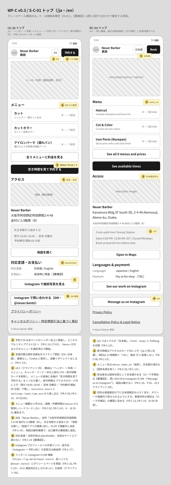
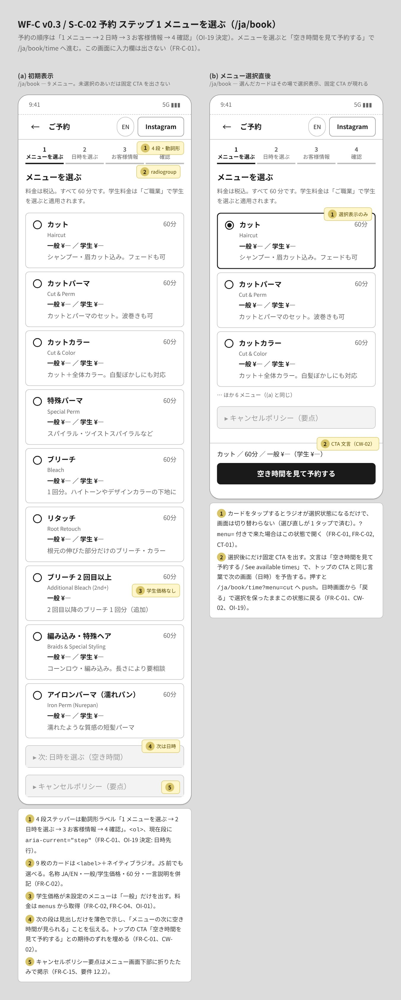
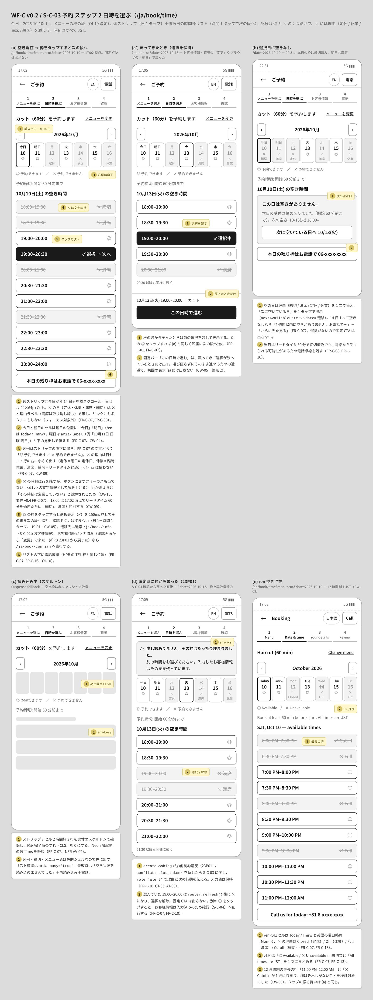
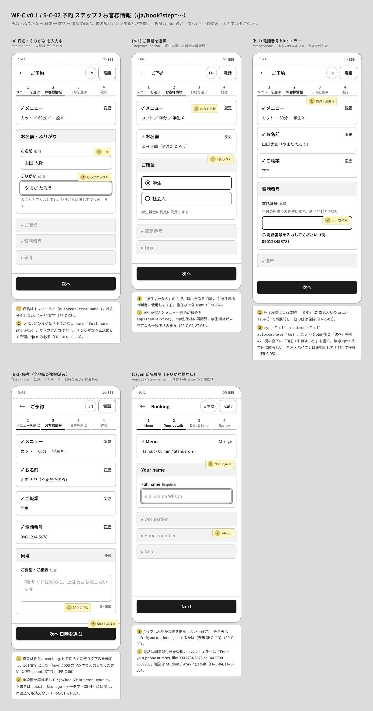
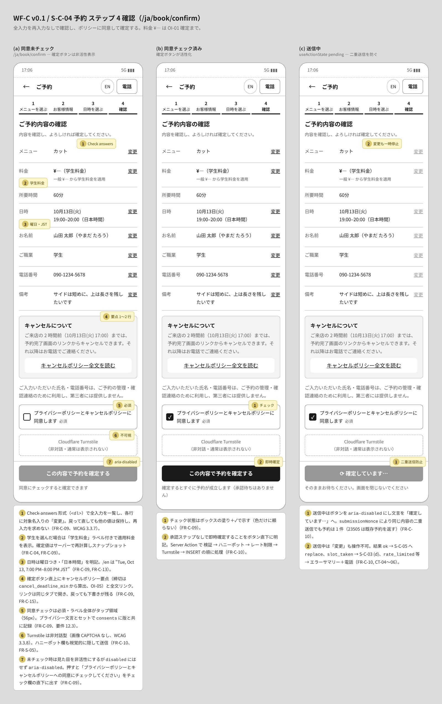
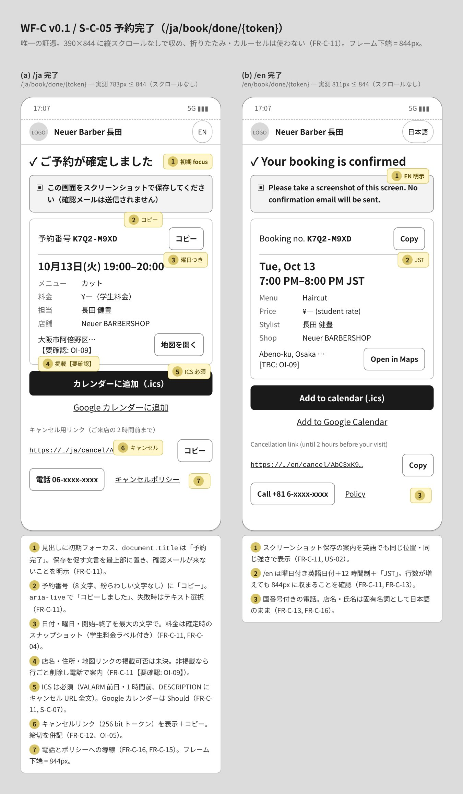
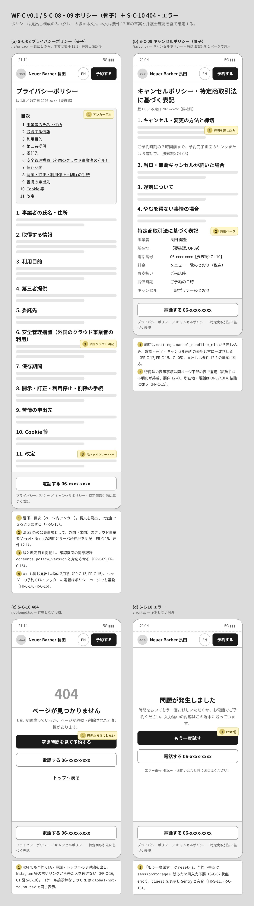
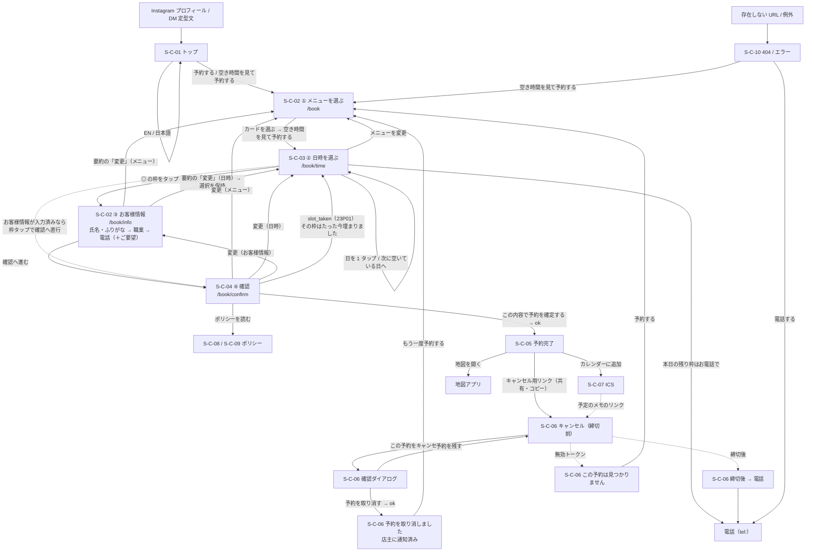

# 顧客サイト ワイヤーフレーム（WF-C）

## 文書情報

| 項目 | 内容 |
|---|---|
| 文書 ID | WF-C |
| 版 | v0.2 |
| 日付 | 2026-10-10 |
| 対象画面 | S-C-01〜06、S-C-08〜10（S-C-07 ICS は Route Handler のため画面なし） |
| 関連要件 | FR-C-01〜17、US-01〜02、AT-01〜10 |
| 関連文書 | `../03_design/02_screens.md`（画面一覧・遷移）、`../03_design/03_screen_specs.md`（項目定義・エラー文・状態）、`../05_design_comps/design_direction.md`（共通の前提）、`../06_test/evaluation/cognitive_walkthrough_wf.md`（EVAL-001 と v0.2 対応状況） |
| 共通キット | `wf.css`（グレースケール、390×844 アートボード、8px グリッド） |

### 変更履歴

| 版 | 日付 | 内容 |
|---|---|---|
| v0.1 | 2026-10-10 | 初版（8 ファイル・27 状態） |
| v0.2 | 2026-10-10 | EVAL-001 の WF 修正とクライアント決定 3 件を反映。(1) 予約の順序を「1 メニュー → 2 日時 → 3 お客様情報 → 4 確認」に変更し（OI-19 決定）、ルートを `/{locale}/book` → `/book/time` → `/book/info` → `/book/confirm` に、ファイルを 04〜08 に振り直した。(2) 店名・住所・天王寺駅 徒歩 5 分・地図リンクをトップと完了画面に掲載（OI-09 決定）。(3) 完了画面のキャンセルリンクを「共有・コピー」にし、「カレンダーの予定からもキャンセルできます」を追加（CW-15）。ほかに、枠タップで次の段へ（CW-05）、凡例「× 予約できません」と理由ラベル（CW-09/10）、「今日・明日」（CW-04）、職業の自動前進と備考の同居（CW-11）、/en の 3 状態の追加（CW-03）、確認シートの文言（CW-16/17）、料金行の「変更」削除（HE-03）、404・エラーの電話の重複解消（HE-01）。8 ファイル・31 状態 |

### 表記ルール

- グレースケールの構造図。ブランド色・写真・最終文言は含めない。`¥—` は価格未確定（OI-01）。
- 黄色の番号付き付箋は「振る舞い」の注記。各アートボード下の一覧で FR ID と合わせて説明する。
- 時刻はすべて JST。今日 = 2026-10-10(土)、予約例 = 10月13日(火) 19:00–20:00 カット（学生）。
- 押せる要素は 44px 以上（主要ボタン 48px、時間枠 48px、日セル 44×64px 以上）。空き状況の記号は ◎・× の 2 つだけ。凡例「◎ 予約できます ／ × 予約できません」はストリップの直下、× の理由（定休 / 満席 / 締切）は日セル・行に、締切は文で明記。

---

## 1. 画面一覧

予約フローのステップ番号とファイル番号は一致しない（ファイルはフロー順の通し番号、画面 ID は設計書 `02_screens.md` の ID）。

| # | 画面 ID | 画面 | ルート | 収録している状態 | HTML | 画像 |
|---|---|---|---|---|---|---|
| 1 | S-C-01 | トップ | `/{locale}` | /ja、/en | [customer_01_top.html](screens/customer_01_top.html) | [jpg](screens/customer_01_top.jpg) |
| 2 | S-C-02 | 予約 1 メニューを選ぶ | `/{locale}/book` | 初期表示、メニュー選択直後（固定 CTA「空き時間を見て予約する」） | [customer_02_book_menu.html](screens/customer_02_book_menu.html) | [jpg](screens/customer_02_book_menu.jpg) |
| 3 | S-C-03 | 予約 2 日時を選ぶ | `/{locale}/book/time` | 空き混在（枠タップで次へ）、戻ってきたとき（選択を保持＋固定 CTA）、空きなしの日、読み込み中、枠が埋まった（23P01）、/en | [customer_03_time.html](screens/customer_03_time.html) | [jpg](screens/customer_03_time.jpg) |
| 4 | S-C-02 | 予約 3 お客様情報 | `/{locale}/book/info` | 氏名・ふりがな、職業（選ぶと自動前進）、電話 blur エラー、電話＋ご要望、/en（ふりがななし）。上部にメニュー・日時の要約 | [customer_04_book_info.html](screens/customer_04_book_info.html) | [jpg](screens/customer_04_book_info.jpg) |
| 5 | S-C-04 | 予約 4 確認 | `/{locale}/book/confirm` | 同意未チェック、チェック済み、送信中、/en | [customer_05_confirm.html](screens/customer_05_confirm.html) | [jpg](screens/customer_05_confirm.jpg) |
| 6 | S-C-05 | 予約完了 | `/{locale}/book/done/{token}` | /ja（775px）、/en（822px）。どちらも 844px 以内 | [customer_06_done.html](screens/customer_06_done.html) | [jpg](screens/customer_06_done.jpg) |
| 7 | S-C-06 | キャンセル | `/{locale}/cancel/{token}` | 締切前、確認ダイアログ、完了、締切後、無効トークン、/en | [customer_07_cancel.html](screens/customer_07_cancel.html) | [jpg](screens/customer_07_cancel.jpg) |
| 8 | S-C-08 / 09 / 10 | ポリシー（骨子）、404、エラー | `/{locale}/privacy`、`/{locale}/policy` ほか | プライバシー、キャンセル＋特商法、404、error.tsx | [customer_08_policies_error.html](screens/customer_08_policies_error.html) | [jpg](screens/customer_08_policies_error.jpg) |

v0.1 からのファイル名の変更: `customer_02_book_info` → `customer_04_book_info`、`customer_04_confirm` → `customer_05_confirm`、`customer_05_done` → `customer_06_done`、`customer_06_cancel` → `customer_07_cancel`、`customer_07_policies_error` → `customer_08_policies_error`（`customer_02_book_menu`・`customer_03_time` は据え置き）。

全画面をフロー順に縦に並べた一覧: [customer_contact_sheet.jpg](screens/customer_contact_sheet.jpg)

---

## 2. 画面フロー

順序は「メニュー → 日時 → お客様情報 → 確認」（OI-19 決定）。矢印ラベルはトリガー。

---

## 3. 画面ごとの設計意図

### S-C-01 トップ

- 予約 CTA をヘッダー右上に常設し、全ページから 1 タップで予約に入れる（FR-C-14, CT-01）。本文の CTA「空き時間を見て予約する」は、メニューの次に日時が来る順序（OI-19 決定）と合うため据え置いた（CW-02）。
- 受付時間 18:00–24:00・月曜定休・予約締切をファーストビュー直下のカードにまとめ、「夜に行けるか」をすぐ判断できるようにする（FR-C-08, FR-C-14）。
- メニューは 3 件の概要＋「全 9 メニュー」。価格・所要時間は DB から取得し、¥— は OI-01 確定まで（FR-C-02）。
- アクセスに店名「Neuer Barber」、住所「大阪市阿倍野区阿倍野筋2-4-48 金村ビル3階南（B）」、天王寺駅から徒歩 5 分、「地図アプリで開く」を載せる（OI-09 決定、FR-C-14）。/en は英語住所の下に日本語住所を添え、タクシーや道案内で見せられるようにする。
- /en は「日本語」トグル、12 時間制＋JST、国番号付き電話。担当者名は固有名詞として日本語のまま（FR-C-13, FR-C-16）。

### S-C-02 ① メニューを選ぶ（/book）

- 画面にはメニュー 9 枚だけを置き、入力欄は出さない。次の段は「▸ 次: 日時を選ぶ（空き時間）」の薄色の見出しで予告する（FR-C-01）。
- カードは `<label>`＋ネイティブラジオ。名称 JA/EN、一般・学生価格（未設定なら一般のみ）、所要時間、一言説明（FR-C-02）。学生価格がカードに並ぶので、日時より先に料金の見当がつく。
- カードを選ぶと選択表示になり、固定 CTA「空き時間を見て予約する / See available times」が現れる。押すと `/book/time?menu=…` へ（FR-C-01、CW-02）。`?menu=` 付きのリンクなら選択済みで開く。
- キャンセルポリシー要点を下部に折りたたみで置く（FR-C-15、要件 12.2）。

### S-C-03 ② 日時を選ぶ（/book/time）

- 週ストリップ（14 日を横スクロール）＋選択日の縦リスト。日 1 タップ・時間 1 タップで次の段に進む（FR-C-07, US-01）。
- ◎ の枠をタップすると選択表示を 150ms 見せてすぐ遷移する。確認用の CTA は挟まない（CW-05）。遷移先は通常お客様情報、入力済み（確認から「変更」で来た・23P01 で戻った）なら確認へ直行。
- 固定バー「この日時で進む」は、次の段から戻ってきて選択が残っているときだけ出す（(a') の状態、CW-05）。
- 記号は ◎・× だけ。凡例は FR-C-07 の文言「◎ 予約できます ／ × 予約できません」。× の理由は日セル・行に小さく出す（定休 / 満席 / 締切）。リードタイムで締め切った枠を「満席」と表示しない（CW-09）。
- × の時刻は行を残すが、ボタンにせずフォーカスも当てない文字情報にする（CW-10）。行が消えると「その時刻は営業していない」と誤解されるため。
- 今日・翌日のセルは曜日の位置に「今日」「明日」（/en は Today / Tmrw）（CW-04）。
- 空きのない日は理由と「次に空いている日」を 1 タップで提示し、電話導線を残す（FR-C-07, FR-C-16）。
- スケルトンは実寸で CLS 0。23P01 で戻ったときは `role="alert"` のバナーで理由と次の行動を伝え、入力値は保持（FR-C-10, AT-03）。

### S-C-02 ③ お客様情報（/book/info）

- 上部に、選んだメニュー（適用料金）と日時のコンパクトな要約を置き、それぞれに「変更」（メニュー → `/book`、日時 → `/book/time` の (a')）。日時を決めてから入力するので、入力が無駄にならない（CW-01、OI-19）。
- 「氏名・ふりがな → 職業 → 電話」の 3 段を 1 段ずつ開く。完了段階は要約＋「変更」で、後続の値は保持（FR-C-01）。
- 氏名は 1 欄。ふりがなはひらがなラベル、カタカナ入力は正規化して受理。/en では描画しない（FR-C-03、OI-13）。
- 職業は理由を添えた 2 択（「学生料金の判定に使用します」）。選んだ時点で次の段を開き、「次へ」は押させない（CW-11）。学生を選ぶと要約の料金を即再計算（FR-C-04）。
- 電話は `type="tel"`。エラーは blur 後と「確認へ進む」時だけ、欄の直下に何をすればよいかを書く（FR-C-05）。
- 備考は独立した段にせず、電話の段の下の「＋ ご要望を追加（任意）」で開く。残り文字数を表示（FR-C-06、CW-11）。最後の CTA は「確認へ進む」。

### S-C-04 ④ 確認（/book/confirm）

- Check-answers 形式で 8 項目を一覧し、各行に「変更」。再入力は求めない（FR-C-09、WCAG 3.3.7）。料金行には「変更」を置かない（料金はメニューと職業で決まる、HE-03）。
- 料金は「学生料金」ラベル付き、日時は曜日＋日本時間（FR-C-04, FR-C-09）。/en は曜日つき英語日付＋12 時間制＋JST、締切文・同意文も英語（CW-03）。
- 確定ボタン直上にキャンセルポリシー要点・プライバシー文言・必須の同意チェック（56px のタップ領域）（FR-C-09, FR-C-15）。
- Turnstile は非対話で通常は不可視（FR-C-10、WCAG 3.3.8）。
- 未チェック時は `aria-disabled`（押すとエラー文を表示）、送信中は「確定しています…」で二重送信を防ぐ（FR-C-09, FR-C-10）。

### S-C-05 予約完了

- 唯一の証憑として 1 画面に収める。実測 /ja 775px・/en 822px（いずれも 844px 以内、スクロールなし）（FR-C-11, AT-01）。
- 最上部に「この画面をスクリーンショットで保存してください（確認メールは送信されません）」（FR-C-11）。
- 予約番号に「コピー」、日付・曜日・開始–終了を最大の文字で（FR-C-11）。
- 店名「Neuer Barber」・住所・「地図を開く」を載せる（OI-09 決定、FR-C-11, US-02, AT-02）。
- キャンセルリンクのボタンは「共有・コピー」（Web Share API、非対応時はコピー）。その下に「カレンダーの予定からもキャンセルできます」。スクリーンショットだけでは URL がタップできないため、LINE やメモに送れるようにする（FR-C-12、CW-15）。ボタンを増やさず置き換えたので 844px 以内を保った。
- ICS（必須）は全幅のプライマリ、Google カレンダー（Should）はテキストリンク（FR-C-11, AT-02）。文言の「.ics」はカンプで見直す（CW-08）。

### S-C-06 キャンセル

- GET は表示のみで副作用なし。リンクプレビューによる誤キャンセルを防ぐ（FR-C-12, FR-S-06）。
- 締切時刻を具体的な日時で明記し、破壊的操作はブランド色ではなく枠線の強調で示す（FR-C-12）。/en も同じ構成（CW-03）。
- 確認シートは「この予約を取り消しますか？」と「予約を残す / 予約を取り消す」。初期フォーカスは「予約を残す」（FR-C-12、CW-16）。
- 完了は「予約を取り消しました」＋「店主に通知しました。お電話は不要です。」。「もう一度予約する」で変更を再予約に誘導（FR-C-12, CT-08、CW-17）。
- 締切後はキャンセルボタンを出さず、電話ボタンを大きく出す（FR-C-12, FR-C-16）。
- 無効トークンは理由を区別せず「この予約は見つかりません」＋予約 CTA＋電話（FR-C-12）。

### S-C-08 / 09 ポリシー、S-C-10 404・エラー

- ポリシーは見出し構成のみ。プライバシーは要件 12.1 の 11 項目（米国クラウド事業者の明記を含む）、キャンセルは 12.2 の草案＋特商法表記の兼用。特商法の所在地には店舗住所を載せる（FR-C-15、OI-09 決定）。
- 版・改定日を掲載し `consents.policy_version` と対応させる（FR-C-09, FR-C-15）。
- 404 でも予約 CTA・電話・トップの 3 導線で行き止まりにしない（FR-C-16）。電話は本文のボタンだけにし、フッターの電話は省いた（HE-01）。
- error.tsx は「もう一度試す」（`reset()`）＋電話＋エラー番号（`digest`）。予約下書きは `sessionStorage` に残る（FR-S-11）。

---

## 4. 検証結果（2026-10-10、v0.2）

`node docs/04_wireframes/tools/render_customer.mjs`（Playwright Chromium、deviceScaleFactor 1.5）で全 HTML を描画して確認した。

| 確認項目 | 基準 | v0.2 の結果 | v0.1 |
|---|---|---|---|
| フレーム内の横はみ出し | 全 `.frame` で `scrollWidth <= clientWidth` | 31 フレームすべて OK（/en の時間枠「11:00 PM–12:00 AM」「× Cutoff」を含む） | 27 フレーム OK |
| タップ領域 | `.btn,.slot,.radio,.input,.day,.lang,.back` の高さ 44px 以上、`.change` は 24px 以上 | 276 要素すべて OK（要約・確認の「変更」も 44px） | 224 要素 OK |
| × の行・日セル | `.slot.full`・`.day.off` がリンク・ボタン・`tabindex` 付きでない | すべて OK | — |
| 完了画面の高さ | S-C-05 のフレーム内容 844px 以下 | /ja 775px、/en 822px | 783px / 811px |
| ページエラー・フォント | `pageerror` なし、Noto Sans JP の読み込み | 全ページ OK | OK |

---

## 5. 未決事項

| # | 内容 | 状態 | WF への影響 | 関連 |
|---|---|---|---|---|
| 1 | 予約ステップの順序 | **決定済み（2026-10-10）**: 「メニュー → 日時 → お客様情報 → 確認」。ルートは `/book` → `/book/time` → `/book/info` → `/book/confirm` | v0.2 で反映済み。設計書（`02_screens.md` 1.1・CT-02、`01_sitemap.md` U-10、`00_overview.md` のルート表）に `/book/info` の追加と遷移順の変更が必要 | OI-19、FR-C-01、CW-01 |
| 2 | サイトに店名・住所を載せるか | **決定済み（2026-10-10）**: 掲載可。店名「Neuer Barber」、住所「大阪市阿倍野区阿倍野筋2-4-48 金村ビル3階南（B）」、天王寺駅 徒歩 5 分 | v0.2 で S-C-01・S-C-05・特商法に反映済み。ICS `LOCATION` にも入れる（実装） | OI-09、FR-C-11, FR-C-14、CW-07 |
| 3 | 【要確認: OI-13】/en のふりがな欄を非表示にするか、「Furigana (optional)」で任意表示にするか | 未決 | S-C-02 ③ (c) と S-C-04 のお名前行。WF は非表示で作図 | FR-C-03 |
| 4 | 満席の時間枠を × の行で見せるか（FR-C-07・US-01 本文は「描画しない」） | WF は「行を残し、ボタンにせずフォーカスも当てない」で確定（EVAL-001 論点 1）。要件本文の修正が残る | S-C-03 の時間枠リスト | FR-C-07, US-01、CW-10 |
| 5 | 時間枠のタップで即座に進むか | WF は「即座に次の段へ。固定 CTA は戻ってきたときだけ」で確定（論点 2）。US-01・FR-C-07 の受入基準「確認画面へ進める」を「次の段へ進める」に直す必要あり | S-C-03 | FR-C-07, US-01、CW-05 |
| 6 | 凡例の × の文言 | WF は FR-C-07 の「× 予約できません」＋理由ラベルで確定（論点 3） | S-C-03 | FR-C-07、CW-09 |
| 7 | 【要確認: OI-01 / OI-05 / OI-06 / OI-10】価格、キャンセル締切（仮 2 時間前）、リードタイム（仮 60 分）、掲載電話番号 | 未決 | ¥—、締切の文言、`tel:` の番号を差し替える | FR-C-02, FR-C-08, FR-C-12, FR-C-16 |
| 8 | 【要確認】店名・担当者名・住所のローマ字表記（/en） | 未決 | WF の /en では担当者名を日本語、住所を仮の英語表記で作図 | FR-C-13 |
| 9 | 【要確認】学生料金の対象（留学生・海外の学生を含むか）と学生証の提示の要否 | 未決 | 決まれば S-C-02 ③ の職業欄のヘルプに 1 行追加 | FR-C-04、CW-06 |
| 10 | 【要確認】ヒーロー文の「Neuer BARBERSHOP 内」と店名「Neuer Barber」の書き分け | 未決（カンプ段階で文言を確定） | S-C-01 のリード文 | FR-C-14 |

補足: 依頼の空き日例「10/13(月)」は、2026-10-13 が火曜（月曜は 10/12 で定休）のため WF では「10/13(火)」と表記した。
