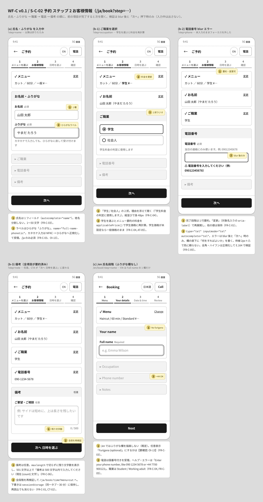
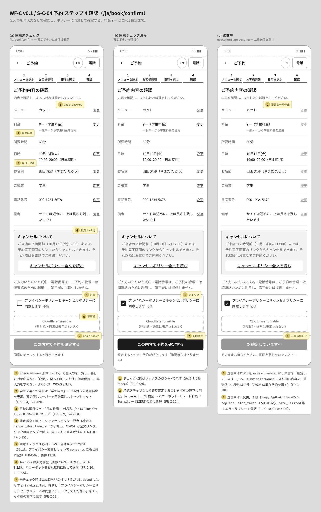
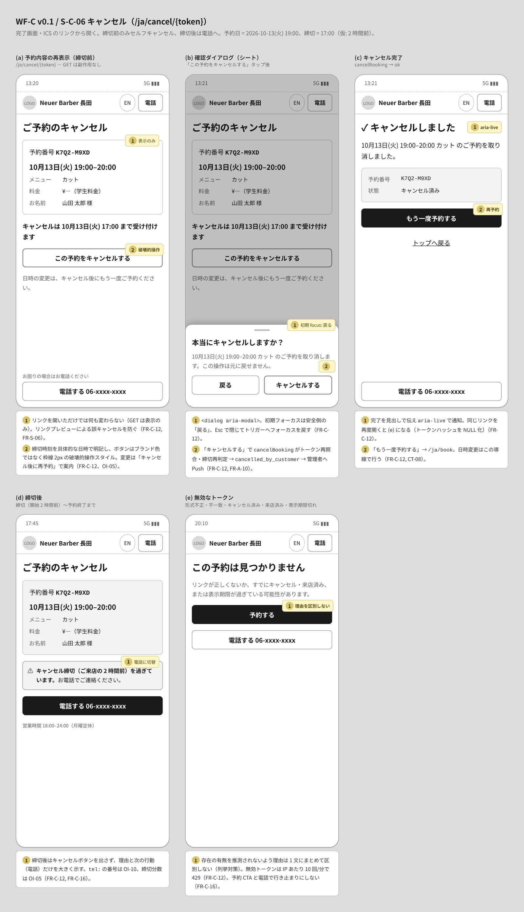
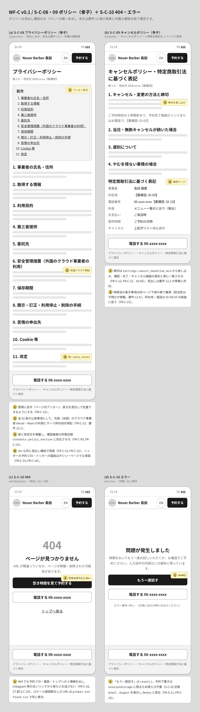
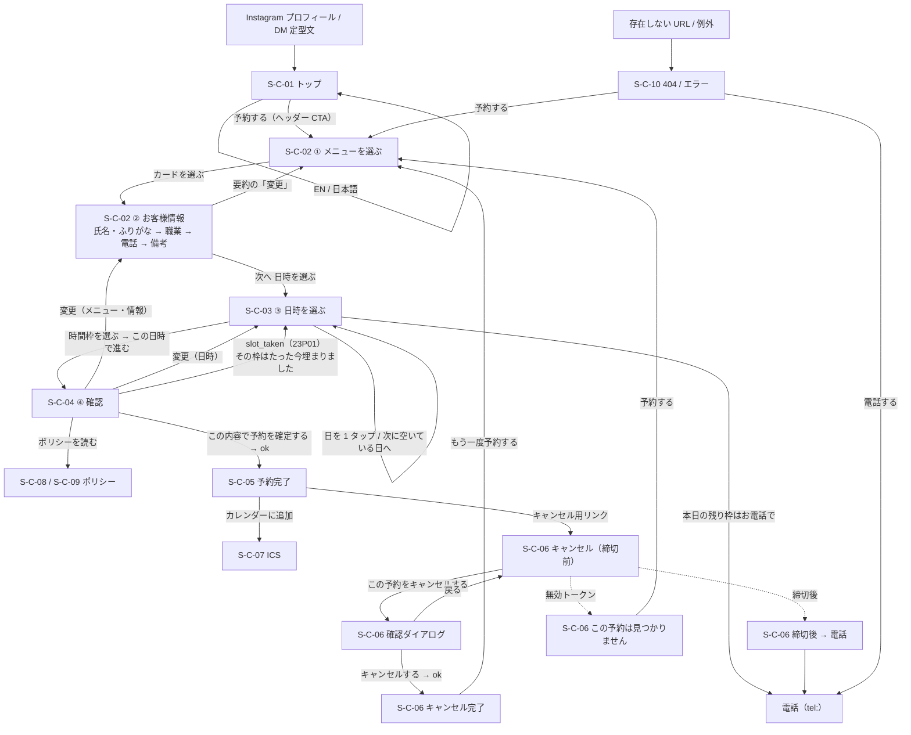

# 顧客サイト ワイヤーフレーム（WF-C）

## 文書情報

| 項目 | 内容 |
|---|---|
| 文書 ID | WF-C |
| 版 | v0.1 |
| 日付 | 2026-10-10 |
| 対象画面 | S-C-01〜06、S-C-08〜10（S-C-07 ICS は Route Handler のため画面なし） |
| 関連要件 | FR-C-01〜17、US-01〜02、AT-01〜10 |
| 関連文書 | `../03_design/02_screens.md`（画面一覧・遷移）、`../03_design/03_screen_specs.md`（項目定義・エラー文・状態）、`../05_design_comps/design_direction.md`（共通の前提） |
| 共通キット | `wf.css`（グレースケール、390×844 アートボード、8px グリッド） |

### 表記ルール

- グレースケールの構造図。ブランド色・写真・最終文言は含めない。`¥—` は価格未確定（OI-01）。
- 黄色の番号付き付箋は「振る舞い」の注記。各アートボード下の一覧で FR ID と合わせて説明する。
- 時刻はすべて JST。今日 = 2026-10-10(土)、予約例 = 10月13日(火) 19:00–20:00 カット（学生）。
- 押せる要素は 44px 以上（主要ボタン 48px、時間枠 48px、日セル 44×64px 以上）。空き状況の記号は ◎・× の 2 つだけ。凡例はストリップの直下、締切は文で明記。

---

## 1. 画面一覧

| # | 画面 ID | 画面 | 収録している状態 | HTML | 画像 |
|---|---|---|---|---|---|
| 1 | S-C-01 | トップ | /ja、/en | [customer_01_top.html](screens/customer_01_top.html) | [jpg](screens/customer_01_top.jpg) |
| 2 | S-C-02 | 予約 1 メニューを選ぶ | 初期表示、メニュー選択直後（要約＋氏名段階を開示） | [customer_02_book_menu.html](screens/customer_02_book_menu.html) | [jpg](screens/customer_02_book_menu.jpg) |
| 3 | S-C-02 | 予約 2 お客様情報 | 氏名・ふりがな、職業、電話 blur エラー、備考（全項目要約）、/en（ふりがななし） | [customer_02_book_info.html](screens/customer_02_book_info.html) | [jpg](screens/customer_02_book_info.jpg) |
| 4 | S-C-03 | 予約 3 日時を選ぶ | 空き混在＋選択、空きなしの日、読み込み中、枠が埋まった（23P01） | [customer_03_time.html](screens/customer_03_time.html) | [jpg](screens/customer_03_time.jpg) |
| 5 | S-C-04 | 予約 4 確認 | 同意未チェック、チェック済み、送信中 | [customer_04_confirm.html](screens/customer_04_confirm.html) | [jpg](screens/customer_04_confirm.jpg) |
| 6 | S-C-05 | 予約完了 | /ja（783px）、/en（811px）。どちらも 844px 以内 | [customer_05_done.html](screens/customer_05_done.html) | [jpg](screens/customer_05_done.jpg) |
| 7 | S-C-06 | キャンセル | 締切前、確認ダイアログ、完了、締切後、無効トークン | [customer_06_cancel.html](screens/customer_06_cancel.html) | [jpg](screens/customer_06_cancel.jpg) |
| 8 | S-C-08 / 09 / 10 | ポリシー（骨子）、404、エラー | プライバシー、キャンセル＋特商法、404、error.tsx | [customer_07_policies_error.html](screens/customer_07_policies_error.html) | [jpg](screens/customer_07_policies_error.jpg) |

全画面をフロー順に縦に並べた一覧: [customer_contact_sheet.jpg](screens/customer_contact_sheet.jpg)

---

## 2. 画面フロー

既定の順序（メニュー → お客様情報 → 日時 → 確認、OI-19 で変更の可能性あり）。矢印ラベルはトリガー。

---

## 3. 画面ごとの設計意図

### S-C-01 トップ

- 予約 CTA をヘッダー右上に常設し、全ページから 1 タップで予約に入れる（FR-C-14, CT-01）。
- 受付時間 18:00–24:00・月曜定休・予約締切をファーストビュー直下のカードにまとめ、「夜に行けるか」をすぐ判断できるようにする（FR-C-08, FR-C-14）。
- メニューは 3 件の概要＋「全 9 メニュー」。価格・所要時間は DB から取得し、¥— は OI-01 確定まで（FR-C-02）。
- アクセス・対応言語・決済・Instagram は placeholder。住所掲載は OI-09 次第（FR-C-14, FR-C-17）。
- /en は「日本語」トグル、12 時間制＋JST、国番号付き電話。店名・氏名は固有名詞として日本語のまま（FR-C-13, FR-C-16）。

### S-C-02 ① メニューを選ぶ

- 初期表示はメニュー 9 枚だけ。後続段階は薄色の見出しで「この先に何があるか」だけ見せ、入力欄は出さない（FR-C-01）。
- カードは `<label>`＋ネイティブラジオ。名称 JA/EN、一般・学生価格（未設定なら一般のみ）、60 分、一言説明（FR-C-02）。
- 選択するとカードは 1 行要約に畳まれ、氏名段階が開いて見出しにフォーカスが移る。`pushState` で「戻る」に対応（FR-C-01）。
- キャンセルポリシー要点を下部に折りたたみで置く（FR-C-15、要件 12.2）。

### S-C-02 ② お客様情報

- 「氏名・ふりがな → 職業 → 電話 → 備考」を 1 段ずつ開く。完了段階は要約＋「変更」で、後続の値は保持（FR-C-01）。
- 氏名は 1 欄。ふりがなはひらがなラベル、カタカナ入力は正規化して受理。/en では描画しない（FR-C-03、OI-13）。
- 職業は理由を添えた 2 択（「学生料金の判定に使用します」）。学生を選ぶと要約の料金を即再計算（FR-C-04）。
- 電話は `type="tel"`。エラーは blur 後と「次へ」時だけ、欄の直下に何をすればよいかを書く（FR-C-05）。
- 備考は任意で残り文字数を表示。最後の CTA は「次へ 日時を選ぶ」（FR-C-06, CT-02）。

### S-C-03 ③ 日時を選ぶ

- 週ストリップ（14 日を横スクロール）＋選択日の縦リスト。日 1 タップ・時間 1 タップで決められる配置（FR-C-07, US-01）。
- 記号は ◎・× だけ。凡例をストリップの直下に置き、締切を「予約締切: 開始 60 分前まで」と文で示す（FR-C-07、OI-06）。
- 満席は × ＋取り消し線の非活性。ボタンにせずフォーカスも当てない（FR-C-07）。
- 空きのない日は「次に空いている日」を 1 タップで提示し、電話導線を残す（FR-C-07, FR-C-16）。
- スケルトンは実寸で CLS 0。23P01 で戻ったときは `role="alert"` のバナーで理由と次の行動を伝え、入力値は保持（FR-C-10, AT-03）。

### S-C-04 ④ 確認

- Check-answers 形式で 8 項目を一覧し、各行に「変更」。再入力は求めない（FR-C-09、WCAG 3.3.7）。
- 料金は「学生料金」ラベル付き、日時は曜日＋日本時間（FR-C-04, FR-C-09）。
- 確定ボタン直上にキャンセルポリシー要点・プライバシー文言・必須の同意チェック（56px のタップ領域）（FR-C-09, FR-C-15）。
- Turnstile は非対話で通常は不可視（FR-C-10、WCAG 3.3.8）。
- 未チェック時は `aria-disabled`（押すとエラー文を表示）、送信中は「確定しています…」で二重送信を防ぐ（FR-C-09, FR-C-10）。

### S-C-05 予約完了

- 唯一の証憑として 1 画面に収める。実測 /ja 783px・/en 811px（いずれも 844px 以内、スクロールなし）（FR-C-11, AT-01）。
- 最上部に「この画面をスクリーンショットで保存してください（確認メールは送信されません）」（FR-C-11）。
- 予約番号とキャンセルリンクに「コピー」、日付・曜日・開始–終了を最大の文字で（FR-C-11, FR-C-12）。
- ICS（必須）は全幅のプライマリ、Google カレンダー（Should）はテキストリンク（FR-C-11, AT-02）。
- 店名・住所・地図リンクは OI-09 次第で行ごと外せる配置（FR-C-11）。

### S-C-06 キャンセル

- GET は表示のみで副作用なし。リンクプレビューによる誤キャンセルを防ぐ（FR-C-12, FR-S-06）。
- 締切時刻を具体的な日時で明記し、破壊的操作はブランド色ではなく枠線の強調で示す（FR-C-12）。
- 確認シートの初期フォーカスは「戻る」。確定後は「もう一度予約する」で変更を再予約に誘導（FR-C-12, CT-08）。
- 締切後はキャンセルボタンを出さず、電話ボタンを大きく出す（FR-C-12, FR-C-16）。
- 無効トークンは理由を区別せず「この予約は見つかりません」＋予約 CTA＋電話（FR-C-12）。

### S-C-08 / 09 ポリシー、S-C-10 404・エラー

- ポリシーは見出し構成のみ。プライバシーは要件 12.1 の 11 項目（米国クラウド事業者の明記を含む）、キャンセルは 12.2 の草案＋特商法表記の兼用（FR-C-15）。
- 版・改定日を掲載し `consents.policy_version` と対応させる（FR-C-09, FR-C-15）。
- 404 でも予約 CTA・電話・トップの 3 導線で行き止まりにしない（FR-C-16）。
- error.tsx は「もう一度試す」（`reset()`）＋電話＋エラー番号（`digest`）。予約下書きは `sessionStorage` に残る（FR-S-11）。

---

## 4. 検証結果（2026-10-10）

Playwright（Chromium、deviceScaleFactor 1.5）で全 HTML を描画して確認した。

| 確認項目 | 基準 | 結果 |
|---|---|---|
| フレーム内の横はみ出し | 全 `.frame` で `scrollWidth <= clientWidth` | 27 フレームすべて OK |
| タップ領域 | `.btn,.slot,.radio,.input,.day,.lang,.back` の高さ 44px 以上、`.change` は 24px 以上 | 224 要素すべて OK |
| 完了画面の高さ | S-C-05 のフレーム内容 844px 以下 | /ja 783px、/en 811px |
| フォント | Noto Sans JP の読み込み | 全ページで読み込み済み |

---

## 5. 未決事項

| # | 内容 | WF への影響 | 関連 |
|---|---|---|---|
| 1 | 【要確認: OI-19】予約ステップの順序。既定はクライアント要望の「メニュー → お客様情報 → 日時 → 確認」。HPB/RESERVA 型の「日時 → お客様情報」にするか | ステッパーのラベル順と S-C-02/03 の並びだけが入れ替わる。各画面の構成は流用できる | FR-C-01、02_screens 1.1 |
| 2 | 【要確認: OI-09】サイトに店名・住所を載せるか | S-C-01 アクセス、S-C-05 の住所行と「地図を開く」、特商法の所在地、ICS `LOCATION` | FR-C-11, FR-C-14 |
| 3 | 【要確認: OI-13】/en のふりがな欄を非表示にするか、「Furigana (optional)」で任意表示にするか | S-C-02 (c) と S-C-04 のお名前行。WF は非表示で作図 | FR-C-03 |
| 4 | 【要確認】満席の時間枠を × ＋取り消し線で見せるか、行ごと描画しないか（FR-C-07・US-01 は「描画しない」） | S-C-03 の時間枠リスト。WF は非活性表示で作図 | FR-C-07, US-01 |
| 5 | 【要確認】時間枠を選んだら即座に確認へ進むか（CT-03）、固定 CTA「この日時で進む」を挟むか | S-C-03 の固定バー。挟むと US-01 の 2 タップが 3 タップになる | FR-C-07, US-01 |
| 6 | 【要確認】凡例の × の文言（「満席」か FR-C-07 の「予約できません」か）。定休日も × で表すため | S-C-03 の凡例 | FR-C-07 |
| 7 | 【要確認: OI-01 / OI-05 / OI-06 / OI-10】価格、キャンセル締切（仮 2 時間前）、リードタイム（仮 60 分）、掲載電話番号 | ¥—、締切の文言、`tel:` の番号を差し替える | FR-C-02, FR-C-08, FR-C-12, FR-C-16 |
| 8 | 【要確認】店名・氏名のローマ字表記（/en） | WF の /en では日本語表記のまま | FR-C-13 |

補足: 依頼の空き日例「10/13(月)」は、2026-10-13 が火曜（月曜は 10/12 で定休）のため WF では「10/13(火)」と表記した。
