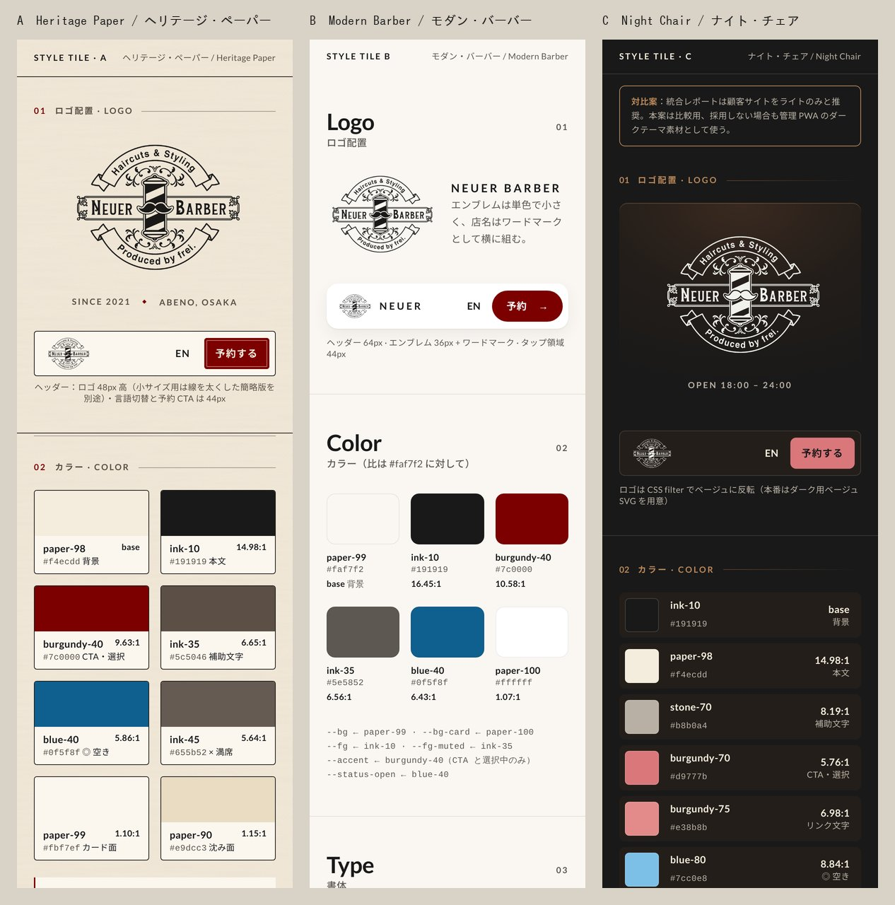
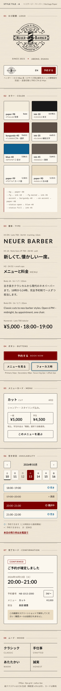
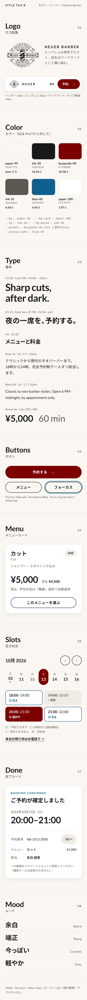
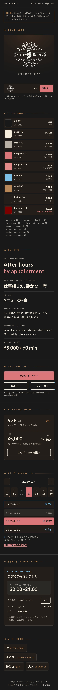

# デザイン方向案（スタイルタイル 3 案）

## 文書情報

| 項目 | 内容 |
|---|---|
| 文書番号 | DESIGN-001 |
| 版 | v0.2（方向決定を記録） |
| 決定 | 2026-10-12: A「ヘリテージ・ペーパー」を採用（B の余白・数字表現を取り入れる）。ベースデザイン 3 画面は `base/`、トークンは `tokens.css`、ガイドは `design_guide.md` |
| 日付 | 2026-10-10 |
| 対象 | Neuer Barber（長田健豊さん個人枠 18:00–24:00）日英予約サイト |
| 提示の場 | 第 2 回打ち合わせ（要件定義書ドラフト・価格表と同時に提示） |
| 根拠 | `docs/research/reports/美容師予約サイト制作ナレッジ.md`「ベージュ×えんじのライトテーマは AAA を満たし、3 層トークンで守る」、`docs/02_requirements/requirements.md` NFR-EN-05/06・FR-C-02/07/11、`docs/research/reference/README.md` |

## 1. 目的

色・書体・部品の「方向性」を 3 つのスタイルタイルで並べ、第 2 回打ち合わせで **1 案に収束** させる。画面レイアウトではなく、同じ部品（ロゴ、配色、書体、ボタン、メニューカード、空き枠、完了カード）を 3 つのトーンで描き分けたもの。選ばれた案でベースデザイン 3 画面に進み、その後の方向転換は変更要求として扱う。

## 2. 共通の前提（3 案とも変えないもの）

- **ブランド**: Neuer Barber。クラフト紙のベージュ、えんじ `#7c0000`、チャコール `#191919`、Lato＋Noto Sans JP（店舗 HP と同じ）。ロゴはバーバーポール＋口ひげのヴィンテージ系エンブレム（`docs/research/reference/neuer_logo.png`、単色 `#504f4c` の透過 PNG）。タイルでは CSS filter で色を変えている。
- **アクセシビリティ**: WCAG 2.2 AA（NFR-EN-05）。通常文字 4.5:1 以上、大きな文字と UI 部品 3:1 以上、色だけで状態を伝えない。全ペアの実測値は付録 A。
- **タイポグラフィ**: 本文 16px・行間 1.7・字間 0.02em（デジタル庁デザインシステム準拠）。`palt` は見出しだけに使う。数字（料金・時刻）は Lato、和文は Noto Sans JP。ウェイトは 400/500/700 だけ使う。
- **空き状況**: 記号は **◎（予約できます）と ×（予約できません）の 2 つだけ**。○・△ は使わない。空きは青＋◎、満席はグレー＋取り消し線＋×。凡例は一覧の直下に 2 行で置き、その下に電話の案内を出す（FR-C-07）。タイルでは状態の見え方を確認するために × 枠も並べているが、実装では FR-C-07 のとおり満席の時刻をボタンとして表示しない。
- **ターゲット**: 押せる要素はすべて 44px 以上。主要 CTA 56px、時刻ボタン 48px、日付セル 44×64px（7 列 × 44px = 308px なので 320px 幅に収まる）。
- **モーション**: ボタン押下 100ms・時刻ボタンの切替 150–200ms、easing は standard `cubic-bezier(.2,0,0,1)`。`prefers-reduced-motion: reduce` のときは移動するアニメーションを止め、100ms のフェードだけ残す。
- **トークン**: 3 層。プリミティブ（`--paper-98`、`--burgundy-40` …）→ セマンティック（`--bg`、`--fg`、`--accent`、`--status-open` …）→ 用途（各部品の CSS）。3 案ともトークン名は同じで、値だけが違う。どの案を選んでもコードの構造は変わらない。
- **アートボード**: 幅 390px のモバイル 1 枚に縦に並べている。HTML は外部 JS なし、Google Fonts だけ読み込む。

## 3. A「ヘリテージ・ペーパー」— ブランドに忠実

（[HTML](style_tiles/A_heritage_paper.html)）

- **コンセプト**: 店舗 HP のクラフト紙・えんじ・チャコールをそのまま Web 予約に持ち込む。紙の地に細い二重罫と小さな大文字の見出し、角丸 4px のカード、黒の 1px 枠線。ヴィンテージの装飾は罫線と ◆ 程度にとどめる。紙テクスチャは CSS で生成していて、画像ファイルは使わない。実測した輝度の幅は 7.5%（±3.75%）。カードと入力欄は無地にする。
- **ムード**: クラシック / Classic・手仕事 / Crafted・あたたかい / Warm・誠実 / Honest

| トークン | hex | 役割 | 対 `#f4ecdd` |
|---|---|---|---|
| paper-98 | `#f4ecdd` | 背景（base）・CTA の文字 | — |
| paper-99 | `#fbf7ef` | カード面（無地） | 1.10:1 |
| paper-90 | `#e9dcc3` | 沈み面（満席枠・注記） | 1.15:1 |
| ink-10 | `#191919` | 本文・枠線 | 14.98:1 |
| ink-35 | `#5c5046` | 補助文字 | 6.65:1 |
| ink-45 | `#655b52` | × 満席・定休日 | 5.64:1 |
| burgundy-40 | `#7c0000` | CTA・選択中 | 9.63:1 |
| burgundy-30 | `#600000` | 押下時 | 11.95:1 |
| blue-40 | `#0f5f8f` | ◎ 空き・フォーカスリング | 5.86:1 |

- **タイポ**: H1 英字は Lato 700・36/44・字間 0.12em の大文字（"NEUER BARBER"）、H1 和文は Noto 700・28/40・palt、H2 は 24/32 に英字の小さな大文字を添える。
- **向いている客層**: 店の雰囲気を知っている既存客。「ワンランク上の渋い大人」というコンセプト文と合う。訪日客には「日本の個人店らしさ」として伝わる。
- **リスク**: 枠線と罫線が多く、画面が重くなりやすい。ロゴの細い線は 48px 以下でつぶれる（小サイズ用の簡略版が必要）。若い新規客には「古い」と見られるおそれがある。

## 4. B「モダン・バーバー」— 若年層向けのエディトリアル

（[HTML](style_tiles/B_modern_barber.html)）

- **コンセプト**: オフホワイトの地に大きな Lato の見出しと広い余白を置き、テクスチャは使わない。えんじは CTA と選択中だけに使う。エンブレムは小さくし、店名は字間を広げたワードマークとして横に並べる。カードは角丸 16px で薄い影、操作要素はピル形。
- **ムード**: 余白 / Space・端正 / Sharp・今っぽい / Current・軽やか / Easy

| トークン | hex | 役割 | 対 `#faf7f2` |
|---|---|---|---|
| paper-99 | `#faf7f2` | 背景（base） | — |
| paper-100 | `#ffffff` | カード面・CTA の文字 | 1.07:1 |
| paper-96 | `#f0ece5` | 沈み面（満席枠・ピル） | 1.10:1 |
| paper-90 | `#e6e0d6` | 区切り線（装飾） | 1.23:1 |
| ink-10 | `#191919` | 本文・枠線 | 16.45:1 |
| ink-35 | `#5e5852` | 補助文字 | 6.56:1 |
| ink-40 | `#666058` | × 満席・定休日 | 5.82:1 |
| burgundy-40 | `#7c0000` | CTA・選択中だけ | 10.58:1 |
| blue-40 | `#0f5f8f` | ◎ 空き・フォーカスリング | 6.43:1 |

- **タイポ**: H1 英字は Lato 700・44/48・字間 −0.02em の文頭大文字（"Sharp cuts, after dark."）、H1 和文は 32/44、料金の数字は 40px。
- **向いている客層**: Instagram から来る 20 代の新規客と訪日客。情報が読みやすく、操作も迷いにくい。
- **リスク**: 店舗 HP（クラフト紙）との連続性が弱く、ほかの店と区別しにくい。タイルでは時刻ボタンを 2 列に並べたが、FR-C-07 は縦リストを定めているので、実装では A のように 1 列にする。

## 5. C「ナイト・チェア」— 夜の時間帯のムード（対比案）

（[HTML](style_tiles/C_night_chair.html)）

- **コンセプト**: 18:00–24:00 の個人枠に合わせて、チャコールの地にベージュの文字を置く。木目と黒革の椅子の感じは、写真ではなく色（leather `#241e1a`、wood `#b8875a`）とランプのような放射グラデーションで出す。えんじは暗い面では明るいトーン（`#d9777b` / `#e38b8b`）に差し替える。**`#7c0000` をチャコールに置くと 1.55:1 で使えない。**
- **位置づけ**: 統合レポートは「顧客サイトは Phase 1 ではライトのみ」と推奨しており、本案はそれに反する。比較のために置いた案で、管理 PWA のダークテーマ（NFR-EN-06「管理 PWA はダーク追従」）のトークンの出どころにもなる。
- **ムード**: 夜 / After hours・革と木 / Leather & wood・静けさ / Quiet・大人 / Grown-up

| トークン | hex | 役割 | 対 `#191919` |
|---|---|---|---|
| ink-10 | `#191919` | 背景（base）・CTA の文字 | — |
| leather-14 | `#241e1a` | カード面 | 1.07:1 |
| ink-17 | `#2b2926` | 沈み面（満席枠） | 1.21:1 |
| paper-98 | `#f4ecdd` | 本文・枠線 | 14.98:1 |
| stone-70 | `#b8b0a4` | 補助文字 | 8.19:1 |
| stone-60 | `#9a948c` | × 満席・定休日 | 5.85:1 |
| burgundy-70 | `#d9777b` | CTA・選択中 | 5.76:1 |
| burgundy-75 | `#e38b8b` | リンク文字・強調 | 6.98:1 |
| wood-60 | `#b8875a` | セクションラベル・装飾 | 5.57:1 |
| blue-80 | `#7cc0e8` | ◎ 空き・フォーカスリング | 8.84:1 |
| burgundy-40 | `#7c0000` | **使用禁止**（参考値） | 1.55:1 |

- **タイポ**: H1 英字は Lato 700・36/44（"After hours, by appointment." の後半を `#e38b8b` で強調）、H1 和文は 28/40。暗い地では文字が細く見えるので、本文は 400 より細くしない。
- **向いている客層**: 仕事帰りに夜の予約をする社会人。海外のバーバーらしい雰囲気を好む層。
- **リスク**: ブランド色 `#7c0000` がそのまま使えず、えんじの印象がピンク寄りになる。海外のバーバーサイトに多いダーク基調と見分けにくい。屋外の明るい場所でスマホが読みにくい。ロゴは反転用のベージュ版が要る。

## 6. 開発者の推奨

**第一案は A。B の要素を取り入れた「A＋B」を安全策として推奨する。**

- A のパレット、紙テクスチャ、ロゴ、小さな大文字の見出しはブランド体験の核で、全ペアが AA（主要な文字は AAA）を満たす。
- B から取り入れるもの: セクション間の余白 48px、料金と時刻の大きな数字（32–40px）、カード内の罫線を減らすこと、ヘッダーのワードマーク併記。これで A の重さを抑え、若い新規客にも古く見えないようにする。
- C は顧客サイトには採用しない。管理 PWA のダークテーマのトークン（`[data-theme=dark]`）として使う。顧客サイトのダークモードは Phase 2 以降の任意項目にする。

## 7. 選択後の進め方

1. 第 2 回打ち合わせで 1 案を選んでもらう（「A＋B」のような組み合わせも可）。回答期限は 48–72 時間。
2. **ベースデザイン 3 画面**（トップ／メニュー・空き検索／予約フォーム、390×844）を作る。修正は 2 回まで。
3. **展開**: 確認・完了・キャンセル・ポリシー・404 と管理 PWA の主要画面（今日・週・受信箱・設定）。修正は 1 回まで。
4. 確定したトークンを Tailwind v4 の `@theme inline` に移し、axe と Lighthouse CI でコントラストを毎 PR 検査する。
5. 方向転換（別の案への切り替え）は変更要求として別見積にする。

## 8. クライアントへの質問

1. **ロゴのデータ**: ベクター（SVG / AI）や単色版はありますか。手元にあるのは HP の PNG（1417×1090、グレー 1 色）だけです。小サイズ用の簡略版（線を太くしたもの）と、ダーク面用のベージュ版を作ってよいですか。
2. **写真素材**: 店内・施術・ご本人の写真はありますか。撮影する予定はありますか。タイルは写真なしで作っていて、写真の有無でトップ画面の構成が変わります。
3. **英語表記**: お名前「長田 健豊」の読みとローマ字表記（姓名の順序）、英語ページでの店名の書き方（"Neuer Barber" のみか、"by frei" を併記するか）を教えてください。

## 付録 A. コントラスト検証表

WCAG 2.x の相対輝度式 `(L1+0.05)/(L2+0.05)` で、3 案で使っている全ての文字と背景・UI と背景のペアを計算した（Python スクリプト。各 hex が HTML に実際に存在するかと、スウォッチに書いた比が計算値と一致するかも確認）。基準は text 4.5（通常文字）、ui 3.0（UI 部品・フォーカスリング・CTA コンテナ）。

- **修正したもの**: A の × 満席文字 `#6b6158` は沈み面 `#e9dcc3` の上で **4.46:1（FAIL）** だったので、`#655b52`（4.88:1）に変更した。B のスウォッチに 1.06:1 と書いていた値は、計算値の 1.07:1 に直した。
- **紙テクスチャ（A）**: 描画後の最も暗いピクセル `#ebe2d1` で判定し直した。`#191919` 13.67、`#5c5046` 6.07、`#7c0000` 8.79、`#655b52` 5.15、`#0f5f8f` 5.35 で、すべて 4.5 以上。
- 最終結果: **全ペア PASS**（参考行の `#7c0000`/`#191919` 1.55:1 は使っていない色の確認用）。

| 案 | 前景 / 背景 | 比 | 種別（基準） | 用途 | 判定 |
|---|---|---|---|---|---|
| A | `#191919` / `#f4ecdd` | 14.98:1 | text 4.5 + ui 3.0 | 本文・見出し / 紙；セカンダリボタン枠線 | PASS AAA |
| A | `#191919` / `#fbf7ef` | 16.45:1 | text 4.5 | 本文 / カード | PASS AAA |
| A | `#191919` / `#e9dcc3` | 12.97:1 | text 4.5 | 注記 / 沈み面 | PASS AAA |
| A | `#5c5046` / `#f4ecdd` | 6.65:1 | text 4.5 | 補助文字 / 紙 | PASS |
| A | `#5c5046` / `#fbf7ef` | 7.30:1 | text 4.5 | 補助文字 / カード | PASS AAA |
| A | `#7c0000` / `#f4ecdd` | 9.63:1 | text 4.5 + ui 3.0 | セクション番号・電話リンク / 紙；CTA コンテナ | PASS AAA |
| A | `#7c0000` / `#fbf7ef` | 10.58:1 | text 4.5 | CONFIRMED スタンプ / カード | PASS AAA |
| A | `#f4ecdd` / `#7c0000` | 9.63:1 | text 4.5 | CTA・選択中の文字 | PASS AAA |
| A | `#0f5f8f` / `#fbf7ef` | 6.44:1 | text 4.5 + ui 3.0 | ◎ 空き / 時刻ボタン；空き枠ボタンの枠線 | PASS |
| A | `#0f5f8f` / `#f4ecdd` | 5.86:1 | text 4.5 + ui 3.0 | 凡例 ◎ / 紙；フォーカスリング | PASS |
| A | `#655b52` / `#e9dcc3` | 4.88:1 | text 4.5 | × 満席の時刻 / 沈み面 | PASS |
| A | `#655b52` / `#f4ecdd` | 5.64:1 | text 4.5 | 定休日・凡例 × / 紙 | PASS |
| B | `#191919` / `#faf7f2` | 16.45:1 | text 4.5 + ui 3.0 | 本文・見出し / 背景；セカンダリボタン・矢印枠線 | PASS AAA |
| B | `#191919` / `#ffffff` | 17.58:1 | text 4.5 | 本文 / カード | PASS AAA |
| B | `#191919` / `#f0ece5` | 14.93:1 | text 4.5 | 60分ピル・コピー / 沈み面 | PASS AAA |
| B | `#5e5852` / `#faf7f2` | 6.56:1 | text 4.5 | 補助文字 / 背景 | PASS |
| B | `#5e5852` / `#ffffff` | 7.01:1 | text 4.5 | 補助文字 / カード | PASS AAA |
| B | `#ffffff` / `#7c0000` | 11.31:1 | text 4.5 | CTA・選択中の文字 | PASS AAA |
| B | `#0f5f8f` / `#ffffff` | 6.88:1 | text 4.5 + ui 3.0 | ◎ 空き・完了ラベル / カード；空き枠ボタンの枠線 | PASS |
| B | `#0f5f8f` / `#faf7f2` | 6.43:1 | text 4.5 + ui 3.0 | 凡例 ◎ / 背景；フォーカスリング | PASS |
| B | `#666058` / `#f0ece5` | 5.28:1 | text 4.5 | × 満席の時刻 / 沈み面 | PASS |
| B | `#666058` / `#faf7f2` | 5.82:1 | text 4.5 | 定休日・凡例 × / 背景 | PASS |
| B | `#7c0000` / `#faf7f2` | 10.58:1 | ui 3.0 | CTA コンテナ | PASS |
| C | `#f4ecdd` / `#191919` | 14.98:1 | text 4.5 + ui 3.0 | 本文・見出し / 背景；セカンダリボタン枠線 | PASS AAA |
| C | `#f4ecdd` / `#241e1a` | 14.02:1 | text 4.5 | 本文 / カード | PASS AAA |
| C | `#f4ecdd` / `#2b2926` | 12.36:1 | text 4.5 | 本文 / 沈み面 | PASS AAA |
| C | `#b8b0a4` / `#191919` | 8.19:1 | text 4.5 | 補助文字 / 背景 | PASS AAA |
| C | `#b8b0a4` / `#241e1a` | 7.67:1 | text 4.5 | 補助文字 / カード | PASS AAA |
| C | `#b8b0a4` / `#2b2926` | 6.76:1 | text 4.5 | 日付補足 / 沈み面 | PASS |
| C | `#b8875a` / `#191919` | 5.57:1 | text 4.5 | セクションラベル（wood）/ 背景 | PASS |
| C | `#b8875a` / `#241e1a` | 5.21:1 | text 4.5 | 所要時間・ムード EN / カード | PASS |
| C | `#191919` / `#d9777b` | 5.76:1 | text 4.5 | CTA・選択中の文字 | PASS |
| C | `#e38b8b` / `#191919` | 6.98:1 | text 4.5 | 電話リンク・H1 強調 / 背景 | PASS |
| C | `#e38b8b` / `#241e1a` | 6.53:1 | text 4.5 | 使用禁止ラベル / カード | PASS |
| C | `#7cc0e8` / `#241e1a` | 8.28:1 | text 4.5 + ui 3.0 | ◎ 空き・完了ラベル / カード；空き枠ボタンの枠線 | PASS AAA |
| C | `#7cc0e8` / `#191919` | 8.84:1 | text 4.5 + ui 3.0 | 凡例 ◎ / 背景；フォーカスリング | PASS AAA |
| C | `#9a948c` / `#2b2926` | 4.83:1 | text 4.5 | × 満席の時刻 / 沈み面 | PASS |
| C | `#9a948c` / `#191919` | 5.85:1 | text 4.5 | 定休日・凡例 × / 背景 | PASS |
| C | `#d9777b` / `#191919` | 5.76:1 | ui 3.0 | CTA コンテナ | PASS |
| C | `#7c0000` / `#191919` | 1.55:1 | 参考 | 参考: #7c0000 を暗面に置いた場合（不使用） | n/a |

## 付録 B. ファイル

`docs/05_design_comps/README.md` を参照。
