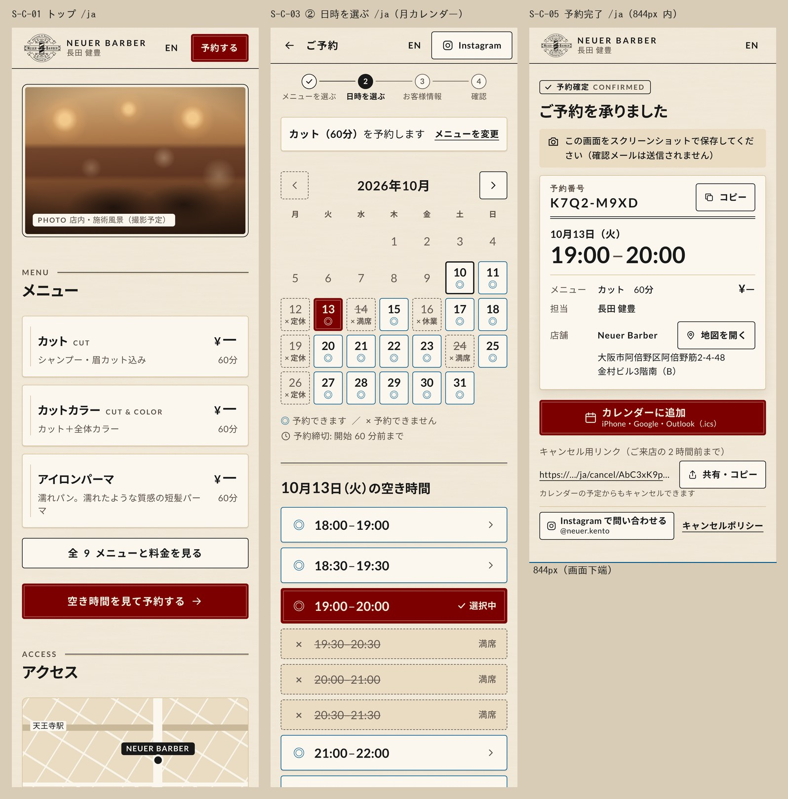

# デザインガイド（ベースデザイン）

## 文書情報

| 項目 | 内容 |
|---|---|
| 文書番号 | DG-001 |
| 版 | v0.8（管理画面も押せる所・押せない所を一目で。v0.7 顧客サイト。v0.6 余白を広く。v0.5 見やすさ優先: 白×墨×赤、Zen Kaku Gothic New＋Inter、ヒーローのみ茶色。ADR-0013） |
| 日付 | 2026-10-27 |
| 対象 | Neuer Barber（長田健豊さん個人枠 18:00–24:00）日英予約サイト。顧客サイトのベースデザイン 3 画面と、全画面で使うトークン |
| 成果物 | `tokens.css`（3 層トークン、v0.2 で変更なし）、`base/01_top.html`・`02_time.html`・`03_done.html`（390×844 の実画面）、各 `.jpg`、`base/01_top_desktop.jpg`、`base/base_contact_sheet.jpg` |
| 根拠 | `design_direction.md`（DESIGN-001、方向 A と「A＋B」の推奨）、`../04_wireframes/`（WF-C v0.4）、`../03_design/03_screen_specs.md` §2・§4、`../03_design/07_components.md`、`../research/reports/美容師予約サイト制作ナレッジ.md`「ベージュ×えんじのライトテーマは AAA を満たし、3 層トークンで守る」、`../06_test/evaluation/cognitive_walkthrough_wf.md`（カンプへの 5 件） |
| 正本 | トークン値の正本は `tokens.css`。`07_components.md` §5 の値（仮値を含む）はこのガイドで置き換える（§2.4） |

### 変更履歴

| 版 | 日付 | 内容 |
|---|---|---|
| v0.1 | 2026-10-12 | 初版（方向 A 採用、トークン、ベースデザイン 3 画面） |
| v0.2 | 2026-10-12 | クライアント FB 反映: トップ簡素化、月カレンダー、Instagram 導線。(1) トップを「ヘッダー → 写真 → メニュー」にし、キャッチ・リード・本文上部の CTA・「会員登録は不要です」・受付時間カードを削除。メニュー直後に全幅の primary「空き時間を見て予約する」、受付時間はアクセスカード内に 2 行（§5.10）。(2) 日付選択を週ストリップから月カレンダー（MonthCalendar / DayCell グリッド、月曜始まり、60 日先まで）に置き換え（§5.5）。(3) 電話対応なしのため顧客側の電話・`tel:` をすべて Instagram の DM（仮 `@neuer.kento`、`https://ig.me/m/neuer.kento`）に置き換え。PhoneButton → InstagramButton（§5.7）、予約フローのヘッダー「電話する」→「Instagram」、完了画面「Instagram で問い合わせる」、日時選択の「本日の残り枠はお電話で」を削除。`tokens.css` と視覚言語は変更なし。再描画・再検証で ALL PASS（§7） |
| v0.8 | 2026-10-27 | **管理画面も押せる所・押せない所を一目で**（v0.7 と同じ原則を管理 PWA に）。(1) 状態ラベル（確定・終了・非表示・新規のお客様など）の枠を外し、塗りのラベルに（ボタンに見えていた）。(2) 必須・任意・補足の囲みを外して文字に。(3) 開閉する行（「お客様に予約確認ページを送る」「詳しい情報」）に ∨ の矢印、開くと向きが変わる。(4) 押すと開く行に › を追加: お知らせの各行、今日の一覧の休憩の行、メニュー・料金の各行。(5) まだ使えないボタンは点線の枠をやめて灰色の塗りにし、理由を表示: 予約を追加の［保存する］（「お名前と開始を入れると保存できます」、これまで画面に出ていなかった）、営業時間の［保存する］（「変更すると保存できます」）、カルテの［写真を追加］（「上のチェックを入れると写真を追加できます」）。顧客サイトの使えない主ボタンも同じ灰色に。(6) 「送った」「やめる」を下線の文字から枠のボタンに。(7) 個人情報の削除の欄を黒の太枠から赤の枠と赤いボタンに（危ない操作であることを色で）。(8) お客様の詳細の見出し「顧客」を「お客様」に揃える。(9) タッチ画面での押した反応（一覧の行・ボタンの背景が変わる） |
| v0.7 | 2026-10-27 | **押せる所・押せない所を一目で**（窓口: 試用で「反応しない所を触る」「どこを押せばよいかわからない」）。原則「枠・ボタンの形＝押せる、平文＝押せない」。(1) ヒーローの 3 項目（枠と区切り線）をアイコン付きの平文 2 行に（受付・定休／駅から徒歩）。(2) 予約欄の進行バー（タブに見えた）を廃止。ステップの番号付き見出しで足りる。(3) 開いているステップに操作の一言（「ご希望のメニューをタップしてください」「日付をタップして、空いている時間を選んでください」「入力して、画面下の「この内容で予約する」を押してください」）。(4) 済んだステップはカード全体が「変更 ›」ボタン（枠付きの丸ボタンを表示し、押せる範囲はカード全体）。まだ選べないステップは枠・背景なしの灰色の文字にし、理由（「メニューを選ぶと選べます」など）を添える。①に戻ったときの③は「入力する ›」。(5) 案内地図をタップで地図アプリを開くリンクにし、右下に「タップで地図アプリを開く」を表示。(6) 必須・任意の囲み（ボタンに見えた）をやめ、必須は赤字・任意は灰色の文字に。(7) カレンダーの定休・満席の日と、戻れない前月の矢印から点線の枠を外す（枠があるのは選べる日だけ）。(8) タッチ画面での押した反応（ボタン・済んだステップの背景が変わる） |
| v0.6 | 2026-10-23 | **余白を広く**（窓口「もっとスタイリッシュに → 余白を多く」）。顧客サイトのみ（`body.site`）。(1) 左右の余白 16→20px（375px 以上。768px 以上は 32px）。ヘッダーと完了ページは 16px のまま（1 行・1 画面に収めるため）。(2) セクション間 48→80px（768px 以上は 128px）、見出しの下 20→32px。トークンに `--space-20`（80px）・`--space-24`（96px）・`--space-32`（128px）を追加。(3) ヒーロー: 3 項目の上下 14→24px、CTA の上 20→40px・高さ 60px。(4) 予約欄: 進行バーの下 16→32px、ステップの間 10→16px、開いているステップは枠をなくし、メニューのカード・カレンダーを全幅に（日セル 46px@390px）。メニューのカードは上下 20px・間 12px。日時の「空き時間」見出しの上 32px。(5) アクセスの帯の上下 64/80px、住所カードの内側 24px。フッターの上下 64/48px、リンク行 56px。(6) ポリシー: 目次の上 40px、各章の上 64px |
| v0.5 | 2026-10-22 | **見やすさ優先（ADR-0013）**。「色が単調で強弱がわかりにくい」との指摘を受け、デザイン A 案を採用（ヒーローの色合いだけ従来の茶色を残す）。(1) 色: 紙（ベージュ＋テクスチャ）をやめ、背景は白 `#ffffff`、文字は墨 `#141414`、補足 `#5a5a5a`、区切り `#e3e1dc`、沈んだ面 `#f5f4f1`。アクセントは赤 `#a3121c`（押下 `#7e0d15`）で、CTA と「今ここ・選択中」だけに使う。`--paper-texture` は `none`（旧値は `--paper-texture-legacy`）。(2) 書体: 和文 Zen Kaku Gothic New（500/700/900）、欧文・数字 Inter（500/700/800）。トークン名を `--font-latin` / `--font-jp` に変更。本文 17px・行間 1.8・太さ 500。(3) トップ: ヒーローを全幅の写真（未着の間は従来の茶色のプレースホルダー）にし、下に黒の幕を敷いて白で「ABENO · OSAKA／ネット予約受付中」。直下に受付・定休日・最寄り駅の徒歩分の 3 列、赤い「空き時間を見て予約する →」（`#book` へ）。v0.2 で外した本文上部の CTA を戻す。(4) 見出し: 英字の小見出しを赤・字間 0.24em、見出し 28px／900、二重罫は廃止。(5) 予約欄: 上に 3 分割の進行バー（今のステップを赤）、ステップは角丸 12px のカードで未到達は沈んだ面、メニューは 1 件 1 カード（名前 19px／900、料金 22px／800、選択中は赤い縁）。(6) アクセスは全幅の沈んだ帯、フッターは墨の帯に明るい文字。ボタンは角丸 12px、主ボタンは内側の細線をやめて影。(7) 範囲: 顧客サイトは `body.site` に限定した上書き（`globals.css` 末尾）。管理 PWA は色トークンの変更（白・赤）だけを受け、部品の形は変えない |
| v0.4 | 2026-10-12 | 実装との同期。**U-05 決定**: 完了見出しは「ご予約を承りました」＋スタンプ「予約確定 CONFIRMED」（DES-03 §4.1・§4.4 と i18n `done` を更新済み）。§2.2 の表に実装した `--danger` / `--danger-pressed`（`src/styles/globals.css`、展開カンプ T-01）を追加。トークン値と 3 画面の描画は変更なし |
| v0.3 | 2026-10-12 | 決定事項 G1〜G4（2026-10-12 確定）の反映。**G1 導線の 1 本化**: 予約の入口を「トップ → ① メニューを選ぶ（`/{locale}/book`）→ ② 日時 → ③ お客様情報 → ④ 確認」の 1 本にした。トップの CTA はヘッダー・メニュー直後とも「予約する / Book」で `/ja/book` へ。「空き時間を見て予約する / See available times」はメニュー段の固定 CTA（メニュー選択後）だけに使う（§5.0）。トップの secondary「全 9 メニューと料金を見る」を削除し、メニューカード 9 枚（情報表示・リンクなし。和名・英字名・¥—・所要時間、説明は既存の 3 件だけ 1 行）を並べた（§5.2、§5.10）。**G2** Instagram `@neuer.kento` 確定（仮を削除）。**G3** 特商法の電話番号は「請求があれば遅滞なく開示」で確定（§9.1）。**G4** 月カレンダーの初期の選択日 = 今日。02_time を「今日 10/10 を選択」に変更し、DayCell に「今日＋選択中」の状態を追加（§5.5）。完了画面（10/13）は別の例日のまま。U-07 解決・U-08 を一部解決（§11）。再描画・再検証で ALL PASS（§7） |



---

## 1. 決定事項

| # | 決定 | 内容 |
|---|---|---|
| D-01 | 方向 **A「ヘリテージ・ペーパー」を採用**（2026-10-12） | クラフト紙のベージュ `#f4ecdd`、えんじ `#7c0000`、チャコール `#191919`、Lato＋Noto Sans JP。店舗 HP と同じ素材で予約まで続ける |
| D-02 | **B「モダン・バーバー」から借りた要素** | (1) セクション間の余白 48px（`--section-gap`）、(2) 日付・時刻・料金の大きな Lato 数字（予約日時 36px、時刻ボタン 20px、料金 30px、カレンダーの日付 18px。v0.1 の受付時間 36px はカードごと削除）、(3) カード内の罫線を減らす（カードは淡い罫 `--border-subtle`＋接地影 `--shadow-1`。黒い 1px 枠は操作できる部品だけ）、(4) ヘッダーのワードマーク併記（エンブレム 48px＋「NEUER BARBER」） |
| D-03 | えんじの用途を **CTA と「選択中」だけ**に限定 | プライマリボタン、選択中の日セル、選択中の時間枠の 3 か所。見出し番号・リンク・装飾には使わない（DESIGN-001 の A タイルで使っていたセクション番号のえんじはやめた） |
| D-04 | ◎ は青 `--status-open`、× はセピアグレー `--fg-subtle`＋破線＋取り消し線 | 記号は ◎ と × の 2 つだけ。色・記号・文字（理由ラベル）を必ず併用する |
| D-05 | 装飾は「細い二重罫・小さな大文字ラベル・エンブレム 1 つ」まで | 1 画面にエンブレムは 1 つ（ヘッダー）。◆ やリボンなどの飾りは使わない。二重罫はセクション見出し・完了カードの区切り・フッター上端だけ（v0.2 で受付時間カードを削除） |
| D-06 | 紙テクスチャはページ背景だけ | カード・入力欄・ボタン・沈み面は無地。輝度の幅 7.28%（上限 7.5%） |
| D-07 | 顧客サイトはライトのみ（Phase 1） | `[data-theme="dark"]` は管理 PWA 用に用意だけしておく（§9.2） |
| D-09 | **クライアント FB（2026-10-12）を反映**（v0.2） | トップは写真とメニューを先に見せ、予約 CTA はヘッダー＋メニュー直後の 2 か所だけ。日付は月カレンダー（月曜始まり）。問い合わせは Instagram の DM に一本化し、顧客側から電話の導線をなくす（管理 PWA の予約カードの `tel:` は店主からの発信用に残す） |
| D-10 | **導線の 1 本化**（v0.3、決定 G1） | 予約の入口はトップの「予約する」（ヘッダー＋メニュー直後）→ `/{locale}/book`（① メニュー）だけ。トップから `/book/time` へ直接行くリンクは置かない。トップのメニューカードは情報表示でリンクにしない。「空き時間を見て予約する」はメニュー段の CTA 専用 |
| D-08 | カンプ段階の評価項目を反映 | CW-08（カレンダー追加の文言）を完了画面に適用、HE-04（ボタン = 動詞・チップ = 状態）を §5.0 の規則にした。HE-02・CW-20・CW-26 は 3 画面の対象外なので §9.3 で展開カンプへ渡す |

---

## 2. トークン

3 層。部品の CSS は第 2 層（セマンティック）だけを参照し、色名（`--burgundy-40` など）や生の hex を書かない。

### 2.1 第 1 層: プリミティブ（`:root`）

| 分類 | トークン | 値 |
|---|---|---|
| 紙 | `--paper-99` / `--paper-98` / `--paper-90` / `--paper-80` | `#fbf7ef` / `#f4ecdd` / `#e9dcc3` / `#d9c6a0` |
| インク | `--ink-10` / `--ink-35` / `--ink-45` | `#191919` / `#5c5046` / `#655b52` |
| インク（ダーク用） | `--ink-14` / `--ink-17` / `--ink-25` / `--stone-60` / `--stone-70` | `#241e1a` / `#2b2926` / `#3a3632` / `#9a948c` / `#b8b0a4` |
| えんじ | `--burgundy-30` / `--burgundy-40` / `--burgundy-70` / `--burgundy-75` | `#600000` / `#7c0000` / `#d9777b` / `#e38b8b` |
| 青 | `--blue-40` / `--blue-80` | `#0f5f8f` / `#7cc0e8` |
| スペーシング | `--space-1` … `--space-16` | 4 / 8 / 12 / 16 / 24 / 32 / 48 / 64 px |
| 角丸 | `--radius-sm` / `-md` / `-lg` / `-full` | 4 / 8 / 12 / 999 px |
| 文字サイズ | `--text-12` … `--text-36`（`--text-N--lh` が行高） | 12/16、14/20、16/24、18/28、20/28、24/32、30/36、36/40 |
| 行間・字間 | `--leading-body` / `--leading-heading` / `--tracking-body` / `--tracking-caps` | 1.7 / 1.4 / 0.02em / 0.16em |
| フォント | `--font-lato` / `--font-noto` | 本番は `next/font` が注入（`"Lato"` / `"Noto Sans JP"`） |
| 時間 | `--duration-short1…4` / `--duration-medium1…4` | 50/100/150/200 ms、250/300/350/400 ms（Material 3） |
| イージング | `--ease-standard` / `-standard-decel` / `-standard-accel` / `-emph-decel` / `-emph-accel` | `(.2,0,0,1)` / `(0,0,0,1)` / `(.3,0,1,1)` / `(.05,.7,.1,1)` / `(.3,0,.8,.15)` |
| 影 | `--shadow-1` / `--shadow-2` | 接地影（カード）/ やや強い接地影（完了カード） |
| テクスチャ | `--paper-texture` | SVG `feTurbulence` 2 枚（256px の繊維＋512px の漉きムラ）を data URI で。画像ファイルなし |

### 2.2 第 2 層: セマンティック → 第 3 層: 用途

| セマンティック | ライト | ダーク（管理 PWA） | 用途（どの部品のどこに使うか） |
|---|---|---|---|
| `--bg` | paper-98 | ink-10 | ページ背景（`.paper` でテクスチャを重ねる）、CTA の文字色の元 |
| `--bg-card` / `--surface` | paper-99 | ink-14 | Card、アクセスカード、DoneCard、SlotButton ◎、DayCell ◎、Button secondary の面、写真キャプション |
| `--bg-sunken` | paper-90 | ink-17 | SlotRow ×、スクリーンショット注記、フッター、hover |
| `--fg` | ink-10 | paper-98 | 本文・見出し・数字、ステッパーの現在位置 |
| `--fg-muted` | ink-35 | stone-70 | 補足、ラベル（dt）、小さな大文字ラベル、ナビのシェブロン |
| `--fg-subtle` | ink-45 | stone-60 | × の日セル・時間枠・凡例 ×、過去日・期間外の日、無効な ‹ ›（破線枠）、ステッパー未到達 |
| `--accent` | burgundy-40 | burgundy-70 | Button primary、DayCell 選択中、SlotButton 選択中（この 3 つだけ） |
| `--accent-pressed` | burgundy-30 | burgundy-75 | primary の hover / 押下 |
| `--on-accent` | paper-98 | ink-10 | えんじの上の文字・記号・アイコン |
| `--border` | ink-10 | stone-60 | 操作できる部品の枠（secondary、‹ ›）、今日の日セルの 2px 枠、ヘッダー下線、二重罫 |
| `--border-subtle` | paper-80 | ink-25 | カードの枠、区切り線、二重罫の 2 本目（情報を持たせない） |
| `--ring` | blue-40 | blue-80 | フォーカスリング 2px＋offset 2px |
| `--status-open` | blue-40 | blue-80 | ◎ の記号、◎ の日セル・時間枠の枠線、凡例 ◎ |
| `--status-full` / `--status-closed` | ink-45 | stone-60 | × 満席・締切 / × 定休・休業（同じ色。理由は文字で区別する） |
| `--danger` / `--danger-pressed` | `#a33b0b` / `#862f08` | `#f19a9e` / `#f5b3b6`（暫定） | 破壊的操作（S-C-06 の「予約を取り消す」、管理 PWA の削除・取り消し）。`.btn-danger` は 2px 枠と文字、`.btn-danger-fill`（確認シートの実行ボタン）は塗り。えんじ（`--accent`）とは別の錆色 19°、紙の上 5.61:1（テクスチャの最暗部で 5.22:1）・カード上 6.17:1。`tokens.css` には無く `src/styles/globals.css` で定義（展開カンプ T-01） |
| `--gutter` / `--section-gap` | 16px（≥768px は 24px）/ 48px | 同左 | 左右余白 / セクション間 |
| `--target-min` / `--target-cta` | 44px / 56px | 同左 | タップ領域の下限 / 主要 CTA |

### 2.3 Tailwind v4 への接続

`tokens.css` 末尾のコメントをそのまま `src/styles/globals.css` に移す。`@theme inline` で `--color-bg: var(--bg)` のように第 2 層を接続し、`--color-*: initial` で既定パレットを捨てる。スペーシング（`--spacing: 0.25rem`）とタイプスケール（`text-xs`〜`text-4xl`）は Tailwind 既定値と一致するので再定義しない。`.paper` は `@utility paper { … }` にする。ダークは `@custom-variant dark (&:where([data-theme=dark], [data-theme=dark] *))`。

### 2.4 `07_components.md` §5（v0.2）からの変更

| トークン | DES-07 v0.2 | DG-001 | 理由 |
|---|---|---|---|
| `--ring` | burgundy-40 | **blue-40** | えんじを CTA と選択中に限るため。選択中（えんじの面）の上でもリングが見分けられる |
| `--border` | paper-80 | **ink-10**（装飾罫は `--border-subtle` = paper-80 に分離） | 操作部品の枠は 3:1 が必要（paper-80 は紙の上で 1.4:1） |
| `--surface` | `#ffffff` | **paper-99**（`--bg-card` の別名） | 白は紙の上で浮く。A のタイルで決めた無地のカード面 |
| `--status-full` / `--status-closed` | gray-60 `#8a8580`（仮） | **ink-45 `#655b52`** | `#8a8580` は紙の上で 3.2:1 で文字に使えない |
| 角丸 | 6 / 10 / 16 | **4 / 8 / 12 / 999** | A の 4px 角丸を基本にする |
| `--paper-texture` | `url(/textures/kraft.webp)` | **CSS 生成（SVG ノイズ）** | 画像の読み込みなし・タイルの継ぎ目なし。輝度の幅を数値で管理できる |
| 追加 | — | `--fg-subtle`、`--border-subtle`、`--accent-pressed`、`--bg-sunken`、`--shadow-*`、`--ease-standard-*` | 3 画面で必要になったもの |

---

## 3. タイポグラフィ

| 役割 | 書体・ウェイト | サイズ / 行高 | その他 |
|---|---|---|---|
| H1（トップ） | — | — | v0.2 で見えるキャッチを削除。見出し構造のため視覚的に隠した H1「Neuer Barber 長田 — 夜 24 時まで予約できるバーバー（大阪・阿倍野）」を写真の前に置く（`.vh`） |
| H1（完了） | Noto Sans JP 700 | 24 / 32 | `palt` |
| H2（セクション） | Noto Sans JP 700 | 24 / 32 | 上に英字の小さな大文字ラベル（Lato 700・12/16・字間 0.16em・大文字、`--fg-muted`）と二重罫 |
| H2（月見出し・空き時間の見出し） | Noto 700＋Lato 数字（空き時間は 1.2 倍） | 20 / 28 | 「2026年10月」「10月10日（土）の空き時間」 |
| カード見出し | Noto 700 | 18 / 28 | 英字名を 11px の小さな大文字で添える |
| 本文 | Lato → Noto（自動振り分け） | 16 / 1.7 | 字間 0.02em。1 行は最大 40 字（640px） |
| 補足・ラベル | 同上 | 14 / 20（注記は 14 / 1.6） | `--fg-muted` |
| 最小 | 同上 | 12 / 16 | カレンダーの曜日行・× の理由ラベル、キャプション。これより小さくしない（写真キャプションの英字だけ 11px の大文字） |
| 大きな数字 | Lato 700 | 36 / 40（予約日時）、30 / 36（料金）、20（時刻ボタン・予約番号）、18 / 20（カレンダーの日付） | `tabular-nums`。区切りの「–」は 400＋`--fg-muted` |

- **和欧の振り分け**: `--font-sans: var(--font-lato), var(--font-noto), system-ui, sans-serif`。数字・欧文は Lato、和文・全角記号・◎ は Noto Sans JP に自動で落ちる。数字だけの要素には `.num`（`--font-num`）を付けて Lato を保証する。
- **行間** 本文 1.7、見出し 1.4、ボタン 1.25。**字間** 本文 0–0.02em、ボタン 0.04–0.06em、小さな大文字 0.16em、ワードマーク 0.2em。
- **`palt` は見出しだけ**（H1・H2・カード見出し）。本文・ボタンには付けない。
- **和欧間**は半角スペース 1 つ（約 1/4em。JLREQ の四分アキ相当）。「徒歩 5 分」「ブリーチ 2 回目以上」「Instagram で問い合わせる」。
- **曜日の括弧**は全角「（土）」に統一する（WF・DES-03 の「(土)」から変更。Noto の全角括弧と字面が揃う）。
- **ウェイト**は 400 / 500 / 700 だけ。Noto Sans JP は variable で読み込む（本番は `subsets:['latin']` のみ preload）。

---

## 4. スペーシング・グリッド

- **8px リズム**（4px は微調整だけ）。左右ガター 16px（≥768px は 24px）。本文カラムは最大 640px で中央寄せ。
- **縦の間隔**: セクション間 48px（B から）、見出しと内容 24px、カード同士 12px、カード内 16–24px、関連する行 8px、フッター上 64px。
- **ヘッダー**: トップ 64px（≥768px は 72px）、予約フロー・完了 56px。
- **デスクトップ（≥1024px）**: 写真だけ最大 1008px・21:9 に広げ、ほかは 640px の 1 カラム（`base/01_top_desktop.jpg`、1280px で横スクロールなし）。v0.1 の 2 カラムのヒーロー（写真＋コピー）はコピーの削除に伴い廃止。
- **320px**: 全画面で横スクロールなし。ヘッダーのワードマークは 360px 未満で隠す（エンブレムとリンク名は残る）。月カレンダーは 360px 未満で列の間隔を 6px → 2px にし、左右に 8px ずつガターへはみ出す（幅 304px、セル 約 42×52px）。アクセスカードの受付時間は 3 行に折り返す。

---

## 5. コンポーネント仕様

### 5.0 文言の規則（HE-04）

- **予約 CTA の文言**（v0.3、D-10）: トップの CTA（ヘッダー＋メニュー直後）は **「予約する / Book」だけ**で、行き先は `/{locale}/book`（① メニュー）。**「空き時間を見て予約する / See available times」はメニュー段（S-C-02）の固定 CTA だけ**に使い、メニューを選んだ後に出して `/book/time` へ進める。ほかの画面（404 を含む）で予約へ戻す CTA も「予約する」。
- **ボタン・リンクは動詞**: 予約する／空き時間を見て予約する／地図を開く／Instagram で問い合わせる／コピー／共有・コピー／カレンダーに追加／メニューを変更。予約フローのヘッダーだけは幅の都合で「Instagram」（`aria-label`「Instagram の DM で問い合わせる（@neuer.kento）」、表示名で始まるので 2.5.3 を満たす）。
- **チップ・ラベルは状態**: 予約できます／予約できません／選択中／満席／締切／定休／休業／予約確定。管理 PWA も「施術開始」（ボタン）と「施術中」（チップ）のように分ける。
- 同じ語幹の動詞と状態を並べるときは、形（ボタンの枠・塗り / チップの小さな文字）でも区別する。

### 5.1 Button

| バリアント | 高さ | 見た目 | 状態 |
|---|---|---|---|
| primary | 56px（ヘッダー内は 44px） | `--accent` の面、`--on-accent` の文字 16px 700・字間 0.06em、内側 4px に紙色 40% の細線（二重罫の意匠） | hover / 押下 = `--accent-pressed`、押下で 1px 下がる、focus = リング、無効は `aria-disabled`＋押すとエラー文（色を薄くしない） |
| primary（2 行） | 56px | 16px のラベル＋12px の補足（「カレンダーに追加 / iPhone・Google・Outlook（.ics）」） | 同上 |
| secondary | 48px（`-sm` は 44px・14px） | `--bg-card` の面、1px `--border`、`--fg` の文字。アイコン 20px（`-sm` は 16px）は左 | hover = `--bg-sunken`、focus = リング |
| secondary（2 行） | 44px（フッターは 48px） | 14px のラベル＋12px のハンドル（完了画面の「Instagram で問い合わせる / @neuer.kento」、フッターは「… / DM ・ @neuer.kento」） | 同上 |
| ghost | 44px | 文字だけ 14px 700、下線 1px・offset 4px | hover で下線を太く（実装時）、focus = リング |
| icon | 44×44 | secondary の正方形（‹ ›） | 同上。`aria-label` 必須。無効（範囲外の月）は `<button disabled>`: 透明の面・1px 破線 `--fg-subtle`・記号 `--fg-subtle`（× と同じ「破線 = できない」の言語。色を薄くするだけにしない） |

角丸 4px。幅はモバイルで全幅、ヘッダー・行内では内容幅。アイコンは 24 グリッド・線幅 1.75・`currentColor`・`aria-hidden`。

### 5.2 Card / DoneCard

- **Card**: `--bg-card`、1px `--border-subtle`、角丸 4px、`--shadow-1`、内側 16–24px。操作できないカードに黒枠を付けない。メニューカードは左に 1px の縦罫（`--border-subtle`）を入れ、名前（18px）・説明（14px）を左、料金（Lato 30px）・所要時間（14px）を右に揃える。
- **MenuCard informational**（v0.3、トップ）: `<article>`（リンク・ボタンにしない、フォーカスなし、hover なし）。9 枚を 8px 間隔で縦に並べ、内側は上下 12px・左 24px（縦罫）・右 16px。左に和名（18/28 700）とその下に英字名（Lato 700 11px・大文字・`--fg-muted`、長い名前は折り返す）、右に料金（Lato 30/36、`¥—`）とその下に所要時間（14/20）。説明は既存の 3 件（カット・カットカラー・アイロンパーマ）だけ 14/20 で下に 1 行（狭い幅では折り返す）。予約への入口はカードではなく直後の「予約する」（§5.10）。選べるカード（RadioCard）はメニュー段（S-C-02）だけ
- **アクセスカード**（v0.2、受付時間カードを置き換え）: Card の中に 店名（Lato 700 18px）と住所 2 行 → 淡い罫 → 徒歩アイコン＋「JR天王寺駅から徒歩約 7 分」（16px 500）→ 時計アイコン＋受付時間 2 行（14 / 20）。1 行目「受付 **18:00–24:00** ／ 定休 **月曜日**」、2 行目「予約締切 開始 **60** 分前」。ラベル（受付・定休・予約締切）は `--fg-muted`、値は `--fg` 700。各項目は `white-space: nowrap` の塊にし、狭い幅では「／」の後で折り返す。電話番号は載せない。
- **DoneCard**: `--shadow-2`。上から 予約番号（ラベル 12px＋Lato 20px・字間 0.12em）と「コピー」、二重罫、日付（16px 700）と時刻（Lato 36px）、淡い罫、dt/dd（メニュー＋所要時間＋料金、担当、店舗名＋「地図を開く」＋住所 2 行）。学生料金のときは料金の後に「学生料金」の小さなラベルを付ける（FR-C-04）。

### 5.3 Header / Footer

| 部品 | 仕様 |
|---|---|
| Header（トップ） | 64px、sticky、紙テクスチャ、下に 1px `--border`。ページ上部の主 CTA はこの「予約する」（v0.2 で本文上部の CTA を削除したため。行き先は `/ja/book`）。左: エンブレム 48px 高（62×48、`filter: brightness(.32)` でチャコール単色）＋ワードマーク「NEUER BARBER」（Lato 700・13px・字間 0.2em）と「長田 健豊」（12px）。右: 「EN」（44×44、Lato 700 14px）、「予約する」primary 44px |
| Header（予約フロー） | 56px。← 戻る（44×44、`aria-label`）、「ご予約」（16px 700・字間 0.08em）、EN、InstagramButton（secondary 44px、アイコン 18px＋「Instagram」）。エンブレムは出さない |
| Header（完了） | 56px。エンブレム 40px＋ワードマーク、EN だけ（予約 CTA は出さない） |
| Footer | `--bg-sunken`、上端に二重罫（1px `--border`＋2px の地＋1px）。InstagramButton（secondary 2 行 48px「Instagram で問い合わせる / DM ・ @neuer.kento」）、ポリシー 3 行（44px、14px、右にシェブロン、下に `--border-subtle`）、© 12px |

### 5.4 Stepper（BookingStepper）

4 列の等幅グリッド。丸 24px（Lato 700 12px）＋ラベル 12/16。完了 = 1px `--fg` の輪＋✓、現在 = `--fg` の塗り＋`--bg-card` の数字＋ラベル 700（`aria-current="step"`）、未到達 = 1px `--fg-subtle` の輪と数字。丸をつなぐ線は 1px（完了区間は `--fg`、それ以外は `--fg-subtle`）。えんじは使わない（「選択中」ではなく「現在地」のため）。

### 5.5 MonthCalendar / DayCell（グリッド）

v0.2 で週ストリップ（WeekStrip、46×72 のセルを横スクロール）を廃止し、ホットペッパービューティー型の月カレンダーに置き換えた。

**構成**（上から）: 月見出し（‹ 44×44・「2026年10月」H2 20/28・› 44×44 の 3 列グリッド）→ 曜日行 → 7 列のグリッド → Legend → 締切 → 時間枠リスト（§5.6、変更なし）。

| 項目 | 仕様 |
|---|---|
| 週の始まり | **月曜始まり**（月 火 水 木 金 土 日）。月曜定休が左端の列にそろい、土日が右端で隣り合う。曜日行は 12/16 700 `--fg-muted`（土日も同じ色。赤・青を使わない） |
| グリッド | `grid-template-columns: repeat(7, minmax(0,1fr))`、列・行の間隔 6px。390px で 46×52px。360px 未満は間隔 2px（行 4px）、左右に 8px ずつガターへはみ出して幅 304px（320px で約 42×52px） |
| 前月・翌月の日 | 描画しない（空のセル、`aria-hidden`） |
| 範囲 | 今日から 60 日先（`booking_window_days`、仮 60。今日 10/10 なら 12/9）まで |
| 初期の選択日（v0.3、決定 G4・OI-24） | **今日**（JST）。今日が ◎ ならその日の時間枠リストを出す。今日が ×（定休・休業・満席・全枠締切）でも今日を選択したままにし、時間枠リストは空きなしの状態（§9.1 (b)、「次に空いている日へ」）を出す。ほかの日へ自動で移らない |
| 月の移動 | › で次の月へ（`?month=2026-11`）。60 日の範囲に 1 日も入らない月（10 月表示の前の月、12 月表示の次の月）への矢印は `<button disabled>` の無効表示（§5.1 icon）。月を移ったら日付は未選択 |

| DayCell の状態 | 見た目 | 要素 |
|---|---|---|
| ◎ available | `--bg-card`、1px `--status-open`、日付 Lato 700 18/20、その下に ◎ 14px 青 | `<a>`、`aria-label="10月11日 日曜日 予約できます"` |
| today | 枠を 2px `--border`（チャコール）にする（◎ の記号はそのまま青） | `aria-current="date"`、`aria-label` に「今日」 |
| selected | `--accent` の面と枠、内側 3px に紙色 40% の細線（primary と同じ二重罫の意匠）、日付・◎ は `--on-accent` | `aria-label` に「選択中」 |
| today＋selected（v0.3、初期表示） | 枠を 2px `--fg`（今日）、その内側に 2px の `--on-accent` の線、面は `--accent`（選択中）。日付・◎ は `--on-accent` | `aria-current="date"`、`aria-label="10月10日 土曜日 今日 予約できます 選択中"` |
| today＋×（今日が予約できない日） | × のセルに今日の 2px `--fg` 枠（破線にしない）。選択中は面を塗らず、下の見出し（例: 今日が 10/12 の定休日なら「10月12日（月）の空き時間」）と空きなしの状態で伝える | `<span>`、読み上げに「今日」「予約できません」 |
| × 満席 | 透明（紙）、1px 破線 `--fg-subtle`、日付 400＋取り消し線、「× 満席」12/16 700、すべて `--fg-subtle` | `<span>`（リンクにしない・フォーカスなし）、読み上げ用に「10月14日 水曜日 予約できません」 |
| × 定休 / 休業 / 締切 | 同上、取り消し線なし、「× 定休」「× 休業」「× 締切」 | 同上 |
| past / out（過去日・60 日先より後） | 枠なし・記号なし、日付 400 `--fg-subtle` | `<span>`、読み上げ「10月1日 木曜日 受付終了」 |
| hover | ◎ のみ `--bg-sunken`（150ms） | — |
| focus | ◎・selected に `--ring` 2px＋offset 2px | Tab は ◎ の日だけを辿る |

- **色だけに頼らない**: ◎ / × の記号、× の理由ラベル、破線（× の日・無効な ‹）と実線（◎）、満席の取り消し線、今日の 2px 枠、選択中の塗り＋内側の線、過去日の「記号なし」を併用する。グレースケールにしても状態が区別できる（WF-C v0.3 で確認）。
- 「今日」「明日」のラベルは廃止（セル内に入らないため）。今日は枠と `aria-label`、選択日は下の見出し「10月10日（土）の空き時間」で伝える。
- 1 日の文字は「× 定休」まで（12px で約 34px。42px のセルに収まる）。/en は Closed / Off / Full / Cutoff（展開カンプで 320px の収まりを確認、§9.1）。

### 5.6 SlotButton / SlotRow（時間枠リスト）

| 状態 | 高さ | 見た目 | 要素 |
|---|---|---|---|
| ◎ available | 56px | `--bg-card`、1px `--status-open`、`--shadow-1`。左に ◎（18px 青）、時刻「19:00–20:00」Lato 700 20px、右にシェブロン（`--fg-muted`） | `<a>`（タップで 150ms の選択表示→次の段へ） |
| selected | 56px | `--accent` の面、内側に紙色の細線、◎・時刻・「✓ 選択中」は `--on-accent` | `aria-current="true"` |
| × 締切 / 満席 | 48px | `--bg-sunken`、1px 破線 `--fg-subtle`、×・時刻 18px 400＋取り消し線・理由 14px 500 はすべて `--fg-subtle` | `<li>` の文字だけ（ボタン・リンク・`tabindex` なし）。読み上げは「× 18:00–19:00 予約できません（締切）」 |
| focus | — | ◎・selected に `--ring` 2px＋offset 2px（`:focus-visible`） | Tab は ◎ の枠だけを辿る |
| hover | — | ◎ のみ `--bg-sunken`（150ms） | — |

行間 8px。× 行を 48px に下げて ◎ 行（56px）より軽く見せる。

### 5.7 Legend・締切・InstagramButton

- **Legend**: カレンダーの直下。「◎ 予約できます ／ × 予約できません」14/20、文字は `--fg-muted`、◎ は `--status-open`、× は `--fg-subtle`（いずれも 700）。
- **締切**: 時計アイコン 16px＋「予約締切: 開始 60 分前まで」14/20 `--fg-muted`。
- **InstagramButton**（v0.2、PhoneButton を置き換え）: secondary。アイコンは Instagram の角丸四角＋円＋点（線画、24 グリッド・線幅 1.75、ブランドのグラデーションは使わない）。リンク先は DM を直接開く `https://ig.me/m/neuer.kento`（「Instagram で施術写真を見る」だけはプロフィール `https://www.instagram.com/neuer.kento/`）。`rel="noopener noreferrer"`。

| 置き場所 | 形 | ラベル |
|---|---|---|
| 予約フローのヘッダー | `-sm` 44px、アイコン 18px | 「Instagram」（`aria-label`「Instagram の DM で問い合わせる（@neuer.kento）」） |
| 完了画面の最下段 | `-sm` 2 行 44px（左右 10px・間隔 6px・字間 0.02em に詰めて「キャンセルポリシー」と 1 行に並べる） | 「Instagram で問い合わせる」／「@neuer.kento」 |
| フッター（トップ・ポリシー） | 2 行 48px、全幅 | 「Instagram で問い合わせる」／「DM ・ @neuer.kento」 |
| キャンセル締切後（S-C-06） | primary 56px、全幅 | 「Instagram で問い合わせる」＋上に「キャンセル締切を過ぎています。Instagram の DM でご連絡ください」 |
| 404・エラー（S-C-10） | secondary 48px、全幅（本文の 1 つだけ。フッターの導線は省く、HE-01） | 「Instagram で問い合わせる」 |

- 日時選択の「本日の残り枠はお電話で」は**削除**した（代わりの文言も置かない）。空きのない日は「次に空いている日へ」ボタンだけ（§9.1）。
- 顧客側の画面に電話番号・`tel:` は置かない。管理 PWA の予約カード・予約詳細の `tel:`（店主からお客様への発信）は残す。

### 5.8 ShareCopyButton / CopyButton

secondary `-sm`（44px）。アイコン（共有 = 上向き矢印＋箱、コピー = 重なった四角）＋「共有・コピー」「コピー」。押したら `aria-live="polite"` の領域に「コピーしました」を出し、ボタンのラベルを 2 秒だけ「コピーしました ✓」に替える（幅は固定して揺らさない）。キャンセル URL は左に Lato 14px・下線・1 行で省略表示（`text-overflow: ellipsis`、44px の行）。下に「カレンダーの予定からもキャンセルできます」12/16。

### 5.9 写真・地図のプレースホルダー

- **ヒーロー写真**: 3:2、角丸 4px、外側 4px の地をあけて 1px `--border` の枠（二重罫の額縁）。中身は暖色のぼけ（ランプの光・木の腰壁・椅子の影）を CSS グラデーションで描き、紙と同じノイズを重ねる。左下に「PHOTO 店内・施術風景（撮影予定）」のキャプション（`--bg-card` 地）。写真が入ったら同じ枠に置き換える。
- **地図**: 16:9（≥768px は 2:1）、角丸 8px、`--bg-sunken` の地に道路と線路、ピンは `--fg`（えんじは使わない）。本番は静的地図画像。

### 5.10 トップ（S-C-01）の構成

v0.2（クライアント FB）で「ヘッダー → 写真 → メニュー」に簡素化し、v0.3（G1）でメニューを 9 件すべて表示・予約 CTA を「予約する」に統一した。上から **ヘッダー → 写真 → メニュー（9）→ 予約 CTA → アクセス → 対応言語 → Instagram → フッター**:

| # | ブロック | 内容 |
|---|---|---|
| 1 | Header（トップ） | エンブレム＋ワードマーク、EN、「予約する」primary 44px（ページ上部の主 CTA、`/ja/book`） |
| 2 | 写真 | ヒーロー写真 3:2（≥1024px は 21:9）。直前に視覚的に隠した H1 |
| 3 | メニュー（9） | 小さな大文字ラベル「MENU」＋H2「メニュー」、MenuCard informational 9 枚（§5.2。カット → カットパーマ → カットカラー → 特殊パーマ → ブリーチ → リタッチ → ブリーチ 2 回目以上 → 編み込み・特殊ヘア → アイロンパーマ、`menus.sort_order`）。カードはリンクにしない。v0.2 の secondary「全 9 メニューと料金を見る」は削除 |
| 4 | 予約 CTA | **全幅の primary 56px「予約する →」（`/ja/book`）をメニューの直後に 1 つだけ**（上に 24px）。「空き時間を見て予約する」はトップでは使わない（§5.0） |
| 5 | アクセス | 目印入りの案内地図（OpenStreetMap から生成した SVG、徒歩ルート付き）→ アクセスカード（店名・〒・住所 → 徒歩約 7 分 → 受付時間 2 行、§5.2）→ 最寄り駅と道順のカード → secondary「Googleマップで開く」＋ ghost「Appleマップで開く」（建物の座標でピン） |
| 6 | 対応言語・お支払い | dt/dd 2 行 |
| 7 | Instagram | secondary「Instagram で施術写真を見る」（プロフィール） |
| 8 | Footer | InstagramButton（DM）、ポリシー 3 行、© |

削除したもの: 英字ラベル「BY APPOINTMENT · ABENO, OSAKA」、キャッチ「仕事帰りに、夜 24 時まで。」、リード文、その下の CTA と「会員登録は不要です」、受付時間カード（「OPEN HOURS · 受付時間」、36px の 18:00–24:00、最終受付 23:00 開始）、（v0.3）「全 9 メニューと料金を見る」。390px の内容の高さは 2636px（v0.1）→ 2192px（v0.2）→ 2712px（v0.3、メニュー 9 枚）。

---

## 6. 画像・ロゴの扱い

- **紙テクスチャ**: `.paper` をページ背景（`body`・sticky ヘッダー）だけに使う。2 枚のノイズ（繊維 α 0.048、漉きムラ α 0.035）を `multiply` で `--paper-98` に重ねる。**輝度の幅の上限 7.5%**（描画後の最明と最暗の相対輝度差 ÷ `#f4ecdd` の輝度）。実測 7.28%（最暗 `#ede4d4`、最明 `#f4ecdc`）。文字のコントラストは最暗ピクセルで判定する（§7）。カード・入力欄・ボタン・沈み面・ダーク面には使わない。
- **ロゴ**: 現在は HP の PNG（1417×1090、単色 `#504f4c`）を `filter: brightness(.32)` でチャコールにして使用。48px 高ではヒゲの輪郭と「Produced by frei.」がつぶれる。**クライアントに依頼・確認するもの**: (1) ベクター（SVG / AI）、(2) 単色チャコール版、(3) 単色えんじ版（印刷物・OGP 用。画面の UI ではえんじを使わない）、(4) ダーク面用ベージュ版（管理 PWA）、(5) 24–48px 用の簡略版（線を太くし、リボンの小文字を省く）、(6) favicon・PWA アイコン用のバーバーポール単体。
- **写真**: 暖色寄り・やや低彩度・黒を `#191919` 付近に締める 1 つのグレード。ヒーロー 3:2、カード 4:5。人物の顔が大きく写る写真は本人の掲載同意を取る。文字を写真の上に重ねない（重ねる場合は `--bg-card` のキャプション地を敷く）。
- **アイコン**: インライン SVG、24 グリッド、線幅 1.75、角丸の線端。意味を持つアイコンは隣の文字と一緒に置き、単独で使うときは `aria-label`。

---

## 7. アクセシビリティ確認結果

検証は `tools/render_base.mjs`（Playwright で描画し、全要素の文字色・背景色・枠線・アイコン色・CTA の面と、操作要素の寸法、横幅、高さ、フォント読み込みを収集）と `tools/contrast_check_base.py`（WCAG 2.x の相対輝度式。紙の上のペアはテクスチャの最暗ピクセルでも判定）で行った。基準: 通常文字 4.5:1、大きな文字（24px 以上、または 700 で 18.66px 以上）3:1、UI 部品の枠・アイコン・CTA の面 3:1。**結果: ALL PASS**（v0.3 の 3 画面を 2026-10-12 に再描画・再検証。トークンのペアは v0.1 と同じ）。

### 7.1 トークンのペア（ライト＝顧客サイト、ダーク＝管理 PWA）

| テーマ | 前景 / 背景 | 比 | 紙の最暗部で | 種別（基準） | 用途 | 判定 |
|---|---|---|---|---|---|---|
| light | `#191919` / `#f4ecdd` | 14.98:1 | 13.94:1 | text 4.5 | 本文・見出し / 紙（--fg / --bg） | PASS AAA |
| light | `#191919` / `#fbf7ef` | 16.45:1 | — | text 4.5 | 本文 / カード（--fg / --bg-card） | PASS AAA |
| light | `#191919` / `#e9dcc3` | 12.97:1 | — | text 4.5 | 注記・フッター / 沈み面（--fg / --bg-sunken） | PASS AAA |
| light | `#5c5046` / `#f4ecdd` | 6.65:1 | 6.19:1 | text 4.5 | 補助文字 / 紙（--fg-muted） | PASS |
| light | `#5c5046` / `#fbf7ef` | 7.30:1 | — | text 4.5 | 補助文字 / カード | PASS AAA |
| light | `#5c5046` / `#e9dcc3` | 5.76:1 | — | text 4.5 | 補助文字 / 沈み面 | PASS |
| light | `#655b52` / `#f4ecdd` | 5.64:1 | 5.25:1 | text 4.5 | × 日セル・凡例 × / 紙（--fg-subtle） | PASS |
| light | `#655b52` / `#e9dcc3` | 4.88:1 | — | text 4.5 | × 時間枠行 / 沈み面 | PASS |
| light | `#655b52` / `#fbf7ef` | 6.20:1 | — | text 4.5 | ステッパー未到達 / カード | PASS |
| light | `#0f5f8f` / `#fbf7ef` | 6.44:1 | — | text 4.5 | ◎ / 時間枠・日セル（--status-open） | PASS |
| light | `#0f5f8f` / `#f4ecdd` | 5.86:1 | 5.45:1 | text 4.5 | 凡例 ◎ / 紙 | PASS |
| light | `#f4ecdd` / `#7c0000` | 9.63:1 | — | text 4.5 | CTA・選択中の文字（--on-accent / --accent） | PASS AAA |
| light | `#fbf7ef` / `#191919` | 16.45:1 | — | text 4.5 | ステッパー現在・地図ピン（--bg-card / --fg） | PASS AAA |
| light | `#191919` / `#f4ecdd` | 14.98:1 | 13.94:1 | ui 3.0 | 操作部品の枠線（--border） | PASS |
| light | `#191919` / `#fbf7ef` | 16.45:1 | — | ui 3.0 | 枠線・アイコン / カード | PASS |
| light | `#0f5f8f` / `#f4ecdd` | 5.86:1 | 5.45:1 | ui 3.0 | ◎ セル・行の枠線、フォーカスリング（--ring） | PASS |
| light | `#0f5f8f` / `#fbf7ef` | 6.44:1 | — | ui 3.0 | フォーカスリング / カード | PASS |
| light | `#7c0000` / `#f4ecdd` | 9.63:1 | 8.97:1 | ui 3.0 | CTA・選択中の面（--accent） | PASS |
| light | `#600000` / `#f4ecdd` | 11.95:1 | 11.12:1 | ui 3.0 | CTA 押下（--accent-pressed） | PASS |
| light | `#f4ecdd` / `#600000` | 11.95:1 | — | text 4.5 | 押下中 CTA の文字 | PASS AAA |
| light | `#655b52` / `#f4ecdd` | 5.64:1 | 5.25:1 | ui 3.0 | × セルの破線枠（非活性・参考） | PASS |
| dark | `#f4ecdd` / `#191919` | 14.98:1 | — | text 4.5 | 本文 / 背景 | PASS AAA |
| dark | `#f4ecdd` / `#241e1a` | 14.02:1 | — | text 4.5 | 本文 / カード | PASS AAA |
| dark | `#f4ecdd` / `#2b2926` | 12.36:1 | — | text 4.5 | 本文 / 沈み面 | PASS AAA |
| dark | `#b8b0a4` / `#191919` | 8.19:1 | — | text 4.5 | 補助文字 / 背景 | PASS AAA |
| dark | `#b8b0a4` / `#241e1a` | 7.67:1 | — | text 4.5 | 補助文字 / カード | PASS AAA |
| dark | `#9a948c` / `#191919` | 5.85:1 | — | text 4.5 | × / 背景 | PASS |
| dark | `#9a948c` / `#2b2926` | 4.83:1 | — | text 4.5 | × / 沈み面 | PASS |
| dark | `#191919` / `#d9777b` | 5.76:1 | — | text 4.5 | CTA・選択中の文字 | PASS |
| dark | `#191919` / `#e38b8b` | 6.98:1 | — | text 4.5 | 押下中 CTA の文字 | PASS |
| dark | `#7cc0e8` / `#241e1a` | 8.28:1 | — | text 4.5 | ◎ / カード | PASS AAA |
| dark | `#7cc0e8` / `#191919` | 8.84:1 | — | ui 3.0 | フォーカスリング・◎ 枠 | PASS |
| dark | `#d9777b` / `#191919` | 5.76:1 | — | ui 3.0 | CTA の面 | PASS |
| dark | `#9a948c` / `#191919` | 5.85:1 | — | ui 3.0 | 操作部品の枠線 | PASS |

### 7.2 画面で実測したペア（DOM から収集。紙の上は最暗ピクセルで判定）

| 画面 | 収集したペア | 通常文字の最小 | 大きな文字の最小 | UI（枠・アイコン・面）の最小 | 判定 |
|---|---|---|---|---|---|
| 01_top | 116 | 5.76:1（`#5c5046` / `#e9dcc3`、フッターの ©） | 13.94:1（見出し `#191919` / 紙の最暗部） | 5.76:1（フッターのシェブロン） | PASS |
| 02_time | 184 | 4.88:1（`#655b52` / `#e9dcc3`、× 時間枠） | 9.63:1（選択中の時刻） | 5.25:1（無効な ‹ の破線枠・記号 `#655b52` / 紙の最暗部） | PASS |
| 03_done | 50 | 6.19:1（`#5c5046` / 紙の最暗部、ワードマーク下・キャンセルの補足） | 7.30:1（時刻の「–」） | 8.97:1（CTA の面 / 紙の最暗部） | PASS |

**月カレンダー（02_time）の内訳**: ◎ の記号 `#0f5f8f` / カード 6.44:1（22 か所）、◎ のセル・時間枠の枠 `#0f5f8f` / 紙の最暗部 5.45:1（22 か所）、今日＋選択中（10/10）の 2px 枠 `#191919` / 紙の最暗部 13.94:1、その内側の線 `#f4ecdd` / `#7c0000` 9.63:1、選択中の日付・◎ `#f4ecdd` / `#7c0000` 9.63:1、選択中の時間枠の面 `#7c0000` / 紙の最暗部 8.97:1、× の日・過去日の文字と破線枠 `#655b52` / 紙の最暗部 5.25:1（37 か所）、曜日行 `#5c5046` / 紙の最暗部 6.19:1。× と過去日は非活性だが、読める文字として 4.5:1 を満たす。

v0.1 との差: 01_top は受付時間カード（36px の数字・「–」）が無くなり大きな文字の最小が上がった。02_time はペアが 153 → 184（31 個の日セル）。最小値（4.88:1、× 時間枠）は変わらない。v0.3 との差: 01_top はメニュー 9 枚でペアが 81 → 116、操作要素が 11 → 10（「全 9 メニューと料金を見る」を削除）。02_time は選択日を 10/13 → 今日 10/10 に移しただけでペア数・最小値は同じ。

写真の上に直接置いた文字はない（キャプションは `--bg-card` 地）。半透明の文字色もない。全ペアの一覧は `python3 tools/contrast_check_base.py <出力先> --md` で再出力できる。

### 7.3 ターゲット・リフロー・高さ・フォント

| 画面 | 操作要素 | 最小辺 | 主な高さ | 横幅 390 / 320 | 内容の下端 | フォント | 判定 |
|---|---|---|---|---|---|---|---|
| 01_top | 10 | 44px | CTA「予約する」56（メニュー直後）、secondary 48、Instagram（2 行）48、ヘッダー・ナビ 44。メニューカード 9 枚は操作要素ではない | 390 / 320（はみ出しなし） | 2712px（スクロール。v0.2 は 2192px） | Lato 400/700・Noto Sans JP（variable）読み込み済み、`document.fonts.check` true | PASS |
| 02_time | 30 | 44px | ◎ 時間枠 56、日セル 46×52（320px で 42×52）、‹ › 44×44、Instagram 44 | 390 / 320 | 1429px（スクロール） | 同上 | PASS |
| 03_done | 9 | 44px | CTA 56、コピー・共有・地図・Instagram 44 | 390 / 320 | **809px ≤ 844（スクロールなし）** | 同上 | PASS |

- 320px ではメニューカードの英字名「ADDITIONAL BLEACH (2ND+)」とアイロンパーマの説明が 2 行に折り返す（横スクロールなし）。
- × の日セル・過去日・時間枠 × は操作要素ではない（`<span>` / `<li>`、フォーカス対象外）。無効な ‹ は `<button disabled>`（44×44、フォーカス対象外）。
- 完了画面の最下段は「Instagram で問い合わせる / @neuer.kento」（213px）と「キャンセルポリシー」（137px）を 1 行に並べて 358px に収めた。折り返すと 861px になり 844px を超えるため、ボタンの左右余白・間隔・字間を詰めた（§5.7）。
- 1280px のデスクトップ版（01_top）も横スクロールなし。
- 色だけで状態を伝えない: ◎ / × の記号、理由ラベル（締切・満席・定休・休業）、取り消し線、破線、「✓ 選択中」の文字、月カレンダーでは今日の 2px 枠・選択中の塗りと内側の線・過去日の「記号なし」を併用（§5.5）。

---

## 8. モーション

| 用途 | トークン | 値 |
|---|---|---|
| ボタンの hover・押下（色、1px 下がる） | `--duration-short2` + `--ease-standard` | 100ms |
| 日セル・時間枠の hover / 選択表示 | `--duration-short3` + `--ease-standard` | 150ms（選択表示を見せてから次の段へ） |
| フォーカスリング | `--duration-short3` | 150ms（実装時） |
| ボトムシート入場 / 退場（管理 PWA） | `--duration-medium4` + `--ease-emph-decel` / `--duration-short4` + `--ease-emph-accel` | 400ms / 200ms |
| ステップ遷移 | `--duration-medium2` + `--ease-standard` | 300ms（展開カンプで検討） |

- 3 画面の動きは **hover と押下の transition だけ**。アニメーション（`@keyframes`）・パララックス・スクロール連動・バーバーポールの回転は使わない（検証: `document.getAnimations()` 0 件）。
- `prefers-reduced-motion: reduce` のとき: `tokens.css` が medium 系と short3/4 を 100ms に縮め、各画面で押下の 1px 移動（`transform`）を止める。色の変化（100ms）だけ残る（検証: reduce で transition-duration 0.1s）。

---

## 9. 展開カンプへの申し送り

### 9.1 残りの画面

| 画面 | 引き継ぐ部品・注意 |
|---|---|
| S-C-02 ① メニューを選ぶ | Card（メニュー）を `<label>`＋ラジオの RadioCard に。選択中は `--accent` の 2px 枠＋右上の ✓（えんじは「選択中」なので可）。一般・学生価格を Lato 30 / 18 で併記。固定 CTA「空き時間を見て予約する」56px（`safe-area` 対応）は**メニューを選んだ後にだけ**出す（この文言を使うのはこの CTA だけ、§5.0）。トップの「予約する」からここに来る |
| S-C-03 の他状態 | (a') 戻ってきたとき = 固定バー（要約 14px＋primary 56px）、(b) 空きなし = `--bg-sunken` のカード＋secondary「次に空いている日へ」だけ（電話導線は置かない。今月に空きがなければ「次の月を見る」）。初期表示で今日が × のときもこの状態（今日を選択したまま、§5.5）、(c) スケルトン = 月カレンダー 5〜6 行 × 7 の 52px・行 56 の `--bg-sunken` ブロック（点滅させない）、(f) 翌々月 = › を無効表示、12/10 以降は past と同じ表示、「ご予約は 60 日先（12月9日）まで」の 1 文、月を移ったら日付未選択（WF-C v0.3 (f)）、(d) 23P01 = `role="alert"` のバナー（`--bg-card`、左に 4px の `--fg` 罫と「!」。えんじは使わない）、(e) /en = 「11:00 PM–12:00 AM」＋「× Cutoff」が 1 行に収まるか、日セルの「× Closed」「× Cutoff」が 42px に収まるか（収まらなければ × と理由を 2 行にしてセル 56px）を 320px で確認 |
| S-C-02b ③ お客様情報 | 入力欄は `--bg-card`・1px `--border`・高さ 48px・16px（iOS ズーム回避）、エラーは欄の直下に 14px の文と「!」アイコン、`aria-invalid` の枠は 2px `--fg`（赤に頼らない） |
| S-C-04 ④ 確認 | Check-answers の行＋「変更」ghost。同意チェックはタップ領域 56px。**HE-02**: エラーサマリー（`role="alert"`、`--bg-card`、上端 4px の `--fg` 罫、見出し「送信できませんでした」、本文「送信が多すぎます。しばらくしてからお試しいただくか、Instagram の DM でご連絡ください」＋InstagramButton「Instagram で問い合わせる」secondary）を rate_limited・Turnstile 失敗の状態として作図する |
| S-C-05 /en | 2 行になる日時（"Tue, Oct 13" / "7:00 PM–8:00 PM JST"）で 844px 以内に収まるか再確認（/ja は 809px、余白 35px）。最下段は「Ask on Instagram / @neuer.kento」＋「Policy」（/ja の行は余白 0px で収めているので、/en で長くなる文言は避ける） |
| S-C-06 キャンセル | 破壊的操作は `--danger`（未定義。えんじとは別の色相で、紙の上 4.5:1 以上を新たに決める）。確認ダイアログは「予約を取り消す」＝動詞、完了は「取り消し済み」＝状態（HE-04）。締切後は「キャンセル締切を過ぎています。Instagram の DM でご連絡ください」＋primary「Instagram で問い合わせる」、補足に DM 先 @neuer.kento |
| S-C-08〜10 | 本文 16/1.7・最大 640px、見出しは H2 の様式。404・エラーでは本文の InstagramButton を残しフッターの導線を省く（HE-01）。特商法表記の電話番号は「ご請求があれば遅滞なく開示します（Instagram の DM @neuer.kento でご請求ください）」で確定（G3）。連絡先は Instagram @neuer.kento（DM） |

### 9.2 管理 PWA（ダークテーマ）

- `prefers-color-scheme` に追従し、`[data-theme="dark"]` で上書き（設定で固定、FR-A-18）。値は `tokens.css` に用意済み（DESIGN-001 C 案の色）。紙テクスチャは付けない。
- えんじは `--accent` = `#d9777b`（文字は `#191919`）。`#7c0000` は暗面で 1.55:1 のため使わない。◎ と フォーカスは `#7cc0e8`。
- **CW-20**: FAB は拡張 FAB「＋ 追加」（56px、`--accent`）にする。初回だけラベル付き、スクロール後も縮めない。
- **CW-26**: タイムラインの空き区間に薄い「＋」（`--fg-muted`、24px）と hover 相当の `--bg-sunken` を付け、タップで手動予約を始められると分かるようにする。
- **HE-04**: 状態チップ（施術中・来店済み・キャンセル）と操作ボタン（施術開始・来店済みにする）を §5.0 の規則で分ける。
- 予約カード・予約詳細の `tel:` ボタンは残す（店主がお客様に電話をかける用途）。web 予約の制限「電話のみ」は「DM のみ」（`instagram_only`）に改名、手動予約の経路の選択肢「電話」は残す（WF-A v0.3）。
- 状態の区別は色だけに頼らない（キャンセル = 破線＋取り消し線、ブロック = 斜線 `--border-subtle`、重なり警告 = 太枠＋「!」）。

### 9.3 カンプ段階の 5 件の扱い

| ID | 扱い |
|---|---|
| CW-08 | **反映済み**（03_done）: 「カレンダーに追加」＋補足「iPhone・Google・Outlook（.ics）」 |
| HE-04 | **規則化**（§5.0）。3 画面の文言はこの規則に合わせた（v0.2 の問い合わせは「Instagram で問い合わせる」。予約フローのヘッダーだけ幅の都合で「Instagram」＋動詞を含む `aria-label`） |
| HE-02 | 3 画面の対象外。S-C-04 の展開カンプで作図（§9.1） |
| CW-20 / CW-26 | 管理 PWA の展開カンプで作図（§9.2） |

---

## 10. WF との差分

WF v0.3（2026-10-12）はクライアント FB をこのガイド v0.2 と同時に、WF-C v0.4 は決定 G1〜G4 を v0.3 と同時に反映したので、トップの構成（メニュー 9 件・「予約する」）・月カレンダー（初期の選択日 = 今日）・Instagram 導線は WF とカンプで一致している。下の表は WF v0.2 に対してベースデザイン v0.1 で変えた点と、その v0.2 での扱い。

| 画面 | WF v0.2 | ベースデザイン | 理由 |
|---|---|---|---|
| 01 | 「地図アプリで開く」 | 「地図を開く」 | 完了画面と同じ語にそろえた |
| 01 | メニュー 3 件目「アイロンパーマ（濡れパン）」 | 名前「アイロンパーマ」、説明に「濡れパン。…」 | 18px の見出しを 1 行に収めるため |
| 01 | — | ~~ヒーロー CTA の下に「会員登録は不要です」、キャッチの上に英字ラベル~~ | v0.2 でクライアント FB によりキャッチ・リード・CTA・注記ごと削除（§5.10） |
| 01 | お支払い「来店時に現金・【要確認】」 | 「ご来店時（方法は確認中）」 | クライアントに見せる画面で【要確認】を出さない |
| 01 | — | 360px 未満でワードマークを隠す | 320px で横スクロールを出さないため |
| 02 | ヘッダー「電話」 | v0.1「電話する」→ **v0.2「Instagram」** | 電話対応なし（クライアント FB）。WF v0.3 も「Instagram」 |
| 02 | 選択中の行「✓ 選択 → 次へ」 | 「✓ 選択中」 | (a') と同じ表示にそろえた。(a) では 150ms 見せてすぐ遷移する |
| 02 | ◎ の行は右端に ◎ | 左に ◎、右にシェブロン | 記号を時刻の前に置き（DES-03 の「◎ 18:00–19:00」）、右のシェブロンで「次の段へ進む」ことを示す |
| 02 | 「10月10日(土)」 | 「10月10日（土）」 | 曜日の括弧を全角に統一（§3） |
| 03 | 見出し「✓ ご予約が確定しました」 | スタンプ「✓ 予約確定 CONFIRMED」＋見出し「ご予約を承りました」 | 依頼どおりの見出しにし、即時確定であることはスタンプで残した。DES-03 §4.4 と i18n `done` の更新が必要 |
| 03 | 「カレンダーに追加（.ics）」＋ghost「Google カレンダーに追加」 | 「カレンダーに追加 / iPhone・Google・Outlook（.ics）」の 1 ボタン | CW-08。Google 用リンク（Should）は省き、余白を確保した。Android で .ics が開けない場合は実装時に ghost 44px で戻す（高さの余裕 35px） |
| 03 | 料金を独立行「¥—（学生料金）」 | メニュー行に「カット 60分 ¥—」 | 依頼どおり。学生料金のときはラベルを付ける（§5.2） |
| 03 | 住所の右に「地図を開く」 | 店名の右に「地図を開く」、住所は下に 2 行 | 住所を 2 行に収め、844px 以内を保つため |
| 03 | 「電話 06-…」 | v0.1「電話する / 06-…」→ **v0.2「Instagram で問い合わせる / @neuer.kento」** の 2 行ボタン | 電話対応なし（クライアント FB）。ポリシーのリンクと 1 行に並べるため 2 行・余白を詰めた |
| 全体 | 依頼文の完了画面 ID「S-C-06」 | **S-C-05**（WF v0.2・DES-02/03 の ID） | S-C-06 はキャンセル画面 |

---

## 11. 未決（クライアント確認）

| # | 項目 | 影響 | 期限の目安 |
|---|---|---|---|
| U-01 | **写真素材**: 店内・施術・ご本人の写真の有無、撮影の予定 | トップのヒーロー（今はぼけのプレースホルダー）、メニューカードに写真を載せるか | 展開カンプ着手まで |
| U-02 | **ロゴ SVG**: ベクター、単色版、簡略版、ダーク用ベージュ版を作ってよいか（§6） | ヘッダー 48px での可読性、favicon・PWA アイコン | 同上 |
| U-03 | **英語表記**: 「長田 健豊」の読みとローマ字（姓名の順）、英語ページの店名（"Neuer Barber" のみか "by frei" 併記か）、英語住所 | /en の全画面、ICS | /en カンプまで |
| U-04 | **価格**（OI-01）: 一般・学生の料金 | ¥— の置き換え。料金の桁数で 30px の数字が 1 行に収まるか再確認 | 実装前 |
| U-05 | ~~完了見出しの文言「ご予約を承りました」（本ガイドの採用）か「ご予約が確定しました」（DES-03）~~ **決定（v0.4）: 「ご予約を承りました」＋スタンプ「予約確定 CONFIRMED」**（確定であることはスタンプで示す。/en は “Your booking is confirmed” ＋ “Confirmed BOOKED”） | DES-03 §4.1・§4.4 と i18n（`done.heading`・`done.stamp`・`done.stampEn`）を更新済み | 解決 |
| U-06 | ~~掲載する電話番号（OI-10）~~（v0.2: 電話対応なしに決定、不要）と支払い方法（OI-14） | トップの「お支払い」 | 実装前 |
| U-07 | ~~Instagram のハンドル~~（v0.3: `@neuer.kento` に決定、G2・OI-23）と DM の受付（返信の目安を載せるか）、~~電話番号を出さない場合の特商法表記~~（v0.3: 「請求があれば遅滞なく開示」で決定、G3） | 全画面の InstagramButton のハンドル・リンク、S-C-09 の特商法表 | 実装前 |
| U-08 | ~~月カレンダーの初期の選択日~~（v0.3: 今日に決定、G4・OI-24）と予約できる期間（仮 60 日、FR-C-08） | 月カレンダーの範囲外の日・月の無効表示（§5.5） | 実装前 |

---

## 付録. 再生成の手順

```bash
OUT=/tmp/base_render && mkdir -p $OUT
node docs/05_design_comps/tools/render_base.mjs $OUT          # 390×844 @3x の PNG・320px・reduced-motion・1280px・audit.json
python3 docs/05_design_comps/tools/contrast_check_base.py $OUT --md   # 検証表（ALL PASS で終了コード 0）
python3 docs/05_design_comps/tools/build_base_images.py $OUT  # base/*.jpg（q88）と base_contact_sheet.jpg
```
