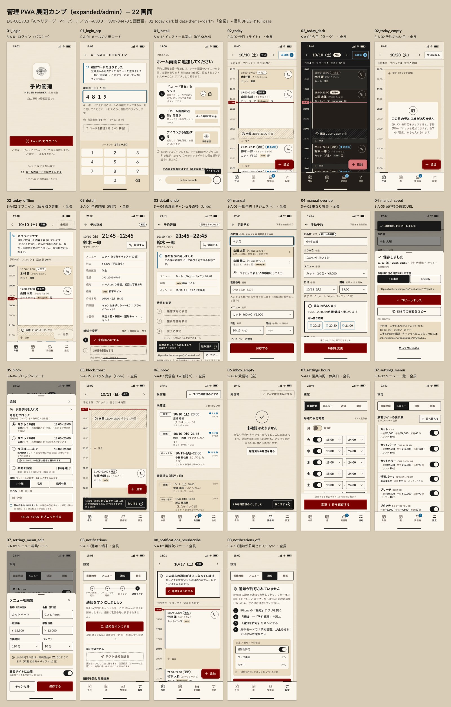

# 管理 PWA 展開カンプ（expanded/admin）

| 項目 | 内容 |
|---|---|
| 対象 | 管理 PWA（`/admin`、日本語固定）S-A-01・02・04〜10・12 の展開カンプ 22 画面 |
| 版・日付 | v0.1 / 2026-10-12 |
| 基準 | `../../design_guide.md`（DG-001 v0.3「A ヘリテージ・ペーパー」）、`../../tokens.css`（ライト＋`[data-theme="dark"]`）、`../../base/02_time.html`・`03_done.html` の部品、WF-A v0.3（`../../../04_wireframes/admin_flow.md`・`screens/admin_*.html`）、DES-03 §6〜§10、DES-07 §2・§4、要件 FR-A-01〜12・15・18 |
| 方針 | 夜（18:00–24:00）の片手操作向け。ライトが既定、ダークは `tokens.css` のダーク値だけで描く。えんじ = 主操作（primary・FAB）と現在時刻の線、青 = 情報の状態（未確認・情報バナー・空き時刻）、インク = 構造（選択中・チップ・枠・罫）。カードは `--bg-card`（paper-99）、紙テクスチャはページ背景だけ |
| 結果 | コントラスト・構造の自動検証 **ALL PASS**（ライト 21 画面＋ダーク 1 画面、2026-10-12） |



## 1. ファイルと状態

各 HTML は 390px の実画面（アートボード・注記なし）。外部に読むのは `../../tokens.css` と Google Fonts（Lato 400/700、Noto Sans JP variable）だけで、JS はない。standalone PWA の見た目として、上に状態バー、下にホームインジケーターを模式で描き（`aria-hidden`）、ブラウザのバーは出さない（`01_install` だけ Safari タブの状態）。共通 CSS とアイコンは各 HTML に埋め込み済み（後述の `sync_expanded_admin.py`）。JPEG は 390×844 @3x・品質 88。「全長」は full page で撮影。

| ファイル | 画面 ID | 状態 | 主な FR | JPEG |
|---|---|---|---|---|
| `01_login.html` | S-A-01 | standalone・未ログイン。primary「Face ID でログイン」、副導線「メールのコードでログインする」、30 日保持 | FR-A-01, 09 | 1 画面 |
| `01_login_otp.html` | S-A-01 | 6 桁コードを 1 欄で入力中（`inputmode="numeric"`・`autocomplete="one-time-code"`・`maxlength=6`）、送信済みの情報バナー（`role="status"`）、有効期限 10 分（19:13 まで）、再送は 60 秒後、iOS キーボードの QuickType 候補（模式） | FR-A-01 | 1 画面 |
| `01_install.html` | S-A-12 | iOS Safari タブ（standalone でない）。3 ステップ図解（「…」→ 共有 / ホーム画面に追加 / アイコンから起動）、通知ボタンなし、Safari のツールバー（模式）に「ここをタップ」 | FR-A-09, 15 | 1 画面 |
| `02_today.html` | S-A-02 | 10/10（土）19:40。15 分 = 28px のタイムライン 18:00–24:00、現在線（えんじ）、予約カード 4 枚（完了・施術中・確定＋未確認 ×2）、ブロック 1（斜線＋破線）、空き区間の「＋」（CW-26）、未確認 3、拡張 FAB「＋ 追加」（CW-20）、タブバー | FR-A-02, 06, 11 | 全長 |
| `02_today_dark.html` | S-A-02 | 同上を `<html data-theme="dark">` で（ダークトークンだけ。テクスチャなし） | FR-A-18 | 全長 |
| `02_today_empty.html` | S-A-02 | 予約のない日（10/20 火）。全面が空き区間、空状態カード、「今日に戻る」 | FR-A-02 | 全長 |
| `02_today_offline.html` | S-A-02 | 機内モード。情報バナー「オフラインです（10/10 19:05 取得）」、FAB・未確認は無効（破線）、`tel:` は有効 | FR-A-17 | 全長 |
| `03_detail.html` | S-A-04 | 全画面の予約詳細（確定・来店前）。全項目＋経路・作成日時・同意版、「電話する」、状態ボタン 来店済みにする／施術を開始する／完了にする、キャンセル系 3 つ、確認 URL のコピー・再発行、店主メモ、履歴、明示的な ← | FR-A-04, 05 | 全長 |
| `03_detail_undo.html` | S-A-04 | 管理者キャンセルの直後。状態チップ「管理者キャンセル」（破線）、時刻に取り消し線、枠を空きに戻した旨、5 秒 Undo トースト（`role="status"`、残り 3 秒） | FR-A-04 | 1 画面 |
| `04_manual.html` | S-A-05 | 未入力＋お名前「やまだ」で既存顧客サジェスト（combobox / listbox、来店回数・最終来店・「DM のみ」pill、新しいお客様の行）、「10/13（火）の空き」チップ、経路セグメント、保存（`aria-disabled`） | FR-A-05, 10 | 全長 |
| `04_manual_overlap.html` | S-A-05 | 新しいお客様（ふりがな欄あり）。開始 19:00 が `aria-invalid`、警告（`role="alert"`）「19:00–20:00 の佐藤 健様と重なります」＋近い空き時間 3 つ、操作は「時間を変更」だけ | FR-A-05 | 全長 |
| `04_manual_saved.html` | S-A-05 | 保存後のシート（`role="dialog"`）。ja / en、確認 URL、「✓ コピーしました」、DM 用の文面、上部トースト「確認 URL をコピーしました」（`role="status"`） | FR-A-05 | 1 画面 |
| `05_block.html` | S-A-06 | FAB「追加」のボトムシート。手動予約の行、プリセット 今から 1 時間／2 時間／今日はここまで／期間を指定（各行に区間・種別・お客様側への影響、今日はここまでに重なり）、種別、ラベル、影響の 1 行、「18:00–19:00 をブロックする」 | FR-A-06 | 1 画面 |
| `05_block_toast.html` | S-A-06 | 保存直後の今日（10/11 18:02）。新しいブロック、Undo トースト（2 行目にお客様側への影響）、FAB はトーストの上へ退避 | FR-A-06 | 全長 |
| `06_inbox.html` | S-A-07 | 未確認 3（新規 2・キャンセル 1。キャンセルは破線＋取り消し線）＋確認済み、「すべて確認済みにする」、20 秒更新の注記 | FR-A-10, 11 | 全長 |
| `06_inbox_empty.html` | S-A-07 | 空状態（すべて確認済みの直後、Undo トースト） | FR-A-11 | 1 画面 |
| `07_settings_hours.html` | S-A-08 | 曜日 7 行（スイッチ＋開始・終了、月 = 定休、日曜の終了を未保存で変更中）、臨時休業・時間変更の一覧と追加、枠ルール（刻み・締切・先行上限・セルフキャンセル締切・プレビュー・祝日表示）、「変更 1 件を保存する」 | FR-A-07 | 全長 |
| `07_settings_menus.html` | S-A-09 | 9 メニュー＋非公開 1。一般・学生価格、所要、バッファ、公開スイッチ、「並べ替える」、「メニューを追加する」 | FR-A-08 | 全長 |
| `07_settings_menu_edit.html` | S-A-09 | 編集シート（カットパーマ）。名称 JA/EN、価格 2 つ、所要・バッファ、最終開始 21:50 の計算（`role="status"`）、公開、キャンセル／保存する | FR-A-08 | 1 画面 |
| `08_notifications.html` | S-A-10 | オンボーディング 4 段（3 段完了・「通知をオン」が現在）、「通知をオンにする」、「テスト通知を送る」（オン後に有効）、通知を受け取る端末（最終確認＝`last_seen_at`・送信失敗回数）、ログイン中の端末、「この端末以外をログアウト」、日次サマリー | FR-A-09, 12, 16 | 全長 |
| `08_notifications_resubscribe.html` | S-A-02（S-A-10） | 今日（10/17 18:01）の上部に再購読バナー「この端末の通知がオフになっています」＋「通知をオンにする」 | FR-A-09 | 全長 |
| `08_notifications_off.html` | S-A-10 | 通知が許可されていない。設定 > 通知 > 予約管理 の 4 手順、集中モード、設定画面の図（代替テキスト付き）、「もう一度試す」 | FR-A-09 | 全長 |
| `contact_sheet.jpg` | — | 22 画面の 1 画面目を 6 列に並べた一覧（1600×2509、ラベル付き） | — | — |

### 例のデータ（画面間でそろえた値）

今日 = 10/10（土）。10/10: 木村 蒼 18:00 完了（電話）、山田 太郎 19:00–21:00 施術中（Instagram）、休憩 21:00–21:30、鈴木 一郎 21:45（web・未確認）、高橋 翔 23:00（web・未確認）。未確認 3 = この 2 件＋10/13 小林 拓也様のキャンセル。手動予約の日は 10/13（火）で、佐藤 健様 19:00–20:00 はベースの完了画面（`base/03_done`）の例予約と同じ。ブロックの例は 10/11（日）18:02 で加藤 大翔様 21:00–22:00。価格・所要・バッファは仮（OI-01・OI-07。店舗 HP の参考価格、学生は 500 円引き）。

## 2. 部品とトークンの使い方

| 部品 | 仕様 |
|---|---|
| ヘッダー | 56px、sticky、紙＋下に 1px `--border`。今日は ‹ 日付（20px、Lato の数字）＋「今日」チップ ›、右に未確認ボタン（青枠・件数バッジ、`aria-label`「未確認 3 件（受信箱を開く）」）。360px 未満は件数だけ |
| タイムライン | 時刻列 52px（正時 700 `--fg`、半 400 `--fg-muted`）、レーン罫は正時 実線・30 分 破線・15 分 点線（いずれも `--border-subtle`）。予約・ブロックは時刻順の `<ol>` で読み上げ順を担保 |
| BookingCard | `--bg-card`、左 4px のインク罫（疑似要素）、≥ 56px（60 分 = 110px）。時刻＋状態チップ（施術中 = インク塗り、確定 = 枠、完了 = ✓＋沈み面、未確認 = 青）、氏名（ふりがな）、メニュー、経路 pill、備考アイコン（`vh`「備考あり」）。`tel:` はカードのリンクと別の 44px 円 |
| BlockCard | 斜線（`--border-subtle`）＋破線枠（`--fg-subtle`）。文字は `--bg` 地のラベルに載せる |
| NowLine | 2px `--accent`＋左の丸、時刻列に `--accent` 地のラベル |
| 空き区間 | `--bg-sunken`＋「＋ 空き」（CW-26）。ポインター用の補助で `aria-hidden`（キーボード・読み上げは FAB から同じ操作） |
| FAB | 拡張「＋ 追加」56px、`--accent`、角丸 12px、primary と同じ内側の細線。トースト表示中はトーストの上へ退避 |
| タブバー | 72px＋安全領域（カンプは 34px を模擬）、タブ 56px、現在タブはインク＋上の 3px 罫、受信箱に青の件数 |
| ボタン | DG §5.1 のまま。無効は `aria-disabled`＋破線＋理由の文（色を薄くしない） |
| チップ / pill | チップ = 状態（12px 700、角丸 999）、pill = 経路（沈み面）。動詞はボタン、状態はチップ（HE-04） |
| 入力 | 48px・16px・1px `--border`。エラー・変更中は 2px。select はアイコンを `currentColor` の SVG で重ねる（ダークでも色が追従） |
| セグメント / スイッチ | 選択中・ON = インク（`--fg`）の塗り。OFF は沈み面＋`--fg-subtle` の枠とつまみ。スイッチは 52×32、タップ領域 56×44 |
| 空き時刻チップ | 顧客側の SlotButton ◎ と同じ青枠＋◎（タップで開始に入る） |
| バナー | 情報 = 左 4px の青罫＋i（オフライン、送信済み、枠の開放）、警告 = 2px インク枠＋左罫＋「!」（再購読、重なり。えんじは使わない） |
| トースト | 反転面（`--fg` 地・`--bg` の文字）、`role="status"`、Undo は 44px のボタン＋残り秒の輪。タブバーの上、シート表示中は画面上部 |
| シート | `--bg-card`、角丸 12px、`role="dialog" aria-modal="true"`、背面は `inert`＋スクリム |

## 3. 検証（2026-10-12）

`tools/render_expanded_admin.mjs` で 22 画面を Playwright（Chromium、390×844 @3x、`document.fonts.ready` 後に Lato・Noto Sans JP の読み込みを `document.fonts.check` で確認）で描画し、全要素の文字色・背景色、操作要素の枠・面、スイッチの枠、現在時刻の線、アイコン色と、操作要素の寸法・構造を `audit.json` に集め、`tools/contrast_check_expanded_admin.py` で判定した。基準: 通常文字 4.5:1、大きな文字 3:1、UI 部品（枠・アイコン・面）3:1。ライトの紙の上は紙テクスチャの最暗ピクセルでも判定（最暗 `#ede4d4` / 最明 `#f4ecdc`、輝度の幅 7.28%（上限 7.5%））。シートの背面（`inert`）は対象外。

**結果: ALL PASS**（コントラスト、操作要素 44px 以上、予約カード 56px 以上、タブバー 72px＋安全領域、FAB 56px、390 / 320px で横はみ出しなし（`scrollWidth` と、画面外にはみ出す要素 0 個）、全入力にラベル、トーストは `role="status"`、重なり警告は `role="alert"`、シートは `role="dialog" aria-modal`、各画面 h1 は 1 つ、ページエラー・アニメーション 0）。

### 3.1 トークンのペア — ライト

| テーマ | 前景 / 背景 | 比 | 紙の最暗部で | 種別（基準） | 用途 | 判定 |
|---|---|---|---|---|---|---|
| light | `#191919` / `#f4ecdd` | 14.98:1 | 13.94:1 | text 4.5 | 本文・見出し / 紙（--fg / --bg） | PASS AAA |
| light | `#191919` / `#fbf7ef` | 16.45:1 | — | text 4.5 | 予約カード・リスト / カード（--fg / --bg-card） | PASS AAA |
| light | `#191919` / `#e9dcc3` | 12.97:1 | — | text 4.5 | 完了カード・経路 pill / 沈み面（--fg / --bg-sunken） | PASS AAA |
| light | `#5c5046` / `#f4ecdd` | 6.65:1 | 6.19:1 | text 4.5 | 時刻ラベル・補足 / 紙（--fg-muted） | PASS |
| light | `#5c5046` / `#fbf7ef` | 7.30:1 | — | text 4.5 | ふりがな・補足 / カード | PASS AAA |
| light | `#5c5046` / `#e9dcc3` | 5.76:1 | — | text 4.5 | 空き区間の「＋ 空き」・完了の時刻 / 沈み面 | PASS |
| light | `#655b52` / `#fbf7ef` | 6.20:1 | — | text 4.5 | 無効ボタンの文字 / カード（--fg-subtle） | PASS |
| light | `#655b52` / `#f4ecdd` | 5.64:1 | 5.25:1 | text 4.5 | 無効ボタン・FAB（オフライン）/ 紙 | PASS |
| light | `#0f5f8f` / `#fbf7ef` | 6.44:1 | — | text 4.5 | 未確認チップ・未確認ボタン・空き時刻 ◎ / カード（--info = --status-open） | PASS |
| light | `#fbf7ef` / `#0f5f8f` | 6.44:1 | — | text 4.5 | 未確認の件数バッジ（--on-info / --info） | PASS |
| light | `#f4ecdd` / `#7c0000` | 9.63:1 | — | text 4.5 | primary・FAB・現在時刻ラベル（--on-accent / --accent） | PASS AAA |
| light | `#fbf7ef` / `#191919` | 16.45:1 | — | text 4.5 | 施術中・今日チップ、選択中のセグメント、手順番号（--bg-card / --fg） | PASS AAA |
| light | `#f4ecdd` / `#191919` | 14.98:1 | — | text 4.5 | トースト（--on-inverse / --inverse） | PASS AAA |
| light | `#191919` / `#fbf7ef` | 16.45:1 | — | ui 3.0 | 操作部品の枠・tel ボタン・スイッチ ON（--border / --fg） | PASS |
| light | `#7c0000` / `#f4ecdd` | 9.63:1 | 8.97:1 | ui 3.0 | 現在時刻の線・FAB・primary の面（--accent）/ 紙 | PASS |
| light | `#7c0000` / `#fbf7ef` | 10.58:1 | — | ui 3.0 | 現在時刻の線（カードを横切る） | PASS |
| light | `#0f5f8f` / `#fbf7ef` | 6.44:1 | — | ui 3.0 | 空き時刻チップ・未確認ボタンの枠、フォーカスリング | PASS |
| light | `#0f5f8f` / `#f4ecdd` | 5.86:1 | 5.45:1 | ui 3.0 | 情報バナーの左罫・リング / 紙 | PASS |
| light | `#655b52` / `#f4ecdd` | 5.64:1 | 5.25:1 | ui 3.0 | ブロックの破線枠・無効の破線（--fg-subtle） | PASS |
| light | `#655b52` / `#e9dcc3` | 4.88:1 | — | ui 3.0 | スイッチ OFF のつまみ / 沈み面 | PASS |
| light | `#655b52` / `#fbf7ef` | 6.20:1 | — | ui 3.0 | スイッチ OFF の枠 / カード | PASS |

### 3.2 トークンのペア — ダーク（`02_today_dark`）

| テーマ | 前景 / 背景 | 比 | 紙の最暗部で | 種別（基準） | 用途 | 判定 |
|---|---|---|---|---|---|---|
| dark | `#f4ecdd` / `#191919` | 14.98:1 | — | text 4.5 | 本文 / 背景 | PASS AAA |
| dark | `#f4ecdd` / `#241e1a` | 14.02:1 | — | text 4.5 | 予約カード / カード | PASS AAA |
| dark | `#f4ecdd` / `#2b2926` | 12.36:1 | — | text 4.5 | 完了カード・pill / 沈み面 | PASS AAA |
| dark | `#b8b0a4` / `#191919` | 8.19:1 | — | text 4.5 | 時刻ラベル・補足 / 背景 | PASS AAA |
| dark | `#b8b0a4` / `#241e1a` | 7.67:1 | — | text 4.5 | ふりがな・タブ（非選択）/ カード | PASS AAA |
| dark | `#b8b0a4` / `#2b2926` | 6.76:1 | — | text 4.5 | 「＋ 空き」・完了の時刻 / 沈み面 | PASS |
| dark | `#9a948c` / `#241e1a` | 5.48:1 | — | text 4.5 | 完了チップの枠 / カード（参考） | PASS |
| dark | `#7cc0e8` / `#241e1a` | 8.28:1 | — | text 4.5 | 未確認チップ・未確認ボタン / カード | PASS AAA |
| dark | `#241e1a` / `#7cc0e8` | 8.28:1 | — | text 4.5 | 未確認の件数バッジ | PASS AAA |
| dark | `#191919` / `#d9777b` | 5.76:1 | — | text 4.5 | FAB・現在時刻ラベル（--on-accent / --accent） | PASS |
| dark | `#241e1a` / `#f4ecdd` | 14.02:1 | — | text 4.5 | 施術中・今日チップ（--bg-card / --fg） | PASS AAA |
| dark | `#d9777b` / `#191919` | 5.76:1 | — | ui 3.0 | 現在時刻の線・FAB の面 / 背景 | PASS |
| dark | `#d9777b` / `#241e1a` | 5.39:1 | — | ui 3.0 | 現在時刻の線（カードを横切る） | PASS |
| dark | `#9a948c` / `#191919` | 5.85:1 | — | ui 3.0 | 操作部品の枠・ブロックの破線 | PASS |
| dark | `#9a948c` / `#241e1a` | 5.48:1 | — | ui 3.0 | tel ボタンの枠 / カード | PASS |
| dark | `#7cc0e8` / `#191919` | 8.84:1 | — | ui 3.0 | フォーカスリング | PASS |

ダークの暗い面に `#7c0000` は使っていない（1.55:1）。えんじは `--accent` = `#d9777b`（文字は `#191919`）、未確認と情報は `#7cc0e8`。

### 3.3 画面で実測したペア（各画面の最小）

| 画面 | テーマ | ペア数 | 通常文字の最小 | 大きな文字の最小 | UI（枠・アイコン・面）の最小 | 判定 |
|---|---|---|---|---|---|---|
| 01_login | light | 14 | 6.19:1（`#5c5046` / `#f4ecdd`（紙の最暗部） NEUER BARBER長田） | 13.94:1（`#191919` / `#f4ecdd`（紙の最暗部） 予約管理） | 8.97:1（`#7c0000` / `#f4ecdd`（紙の最暗部） fill: Face ID ） | PASS |
| 01_login_otp | light | 34 | 5.25:1（`#655b52` / `#f4ecdd`（紙の最暗部） コードを再送する（60 秒後） | 12.97:1（`#191919` / `#e9dcc3` ⌫） | 5.25:1（`#655b52` / `#f4ecdd`（紙の最暗部） border: コードを再送） | PASS |
| 01_install | light | 25 | 6.19:1（`#5c5046` / `#f4ecdd`（紙の最暗部） Install） | 13.94:1（`#191919` / `#f4ecdd`（紙の最暗部） ホーム画面に追加してください） | 6.19:1（`#5c5046` / `#f4ecdd`（紙の最暗部） icon in Safari） | PASS |
| 02_today | light | 94 | 5.76:1（`#5c5046` / `#e9dcc3` 空き） | 13.94:1（`#191919` / `#f4ecdd`（紙の最暗部） 10/10（土）今日） | 5.25:1（`#655b52` / `#f4ecdd`（紙の最暗部） border: 休憩21:0） | PASS |
| 02_today_dark | dark | 94 | 5.76:1（`#191919` / `#d9777b` 現在 19:40） | 14.98:1（`#f4ecdd` / `#191919` 10/10（土）今日） | 4.83:1（`#9a948c` / `#2b2926` border: 木村 蒼様に） | PASS |
| 02_today_empty | light | 43 | 5.76:1（`#5c5046` / `#e9dcc3` 空き（タップで追加）） | 13.94:1（`#191919` / `#f4ecdd`（紙の最暗部） 10/20（火）） | 5.76:1（`#5c5046` / `#e9dcc3` icon in 空き（タップ） | PASS |
| 02_today_offline | light | 97 | 5.25:1（`#655b52` / `#f4ecdd`（紙の最暗部） 未確認） | 13.94:1（`#191919` / `#f4ecdd`（紙の最暗部） 10/10（土）今日） | 5.25:1（`#655b52` / `#f4ecdd`（紙の最暗部） border: 未確認 件数） | PASS |
| 03_detail | light | 88 | 5.25:1（`#655b52` / `#f4ecdd`（紙の最暗部） 2） | 6.19:1（`#5c5046` / `#f4ecdd`（紙の最暗部） –） | 5.25:1（`#655b52` / `#f4ecdd`（紙の最暗部） border: 施術を開始す） | PASS |
| 03_detail_undo | light | 56 | 5.25:1（`#655b52` / `#f4ecdd`（紙の最暗部） 1） | 6.19:1（`#5c5046` / `#f4ecdd`（紙の最暗部） –） | 5.25:1（`#655b52` / `#f4ecdd`（紙の最暗部） border: 来店済みにす） | PASS |
| 04_manual | light | 64 | 5.76:1（`#5c5046` / `#e9dcc3` 090-…-5678・来店 ） | — | 5.45:1（`#0f5f8f` / `#f4ecdd`（紙の最暗部） border: 20:15） | PASS |
| 04_manual_overlap | light | 52 | 6.19:1（`#5c5046` / `#f4ecdd`（紙の最暗部） 下書きを自動保存） | — | 6.44:1（`#0f5f8f` / `#fbf7ef` border: 20:15） | PASS |
| 04_manual_saved | light | 24 | 7.30:1（`#5c5046` / `#fbf7ef` 10/13（火）20:15–） | 16.45:1（`#191919` / `#fbf7ef` 保存しました） | 9.63:1（`#f4ecdd` / `#7c0000` icon in コピーしまし） | PASS |
| 05_block | light | 45 | 7.30:1（`#5c5046` / `#fbf7ef` 開始は今（18:02）を 5） | — | 6.44:1（`#0f5f8f` / `#fbf7ef` icon in 重なる予約は） | PASS |
| 05_block_toast | light | 63 | 5.76:1（`#5c5046` / `#e9dcc3` 空き） | 13.94:1（`#191919` / `#f4ecdd`（紙の最暗部） 10/11（日）今日） | 5.25:1（`#655b52` / `#f4ecdd`（紙の最暗部） border: 休憩18:0） | PASS |
| 06_inbox | light | 66 | 5.76:1（`#5c5046` / `#e9dcc3` （いとう れん）） | — | 6.19:1（`#5c5046` / `#f4ecdd`（紙の最暗部） icon in アプリを開い） | PASS |
| 06_inbox_empty | light | 23 | 5.25:1（`#655b52` / `#f4ecdd`（紙の最暗部） すべて確認済みにする） | 13.94:1（`#191919` / `#f4ecdd`（紙の最暗部） 未確認はありません） | 5.25:1（`#655b52` / `#f4ecdd`（紙の最暗部） border: すべて確認済） | PASS |
| 07_settings_hours | light | 117 | 6.19:1（`#5c5046` / `#f4ecdd`（紙の最暗部） オフ = 定休日） | — | 6.20:1（`#655b52` / `#fbf7ef` track/ui borde） | PASS |
| 07_settings_menus | light | 131 | 6.19:1（`#5c5046` / `#f4ecdd`（紙の最暗部） 右のスイッチ = 公開） | — | 6.19:1（`#5c5046` / `#f4ecdd`（紙の最暗部） icon in 価格・所要・） | PASS |
| 07_settings_menu_edit | light | 31 | 7.30:1（`#5c5046` / `#fbf7ef` ¥） | 16.45:1（`#191919` / `#fbf7ef` メニューを編集） | 10.58:1（`#7c0000` / `#fbf7ef` fill: 保存する） | PASS |
| 08_notifications | light | 72 | 5.76:1（`#5c5046` / `#e9dcc3` 日次サマリー毎日 21 時台） | 16.45:1（`#191919` / `#fbf7ef` 通知をオンにしましょう） | 6.20:1（`#655b52` / `#fbf7ef` border: テスト通知を） | PASS |
| 08_notifications_resubscribe | light | 67 | 5.76:1（`#5c5046` / `#e9dcc3` 空き） | 13.94:1（`#191919` / `#f4ecdd`（紙の最暗部） 10/17（土）今日） | 5.76:1（`#5c5046` / `#e9dcc3` icon in 空き） | PASS |
| 08_notifications_off | light | 40 | 5.76:1（`#5c5046` / `#e9dcc3` 設定 ＞ 通知 ＞ 予約管理） | 16.45:1（`#191919` / `#fbf7ef` 通知が許可されていません） | 7.30:1（`#5c5046` / `#fbf7ef` icon in 今日） | PASS |

- 全長の行頭・行末をまたぐ「一覧の行」（行リンク・listbox の候補・受信箱の行・メニューの行・予約カードのリンク）は、文字とシェブロンで操作できると分かるため、行の区切りの淡い罫と群の沈み面は装飾として判定から外し、件数だけ記録した（`decoEdges`。02_today 4、06_inbox 5、07_settings_menus 10 など）。選択中の候補（サジェストの 1 行目）は沈み面だけだと 1.27:1 なので、左に 4px のインク罫を足して状態を示した。
- ダークの UI の最小は 4.83:1（完了カードの沈み面 `#2b2926` の上の tel ボタンの枠 `#9a948c`）。

### 3.4 構造

| 画面 | 操作要素 | 最小辺 px | 予約カードの高さ px | タブバー | FAB | scrollWidth 390 / 320 | ラベルなし入力 | トースト role | 判定 |
|---|---|---|---|---|---|---|---|---|---|
| 01_login | 2 | 44 | — | — | — | 390 / 320 | 0 | — | PASS |
| 01_login_otp | 3 | 44 | — | — | — | 390 / 320 | 0 | — | PASS |
| 01_install | 1 | 44 | — | — | — | 390 / 320 | 0 | — | PASS |
| 02_today | 17 | 44 | 110, 222, 110, 110 | 72＋34 | 56 | 390 / 320 | 0 | — | PASS |
| 02_today_dark | 17 | 44 | 110, 222, 110, 110 | 72＋34 | 56 | 390 / 320 | 0 | — | PASS |
| 02_today_empty | 8 | 44 | — | 72＋34 | 56 | 390 / 320 | 0 | — | PASS |
| 02_today_offline | 17 | 44 | 110, 222, 110, 110 | 72＋34 | 56 | 390 / 320 | 0 | — | PASS |
| 03_detail | 13 | 44 | — | — | — | 390 / 320 | 0 | — | PASS |
| 03_detail_undo | 8 | 44 | — | — | — | 390 / 320 | 0 | status | PASS |
| 04_manual | 20 | 44 | — | — | — | 390 / 320 | 0 | — | PASS |
| 04_manual_overlap | 16 | 44 | — | — | — | 390 / 320 | 0 | — | PASS |
| 04_manual_saved | 5 | 44 | — | — | — | 390 / 320 | 0 | status | PASS |
| 05_block | 11 | 44 | — | — | — | 390 / 320 | 0 | — | PASS |
| 05_block_toast | 11 | 44 | 110 | 72＋34 | 56 | 390 / 320 | 0 | status | PASS |
| 06_inbox | 10 | 44 | — | 72＋34 | — | 390 / 320 | 0 | — | PASS |
| 06_inbox_empty | 7 | 44 | — | 72＋34 | — | 390 / 320 | 0 | status | PASS |
| 07_settings_hours | 39 | 44 | — | 72＋34 | — | 390 / 320 | 0 | — | PASS |
| 07_settings_menus | 30 | 44 | — | 72＋34 | — | 390 / 320 | 0 | — | PASS |
| 07_settings_menu_edit | 10 | 44 | — | — | — | 390 / 320 | 0 | — | PASS |
| 08_notifications | 13 | 44 | — | 72＋34 | — | 390 / 320 | 0 | — | PASS |
| 08_notifications_resubscribe | 12 | 44 | 222, 110 | 72＋34 | 56 | 390 / 320 | 0 | — | PASS |
| 08_notifications_off | 9 | 44 | — | 72＋34 | — | 390 / 320 | 0 | — | PASS |

## 4. WF v0.3 との差分

| 画面 | WF v0.3 | カンプ | 理由 |
|---|---|---|---|
| 01 ログイン | ghost「Face ID が使えない場合」 | 説明文「Face ID が使えない場合」＋ghost「メールのコードでログインする」 | ボタンは動詞（DG §5.0、HE-04） |
| 01 コード | メールアドレス欄（入力済み）＋コード欄 | メールアドレス欄を置かない。「登録済みの宛先に 6 桁のコードを送りました」 | 管理者 1 名で宛先は固定。DES-03 §9.4 の列挙対策の文言に合わせ、画面にアドレスを出さない |
| 01 インストール | 手順 1「共有ボタン（□↑）をタップ」、Safari の旧ツールバー | 手順 1「「…」→「共有」をタップ」（補足に旧 iOS の □↑）、iOS 26 のコンパクトなツールバー | iOS 26 の Safari は共有が「…」の中にあるため（実機で要確認、§6） |
| 02 今日 | 未確認 2、高橋様の経路「電話」で未確認、メニュー「カット＋眉」、「空き 2 枠」、佐藤様 18:00 | 未確認 3（他日のキャンセルを含む）、高橋様は web、「リタッチ」、「空き 計 30 分」、木村様 18:00 | 未確認の対象は新規 web 予約と顧客キャンセルだけ（FR-A-11）。メニューはベース v0.3 の 9 件。15 分の隙間は 60 分枠にならない。佐藤様は 10/13 の例予約に使うため |
| 02 今日 | FAB「+」、タブ 56px | 拡張 FAB「＋ 追加」、タブバー 72px＋安全領域 | CW-20（DG §9.2）、依頼の寸法 |
| 02 予約のない日 | 10/14（水）、「今日」ボタン | 10/20（火）、「今日に戻る」 | ベースの月カレンダーで 10/14 は満席。ボタンは動詞 |
| 04 詳細 | 状態ボタン「来店 / 施術開始 / 完了」を横並び、キャンセル系は danger | 番号付きの縦 3 段「来店済みにする / 施術を開始する / 完了にする」（次の 1 つだけ primary、他は無効＋理由）。キャンセル系は「〜にする」＋説明の secondary＋×、見出しと「すぐ実行・5 秒で取り消せる」の注記 | 動詞化（HE-04）、片手で誤タップしにくい間隔。`--danger` が未定義で、えんじは主操作専用のため（§5） |
| 04 詳細 | 電話の 48px 円、料金 ¥3,300 | secondary「電話する」44px、¥4,500（仮） | ラベル付きで意味が明確。価格は仮値を統一 |
| 05 手動予約 | 日付 10/11、(a) 未入力と (a') サジェストが別、「保存」 | 日付 10/13、(a)+(a') を 1 画面、「保存する」 | 10/11 は S-A-06 の例と人物が重なる。依頼どおり 1 画面に。動詞 |
| 05 重なり | 実装は赤（WF 注記） | 2px インク枠＋左罫＋「!」、`role="alert"` | DG §9.2「重なり警告 = 太枠＋!」とえんじの用途の規則。FR-A-05 の「赤表示」とは差がある（§6） |
| 05 保存後 | 「確認 URL をコピー」 | コピー直後の状態として「✓ コピーしました」 | DG §5.8 のラベル切り替えを見せる |
| 06 ブロック | (a) FAB のシートで行タップ即保存、(c) 期間指定は全画面 | 1 枚のボトムシートに統合（プリセットはラジオで「今から 1 時間」が既定、種別・ラベル、「18:00–19:00 をブロックする」） | 依頼どおりシートに種別・ラベルを入れるため。既定選択により FAB →「ブロックする」の 2 タップを維持（AT-21）。重なる行を選んで押すと S-A-06 (d) の警告へ進む（未作図） |
| 06 ブロック | 重なりの例「佐藤 健様」 | 「加藤 大翔様」 | 10/13 の佐藤様と区別 |
| 08 営業時間 | 臨時休業 10/15（木）、「リードタイム」、「変更 1 件を保存」 | 10/16（金）、「締切（何分前まで web 予約できるか）」、「変更 1 件を保存する」 | ベースの月カレンダーで 10/16 が休業。顧客側の「予約締切」と語をそろえた。動詞 |
| 09 メニュー | 5 件（カット＋眉ほか）、長押しで並べ替え | 9 件＋非公開の眉カット、「並べ替える」モード（上下ボタン） | ベース v0.3 の 9 メニュー。DES-07 v0.4 と WCAG 2.5.7（ドラッグ以外の手段） |
| 10 通知 | (a) 未購読と (b) 購読済み・テスト結果が別画面 | 1 画面に「通知をオンにする」と「テスト通知を送る」（オンにするまで無効）、端末一覧、他端末ログアウト | 依頼の構成。テスト結果（201・届いた／届かない）と「購読を作り直す」は未作図（§6） |
| 全体 | 日付「10/10(土)」 | 「10/10（土）」 | DG §3 の全角括弧 |

## 5. トークンの不足（`tokens.css` は変更していない。ページ内で別名を定義）

| 不足 | カンプでの代用（`tools/expanded_admin_shared.css` の `:root`） | 提案 |
|---|---|---|
| `--danger` / `--on-danger` | キャンセル系・ログアウトは secondary＋×／ログアウトのアイコン＋見出し・注記で区別 | えんじと別の色相で紙の上 4.5:1・ダークでも 4.5:1 の値を決める（DG §9.1 S-C-06 と共通） |
| `--overlap`（DES-07 にあり） | 2px `--fg` の枠＋左罫＋「!」 | 色を足すなら `--danger` と兼ねるか決める（FR-A-05 の「赤」） |
| `--info` / `--on-info` | `--status-open` / `--bg-card` の別名 | 「◎ 予約できます」と「未確認・情報」の意味を分けて命名 |
| `--inverse` / `--on-inverse` | `--fg` / `--bg`（トースト） | 反転面として定義 |
| `--scrim` | `rgb(25 25 25 / .5)`、ダーク `rgb(0 0 0 / .6)` | 追加 |
| `--block-hatch`（DES-07 にあり） | `--border-subtle` の別名 | 追加（ライト paper-80 / ダーク ink-25 で可） |
| primary の内側の細線 | `--accent-line`（ライト `rgb(244 236 221 / .4)`、ダーク `rgb(25 25 25 / .35)`）。ベースは各 HTML に生の rgb | ダークで色が逆になるためトークン化 |
| ダークの `--shadow-1: none` | `box-shadow` を複数並べると宣言ごと無効になる（カード左罫が消えた）。左罫を疑似要素に分けて回避 | `none` ではなく `0 0 #0000` にする |
| 部品の寸法 | `--tabbar-h: 72px`、`--row: 28px`（15 分）、`--sim-safe-top: 47px` / `--sim-safe-bottom: 34px`（カンプだけ。本番は `env(safe-area-inset-*)`） | 部品トークン（第 3 層）として扱う |
| manifest の `theme_color` | 各 HTML の `<meta name="theme-color">` にライト `#f4ecdd`・ダーク `#191919` | FR-A-15 の値として確定 |

## 6. 未決・申し送り

| # | 項目 | 影響 |
|---|---|---|
| 1 | アプリ名「予約管理」は仮（OI-08。DES-03 §9.2 は「Neuer 予約管理」） | ログイン、インストール手順 3、通知の案内 |
| 2 | 重なり警告の色: FR-A-05 は「赤表示」、DG §9.2 は太枠＋「!」。`--danger` / `--overlap` の値と合わせて決める | S-A-05・06、S-A-04 のキャンセル系 |
| 3 | iOS 26 の Safari で「共有」が「…」の中にあるかと「ホーム画面に追加」の位置を実機で確認（旧 iOS の補足を残すか） | S-A-12 |
| 4 | 遅刻キャンセルの定義（OI-05）、手動予約の保存直後の取り消し（OI-22） | S-A-04・05 |
| 5 | 価格・所要・バッファ（OI-01・OI-07）。メニュー一覧と予約カードの金額 | S-A-09、S-A-04 |
| 6 | タブバー 72px＋安全領域 34px = 106px はタイムラインの表示域を圧迫する（390×844 で 18:00–22:00 程度が 1 画面）。56px＋安全領域も検討 | S-A-02 |
| 7 | 空き区間のタップはポインター専用（`aria-hidden`）。キーボード・読み上げは FAB から。実装で同じ方針にするか | S-A-02 |
| 8 | ダークは今日の 1 画面だけ検証。他の画面もトークンだけで描いているが、実装時に全画面をダークで再検証する | 全画面 |
| 9 | 未作図の状態: S-A-03 週、S-A-11 顧客、今日の詳細シート、S-A-06 (d) 重なり警告・ブロックの詳細と削除、S-A-07 (c) アプリ内トースト、S-A-10 テスト結果と「購読を作り直す」、S-A-08 臨時休業の追加シート、Android のインストール、読み込み中・エラー | 次の展開 |

## 7. 再生成

```bash
OUT=/tmp/admin_render && mkdir -p $OUT
python3 docs/05_design_comps/tools/sync_expanded_admin.py              # 共通 CSS・アイコンを各 HTML に埋め込む（共通部分を直したとき）
node docs/05_design_comps/tools/render_expanded_admin.mjs $OUT          # 各 .jpg・contact_sheet.jpg・audit.json
python3 docs/05_design_comps/tools/contrast_check_expanded_admin.py $OUT --md   # 検証表（ALL PASS で終了コード 0）
```

共通 CSS の正本は `tools/expanded_admin_shared.css`、アイコンは `tools/expanded_admin_sprite.svg`（各 HTML の `/* @shared:start */`〜`/* @shared:end */` と `<!-- @sprite:start -->`〜`<!-- @sprite:end -->` を置き換える）。画面ごとの CSS は各 HTML の「page-local」以降。
