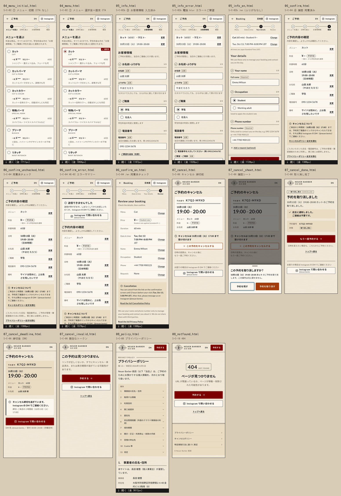

# 展開カンプ — 顧客サイト（残りの画面）

| 項目 | 内容 |
|---|---|
| 版 | v0.1（2026-10-12） |
| デザイン | ベースデザイン「A ヘリテージ・ペーパー」（DG-001 v0.3、`../../design_guide.md`）。`../../tokens.css` と `../../base/*.html` の部品・クラスを流用 |
| 根拠 | WF-C v0.4（`../../../04_wireframes/screens/customer_02/04/05/07/08_*.html`、`customer_flow.md`）、DES-03 §1・§3・§5、DES-02（ルート）、要件定義書 v0.6 FR-C-01〜06・09・12・13・15・16 |
| 形式 | 各状態を 1 ファイルの 390px 実画面（アートボードの枠なし）。`../../tokens.css` と Google Fonts（Lato・Noto Sans JP）を読み込み、CSS は各ページに内蔵して単体で開ける。画像は 390 幅 @3x の全ページ JPEG（q88） |
| 一覧 |  |

`tokens.css` と `base/` は変更していない。トークンに無い色は各ページの CSS で定義した（下の「未決」の T-01）。

---

## 1. ファイルと状態

| ファイル | 画面 ID | ルート | 状態 | 関連要件 |
|---|---|---|---|---|
| `04_menu_initial.html` | S-C-02 ① メニューを選ぶ | `/ja/book` | (a) 初期表示。9 枚の RadioCard が未選択で、固定 CTA なし | FR-C-01, 02, 15 |
| `04_menu.html` | S-C-02 | `/ja/book?menu=cut` | (b) カットを選択。2px のえんじ枠＋「✓ 選択中」、固定 CTA（要約＋「空き時間を見て予約する →」） | FR-C-01, 02 |
| `05_info.html` | S-C-02b ③ お客様情報 | `/ja/book/info?step=phone` | 要約（メニュー・日時＋各「変更」）。お名前・ふりがな（入力済み）→ ご職業（学生）→ 電話（入力済み）→「＋ ご要望を追加（任意）」は閉じた状態。CTA「確認へ進む」 | FR-C-01, 03, 04, 05, 06 |
| `05_info_error.html` | S-C-02b | 同上 | 電話の blur エラー「電話番号を入力してください（例: 09012345678）」（`aria-invalid`＋2px のチャコール枠＋「!」＋`aria-describedby`）。ご要望欄を開き、カウンター 0 / 500 | FR-C-05, 06 |
| `05_info_en.html` | S-C-02b /en | `/en/book/info?step=phone` | ふりがな欄なし。Full name・Student / Working adult・国番号付きの電話、「All times are Japan Standard Time (JST).」 | FR-C-03, 13 |
| `06_confirm.html` | S-C-04 ④ 確認 | `/ja/book/confirm` | Check-answers 8 行（料金と所要時間は「変更」なし、料金に「学生料金」ラベル）、キャンセル要点、プライバシー文言、同意チェック済み、Turnstile の置き場所、primary「この内容で予約を確定する」＋「承認待ちはありません」 | FR-C-04, 09, 10, 15 |
| `06_confirm_unchecked.html` | S-C-04 | 同上 | 同意未チェック。確定ボタンは `aria-disabled="true"`（破線・`--fg-subtle`。押すとエラー文を出すので Tab で届く）、補足「同意にチェックすると確定できます」 | FR-C-09 |
| `06_confirm_error.html` | S-C-04 | 同上 | **HE-02**: エラーサマリー（`role="alert"`、上端 4px の `--fg` 罫、「送信できませんでした」＋「送信が多すぎます。…Instagram の DM でご連絡ください」＋InstagramButton） | FR-C-10, FR-S-04/05, 16 |
| `06_confirm_en.html` | S-C-04 /en | `/en/book/confirm` | 同意未チェック。“Tue, Oct 13 / 7:00 PM–8:00 PM JST”、英語の締切文・同意文 | FR-C-09, 13 |
| `07_cancel.html` | S-C-06 キャンセル | `/ja/cancel/{token}` | (a) 締切前。予約内容（DoneCard と同じ組み）、締切「10月13日（火）17:00 まで」、破壊的操作「この予約をキャンセルする」（2px の `--danger` 枠） | FR-C-12, FR-S-06 |
| `07_cancel_sheet.html` | S-C-06 | 同上 | (b) 確認シート（`role="dialog" aria-modal`、スクリム、背面は `inert`）。「予約を残す」（初期フォーカス）／「予約を取り消す」（`--danger` の塗り） | FR-C-12 |
| `07_cancel_done.html` | S-C-06 | 同上 | (c) スタンプ「✓ 取り消し済み」＋見出し「予約を取り消しました」、「店主に通知しました。ご連絡は不要です。」（`role="status"`）、状態チップ「取り消し済み」、primary「もう一度予約する」→ `/ja/book` | FR-C-12, FR-A-10 |
| `07_cancel_deadline.html` | S-C-06 | 同上 | (d) 締切後。キャンセルボタンなし、バナー「キャンセル締切を過ぎています。Instagram の DM でご連絡ください。」、primary「Instagram で問い合わせる」、DM 先 @neuer.kento | FR-C-12, 16 |
| `07_cancel_invalid.html` | S-C-06 | 同上 | (e) 無効なトークン「この予約は見つかりません」（理由を区別しない）＋「予約する」＋Instagram＋トップへ | FR-C-12, 16 |
| `08_policy.html` | S-C-08 プライバシーポリシー | `/ja/privacy` | 小さな大文字ラベル＋H1、版・改定日、目次（11 項目のアンカー、各 44px）、二重罫付きの H2 と本文サンプル（要件 12.1 に沿う）、米国クラウド事業者の囲み、フッター | FR-C-15, 16 |
| `08_notfound.html` | S-C-10 404 | `not-found.tsx` | 404 のスタンプ、「ページが見つかりません」、primary「予約する →」、secondary「Instagram で問い合わせる」（本文の 1 つだけ。フッターの Instagram は省く、HE-01）、トップへ | FR-C-16 |

各 `.html` と同名の `.jpg` がある（390 幅 @3x、全ページ）。`contact_sheet.jpg` は 16 画面を 6 列で並べたもの（1552px 幅、各画面の上部 1100px、続きがある画面は下端に「↓ 続く」）。

### 1.1 ベースから流用した部品と、新しく作った部品

| 部品 | 出所 / 仕様 |
|---|---|
| Header（予約フロー 56px）、Stepper、Button（primary / secondary / -sm / ghost）、Card、二重罫、Footer、InstagramButton、DoneCard の組み（予約番号・二重罫・Lato 36 の時刻・dt/dd） | `base/02_time.html`・`01_top.html`・`03_done.html` のクラスをそのまま流用 |
| RadioCard（S-C-02） | §9.1 の申し送り: `<label>`＋ネイティブラジオ（JS 前でも選べる）。操作できるので 1px `--border`（黒）の枠（トップの情報カードは淡い枠のまま）。選択中 = 2px `--accent` 枠＋ラジオの点＋右上の「✓ 選択中」バッジ。一般 Lato 30 ／ 学生 Lato 18 を併記、学生価格がない「ブリーチ 2 回目以上」は一般だけ |
| StickyCta | `position: sticky; bottom: 0`、紙テクスチャ、上端 1px `--border`、`padding-bottom: max(16px, env(safe-area-inset-bottom))`、`html { scroll-padding-bottom }` で入力欄を隠さない |
| SelectionSummary | カード内 2 行（48px）＋ghost「変更」（対象名入りの `aria-label`） |
| 入力欄 | §9.1: `--bg-card`・1px `--border`・高さ 48px・16px。エラーは 2px `--fg` 枠＋直下 14px 700 の「!」付きの文（赤に頼らない）。ラベルは `label[for]`、ヘルプ・エラーは `aria-describedby` |
| 職業ラジオ | 縦並び 48px、選択はチャコールの点＋2px 枠＋太字（えんじは D-03 の「選択中」3 か所＋メニューだけに留めた） |
| ConsentCheckbox | ラベル全体がタップ領域（最小 56px、2 行の 390px で 354×77px）。チェック = チャコールの塗り＋✓＋2px 枠 |
| 無効な primary（`aria-disabled`） | 色を薄くせず、§5.1 の icon 無効と同じ「破線＝できない」の言語（透明・1px 破線・`--fg-subtle` の文字、5.25:1） |
| ErrorSummary / Banner | HE-02 は上端 4px、締切後のバナーは左 4px の `--fg` 罫と「!」（§9.1 の 23P01 バナーと同じ）。えんじ・赤は使わない |
| 破壊的操作 | page-local `--danger: #a33b0b`（朱、色相 19°。えんじ 0° と別の色相・明度）。締切前は枠線 2px、確認シートの「予約を取り消す」だけ塗り |
| BottomSheet | `--bg-card`、上の角丸 12px、つまみ、スクリム `rgb(25 25 25 / .55)`。360px 未満はボタンを縦積み（「予約を残す」を上） |

---

## 2. 検証

`tools/render_expanded_customer.mjs`（Playwright、390×844・deviceScaleFactor 3、`document.fonts.ready` 後に全ページを撮影。固定 CTA を本来の位置に描くためビューポートを文書の高さに伸ばして撮る）で描画・収集し、`tools/contrast_check_expanded.py`（`contrast_check_base.py` を一般化。WCAG 2.x の相対輝度式、紙の上のペアはテクスチャの最暗ピクセル `#ede4d4` でも判定）で判定した。基準: 通常文字 4.5:1、大きな文字 3:1、UI（枠・アイコン・面）3:1。**結果: ALL PASS**（16 画面、2026-10-12）。

### 2.1 コントラスト（DOM から収集。紙の上は最暗ピクセルで判定）

| 画面 | ペア | 通常文字の最小 | 大きな文字の最小 | UI の最小 | 判定 |
|---|---|---|---|---|---|
| 04_menu | 153 | 5.25:1（`#655b52` / 紙、次の段の予告） | 13.94:1 | 6.19:1（アコーディオンのシェブロン） | PASS |
| 04_menu_initial | 142 | 5.25:1（同上） | 13.94:1 | 6.19:1 | PASS |
| 05_info | 62 | 6.19:1（`#5c5046` / 紙、ステッパー） | 13.94:1 | 8.97:1（CTA の面） | PASS |
| 05_info_en | 57 | 6.19:1 | 13.94:1 | 8.97:1 | PASS |
| 05_info_error | 65 | 6.19:1 | 13.94:1 | 8.97:1 | PASS |
| 06_confirm | 68 | 5.25:1（`#655b52` / 紙、Turnstile の置き場所） | 13.94:1 | 5.25:1（Turnstile のアイコン） | PASS |
| 06_confirm_unchecked | 67 | 5.25:1 | 13.94:1 | 5.25:1（無効 CTA の破線枠） | PASS |
| 06_confirm_error | 75 | 5.25:1 | 13.94:1 | 5.25:1 | PASS |
| 06_confirm_en | 62 | 5.25:1 | 13.94:1 | 5.25:1 | PASS |
| 07_cancel | 36 | 6.17:1（`#a33b0b` / `#fbf7ef`、キャンセルボタン） | 7.30:1 | 5.22:1（`--danger` の枠 / 紙の最暗部） | PASS |
| 07_cancel_sheet | 10 | 5.61:1（`#f4ecdd` / `#a33b0b`、予約を取り消す） | 16.45:1 | 6.17:1 | PASS |
| 07_cancel_done | 31 | 5.76:1（`#5c5046` / 沈み面） | 13.94:1 | 8.97:1 | PASS |
| 07_cancel_deadline | 33 | 5.76:1 | 5.76:1 | 8.97:1 | PASS |
| 07_cancel_invalid | 12 | 6.19:1 | 13.94:1 | 8.97:1 | PASS |
| 08_policy | 118 | 5.76:1（目次の見出し / 沈み面） | 13.94:1 | 5.76:1 | PASS |
| 08_notfound | 23 | 5.76:1（フッターの ©） | 13.94:1 | 5.76:1 | PASS |

page-local の `--danger`（`#a33b0b`）: 紙 5.61:1（最暗部 5.22:1）、カード 6.17:1、沈み面 4.86:1、上に置く紙色の文字 5.61:1。`--danger-pressed`（`#862f08`）の上の文字 7.38:1。プレースホルダー（`#5c5046` / カード 7.30:1）も収集対象に入れた。背面が `inert` の確認シートでは、背面の文字はスクリムで隠れて操作もできないため判定から外した。

### 2.2 構造

| 確認項目 | 基準 | 結果 |
|---|---|---|
| ターゲット | `a[href]`・`button`・`summary`・入力欄（隠したラジオ・チェックはカード／ラベルを覆う実寸）の最小辺 ≥ 44px。390 と 320 の両方 | 全 16 画面 PASS（最小 44px。シートのボタンは 56px） |
| リフロー | `scrollWidth` が 390 / 320、`body *` に画面外へはみ出す要素なし | 全 16 画面 PASS |
| 操作できないものにフォーカスしない | `[disabled]`・`.x`・`[inert]` の中・`aria-hidden` の中・次の段の予告・Turnstile・状態チップが Tab 順に入らない（計 452 要素） | PASS。`aria-disabled` の確定ボタン（`06_confirm_unchecked`・`06_confirm_en`）は、押すとエラー文を出すため意図的に Tab で届く（FR-C-09、WF-C の注記 7） |
| ラベル | すべての `input`・`textarea` に `label[for]`・包む `<label>`・`aria-label`・`aria-labelledby` のどれか | PASS（RadioCard は `aria-labelledby`＝メニュー名、`aria-describedby`＝料金・説明） |
| エラー文 | `.err` は `aria-invalid="true"` の欄の `aria-describedby` から参照され、`aria-invalid` の欄には必ずエラー文がある。参照先 ID がすべて存在する | PASS（05_info_error の電話: `aria-describedby="tel-err tel-help"`） |
| 文書 | `<h1>` が 1 つ、`<html lang>`、`tel:` リンクなし（FR-C-16）、ダイアログは `aria-modal`・見出し・初期フォーカスあり | PASS |
| 文言の規則（DG-001 §5.0） | 「空き時間を見て予約する」は `04_menu`（選択後）だけ。ほかの入口は「予約する」 | PASS |
| フォント | Lato 400/700・Noto Sans JP の読み込み（/en は「日本語」の字で判定） | PASS |
| 動き | `prefers-reduced-motion: reduce` で transition 0.1s、`document.getAnimations()` 0 件 | PASS |

内容の高さ（390 幅）: 04_menu 1856px、04_menu_initial 1711px、05_info 1166px、05_info_en 1120px、05_info_error 1328px、06_confirm 1380px、06_confirm_en 1388px、06_confirm_error 1569px、08_policy 3612px。07_* と 08_notfound は 844px 以内。

### 2.3 再生成

```bash
OUT=/tmp/expanded_customer_render
node docs/05_design_comps/tools/render_expanded_customer.mjs $OUT        # 描画・収集・JPEG・contact_sheet.jpg（build_expanded_customer_images.py を呼ぶ）
python3 docs/05_design_comps/tools/contrast_check_expanded.py $OUT --md   # 検証表（ALL PASS で終了コード 0）
```

---

## 3. WF-C v0.4 との差分

| 画面 | WF-C v0.4 | 展開カンプ | 理由 |
|---|---|---|---|
| S-C-02 | メニュー名「アイロンパーマ（濡れパン）」、英字名 “Haircut” “Iron Perm (Nurepan)” | 「アイロンパーマ」＋説明「濡れパン。…」、英字名 “Cut” “Iron Perm” | 承認済みのトップ（DG-001 §10）と名前をそろえた |
| S-C-02 | 選択の表示は WF のラジオの点 | 2px のえんじ枠＋点＋右上「✓ 選択中」バッジ | DG-001 §9.1。色・記号・文字を併用 |
| S-C-02 | 固定バーの要約「カット ／ 60分 ／ 一般 ¥—（学生 ¥—）」 | 同じ文言を 14px の 1 行に。CTA に「→」 | トップの「予約する →」と同じ形 |
| S-C-02 | 「▸ 次: 日時を選ぶ（空き時間）」の薄い見出し | 破線の枠に「② 次: 日時を選ぶ　月カレンダーで空き時間を見て選べます」 | 操作できないものは破線（DG-001 の言語）。リンクに見せない |
| S-C-02b | 完了した段は 1 行の要約＋「変更」に畳む（(b-1)〜(b-3)、FR-C-01） | **開いた段は畳まずに残し、見出しに ✓ を付ける**（指示どおり「氏名・ふりがな → 職業（学生）→ 電話」をすべて見せる状態） | 依頼の状態指定に合わせた。4 項目しかないので畳まなくても 1166px に収まり、「変更」のタップも要らない。**FR-C-01（Must）の「要約表示に畳む」と食い違うので未決 Q-01 で決める**。畳む場合は WF (b-2) の要約行を Card で組めばよい |
| S-C-02b | 段見出し「お名前・ふりがな」の中に「お名前」の欄 | 同じ。段番号は右端に Lato 12px「1/3」 | — |
| S-C-02b | 電話のヘルプは欄の上 | 同じ（ヘルプ → 欄 → エラー文の順） | エラー文を欄の直下に置くため |
| S-C-02b | 備考のラベル「ご要望・ご相談 任意」 | 「任意」は破線のラベル、「必須」は実線のラベル | 必須／任意を形でも区別 |
| S-C-02b /en | 最後の CTA の英語が未定義（WF は氏名段の “Next” のみ） | “Continue to review” | i18n キーが未定（Q-04） |
| S-C-04 | プライバシーポリシーへのリンクは同意文の中 | 同意文の上に ghost「プライバシーポリシー全文を読む」を独立して置く | `<label>` の中のリンクは押し間違いが起きる。44px のターゲットにするため |
| S-C-04 | Turnstile の灰色の箱 | 300×65 の破線の置き場所（`aria-hidden`、「自動の確認（操作は不要です）」） | 本番では通常表示されない。位置と大きさだけ示す |
| S-C-04 | 未チェックの確定ボタンは「非活性表示」 | 破線・`--fg-subtle` の文字（色を薄くしない） | DG-001 §5.1「無効は aria-disabled＋押すとエラー文（色を薄くしない）」 |
| S-C-04 | HE-02 は WF にない | `06_confirm_error.html` を追加 | DG-001 §9.1 の申し送り（rate_limited・Turnstile 失敗） |
| S-C-06 | ヘッダーに LOGO・店名・EN・Instagram | 完了画面と同じミニヘッダー（エンブレム 40px＋ワードマーク＋EN）。Instagram は本文に 1 つ | 完了画面のリンクから来る画面なので完了画面とそろえた。締切後・無効では本文の Instagram が主役になり、ヘッダーと重なるため（HE-01 と同じ考え方） |
| S-C-06 | 破壊的操作は「枠線 2px」（色は未定） | page-local `--danger #a33b0b` の 2px 枠＋× アイコン、確認シートの実行ボタンだけ塗り | DG-001 §9.1。トークン追加は T-01 |
| S-C-06 | 完了の状態「キャンセル済み」 | 「取り消し済み」（スタンプ・状態チップ） | DG-001 §9.1「完了は『取り消し済み』＝状態」、確認シートの動詞「予約を取り消す」とそろえる（CW-16） |
| S-C-06 | 完了の CTA「もう一度予約する」 | 同じ（行き先は `/ja/book`）。下に「日時を変えたい場合も、こちらからご予約ください。」 | DG-001 §5.0 は「予約へ戻す CTA も『予約する』」。語幹は同じで、再予約であることが伝わるため WF・DES-03 §5.2 の文言を残した（Q-03） |
| S-C-06 | 日付の括弧「(火)」 | 「（火）」 | DG-001 §3 |
| S-C-08 | 本文はグレーの線、改定日【要確認】 | 要件 12.1 に沿った本文サンプル、改定日「2026年11月1日」（仮） | クライアントに見せる画面に【要確認】を出さない（DG-001 §10 と同じ扱い）。本文は弁護士確認前のサンプル |
| S-C-08 | 目次は沈み面のリスト | 同じ。各行 44px・番号 Lato・シェブロン。末尾に「ページの先頭へ」 | ターゲット 44px |
| S-C-10 | 「404」の大きな数字 | 二重の額縁のスタンプ（Lato 36「404」＋“NOT FOUND”） | タイプスケールの最大（36px）に収め、完了画面のスタンプとそろえた |

---

## 4. 未決・申し送り

| # | 項目 | 内容 | 影響 |
|---|---|---|---|
| T-01 | **`--danger` トークンの追加**（`tokens.css` は変更していない） | 提案: 第 1 層 `--rust-45: #a33b0b`・`--rust-35: #862f08`、第 2 層 `--danger: var(--rust-45)`・`--danger-pressed: var(--rust-35)`。ダーク（管理 PWA）用の値は未定（暗面で 4.5:1 以上の明るい朱が必要）。今は各 07_* ページの `:root` で定義 | S-C-06、管理 PWA の削除・取り消し |
| Q-01 | **S-C-02b の完了段を畳むか**（FR-C-01 Must との差） | カンプは開いたまま＋✓。FR-C-01・WF-C は「要約表示に畳む＋変更」。どちらかに決め、DES-03 §1.4 か本カンプを直す | S-C-02b、FR-C-01、AT-06 |
| Q-02 | 学生料金の対象と学生証提示（OI-20） | 職業欄のヘルプは「学生料金の判定に使用します」だけ。決まったら 1 行足す（高さ +24px 程度） | S-C-02b |
| Q-03 | 取り消し完了の CTA 文言 | 「もう一度予約する」（WF・DES-03）か「予約する」（DG-001 §5.0 の字面）か | S-C-06 (c)、i18n |
| Q-04 | /en の未定義の文言 | “Continue to review”（S-C-02b の CTA）、“Your selection”、“Used only to contact you on the day.”、エラーサマリーの “We could not send your booking” など。i18n の確定時に見直す | /en 全般 |
| Q-05 | 価格（OI-01） | すべて `¥—`。桁が決まったら RadioCard の「一般 Lato 30 ／ 学生 Lato 18 ／ 60分」が 320px で 1 行に収まるか再確認（今は 1 行） | S-C-02、S-C-04 |
| Q-06 | ポリシー本文 | `08_policy.html` は要件 12.1 に沿ったサンプル。委託先の最終構成・改定日・弁護士確認で差し替え。/en と S-C-09（キャンセルポリシー＋特商法表）は同じ組み（H2＋本文＋dl 表）で作れる | S-C-08, 09 |
| Q-07 | 展開していない状態 | S-C-02 の公開メニュー 0 件、S-C-02b の氏名・ふりがな入力中（(a)）、S-C-04 送信中「確定しています…」・`bot_check_failed`・`restricted`、S-C-06 /en、S-C-09、S-C-10 の error.tsx、S-C-03 の他状態（§9.1）。本カンプの部品（ErrorSummary・Banner・無効 CTA）で組める | 次の展開 |
| — | CW-20 / CW-26 | 管理 PWA の申し送りなので本カンプの対象外（`expanded/admin/` で扱う） | 管理 PWA |
